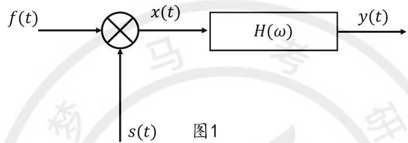
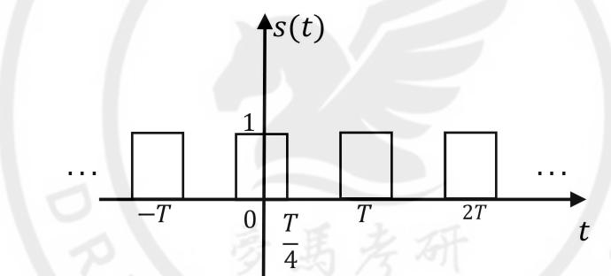
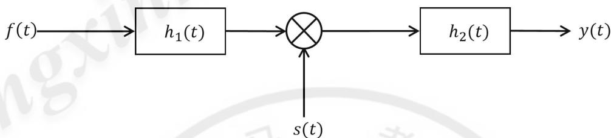
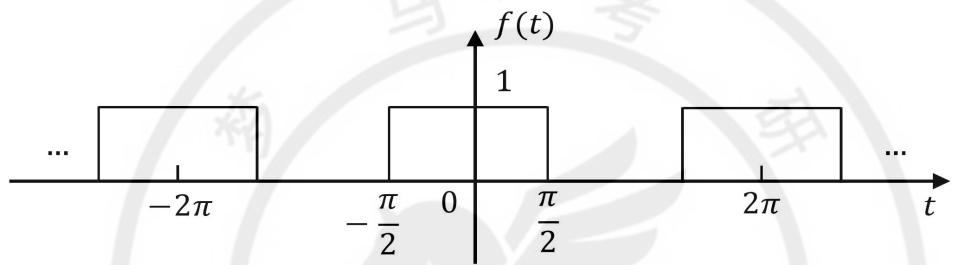
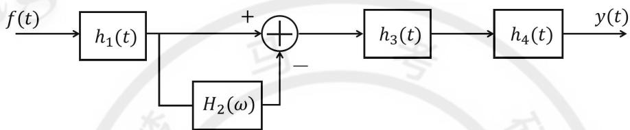
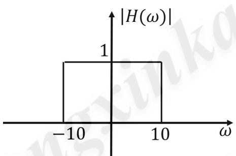
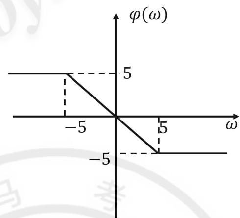
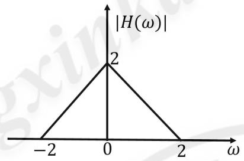
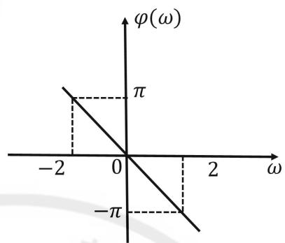

## 【第 22 节】课后作业

1、【2024 复旦大学】

某系统的频响特性:

$$
H (\omega) = \frac {j \omega + 4}{- \omega^ {2} + 5 j \omega + 6}
$$

(1)求表征系统的微分方程;

(2)当输入为 $x(t)=e^{-4t}u(t)-te^{-4t}u(t)$ 时,求输出响应。

夢馬考研

2、【2024 广东工业大学】

一个信号的脉冲宽度越大，那么他的频带宽度\_\_\_\_（越大/越小）

## 3、【2024 重庆邮电大学】

在下图中，图 1 为系统结构，图 2 为周期信号 $s(t)$ 的时域波形，T = 1ms，已知：

$$
f (t) = \frac {\sin 2 \pi t}{\pi t} \cos (2 0 0 0 \pi t), H (\omega) = \left\{ \begin{array}{l l} e ^ {- j 2 \omega} & , | \omega | <   \pi \\ 0 & , | \omega | > \pi \end{array} \right.
$$

(1)画出 $f(t)$ 傅里叶变换频谱图 $F(\omega)$ ;

(2)求 $s(t)$ 的傅里叶变换;

(3) 求 $X(\omega)$ ;

(4)求系统响应 $y(t)$ 。

  
图2

5、【2024 重庆大学】

(1) $H(\omega) = \frac{2}{j\omega - \omega^{2}}$ ，求 $h(t) = \_\_\_$

(2) 已知周期信号 $f(t)$ 是以 0 为中心，门宽为 $\pi$ 高为 1 的门信号，且其周期是 $T = 2\pi$ ，另外载波信号 $s(t) = \sin\left(\frac{3}{4}t\right)$ ， $h_{1}(t) = e^{-t}u(t)$ ， $h_{2}(t) = \frac{\sin\left(\frac{t}{2}\right)}{\pi t}$ ，系统如图所示：

(1) 求子系统 $h_{1}(t)$ 的傅里叶变换 $H_{1}(\omega)$ ，并画出其频谱图；

(2) 求子系统 $h_{2}(t)$ 的傅里叶变换 $H_{2}(\omega)$ ，并画出其频谱图并判断系统特性；

(3) 求系统的输出信号 $y(t)$ 。(关注通信考研小马哥，通信考研不迷路)

  
夢馬考研

## 6、【2024 西南交通大学】

如图所示系统中，已知：

$$
h _ {1} (t) = \frac {d}{d t} \left[ \frac {\sin \omega_ {c} t}{2 \pi t} \right], H _ {2} (\omega) = e ^ {- j \frac {2 \pi \omega}{\omega_ {c}}}, h _ {3} (t) = \frac {\sin 3 \omega_ {c} t}{\pi t}, h _ {4} (t) = u (t)
$$

试求解下列问题:

(1) 确定 $H_{1}(\omega)$ ;

(2) 求整个系统的冲激响应 $h(t)$ ;

(3) 求当输入 $f(t)=\sin2\omega_{c}t+\cos\frac{\omega_{c}t}{2}$ 时的输出 $y(t)$ 。

7、【2024 华北电力大学】

已知下图系统函数 $H(\omega)$ ，以下四个信号哪个可以通过该系统无失真输出
(1) $5\sin10t$ (2) $3\cos3t$ (3) $\frac{4}{3}\cos^{2}6t$ (4) $\frac{1}{5}\sin^{2}4t$

夢馬考研

8、【2024 西安工程大学】

LTI 系统的幅频响应 $|H(\omega)|$ 和相频响应 $\varphi(\omega)$ 如图所示, 若激励 $f(t)=1+ \sum_{n=1}^{\infty}\frac{1}{n}\cos nt$ , 求该系统的响应 $y(t)$

  
(a)

  
(b)