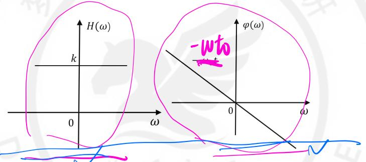
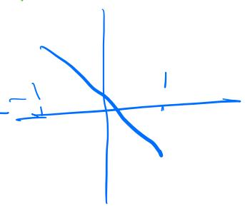
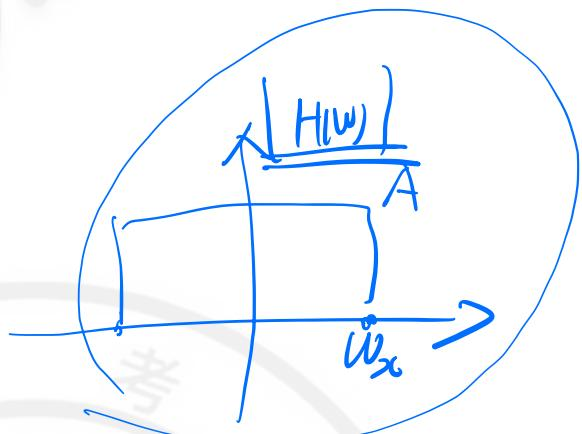
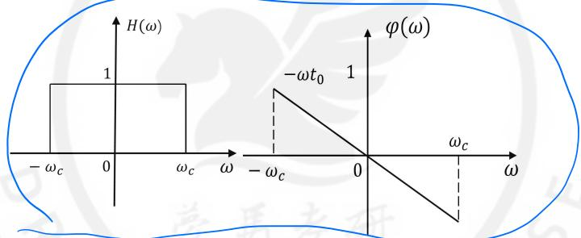
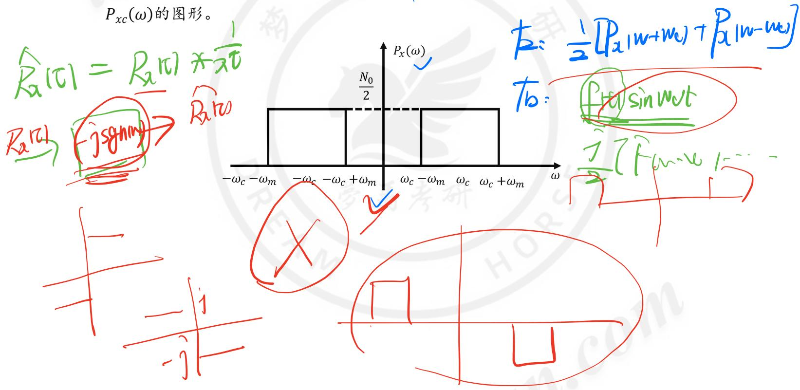
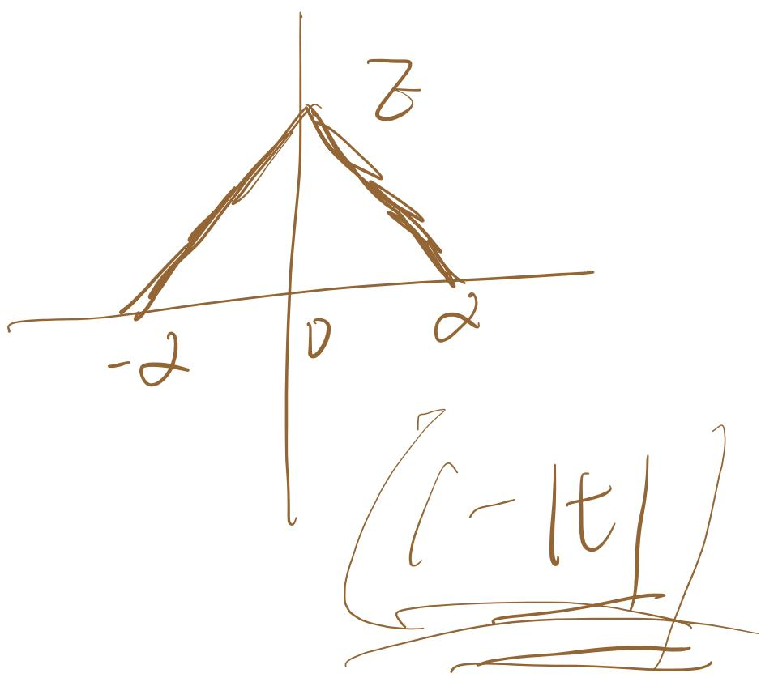

$f_{H1}\cos w_{0}t$ 调斜子的调

α. 又
1. in 作用于亲氏求out
α. 离性判断 h(t)

3. FT如何求out. 如问判断特性

$$
f (t) = \sqrt {(t)} \text {   or   } y _ {x} (t) = h (t)
$$

$$
\text {   q.   } \frac {y ^ {\prime} (t) + 2 y (t) = f (t)}{h ^ {\prime} (t) + 2 h (t) = \delta (t)}
$$

$$
\begin{array}{r l} {\Rightarrow j w H (w) + 2 H (w)} & {= 1} \\ {\Rightarrow H (w)} & {= \frac {1}{j w + 2} = \frac {\mathrm{右边形式}}{\mathrm{左边形式}}} \end{array}
$$

$$
H (w) = \int_ {- w} ^ {w} h (t) e ^ {- j w t} d t
$$

$$
\begin{array}{r l} {\mathrm{eq.}} & {\frac {y ^ {\prime \prime} (t) + 3 y ^ {\prime} (t) + 2 y (t) = f ^ {\prime} (t) + 3 f (t)}{h ^ {\prime} (t) + 3 h (t) + 2 h (t) = d ^ {\prime} (t) + 3 d (t)}} \\ & {(j w) ^ {2} H (w) + 3 j w H (w) + 2 H (w) = j w + 3 \quad (j w) ^ {2} + 3 j w + 2} \\ & {H (w) = \frac {j w + 3}{(j w) ^ {2} + 3 j w + 2}} \end{array}
$$

## 专题9 连续系统的频域分析

## 考点1：连续系统的频域表示

1、结构框图与网络函数

已知连续LTI系统的冲激响应为 $h(t)$ ，设输入信号为 $e(t)$ ，输出为 $r(t)$ 。若

$h(t)\leftrightarrow H(\omega)$ $e(t)\leftrightarrow E(\omega)$ $r(t)\leftrightarrow R(\omega)$

则

$$
r (t) = e (t) * h (t)
$$

根据卷积定理

$$
R (\omega) = E (\omega) H (\omega)
$$

则

$$
H (\omega) = \frac {R (\omega)}{E (\omega)}
$$

$H(\omega)$ 称为系统函数，也称作系统的频率响应特性。

$$
\begin{array}{l} {j ^ {2} = - 1} \\ {(j w) ^ {2} = - w ^ {2}} \end{array}
$$

$$
\text { 时域 } f (t) \longrightarrow \boxed {h (t)} \longrightarrow y (t) \Rightarrow y (t) = f (t) * h (t)
$$

$$
\text {频域} F (\omega) \longrightarrow \boxed {H (\omega)} \longrightarrow Y (\omega) \Rightarrow Y (\omega) = F (\omega) \cdot H (\omega)
$$

例 46: 求下列微分方程所描述系统的频率响应 $H(\omega)$ 。

$$
(1) y ^ {\prime \prime} (t) + 3 y ^ {\prime} (t) + 2 y (t) = f ^ {\prime} (t); \tag {2}
$$

$$
(2) y ^ {\prime \prime} (t) + 5 y ^ {\prime} (t) + 6 y (t) = f ^ {\prime} (t) + 4 f (t)
$$

(1)

$$
H (w) = \frac {f (w)}{f (w)} = \frac {j w}{\frac {(j w) ^ {2} + 3 j w + 2}{- w ^ {2}}}
$$

Hiwi 应用

$$
\frac {j w + 4}{(j w + 2) (j w + 3)} = \frac {k _ {1}}{j w + 2} + \frac {k _ {2}}{j w + 3}
$$

$^{0}h(t) \stackrel{FT}{\rightarrow} H(w)$

$$
k _ {1} = 2, \quad k _ {2} = - 1
$$

$$
= (2)
$$

$$
\frac {j w + 4}{(j w) ^ {2} + 5 j w + 6}
$$

$$
\begin{array}{l} \frac {4}{6} \\ \frac {2}{3} \times 2 \\ \frac {4}{3} \end{array}
$$

$$
1 ^ {0} H (w) \stackrel {[ w ]} {\rightarrow} h (t)
$$

$$
\begin{array}{r l} {\Rightarrow h (w) = (2 e ^ {- w} - e ^ {- w + 1})} \\ {H (w) = \frac {j w}{(j w + 1) (j w + 2)}} & {= \frac {k _ {1}}{j w + 1} + \frac {k _ {2}}{j w + 2}} \end{array}
$$

$$
k _ {1} (j w + 2) + k _ {2} (j w + 1) = j w \Rightarrow k _ {1} + k _ {2} = 1   2 k _ {1} + k _ {2} = 0
$$

$$
\therefore H (w) = \frac {- 1}{j w + 1} + \frac {2}{j w + 2}
$$

$$
\Rightarrow k _ {1} = - 1, k _ {2} = 2
$$

官网：tongxi nkaoyan.com

$$
\Rightarrow h (t) = (- e ^ {- t} + 2 e ^ {- x}) \quad (n \pi)
$$

梦马班讲义

考点 2: 网络函数的应用

(2)求零状态 $\overrightarrow{程}$ . $(A+1)$

美国日报

$$
Y _ {z s} (\omega) = F (\omega) \cdot H (\omega) \stackrel {\text {逆变换}} {\rightarrow} y _ {z s} (t)
$$

$$
\begin{array}{r l}{\mathrm{E} \times h (t)}&{= \int_ {- \infty} ^ {\infty} h (t) \cdot \frac {E d t}{E} = E \sqrt {\int_ {- \infty} ^ {\infty} h (t) d t} = E H (0)}\\&{E \rightarrow E H (0)}\end{array}
$$

$$
\begin{array} { r l }&{ } \text {   (3)与e指数卷积   }\\& e ^ { j w _ { 0 } t } \times h ( t ) = \int _ { - w } ^ { w } h ( t ) \cdot e ^ { j w _ { 0 } ( t - t ) } d t = e ^ { j w _ { 0 } t } \int _ { - w } ^ { w } h ( t ) e ^ { - j w _ { 0 } \tau } d t\\&{ } \text {   (4)与cosω₀t卷积   } \quad \cos w _ { 0 } t = \frac { e ^ { j w _ { 0 } t } + e ^ {- j w _ { 0 } t } } { 2 } = e ^ { j w _ { 0 } t } \cdot H ( w _ { 0 } ) \quad \text {   q:   } H ( w ) = \frac { 1 } { j w + 2 } ,\\&{ } \Rightarrow \frac { 1 } { 2 } \left[ e ^ { j w _ { 0 } t } H ( w _ { 0 } ) + e ^ { - j w _ { 0 } t } \cdot H ( - w _ { 0 } ) \right]\\&{ } = \frac { 1 } { 2 } \left[ e ^ { j w _ { 0 } t } \cdot | H ( w ) | \cdot e ^ { j \varphi ( w _ { 0 }) } + e ^ { - j w _ { 0 } t } | H ( - w ) | \cdot e ^ { j \varphi ( - w _ { 0 }) } \right]\\&{ } = \frac { 1 } { 2 } \left[ e ^ { j [ w _ { 0 } t + \varphi ( w ) ] } | H ( w ) | + | H ( w ) | \cdot e ^ { - j [ w _ { 0 } t + \varphi ( w ) ] } \right]\\&{ } = \frac { | H ( w ) | \cdot \cos [ w _ { 0 } t + \varphi ( w ) ] } { H ( w ) = \frac { 1 } { j w + 2 } \quad \text {   负   } \quad \cos 2 t }\\&{ } \Rightarrow - \frac { 1 } { \sqrt { 2 } } \cos ( 2 t - \frac { \pi } { 4 } )\\&{ } \cos \Delta t \rightarrow | H ( w ) | \cdot \cos ( w _ { 0 } t + \varphi ( w ) )\\&{ } H ( 2 ) = \frac { 1 } { j ^ { 2 + 2 } }\\& | H ( 2 ) | = \frac { 1 } { \sqrt { 4 + 4 } } = \frac { 1 } { 2 \sqrt { 2 } } ,\\&{ } \varphi ( 2 ) = 0 - a u t o n \frac { 2 } { 2 } = - \frac { \pi } { 4 } .\end{array}
$$

考点3: 无失真系统频谱特点

所谓无失真是指响应信号与激励信号相比，只是大小与出现的时间不同，而无波

形上的变化。设激励信号为 $e(t)$ ，响应信号为 $r(t)$ ，无失真传输的条件是

时域表示:

j(φ(m))

$$
r (t) = k e (t - t _ {0})
$$

$$
H (w) = \left\lfloor H (w) \right\rfloor \cdot e ^ {i}
$$

系统的冲激响应：

$$
h (t) = k \delta (t - t _ {0})
$$

$$
\Rightarrow | H (w) | = k
$$

系统的频率响应:

$$
\Downarrow F T
$$

$$
H (\omega) = k e ^ {- j \omega t _ {0}}
$$

$$
\varphi (w) = - w t o
$$

无失真传输系统的幅度和相位特性如所示。

也就是说， $H(\omega)$ 的幅频特性必须是一个与频率无关的常数，相位必须是频率的线性函数。

例 47: 在以下由冲激响应或频率响应函数描述的系统中, 能够无失真传输信号的是(A)。

A、 $h(t)=3\delta(t-3)$ B、 $h(t)=\sin2t$

C、 $H(j\omega) = \frac{2 - j\omega}{2 + j\omega}$

在 $(-1,1)$ 内无顶

D. $H(j\omega) = 2e^{-j\omega}$ , $|\omega| < 1$

$$
1 = \frac {\sqrt {4 + w ^ {2}}}{\sqrt {4 + w ^ {2}}}
$$

$$
\arctan \frac {- w}{2} - \arctan \frac {w}{2}
$$

考点 4：全通系统频谱特点

全通系统的幅频特性为常数， $|H(\omega)| = k$ ，相位特性不受任何约束，一般用来相位均衡器或移相器。

## 考点 5: 理想低通滤波器

1、理想低通滤波器的频谱特性:

系统函数:

$H(\omega)=\left\{\begin{aligned}e^{-j\omega t_{0}}&| \omega |<\omega_{c}\\ 0&\omega 为其他值,\end{aligned}\right.$ ， $t_{0}$ 为常数 通常内无大真

理想低通滤波器的幅频与相频特性

考点6: (相关: 比较某信号与另一个延时τ的信号之间的相似程度)

应用背景：(1)雷达回波识别(2)通信同步信号识别

1、自相关与互相关

(1)设 $f_{1}(t)$ 与 $f_{2}(t)$ 为能量有限信号，则

互相关

自相关

$$
R _ {1 2} (\tau) = \int_ {- \infty} ^ {\infty} f _ {1} (t) f _ {2} (t - \tau) d t = \int_ {- \infty} ^ {\infty} f _ {1} (t + \tau) f _ {2} (t) d t
$$

$$
R (\tau) = \int_ {- \infty} ^ {\infty} f (t) f (t - \tau) d t = \int_ {- \infty} ^ {\infty} f (t + \tau) f (t) d t
$$

具有性质

$$
R _ {1 2} (\tau) = R _ {2 1} (- \tau), R (\tau) = R ^ {*} (- \tau)
$$

(2)设 $f_{1}(t)$ 与 $f_{2}(t)$ 为功率有限信号，则

互相关

V

$$
R _ {1 2} (\tau) = \lim _ {T \rightarrow \infty} \left[ \frac {1}{T} \int_ {- \frac {T}{2}} ^ {\frac {T}{2}} f _ {1} (t) f _ {2} (t - \tau) d t \right]
$$

自相关

$$
R (\tau) = \lim _ {T \to \infty} \left[ \frac {1}{T} \int_ {- \frac {T}{2}} ^ {\frac {T}{2}} f (t) f (t - \tau) d t \right]
$$

2、相关与卷积的关系

$$
R _ {1 2} (t) = f _ {1} (t) * f _ {2} (- t)
$$

3、相关定理

维纳—欣钦关系

$$
\left\{ \begin{array}{l} R (\tau) = \frac {1}{2 \pi} \int_ {- \infty} ^ {\infty} \phi (\omega) e ^ {j \omega \tau} d \omega \\ \phi (\omega) = \int_ {- \infty} ^ {\infty} R (\tau) e ^ {- j \omega \tau} d \tau \end{array} \right.
$$

即功率有限信号的功率谱函数与自相关函数是一对傅里叶变换。在实际中，有些信号无法求它的傅里叶变换，但可用求自相关函数的方法，达到求功率谱的目的。

B站up: 信号与系统\_谷哥

公众号：通信考研小马哥

9): 49. $F(w)=\frac{1}{jw+d}$

$$
F (w) = 2 S a (w) e ^ {- j w}
$$

【梦马班点拨】总结——自相关和互相关函数的求解

$$
| F (w) | = \frac {1}{\sqrt {w ^ {2} + \alpha^ {2}}}
$$

$$
| F (w) | = 2 | S _ {a} (w) |
$$

(1)定义法 $\leftrightarrow$ 表达式法

$$
\left| F (w) \right| ^ {2} = \frac {1}{w ^ {2} + \alpha^ {2}}
$$

(2)图解法(类似于卷积)

(3)频域逆变换法:已知 $f(t)\leftrightarrow\mathrm{F}(\omega)$ ，求 $f(t)$ 的自相关 $R(\tau)$ .

$$
\therefore R (t) = \frac {1}{2 a} e ^ {-}
$$

例48. 已知 $f(t) = u(t) - u(t - 2)$ ，求信号 $f(t)$ 的自相关函数 $R(\tau)$

例49. 求 $f(t) = e^{-\alpha t} u(t)$ 的自相关函数.

$$
e ^ {- \alpha | t |} \rightarrow \frac {2 \alpha}{w ^ {2} + \alpha^ {2}}
$$

例 50: $x(t)$ 的自相关函数 $R_{x}(\tau)$ 的傅里叶变换 $P_{x}(\omega)$ 如图所示, 信号 $x(t)$ 的同相分量 $x_{c}(t)$ 的自相关函数可表示为

$$
R _ {x c} (\tau) = R _ {x} (\tau) \cos \left(\omega_ {c} \tau\right) + \widehat {R} _ {x} (\tau) \sin \left(\omega_ {c} \tau\right)
$$

其中 $\widehat{R}_{x}(\tau)$ 为 $R_{x}(\tau)$ 的希尔伯特变换。求 $R_{xc}(\tau)$ 的傅里叶变换 $P_{xc}(\omega)$ ，并画出

$P_{xc}(\omega)$ 的图形。

石井
国和信号
(改)5-11

10 判断
B站up: 信号与系统\_谷哥
20年: D如

## 考点8: 能量谱和功率谱的求解推荐

## 1、功率信号→功率谱

(1)周期信号是功率信号→考察多三角信号之和

(2)傅里叶级数 $F_{n}$

(3)平均功率: $P = \sum_{n=-\infty}^{\infty}|F_n|^2$

(4) 功率谱: $\phi(\omega)=2\pi\sum_{-\infty}^{\infty}|F_n|^2\delta(\omega-n\omega_0)$

(5)自相关: $\phi (\omega)$ 逆变换得 $R(\tau)$

中e

(1)持续时间有限信号和 $t\to\infty$ 时， $f(t)\rightarrow0$ 的信号

(2)能量: $E = \int_{-\infty}^{\infty}|f(t)|^{2}dt = \frac{1}{2\pi}\int_{-\infty}^{\infty}|F(\omega)|^{2}d\omega$

(3)能量谱: $G(\omega)=|F(\omega)|^{2}$ 公众号：通信考研小马哥
顾量 5 四年

醋英语 20手续费

$$
u _ {m} \cos w t \rightarrow \frac {u _ {m}}{2} ^ {2} \cos w o t
$$

$$
u _ {1} \cos w _ {1} t + u _ {2} \cos w _ {2} t \rightarrow \frac {u _ {1} ^ {2}}{2} a \sin t + \frac {u _ {2} ^ {2}}{2} \cos w _ {2} t
$$

$$
e ^ {- x (u + 1)} \frac {1}{g w + 2} \sqrt {\frac {1}{w ^ {2} + 4}}
$$

$$
G (v) = \frac {1}{w ^ {2} + 4}
$$

(4)自相关: $G(\omega)$ 逆变换得 $R(\tau)$

例54: 已知信号 $x(t) = 16 \cos \left( 20\pi t + \frac{\pi}{4} \right) + 6 \cos \left( 30\pi t + \frac{\pi}{6} \right) + 4 \cos \left( 40\pi t + \frac{\pi}{3} \right)$ . (1)计算并画出信号的功率谱

(2) 计算包含在频率区间 12\~22Hz 范围内的功率是多少?

(1) ${T}_{0} = \frac{1}{5}.{W}_{0} = {10\pi }$

$$
\therefore | F _ {2} | = | F _ {- 2} | = 8   | F _ {3} | = | F _ {- 3} | = 3
$$

$$
(F _ {4}) = (F _ {2}) = 2
$$

$$
\therefore \phi (w) = 2 \lambda \sum_ {n = - \infty} ^ {\infty} (F _ {n}) ^ {2} \delta_ {n} w - n w _ {0}
$$

$$
\begin{array}{r l} {p = \sum_ {n = - \infty} ^ {\infty} | F _ {n} | ^ {2}} \\ {(2 - 2 2 H _ {2} = f)} \\ {2 4 \lambda \sim 4 4 \lambda} \end{array}
$$

$$
P = 2 \times (9 + 4) = 2 6
$$

## 考点7：功率谱与能量谱

## 1、能量信号和能量谱

## (1)能量信号

信号在时间区间 $(-∞,∞)$ 内的能量为有限值，而在时间区间 $(-∞,∞)$ 内的平均功率P=0，这样的信号称为能量信号。大多数时限信号为能量信号。有些信号既不属于能量信号也不属于功率信号，例如 $f(t)=e^{t}$ ; $\delta(t)$ 为无定义的非功率非能量信号。

## (2)能量信号能量 $E$ 的计算公式:

时域公式:

$$
E = \int_ {- \infty} ^ {\infty} | f (t) | ^ {2} d t
$$

频域公式:

$$
E = \frac {1}{2 \pi} \int_ {- \infty} ^ {\infty} | F (\omega) | ^ {2} d \omega
$$

## (3)能量谱

令 $G(\omega) = |F(\omega)|^2$ ， $G(\omega)$ 的单位为 $J / rad$ ，则

$$
E = \frac {1}{2 \pi} \int_ {- \infty} ^ {\infty} G (\omega) d \omega
$$

$G(\omega)$ 称为能量信号的能量频谱密度，简称能量谱。它描述了单位频带内信号的能量随 $\omega$ 分布的规律。

例 51: 令 $f(t) = e^{-\alpha t} u(t)$ ，如果频带 $(- \omega_{B}, \omega_{B})$ 将包含信号总能量的 50%，求 $\omega_{B}$ 。

$E = \int_{-\infty}^{\infty} f(t) dt = \frac{1}{2\pi} \left( \int_{-\infty}^{\infty} (F(w))^{2} dw \right)$

$$
\begin{array}{r l} {E} & {= \int_ {- \infty} ^ {\infty} e ^ {- 2 t} u | t | d t} \\ & {= \int_ {0} ^ {\infty} e ^ {- 2 t} d t} \\ & {= \frac {1}{2 \alpha}} \end{array}
$$

官网：tongxi nkaoyan.com

$$
\begin{array}{r l} & {\frac {1}{2 \pi} \int_ {- w _ {B}} ^ {w _ {B}} (f (w)) ^ {2} d w = \frac {1}{4 \alpha}} \\ & {F (w) = \frac {1}{f w + \alpha} (f (w)) = \sqrt {\frac {1}{w ^ {2} + \alpha^ {2}}}} \\ & {\frac {1}{2 \pi} \int_ {- w _ {B}} ^ {w _ {B}} \frac {1}{w ^ {2} + \alpha^ {2}} d w = \frac {1}{4 \alpha}} \\ & {= \frac {1}{\alpha^ {2} \pi} \arctan (\frac {w _ {B}}{\alpha}) = \frac {1}{4 \alpha}} \\ & {\mathrm{梦马班讲义}} \end{array}
$$

B站up: 信号与系统\_谷哥

$$
\tan \frac {w _ {3}}{\alpha} = \frac {\pi}{4} \quad \frac {w _ {3}}{\alpha} = 1   \mathrm{公众号:通信考研小鸟哥} w _ {3} = \alpha .
$$

## 2、功率信号和功率谱

## (1)功率信号

信号在时间区间 $(- \infty, \infty)$ 内的能量为 $\infty$ ，但平均功率为有限值，这样的信号称为功率信号。周期信号、阶跃信号、符号函数等为功率信号。

(2)功率信号平均功率P的计算公式

时域公式:

$$
P = \lim _ {T \to \infty} \frac {1}{T} \int_ {T} | f (t) | ^ {2} d t
$$

频域公式(对于周期信号):

$$
P = c _ {0} ^ {2} + \sum_ {n = 1} ^ {\infty} \left(\frac {c _ {n}}{\sqrt {2}}\right) ^ {2} = \sum_ {n = - \infty} ^ {\infty} | F _ {n} | ^ {2}
$$

即平均功率P等于频域中直流分量与各次谐波分量平均功率之和。

(3)功率谱密度

$$
\phi (\omega) = \lim _ {T \to \infty} \frac {| F _ {T} (\omega) | ^ {2}}{T} = 2 \pi \sum_ {n = - \infty} ^ {\infty} | F _ {n} | ^ {2} \delta (\omega - n \omega_ {1})
$$

其中 $F_{T}(\omega)$ 为功率信号 $f(t)$ 的截断函数 $f_{T}(t)$ 的傅里叶变换。

(4)功率有限信号的功率谱与自相关函数是一对傅里叶变换对维纳辛钦关系

$$
\left\{ \begin{array}{l l} R (\tau) = \frac {1}{2 \pi} \int_ {- \infty} ^ {\infty} \phi (\omega) e ^ {j \omega t} d \omega \\ \phi (\omega) = \int_ {- \infty} ^ {\infty} R (\tau) e ^ {- j \omega \tau} d \tau \end{array} \right.
$$

即功率有限信号的功率谱函数与自相关函数是一对傅里叶变换。在实际中，有些信号无法求它的傅里叶变换，但可用求自相关函数的方法，达到求功率谱的目的。

$$
R (\tau) = \lim _ {T \to \infty} [ \frac {1}{T} \int_ {- \frac {T}{2}} ^ {\frac {T}{2}} f (t) f (t - \tau) d t ]
$$

对其取傅里叶变换可得:

$$
\begin{array}{r} F T [ R (\tau) ] = F T \left[ \lim _ {T \to \infty} \frac {1}{T} \int_ {- \infty} ^ {\infty} f _ {T} (t) \cdot f _ {T} (t - \tau) d t \right] = F T \left[ \lim _ {T \to \infty} \frac {1}{T} [ f _ {T} (\tau) * f _ {T} (- \tau) ] \right] \\ = \lim _ {T \to \infty} \frac {1}{T} F _ {T} (\omega) \cdot F _ {T} ^ {*} (\omega) = \lim _ {T \to \infty} \frac {1}{T} | F _ {T} (\omega) | ^ {2} \end{array}
$$

例 52: $f(t)=U_{m}\cos\omega_{0}t$ 的自相关函数和功率谱.

$$
F _ {1} = F _ {1} = \frac {U _ {m}}{2}
$$

$\psi(w)=2\pi\sum_{n=-w}^{\infty}|F_{n}|^{2}\delta(n-nw,)$

$R(t) = \frac{u_{n}^{2}}{2}\cos w_{0}t$

例53: $f(t) = U_{1}\cos \omega_{1}t + U_{2}\cos \omega_{2}t$ 的自相关函数和功率谱. $W_{2} = 2W_{1}$ $F_{1} = F_{-1} = \frac{U_{1}}{2}$ $F_{2} = F_{-2} = \frac{U_{2}}{2}$

$$
\begin{array}{r l} {\phi (w)} & {= 2 \pi \sum_ {n = - \infty} ^ {\infty} | F _ {0} | ^ {2} \delta_ {1} w - n w _ {1})} \\ & {= 2 \pi \left[ \frac {u _ {1} ^ {2}}{4} \delta_ {1} (w - w _ {1}) + \frac {u _ {1} ^ {2}}{4} \delta_ {1} (w + w _ {1}) + \frac {u _ {2} ^ {2}}{4} \delta_ {1} (w - w _ {2}) + \frac {u _ {2} ^ {2}}{4} \delta_ {1} (w + w _ {2}) \right]} \\ & {\quad n = 1 \qquad n = - 1 \qquad n = 2 \qquad n = 2} \\ & {= \frac {\pi u _ {1} ^ {2}}{2} [ \delta_ {1} (w - w _ {1}) + \delta_ {1} (w + w _ {1}) ] + \frac {\pi u _ {2}}{2} [ \delta_ {1} (w - w _ {2}) + \delta_ {1} (w + w _ {2}) ]} \\ {\Rightarrow R | T | = \frac {u _ {1} ^ {2}}{2} \cos w _ {1} t + \frac {u _ {2} ^ {2}}{2} \cos w _ {2} t} \\ & {=} \end{array}
$$

例 55: 若信号 $f(t) = A \cos (100\pi t) \cdot \cos (1000\pi t)$ ，求：

(1)判断该信号为能量信号还是功率信号;

(2)计算自相关函数；

(3)求功率谱密度或是能量谱密度;

(4)求信号平均功率或是归一化能量。

eq: (1) $f|t|=\frac{A}{2}$ [cos100πt + cos900πt] 功率

(2) $R(\tau)=\frac{A^{2}}{8}[\cos1100\pi\tau+\cos900\pi\tau]$

(3) FT $\phi(\omega)=\frac{A^{2}}{8}[\pi[-\delta+\delta]}+ \pi[-\delta+\delta]$

(4) $P = \frac{\sum\limits_{{n =  \infty }}^{\infty }\left| {F}_{n}\right| ^{2}}{4 \times  \frac{A^{2}}{16}} = \frac{A}{4}$

3→2 死年
2→3
\$双成\$

$\frac{U_{m}\cos\omega t}{2}$ 且 $\frac{U_{m}^{2}}{2}\cos\omega t$

