## 【第 22 节】课后作业

1、【2024 复旦大学】

某系统的频响特性:

$$
H (\omega) = \frac {j \omega + 4}{- \omega^ {2} + 5 j \omega + 6}
$$

(1)求表征系统的微分方程;

(2)当输入为 $x(t)=e^{-4t}u(t)-te^{-4t}u(t)$ 时,求输出响应。

$$
\begin{array}{r l} {(1)} & {H (w) = \frac {j w + 4}{(j w) ^ {2} + 5 j w + 6} = \frac {Y (w)}{X (w)}} \\ & {(j w) ^ {2} Y (w) + 5 j w Y (w) + 6 Y (w) = j w X (w) + 4 X (w)} \\ {\therefore} & {y ^ {\prime} (t) + 5 y ^ {\prime} (t) + 6 y (t) = x ^ {\prime} (t) + 4 x (t)} \end{array}
$$

$$
(2) \quad x (w) = \frac {1}{j w + 4} - \frac {1}{(j w + 4) ^ {2}} = \frac {j w + 4 - 1}{(j w + 4) ^ {2}} = \frac {j w + 3}{(j w + 4) ^ {2}}
$$

$$
\begin{array}{r l} {\therefore Y _ {(W)} = X _ {(W)}, H _ {(W)}} & {= \frac {j w + 3}{(j w + 4) ^ {2}} \cdot \frac {j w + 4}{(j w + 3) (j w + 2)}} \\ & {= \frac {1}{(j w + 2) (j w + 4)}} \\ & {= \frac {\frac {1}{2}}{j w + 2} + \frac {- \frac {1}{2}}{j w + 4}} \end{array}
$$

$$
\therefore y \vert t \vert = \frac {1}{2} (e ^ {- 2 t} - e ^ {- 4 t}) u \vert t)
$$

2、【2024 广东工业大学】

一个信号的脉冲宽度越大，那么他的频带宽度\_\_\_\_（越大/越小）

$$
B _ {f} = \frac {1}{\tau}
$$

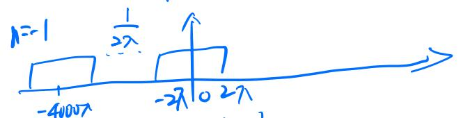

## 3、【2024 重庆邮电大学】

在下图中，图 1 为系统结构，图 2 为周期信号 $s(t)$ 的时域波形，T = 1ms，已知：

$$
f (t) = \frac {\sin 2 \pi t}{\pi t} \cos (2 0 0 0 \pi t), H (\omega) = \left\{ \begin{array}{l l} e ^ {- j 2 \omega} & , | \omega | <   \pi \\ 0 & , | \omega | > \pi \end{array} \right.
$$

(1)画出 $f(t)$ 傅里叶变换频谱图 $F(\omega)$ ;

(2)求 $s(t)$ 的傅里叶变换;

(3)求 $X(\omega)$ ;

$$
\begin{array}{r l} {\mathrm{令} ^ {(1)} f _ {1 1 t}} & {= \frac {\sin 2 \pi t}{\pi t} = 2 \cdot \frac {\sin 2 \pi t}{2 \pi t}} \\ & {= 2 \sin (2 \pi t)} \end{array}
$$

(4)求系统响应 $y(t)$ 。

(3) $\chi(t)=f(t)\cdot8(t)$

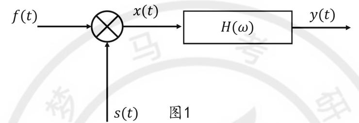

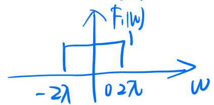

$$
\therefore \chi (w) = \frac {1}{2 \pi} f (w) * S (w)
$$

$$
= \frac {1}{2 \pi} F (w) * 2 \pi \sum_ {n = - \infty} ^ {\infty} F _ {n} \delta (w - n 2 0 0 0 \pi)
$$

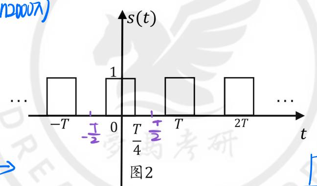

$$
= \sum_ {n = - \infty} ^ {\infty} F _ {n} \cdot F (w - 2 0 0 0 \times n)
$$

$$
\therefore f (t) = f _ {1} (t) \cos (2 0 0 0 \pi t)   \therefore f (w) = \frac {1}{2} [ f _ {1} (w + 2 0 0 0 \pi t) + f _ {1} (w - 2 0 0 0 \pi t) ]
$$

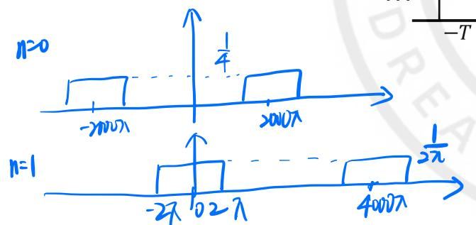

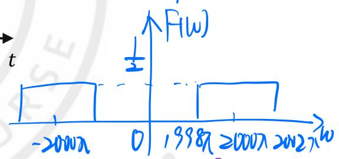

(2) $S_{0}(t)$ 是形为

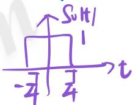

$$
S _ {0} (w) = \frac {I}{2} S _ {a} (\frac {I}{4} w)
$$

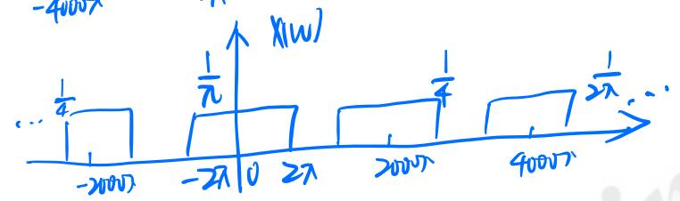

$$
\therefore F _ {n} = \frac {1}{T} \cdot \frac {T}{2} S a (\frac {T}{4} \cdot n \frac {2 \pi}{T})
$$

$$
= \frac {1}{2} S a (\frac {n \pi}{2})
$$

偶+奇谐

(4) $Y(w) = X(w) \cdot H(w)$

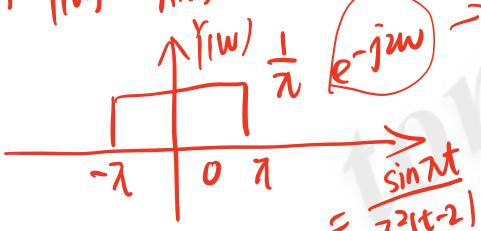

时移

$$
= \left\{ \begin{array}{l l} \frac {\sin \frac {n \pi}{2}}{n \pi}, & n = \text {奇数} \\ \frac {1}{2}, & n = 0 \end{array} \right.
$$

$$
\frac {1}{\pi} S a [ \pi (t - 2) ] = y (t)
$$

官网：www.tongxinkaoyan.com

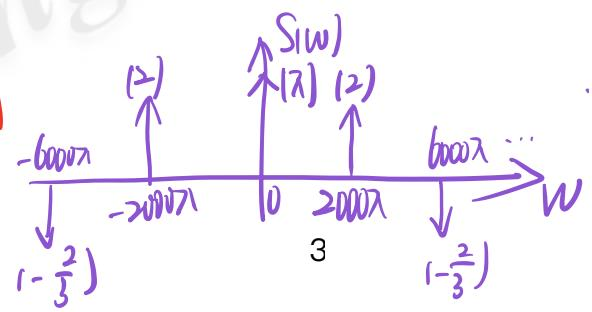

$$
\begin{array}{r l} {\therefore S (w) = 2 \pi \sum_ {n = - \infty} ^ {\infty} F _ {n} \delta (w - n \frac {2 \pi}{T})} \\ {= 2 \pi \sum_ {n = - \infty} ^ {\infty} F _ {n} \delta (w - n 2 0 0 0 \pi)} \\ {\mathrm{梦马班作业}} \end{array}
$$

5、【2024 重庆大学】

(1) $H(\omega) = \frac{2}{j\omega - \omega^2}$ , 求 $h(t) =$

$$
\begin{array}{r l} & {= \frac {2}{j w + (j w) ^ {2}}} \\ & {= \frac {2}{j w (j w + 1)}} \\ & {= \frac {2}{j w} + \frac {- 2}{j w + 1}} \end{array}
$$

$$
\therefore h (t) = \operatorname{sgn} (t) - 2 e ^ {- t} u (t)
$$

(2) 已知周期信号 $f(t)$ 是以 0 为中心, 门宽为 $\pi$ 高为 1 的门信号, 且其周期是 $T =$

$2\pi$ ，另外载波信号 $s(t) = \sin \left(\frac{3}{4} t\right)$ ， $h_1(t) = e^{-t}u(t)$ ， $h_2(t) = \frac{\sin\left(\frac{t}{2}\right)}{\pi t}$ ，系统如图所示：

(1) 求子系统 $h_1(t)$ 的傅里叶变换 $H_1(\omega)$ , 并画出其频谱图;

(2) 求子系统 $h_2(t)$ 的傅里叶变换 $H_2(\omega)$ , 并画出其频谱图并判断系统特性;

(3) 求系统的输出信号 $y(t)$ 。（关注通信考研小马哥，通信考研不迷路）

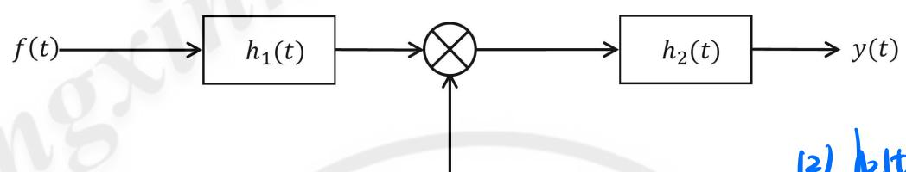

(1) $h_{1}(t)=e^{-t}u(t)$

$$
\begin{array}{r l} {h _ {2} | t |} & {= \frac {\sin \frac {t}{2}}{\frac {t}{2}} \cdot \frac {1}{2 \pi}} \\ & {= \frac {1}{2 \pi} S a (\frac {t}{2})} \end{array}
$$

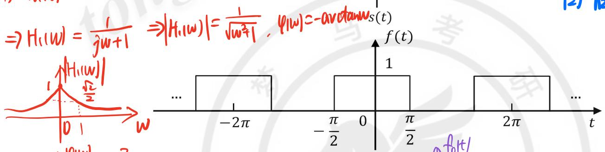

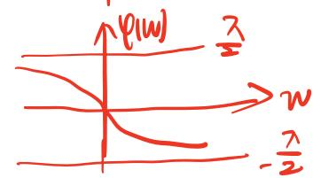

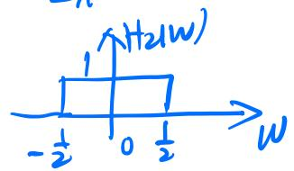

(3) f0|t1图形为

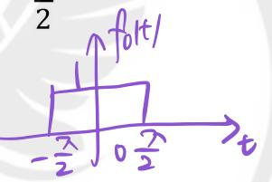  
属于低通源波器

$$
F _ {0} (w) = \pi S a (\frac {\lambda}{2} w)
$$

$$
\begin{array}{r l} {F _ {n}} & {= \frac {1}{2 \pi} F _ {0} (w) | _ {w = n} = \frac {1}{2} S a (\frac {\pi}{2})} \\ & {= \left\{ \begin{array}{l l} {\frac {1}{2},} & {n = 0} \\ {\frac {\sin \frac {n \pi}{2}}{n \pi},} & {n = \mathrm{奇数}} \end{array} \right.} \end{array}
$$

$$
\text {   即   } f _ {n} = \left\{ \begin{array}{l l} \dots & \frac {1}{3 \pi} - \frac {1}{\pi}, \frac {1}{2} \\ n = - 3 & n = 1 \end{array} \right. \text {   个   }
$$

$$
\left. \begin{array}{l l} \frac {1}{\pi} & \frac {- 1}{3 \pi} \\ n = 1 & n = 3 \end{array} \right\}
$$

由于 ${H}_{2}\left( m\right)$ 为周,共关注 ${X}_{2}\left( m\right)$ 中

$$
F (w) = 2 \pi \sum_ {n = - \infty} ^ {\infty} F _ {n} \cdot \sqrt {(w - n)}
$$

$(1-\frac{1}{2},\frac{1}{2})$ 的部分

故n只a±1

$$
x _ {1} (t) = f (t) \times h _ {1} (t) \Rightarrow x _ {1} (w) = F (w) \cdot H _ {1} (w)
$$

当n=1时

$$
\begin{array}{r l} {Y (w)} & {= j \pi F _ {1} H _ {1} (1) \delta (w - \frac {1}{4})} \\ & {= j \pi (\frac {1}{\pi}) \cdot \frac {1}{j + 1} \cdot \delta (w - \frac {1}{4})} \\ & {= \frac {1 + j}{2} \delta (w - \frac {1}{4})} \end{array}
$$

$$
x _ {1} (w) = 2 \pi \frac {3}{n - w} F n \cdot H _ {1} (n) \cdot \delta (w - n)
$$

$$
\begin{array}{r l} {\mathrm{令} x _ {2} (t)} & {= x _ {1} (t) \cdot s (t) = x _ {1} (t) \cdot \sin (\frac {3}{4} t)} \\ {\Rightarrow x _ {2} (w)} & {= \frac {1}{2} [ x _ {1} (w + \frac {3}{4}) - x _ {1} (w - \frac {3}{4}) ] = j \pi \sum_ {n = 0} ^ {\infty} F _ {n} (n + 1, n) [ \sqrt {(w + \frac {3}{4} - n)} - \sqrt {(w - \frac {3}{4} - n)} ]} \end{array}
$$

当n=-官网：www.tongxinkaoyan.com

$$
Y (w) = j \pi F _ {- 1} H _ {1} (- 1) [ - d (w + \frac {1}{4}) ]
$$

$$
y (t) = x _ {2} (t) * h _ {2} (t) \Rightarrow y (w) = x _ {2} (w) \cdot H _ {2} (w)
$$

梦马班作业

$$
= j \pi \cdot \frac {1}{\pi} \cdot \frac {1}{- j + 1} \cdot [ - d _ {1} m + \frac {1}{4} ]
$$

B站up: 信号与系统\_谷哥

$$
\Rightarrow Y (w) = \frac {1 + j}{2} \delta (w - \frac {1}{4}) + \frac {1 - j}{2} \delta (w + \frac {1}{4})
$$

公众号：通信考研小马哥

$$
= - \frac {j - 1}{2} \delta (n + \frac {1}{4})
$$

6、【2024 西南交通大学】 $\Rightarrow  y|t|= \frac{1+\frac{1}{2}}{2}-\frac{1}{2\pi}e^{i\frac{1}{4}t}+\frac{1-\frac{1}{2}}{2}\frac{\pi}{2\pi}e^{-i\frac{1}{4}t}$ 如图所示系统中，已知： $=\frac{1}{2\pi}\left[\frac{\sqrt{2}}{2}e^{\frac{1}{4}t}\cdot e^{\frac{1}{4}t}+\frac{\sqrt{2}}{2}e^{\frac{-i\pi}{4}}\cdot e^{\frac{-i\frac{1}{4}t}{4}}\right]=\frac{\sqrt{2}}{2\pi}\cos(\frac{t}{4}+\frac{\pi}{4})$

$$
h _ {1} (t) = \frac {d}{d t} \left[ \frac {\sin \omega_ {c} t}{2 \pi t} \right], H _ {2} (\omega) = e ^ {- j \frac {2 \pi \omega}{\omega_ {c}}}, h _ {3} (t) = \frac {\sin 3 \omega_ {c} t}{\pi t}, h _ {4} (t) = u (t)
$$

试求解下列问题:

(1) 确定 $H_{1}(\omega)$ ;

$$
\begin{array}{r l} {\mathrm{令} S (t)} & {= \frac {\sin w _ {c t}}{2 \pi t} = \frac {w _ {c}}{2 \pi} \frac {\sin w _ {c t}}{w _ {c t}}} \\ & {= \frac {w _ {c}}{2 \pi} S a (w _ {c t})} \end{array}
$$

(2) 求整个系统的冲激响应 $h(t)$ ;

(3) 求当输入 $f(t) = \sin 2\omega_{c}t + \cos \frac{\omega_{c}t}{2}$ 时的输出 $y(t)$ 。

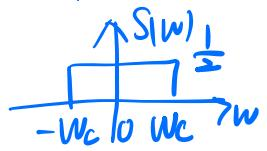

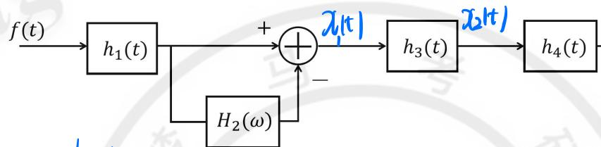

$$
h _ {1} (t) = \frac {d}{d t} S (t)
$$

(2) 令 $f(t) = \delta (t)$ , $y(t) = h(t)$

$$
\therefore H _ {1} (w) = j w S (w) = \frac {7 w}{2} G _ {2 w} ^ {(w)}
$$

$$
\begin{array}{r l} {\mathrm{则} h _ {1} (t)} & {= \sqrt [ 3 ]{(t)} * h _ {1} (t) * [ \sqrt [ 3 ]{(t)} - h _ {2} (t) ] * h _ {3} (t) * h _ {4} (t)} \\ & {= h _ {1} (t) * [ \sqrt [ 3 ]{(t)} - h _ {2} (t) ] * h _ {3} (t) * h _ {4} (t)} \end{array}
$$

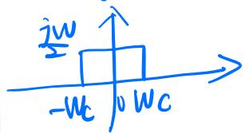

$$
\begin{array}{r l} {\therefore H (w) = H _ {1} (w) \cdot [ 1 - H _ {2} (w) ] \cdot H _ {3} (w) \cdot H _ {4} (w)} \\ & {= \frac {j w}{2} G _ {2 w c} (w) \cdot [ 1 - e ^ {- j \frac {2 \pi w}{w c}} ] \cdot G _ {6 w c} (w) \cdot [ \pi d (w) + j \frac {1}{w} ]} \\ & {= \frac {1}{2} [ 1 - e ^ {- j \frac {2 \pi w}{w c}} ] G _ {2 w c} (w)} \end{array}
$$

$$
\Rightarrow h (t) = \frac {1}{2} \left[ \frac {\sin w _ {c} t}{\pi t} - \frac {\sin [ w _ {c} (t - \frac {2 \lambda}{w _ {c}}) ]}{\pi (t - \frac {2 \lambda}{w _ {c}})} \right]
$$

$$
f (t) = \sin (2 w _ {c} t) + \cos \frac {w _ {c} t}{2}
$$

$\Rightarrow  H\left( {2{w}_{0}}\right)  = 0$ 的 $\sin \left( {2w}\right)$ 无对称轴

$$
\cos \frac {w _ {c t}}{2} \Rightarrow | H (\frac {w _ {c}}{2}) | \cos [ \frac {w _ {c t}}{2} + \varphi (\frac {w _ {c}}{2}) ]
$$

$$
H (\frac {w _ {c}}{2}) = \frac {1}{2} [ 1 - e ^ {- j \frac {2 \pi}{w _ {c}} \cdot \frac {w _ {c}}{2}} ] = \frac {1}{2} [ 1 - e ^ {- j \pi} ] = \frac {1}{2} [ 1 + 1 ] = 1
$$

$$
\Rightarrow | H (\frac {W _ {c}}{2}) | = 1. \quad \varphi (\frac {W _ {c}}{2}) = 0
$$

$$
\Rightarrow y | t | = \cos \frac {w _ {0} t}{2}
$$

7、【2024华北电力大学】

已知下图系统函数 $H(\omega)$ ，以下四个信号哪个可以通过该系统无失真输出

(1) $5\sin10t$ (2) $3\cos3t$ (3) $\frac{4}{3}\cos^{2}6t$ (4) $\frac{1}{5}\sin^{2}4t$

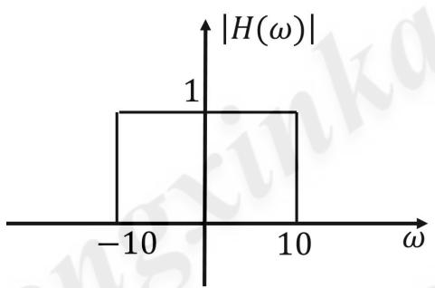

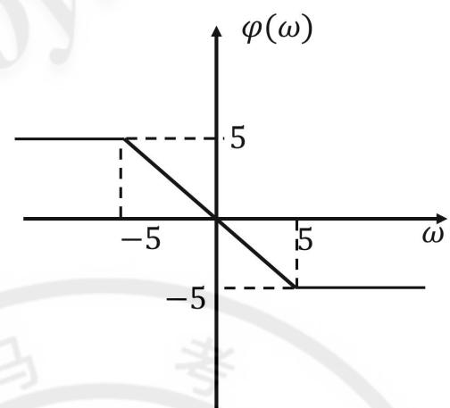

需成引某一区
域内满足无天真
即 $(H(m))$ 和 $4(m)$ 在 $[-5,5]$ 内属于
无天真.

(1) $W =  \pm  {10}$

(2) $w =  \pm  3$

(3) $W =  \pm  {12}$

(4) $W =  \pm  8$

夢馬考研

8、【2024 西安工程大学】

LTI 系统的幅频响应 $|H(\omega)|$ 和相频响应 $\varphi(\omega)$ 如图所示, 若激励 $f(t)=1+ \sum_{n=1}^{\infty}\frac{1}{n}\cos nt$ , 求该系统的响应 $y(t)$

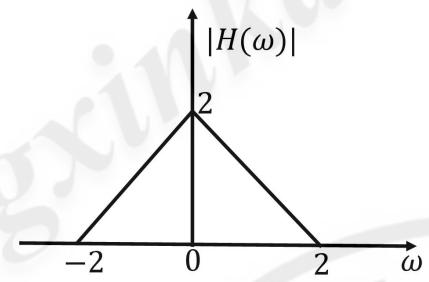

(a)

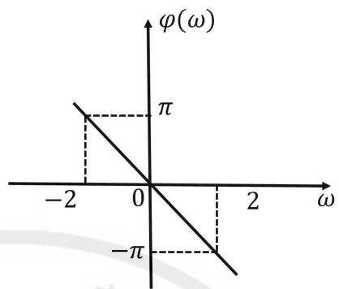  
(b)

$Y(w)=F(w)\cdot H(w)$ 由 $H(w)$ 可知. 只需要关注 $F(w)$ 在 $(-2,2)$ 宽域

$$
f (t) = 1 + \sum_ {n = 1} ^ {\infty} \frac {1}{n} \cos n t = 1 + \cos t + \frac {1}{2} \cos 2 t + \dots
$$

$\therefore$ 在 $\left( {-2,2}\right)$ 区域内 $f\left| t\right|  = 1 + \cos t$

$$
\begin{array}{r l} {\therefore y (t)} & {= H (1) + | H (1) | \cos [ t + \varphi (1) ]} \\ & {= 2 + 1 \cdot \cos (t - \frac {\pi}{2})} \\ & {= 2 + \sin t} \end{array}
$$