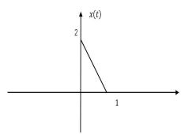
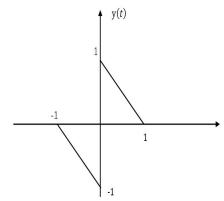
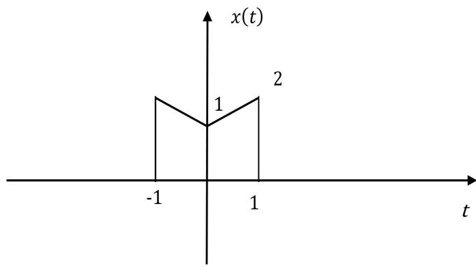
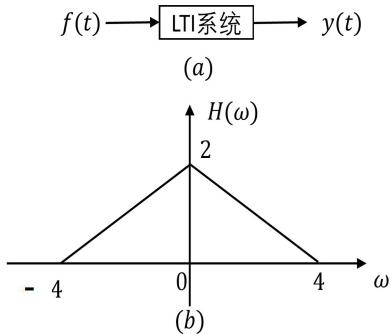
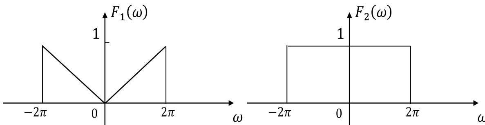
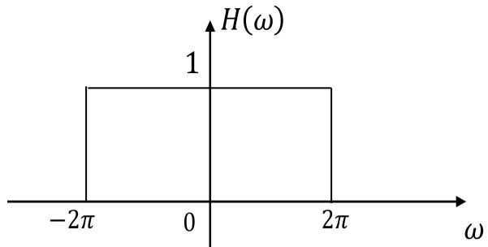
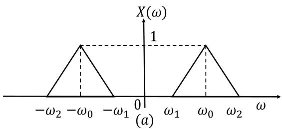
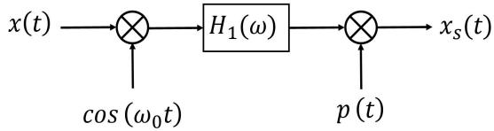

# 第 3 章 傅里叶变换及其在通信系统中的应用章节测试题

考试时间：2026 年5月24日 18：00-20：30

提交时间：20：35 考试形式：闭卷

## 1、【中国科学技术大学843】

输入信号� � 的傅里叶变换� $\begin{array} { r } { \mathrm { \Lambda } ^ { \prime } ( \omega ) = \frac { e ^ { - \left( j \omega + 3 \right) } } { j \omega + 3 } . } \end{array}$ ,则� � 为

## 2、【西安石油大学810】

（1）已知信号�(�)的频谱函数是�(�)，求�( − 2� + 1)的频谱函数。

（2）已知信号 $\begin{array} { r } { f ( t ) = \mathrm { u } \left( t + \frac { \pi } { 2 } \right) - \mathrm { u } \left( t - \frac { \pi } { 2 } \right) } \end{array}$ 的频谱函数是�(�)，求�(1)的值。

3、【西安电子科技大学821】

有限频带信号�(�)的最高频率为 100Hz，则 $f ( 2 t ) * f ^ { 2 } ( t )$ 的最小取样频率为

## 4、【天津工业大学812】

计算卷积 $: e ^ { - 2 t } \mathsf { u } ( t ) \ast 2 = \_$

## 5、【西安电子科技大学 821】

求 $\begin{array} { r } { f ( t ) = \frac { 3 } { \pi t } s i n \left( 3 t \right) c o s } \end{array}$ (99�)的频谱和能量，并画出频谱图。

## 6、【石家庄铁道大学 894】

已知 $\begin{array} { r } { { \cal H } ( \omega ) = \frac { 2 } { 1 + j \omega } , } \end{array}$ ，输入信号 $\begin{array} { r } { e ( t ) = c o s \left( t + \frac { \pi } { 4 } \right) } \end{array}$ ，则输出信号�(�) = \_\_\_\_。

## 7、【天津工业大学812】

已知�(�)的图像如下图所示， $X ( \omega ) = R ( \omega ) + j I ( \omega )$ 。将�(�)通过某线性时不变系统得到的响应�(�)的图像如下图所示,求�(�)的频谱是( )[公众号：通信考研小马哥]

A.R(� B.��(�) C.2�(�) D. $2 R ( \omega ) c o s ( \omega )$

8、【天津工业大学812】

已知�(�)的图像如下图所示，其中�(�) = �(1 − 2�)

求:

(1) $F ( 0 )$ [公众号：通信考研小马哥]

(2) $\int _ { - \infty } ^ { + \infty } F ( \omega ) d \omega$

(3) $\int _ { - \infty } ^ { + \infty } | F ( \omega ) | ^ { 2 } d \omega$

(4) $\int _ { - \infty } ^ { + \infty } F ( \omega ) \frac { 2 s i n \omega } { \omega } e ^ { j \frac { \omega } { 2 } } d \omega$ [官网：tongxinkaoyan.com]

## 9、【沈阳工业大学807】

已知时域周期信号 $\begin{array} { r } { f \left( t \right) = 1 + s i n \left( t \right) + \sqrt { 3 } c o s \left( t \right) + 3 c o s \left( 2 t + \frac { \pi } { 4 } \right) } \end{array}$ ，请画出该信号展开成指数形式的傅里叶级数的幅度谱和相位谱。

## 10、【中山大学884】

如图 4(a)所示���系统，其频率响应�(�)，如图4(b)所示，若系统的激励� � =$\begin{array} { r } { \sum _ { n = - \infty } ^ { \infty } { \frac { 1 } { 2 } } e ^ { j n \frac { \pi } { 2 } } e ^ { j n \omega _ { 0 } t } } \end{array}$ ，其中 $\omega _ { 0 } = 3 \ r a d / s$ ，求系统的时域响应�(�)。(10分)

  
图4

## 11、【武汉理工大学855】

已知 $t f _ { 1 } ( t )$ $t f _ { 2 } ( t )$ 的傅里叶变换 $F _ { 1 } ( \omega )$ 和 $r F _ { 2 } ( \omega )$ 如下图所示，现对信号 $\mathbf { \nabla } \cdot f ( t ) = f _ { 1 } ( t ) +$ ${ f _ { 2 } } ^ { 2 } ( t )$ 进行采样，采样周期为 $T _ { s }$ ，采样之后信号为 $f _ { s } ( t )$

（1）若要从 $f _ { s } ( t )$ 中恢复出原始信号�(�)，试确定最大的采样周期，并在该取值条件下求出 $F _ { s } ( \omega )$ 的表达式和频谱图；

（2）若 $f _ { s } ( t )$ 经过下图所示的理想低通滤波器 $H ( \omega )$ ，求经过滤波器的输出信号 $y ( t )$

## 12、【中山大学884】

如图6所示系统中，�(�)为频带有限的实信号，已知�(�)的频谱如图所示，其中 $\omega _ { 1 } =$ $9 9 \pi ( r a d / s ) , \omega _ { 2 } = 1 0 1 \pi ( r a d / s ) , \omega _ { 0 } = ( \omega _ { 1 } + \omega _ { 2 } ) / 2 = 1 0 0 \pi ( r a d / s ) , H _ { 1 } ( \omega ) = 0 . 3 2 5 \pi ^ { \prime } \omega _ { 0 }$ $G _ { 2 \omega _ { c } } ( \omega )$ ，其中， $\begin{array} { r } { \omega _ { c } = ( \omega _ { 1 } - \omega _ { 2 } ) / 2 = 1 \pi ( r a d / s ) , p ( t ) = \sum _ { n = - \infty } ^ { \infty } { ( - 1 ) ^ { n } \delta ( t - n T ) } } \end{array}$ 注：符号 $G _ { \tau }$ 是指宽度为�的标准门信号。

(1)写出信号�(�)的时域表达式；[公粽号：通信考研小马哥]

(2)画出信号 $x _ { s } ( t )$ 的频谱图；

(3)为了从 $. x _ { s } ( t )$ 中恢复�(�)，请确定频谱不重叠的条件(即抽样间隔�应满足的条件)；

(4)如果 $T = 0 . 1 s$ ，设计一个从 $x _ { s } ( t )$ 中恢复�(�)的系统。

  
图6  
(b)

## 13、【复旦大学957】

连续信号 $x ( t ) = A c o s ( B t + C )$ ，其基波周期为6，傅里叶级数系数 $F _ { n }$ ，

①�(�)为实函数；

②对 $| n | > 1$ 时， $F _ { n } = 0$

③ $F _ { 1 }$ 为正实数；

④ $\begin{array} { r } { \gamma _ { \overline { { 6 } } } ^ { 1 } \int _ { - 3 } ^ { + 3 } | x ( t ) | ^ { 2 } d t = 3 . } \end{array}$

试通过上述条件，确定常数A，B，C。