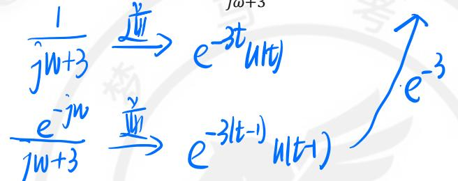

# 第 3 章 傅里叶变换及其在通信系统中的应用

# 章节测试题

考试时间：2026年5月24日 18:00- 20:30

提交时间：20:35

考试形式：闭卷

1.【中国科学技术大学 843】

输入信号 $x(t)$ 的傅里叶变换 $X(\omega)=\frac{e^{-(j\omega+3)}}{j\omega+3}$ ，则 $x(t)$ 为 $e^{-3t}(u|t-1)$

解：

2、【西安石油大学 810】

(1) 已知信号 $f(t)$ 的频谱函数是 $F(\omega)$ ，求 $f(-2t + 1)$ 的频谱函数。

问：

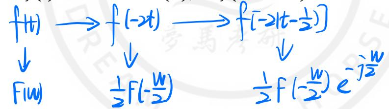

（2）已知信号 $f(t) = \mathrm{u}\left(t + \frac{\pi}{2}\right) - \mathrm{u}\left(t - \frac{\pi}{2}\right)$ 的频谱函数是 $F(\omega)$ ，求 $F(1)$ 的值。

m

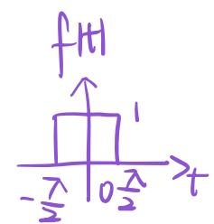

$$
\rightarrow F (w) = \pi S _ {a} (\frac {\pi}{2} w)
$$

$$
\mathrm{则} F (1) = \pi S a (\frac {\pi}{2}) = \pi \frac {\sin \frac {\pi}{2}}{\frac {\pi}{2}} = 2
$$

3. 【西安电子科技大学 821】

有限频带信号 $f(t)$ 的最高频率为 $100\mathrm{Hz}$ ，则 $f(2t)*f^{2}(t)$ 的最小取样频率为 $400\mathrm{Hz}$

评： ${f}_{m} = {100}{H}_{2}$

$$
\mathrm{则} f (2 t) \rightarrow 2 0 0 H _ {2}
$$

$$
f ^ {2} (t) \rightarrow 2 0 0 H _ {2}
$$

$$
f (2 t) * f ^ {2} (t) \longrightarrow 2 0 0 H z
$$

公众号【有涧学社考研】免费分享

4、【天津工业大学 812】

计算卷积 $e^{-2t}u(t)*2=$ 1。

问： $E \times h(t) \rightarrow E \cdot H(0)$

$$
\begin{array}{r l}{\mathrm{则}}&{e ^ {- 2 t} u (t) \rightarrow \frac {1}{j w + 2} \rightarrow H (0) = \frac {1}{2}}\\&{2 \times \frac {1}{2} = 1}\end{array}
$$

## 5、【西安电子科技大学 821】

求 $f(t)=\frac{3}{\pi t}\sin(3t)\cos(99t)$ 的频谱和能量，并画出频谱图。

(2')

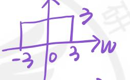

故 $F\left( w\right)$ 为

$$
F (w) = \frac {3}{2} [ G _ {6} (w + 9 9) + G _ {6} (w - 9 9) ]
$$

6.【石家庄铁道大学894】

$$
E = \frac {1}{2 \pi} \int_ {- \infty} ^ {\infty} | F (w) | ^ {2} d w = \frac {1}{2 \pi} \times 2 \times \frac {9}{4} \times 6 = \frac {2 1}{2 \pi} (J)
$$

已知 $H(\omega)=\frac{2}{1+j\omega}$ ，输入信号 $e(t)=cos\left(t+\frac{\pi}{4}\right)$ ，则输出信号 $r(t)=$ \_\_\_\_。

$\overrightarrow{nA}:\cos\omega o t\xrightarrow{H}|H(w_{0})|\cos[w_{0}t+p(w_{0}))|$

已知 ${W}_{0} = 1$ 则

$$
\therefore r (t) = \sqrt {2} \cos (t + \frac {\pi}{4} - \frac {\pi}{4}) = \sqrt {2} \cos t
$$

7.【天津工业大学 812】

已知 $x(t)$ 的图像如下图所示， $X(\omega)=R(\omega)+jI(\omega)$ 。将 $x(t)$ 通过某线性时不变系统得到的响应 $y(t)$ 的图像如下图所示,求 $y(t)$ 的频谱是( B)[公众号:通信考研小马哥]

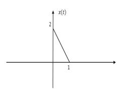

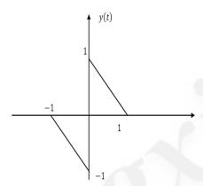

A. $R(\omega$

呼：

B. $jI(\omega)$

C.2R(ω)

$$
\begin{array}{c} y (t) = x _ {0} (t) = \frac {x (t - x (- t))}{2} \\ \downarrow \\ j I (\omega) \\ D. 2 R (\omega) c o s (\omega) \end{array}
$$

【天津工业大学812】

$\overline{ma}$ :

已知 $x(t)$ 的图像如下图所示，其中 $f(t) = x(1 - 2t)$

$\chi(t) \rightarrow \chi(t+1) \rightarrow \chi(-t+1) \rightarrow \chi(1-2t)$

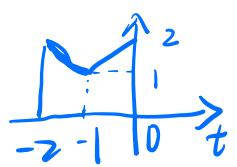

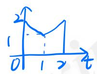

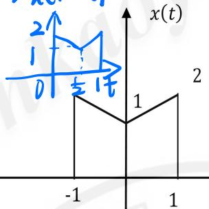

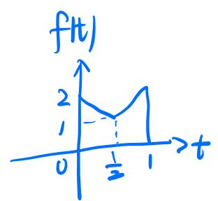

(5')

(1) $F\left|0\right|  = {\int }_{-{w}}^{w}{f\left( t\right) }{dt} = 1 \times  2 - \frac{1}{2} \times  1 \times  1 = \frac{3}{2}$

求:

(1) $F(0)$ [公众号：通信考研小马哥]

(5') (2) $\int_{-\infty}^{\infty} f(w) \, d w = 2\pi \, f(0) = 4\pi$

(2) $\int_{-\infty}^{+\infty} F(\omega) d\omega$

(5') (3)

$$
\int_ {- \infty} ^ {\infty} | F (w) | ^ {2} d w
$$

(3) $\int_{-\infty}^{+\infty}|F(\omega)|^2 d\omega$

(4) $\int_{-\infty}^{+\infty} F(\omega) \frac{2\sin\omega}{\omega} e^{j\frac{\omega}{2}} d\omega$ [官网：tongxinkaoyan.com]

(5') (4) 令 $f_{1}(t)$ 为 $F(w)\frac{2\sin{w}}{w}$ 过度授

$$
= 2 \pi f _ {1 0} ^ {\infty} f ^ {2} (t + \frac {1}{2}) d t
$$

故 $f\left( t\right)  = f\left( t\right)$

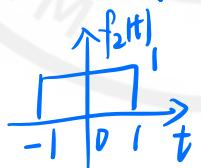

$$
= 4 \pi P _ {0} ^ {\frac {1}{2}} (2 t + 1) ^ {2} d t
$$

$$
= 4 \pi \int_ {0} ^ {\frac {1}{2}} (4 t ^ {2} + 4 t + 1) d t
$$

$$
\therefore f (| t |) = \frac {1}{2 \pi} \int_ {- \infty} ^ {\infty} f (w) \frac {2 \sin w}{w} \cdot e ^ {j w t} d w
$$

$$
= 4 \pi [ \frac {4 t ^ {3}}{3} + 2 t ^ {2} + t ] _ {0} ^ {\frac {1}{2}}
$$

$$
= 4 \pi [ \frac {1}{6} + \frac {1}{2} + \frac {1}{2} ] = \frac {1 4 \pi}{3}
$$

则

$$
\int_ {- \infty} ^ {\infty} F (w) \frac {2 \sin w}{w} e ^ {j \frac {w}{2}} d w = f _ {1} (\frac {1}{2}) \cdot 2 \pi
$$

$$
f _ {1} (\frac {1}{2}) = \int_ {- \infty} ^ {\infty} f (\tau) f _ {2} (\frac {1}{2} - \tau) d \tau = \frac {3}{2}
$$

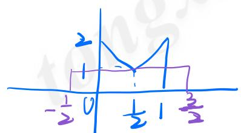

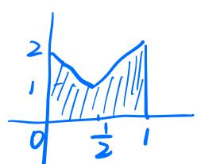

官网；tongxinkaoyan.com 公众号【有涧学社考研】免费分享

$$
\mathrm{故原式} = \frac {3}{2 3} \times 2 \pi = 3 \pi
$$

$(1')$

【沈阳工业大学807】

已知时域周期信号 $f(t) = 1 + \sin (t) + \sqrt{3}\cos (t) + 3\cos \left(2t + \frac{\pi}{4}\right)$ ，请画出该信号展

开成指数形式的傅里叶级数的幅度谱和相位谱。

即： ${W}_{1} = 1,{T}_{1} = {2\pi }$

$$
f (t) = 1 + 2 \cos (t - \frac {\pi}{6}) + 3 \cos (2 t + \frac {\pi}{4})
$$

(5')

$$
C _ {0} = 1
$$

$$
C _ {1} = 2, \quad \varphi_ {1} = - \frac {\pi}{6}
$$

⇒

$$
| F _ {1} | = | F _ {- 1} | = \frac {G _ {1}}{2} = 1
$$

$$
\varphi_ {1} = \frac {\pi}{6}. \quad \varphi_ {- 1} = \frac {\pi}{6}
$$

$$
C _ {2} = 3 \cdot \varphi_ {2} = \frac {\pi}{4}
$$

$$
\vert F _ {2} \vert = \vert F _ {2} \vert_ {3} = \frac {C _ {2}}{2} = \frac {3}{2}
$$

$$
\varphi_ {2} = \frac {\pi}{4}, \quad \varphi_ {- 2} = - \frac {\pi}{4}
$$

10、【中山大学 884】

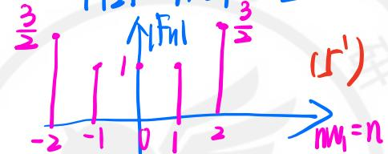

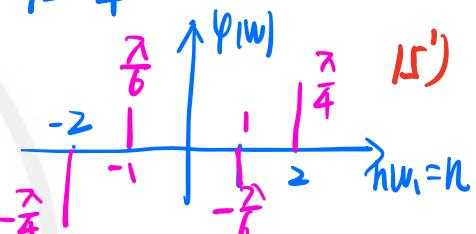

如图 4(a) 所示 LTI 系统，其频率响应 $H(\omega)$ ，如图 4(b) 所示，若系统的激励 $f(t)=$

$\sum_{n = -\infty}^{\infty}\frac{1}{2} e^{jn\frac{\pi}{2}}e^{jn\omega_0t}$ ，其中 $\omega_0 = 3rad / s$ ，求系统的时域响应 $y(t)$ 。(10分)

$$
f (t) = \sum_ {n = - \infty} ^ {\infty} F _ {n} e ^ {j n w _ {0} t}
$$

定义来看

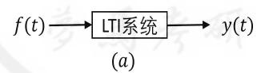

$$
F _ {n} = \frac {1}{2} e ^ {j n \frac {\pi}{2}}
$$

$$
F (w) = 2 \pi \sum_ {n = - w} ^ {w} F _ {n} \delta (w - n w _ {0})
$$

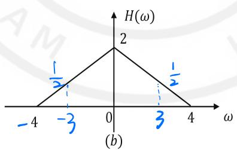

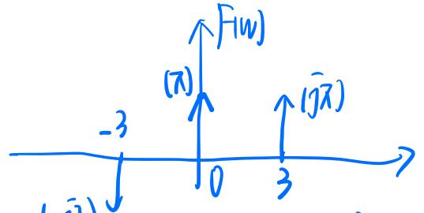  
图4  
叔

$$
n w _ {0} = 3 n
$$

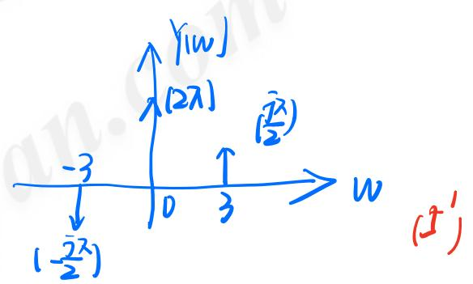  
员关注在一4到4部分

$$
A = 0, \pm 1
$$

$$
(5 ^ {\prime})
$$

$$
y _ {\mathrm{th}} = 1 - \frac {1}{2} \sin 3 t
$$

(5')

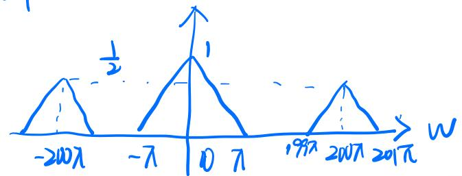

25' 11.【中山大学884】

如图 6 所示系统中, $x(t)$ 为频带有限的实信号, 已知 $x(t)$ 的频谱如图所示, 其中 $\omega_{1} =$

$$
9 9 \pi (r a d / s), \omega_ {2} = 1 0 1 \pi (r a d / s), \omega_ {0} = (\omega_ {1} + \omega_ {2}) / 2 = 1 0 0 \pi (r a d / s), H _ {1} (\omega) =
$$

$G_{2\omega_c}(\omega)$ ，其中， $\omega_{c} = (\omega_{1} - \omega_{2}) / 2 = 1\pi (rad / s)$ ， $p(t) = \sum_{n = -\infty}^{\infty}(-1)^{n}\delta (t - nT)$

注：符号 $G_{\tau}$ 是指宽度为 $\tau$ 的标准门信号。

(1)写出信号 $x(t)$ 的时域表达式；[公粽号：通信考研小马哥]

$$
\begin{array}{r l} & {x _ {s} (t) = x _ {2} (t) \cdot p (t)} \\ {\Rightarrow x _ {s} (w) = \frac {1}{2 \pi} x _ {2} (w) * p (w)} \end{array}
$$

$10^{1}$ (2)画出信号 $x_{s}(t)$ 的频谱图；

$$
\therefore \frac {\uparrow}{- 2 \overline {{1}}} \frac {- \overline {{1}}}{\downarrow} \frac {\uparrow^ {(1)} (t)}{\downarrow} \frac {\uparrow^ {(1)}}{2 \overline {{1}}} > t
$$

无直流.高桥谐

(3)为了从 $x_{s}(t)$ 中恢复 $x(t)$ ，请确定频谱不重叠的条件(即抽样间隔T应满足的条件);

5' (4)如果T=0.1s，设计一个从 $x_{s}(t)$ 中恢复x(t)的系统。 $P_{0}(t)=\sqrt{(t)}-\sqrt{(t-t)}\Rightarrow P_{0}(w)=1-e^{-jw t}$

证：(1) $Sa^{2}(\frac{\pi}{2}t)$ $\rightarrow$

$$
\therefore x (t) = \frac {\sin^ {2} (\frac {\pi}{2} t) \cos (1 0 0 \pi t)}{4 \sin^ {2} (\frac {\pi}{2} t) \cos (1 0 0 \pi t)}
$$

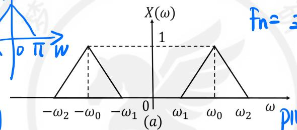

$$
\begin{array}{r l} {f _ {n}} & {= \frac {1}{2 T} P _ {0} (w) / w = n \frac {\pi}{T} = \frac {1}{2 T} [ 1 - e ^ {- j n \pi} ]} \\ & {= \left\{ \begin{array}{l l} {\frac {1}{T}, n = \frac {\pi}{4}} \\ {v, n = i \beta_ {0}} \end{array} \right.} \end{array}
$$

$$
\overrightarrow {p (w)} = 2 \pi \frac {\pi}{n - 2 0} \mathrm{find} (w - n \frac {\pi}{T})
$$

$$
x _ {s} (t) = \frac {2 \pi}{T} \sum_ {n = - \infty} ^ {\infty} \sqrt {(n - n \frac {\pi}{T})}, n = \frac {\pi}{y} \text {   故   }
$$

(2) $\lambda_{2}x_{1}(t)=x(1t)\cos(\omega t)\cos(\omega_{0}t)$

(b) 图6

$$
\frac {\cdots \uparrow}{- \frac {5 \pi}{T}} \frac {\uparrow \uparrow}{- \frac {3 \pi}{T} - \frac {2}{T}} \uparrow \uparrow \frac {P (w)}{0} \frac {\uparrow}{\frac {2}{T}} \frac {\uparrow}{\frac {3 \pi}{T}} \frac {\uparrow}{\frac {5 \pi}{T}} \rightarrow w
$$

$$
\mathrm{则} X _ {1} (w) = \frac {1}{2} [ X (w + w _ {0}) + X _ {1} w - w _ {0} ]
$$

$$
\therefore x _ {s} (w) = \frac {1}{T} \sum_ {n = - w} ^ {w} x _ {2} (w - n \frac {\pi}{T})
$$

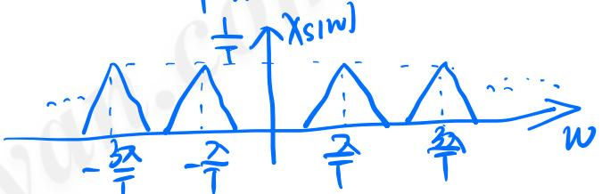

令 ${x}_{2}\left( w\right)  = {x}_{1}\left( w\right)  \cdot  {H}_{1}\left( w\right)$

$$
\begin{array}{r l} {(3)} & {\frac {3 \pi}{T} - \pi \geq \frac {\pi}{T} + \pi \Rightarrow \frac {2 \pi}{T} \geq 2 \pi} \\ & {\Rightarrow T \leq 1 (s)} \end{array}
$$

其中

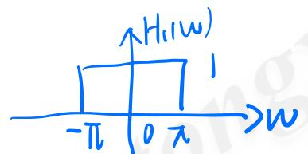

故

(4) $\frac{\pi}{6}T = 0.15$ 则 $\frac{\pi}{T} = 10\pi$ , $x_{s}(w)$ 在 $\pm 10\pi$ . $\pm 30\pi$ . $\pm 50\pi$ . $\pm 70\pi$ . $\pm 90\pi$ . $\pm 110\pi$ . 加在

故 $x_{s}(w)$ 隔去移位后波波

公众号【有涧学社考研】免费分享【武汉理工大学855】

已知 $f_{1}(t)$ 和 $f_{2}(t)$ 的傅里叶变换 $F_{1}(\omega)$ 和 $F_{2}(\omega)$ 如下图所示，现对信号 $f(t)=f_{1}(t)+$

$f_{2}^{2}(t)$ 进行采样，采样周期为 $T_{s}$ ，采样之后信号为 $f_{s}(t)$ 。

(1) $f_{2}^{2}|t| \rightarrow \frac{1}{2\pi} |f_{2}|w| * |f_{2}|w|$

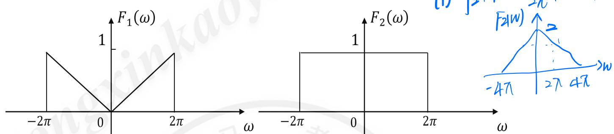

6' (1) 若要从 $f_{s}(t)$ 中恢复出原始信号 $f(t)$ , 试确定最大的采样周期, 并在该取值条件

下求出 $F_{s}(\omega)$ 的表达式和频谱图；

(2) 若 $f_{s}(t)$ 经过下图所示的理想低通滤波器 $H(\omega)$ , 求经过滤波器的输出信号 $y(t)$ 。

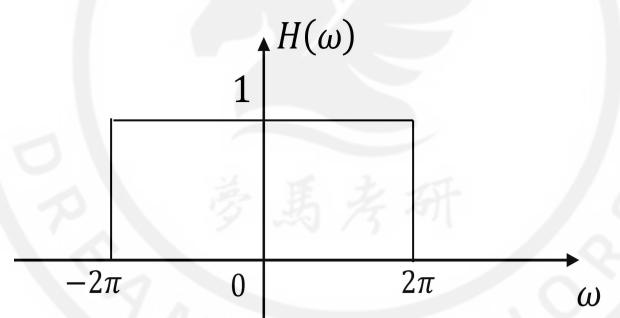

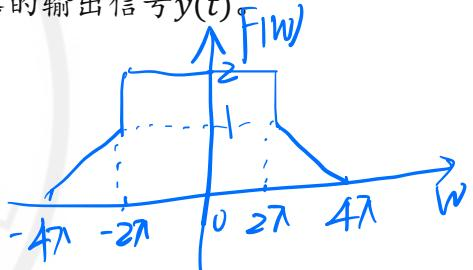

$$
T _ {\max} = \frac {\pi}{W _ {m}} = \frac {1}{4} (s)
$$

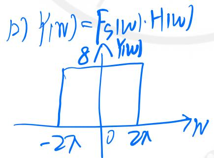

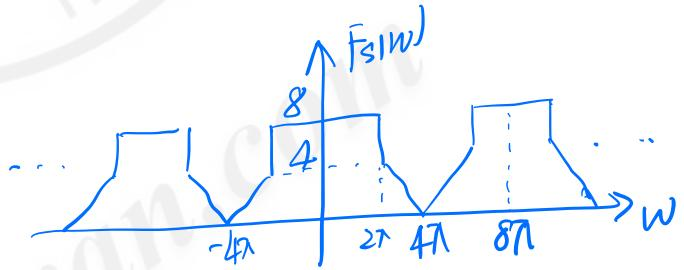

$$
\therefore y _ {1} = 1 6 \text { Sa } (2 \pi t) = 8 \frac {\sin (2 \pi t)}{\pi t}
$$

14、【复旦大学 957】 功率倍数

连续信号 $x(t) = A\cos (Bt + C)$ ，其基波周期为6，傅里叶级数系数 $\alpha$

① $x(t)$ 为实函数；

②对 $|k|>1$ 时， $a_{k}=0;$

③ $a_{1}$ 为正实数；

④ $\frac{1}{6}\int_{-3}^{+3}|x(t)|^{2}dt=3$ 。

试通过上述条件，确定常数 A, B, C。

证：T=6. 则 $W=B=\frac{\pi}{3}$ ，无直流 $F_{0}=0$

全新形式则 $C_{1}=A,\quad\varphi_{1}=C$

$$
P = \frac {1}{6} \int_ {- 3} ^ {+ 3} (x (t) ^ {2}) d t = \sum_ {n = - \infty} ^ {\infty} | F _ {n} | ^ {2} = | F _ {0} | ^ {2} + x F _ {1} | ^ {2} = 3
$$

$$
\begin{array}{r l} {P} & {= \frac {1}{6} \vert - 3 \vert (x (t)) d t - n = - \infty \vert x (t) - n \vert} \\ {\therefore \vert F _ {1} \vert^ {2}} & {= \frac {3}{2} \Rightarrow F _ {1} = \sqrt {\frac {3}{2}} = \frac {\sqrt {6}}{2} \Rightarrow C _ {1} = A = \sqrt {6}} \end{array}
$$

${F}_{1} = 1{F}_{1} / e^{j{P}_{1}}$ 且 ${F}_{1}$ 为正数式

$\therefore \varphi_{1}=c=0$ [2πn·n取整数]

建议完成0