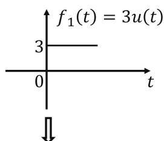
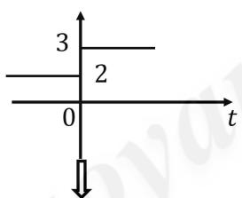
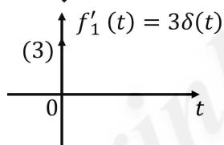
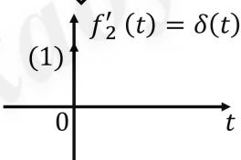

## 第三章 傅里叶变换及其在通信系统中的应用（回顾）

（1）周期信号三角形式的傅里叶级数（一般和余弦）

(2) 周期信号指数形式的傅里叶级数（两种转换）

(3) 非周期信号的傅里叶变换

(4) 傅里叶变换的性质

(5) 周期信号的傅里叶变换

(6) 抽样与恢复

(7) 调制与解调（AM、DSB 和 SSB）

# 第四章 连续时间系统的s域分析

(1) 拉普拉斯的基本定义、常见信号的 LT

(2) 拉氏变换的性质

(3) 拉氏逆变换

(4) 系统函数及其应用

(5) 系统内在特性的判断

(6) 双零法的 LT 求解

(7) 电路系统的 s 域分析（常规与复杂电路）

## 专题1 常见信号的LT

## 考点 1: $FT$ 与 $LT$ 的关系——命题结论

1、从傅里叶变换到拉普拉斯变换

(1)傅里叶变换存在的条件： $f(t)$ 满足绝对可积 $\int_{-\infty}^{\infty}|f(t)|dt<\infty$ 时FT存在。

(2)傅里叶变换到拉氏变换: 不满足绝对可积的信号 $f(t)$ , 乘以一个衰减因子后, 整体满足绝对可积, 即 $\int_{-\infty}^{\infty}|f(t)\cdot e^{-\sigma t}|dt<\infty$ , 求 $f(t)e^{-\sigma t}$ 的 FT

## 2、拉普拉斯变换的定义

令 $s = \sigma + j\omega$ （复频域），则 $F(s) = \int_{-\infty}^{\infty} f(t)e^{-st}dt$

其中 $f(t)$ 称为原函数， $F(s)$ 称为象函数。【双边拉氏变换定义】

由于信号一般都是因果信号， $F(s)=\int_{0-}^{\infty}f(t)e^{-st}dt$ 【单边拉氏变换定义，默认是单边】

## 考点 2：拉氏变换的收敛域(Region of Convergence, ROC)

1、选择合适衰减因子( $\sigma$ )才能使得整体满足绝对可积, 即该条件成为象函数的收敛域ROC

2、以因果信号单边e指数为例, 求 $f(t)=e^{-2t}u(t)$ 的LT

$$
\int_ {- \infty} ^ {\infty} e ^ {- 2 t} u (t) e ^ {- s t} d t = \int_ {0} ^ {\infty} e ^ {- (s + 2) t} d t = - \left. \frac {e ^ {- (s + 2) t}}{s + 2} \right| _ {0} ^ {\infty} = 0 + \frac {1}{s + 2} = \frac {1}{s + 2}
$$

当 $t\to \infty$ 时， $e^{-(s + 2)t} = 0\Rightarrow s + 2 > 0\Rightarrow s > - 2\Rightarrow \sigma > - 2$ 或 $Re[s] > - 2$

3、以反因果信号为例，求 $f(t)=e^{-2t}u(-t)$ 的LT

$$
\int_ {- \infty} ^ {\infty} e ^ {- 2 t} u (- t) \cdot e ^ {- s t} d t = \int_ {- \infty} ^ {0} e ^ {- (s + 2) t} d t = - \frac {e ^ {- (s + 2) t}}{(s + 2)} \int_ {- \infty} ^ {0} = - \frac {1}{s + 2}
$$

当 $t\to\infty$ 时， $e^{-(s+2)t}=0\Rightarrow s+2<0\Rightarrow s<-2\Rightarrow\sigma<-2$ 或 $Re[s]<-2$ 。

4、以双边信号为例，求 $f(t) = e^{-2t}u(t) + e^{3t}u(-t)$ 的LT

$$
\begin{array}{r l} & {\int_ {- \infty} ^ {\infty} [ e ^ {- 2 t} u (t) + e ^ {3 t} u (- t) ] \cdot e ^ {- s t} d t} \\ & {= \int_ {- \infty} ^ {\infty} e ^ {- 2 t} u (t) \cdot e ^ {- s t} d t + \int_ {- \infty} ^ {\infty} e ^ {3 t} u (- t) \cdot e ^ {- s t} d t} \\ & {= \int_ {0} ^ {\infty} e ^ {- (s + 2) t} d t + \int_ {- \infty} ^ {0} e ^ {- (s - 3) t} d t} \\ & {= \frac {e ^ {- (s + 2) t}}{- (s + 2)} \bigg | _ {0} ^ {\infty} + \frac {e ^ {- (s - 3) t}}{- (s - 3)} \bigg | _ {- \infty} ^ {0} = \frac {- 5}{s ^ {2} - s - 6}} \end{array}
$$

当 $t\to\infty$ 时， $e^{-(s+2)t}=0\Rightarrow s+2>0\Rightarrow s>-2\Rightarrow\sigma>-2$ ；

当 $t\to -\infty$ 时， $e^{-(s - 3)t} = 0\Rightarrow s - 3 <   0\Rightarrow s <   3\Rightarrow \sigma <  3$ 。

$\sigma > -2$ 和 $\sigma < 3$ 同时存在，则 $-2 < \sigma < 3$ 。

5、信号 LT 存在的 ROC 规律——结论：针对因果信号，一般。。。。。。

(1) 因果信号: 右边域

(2) 反因果信号: 左边域

(3) 双边信号: 条形域

(4) 有限长信号: 全 s 域 ( 需讨论)

## 考点3：常见信号的单边拉氏变换

1、冲激信号的 LT

$$
\delta (t) \leftrightarrow 1
$$

$$
\int_ {0 _ {-}} ^ {\infty} \delta (t) e ^ {- s t} d t = f (0) = 1
$$

2、冲激偶信号的 LT

$$
\delta^ {\prime} (t) \leftrightarrow s
$$

$$
\int_ {0 _ {-}} ^ {\infty} \delta^ {\prime} (t) e ^ {- s t} d t = - \left[ e ^ {- s t} \right] ^ {\prime} | _ {t = 0} = - \left[ - s e ^ {- s t} \right] _ {t = 0} = s
$$

3、阶跃信号的 LT

$$
u (t) \rightarrow \frac {1}{s}
$$

$$
\int_ {0 _ {-}} ^ {\infty} u (t) e ^ {- s t} d t = \int_ {0} ^ {\infty} e ^ {- s t} d t = \frac {e ^ {- s t}}{- s} \bigg | _ {0} ^ {\infty} = 0 + \frac {1}{s} = \frac {1}{s}, \sigma > 0
$$

4、直流分量的 LT

$$
\begin{array}{c} E \leftrightarrow \frac {E}{s} \\ \int_ {0} ^ {\infty} E \cdot e ^ {- s t} d t = \frac {E}{s} \end{array}
$$

5、单边 $e$ 指数的LT

$$
e ^ {- \alpha t} u (t) \leftrightarrow \frac {1}{s + \alpha}
$$

$$
\int_ {0 _ {-}} ^ {\infty} e ^ {- \alpha t} u (t) e ^ {- s t} d t = \int_ {0} ^ {\infty} e ^ {- (s + \alpha) t} d t = \frac {1}{s + \alpha}, \sigma > - \alpha
$$

学习目的：逆变换 $\rightarrow$ 联想（时域分析时解形式）

## 考点4：LT变换的性质

1、线性——复合信号分解为多个常见信号

例子：

$$
\sin \omega_ {0} t u (t) = \frac {e ^ {j \omega_ {0} t} - e ^ {- j \omega_ {0} t}}{2 j} u (t); \cos \omega_ {0} t u (t) = \frac {e ^ {j \omega_ {0} t} + e ^ {- j \omega_ {0} t}}{2} u (t)
$$

$$
e ^ {j \omega_ {0} t} u (t) \leftrightarrow \frac {1}{s - j \omega_ {0}}; e ^ {- j \omega_ {0} t} u (t) \leftrightarrow \frac {1}{s + j \omega_ {0}}
$$

$$
\frac {1}{2 j} \left[ \frac {1}{s - j \omega_ {0}} - \frac {1}{s + j \omega_ {0}} \right] = \frac {1}{2 j} \left[ \frac {2 j \omega_ {0}}{(s - j \omega_ {0}) (s + j \omega_ {0})} \right] = \frac {\omega_ {0}}{s ^ {2} + \omega_ {0} ^ {2}}
$$

$$
\frac {1}{2} \left[ \frac {1}{s - j \omega_ {0}} + \frac {1}{s + j \omega_ {0}} \right] \frac {1}{2} \left[ \frac {2 s}{(s - j \omega_ {0}) (s + j \omega_ {0})} \right] = \frac {s}{s ^ {2} + \omega_ {0} ^ {2}}
$$

2、尺度变换性质：若 $f(t) \leftrightarrow F(s)$ 则 $f(at) \xleftarrow{a > 0} \frac{1}{a} F\left(\frac{s}{a}\right)$

3、时域移位性质：若 $f(t) \leftrightarrow F(s)$ ，则 $f(t - t_0)u(t - t_0) \leftrightarrow F(s)e^{-st_0}(t_0 > 0)$

4、S域移位性质：若 $f(t) \leftrightarrow F(s)$ ，则 $f(t)e^{-s_{0}t} \leftrightarrow F(s + s_{0})(s_{0}$ 为复常数

【梦马班点拨】一方平移，另一方乘e指数(看到e指数，想到对方平移)；时，不变；不时，则变(符号问题)

例 1: 求 $e^{-2t}u(t-1)$ 的拉普拉斯变换。

【梦马班点拨】时域移位必须前后配对出现，要根据u小括号里的项进行配对

5、时域微分性质：

若 $f(t)\leftrightarrow F(s)$ 则

$$
f ^ {\prime} (t) \leftrightarrow s F (s) - f (0 _ {-})
$$

$$
f ^ {\prime \prime} (t) \leftrightarrow s ^ {2} F (s) - s f (0 _ {-}) - f ^ {\prime} (0 _ {-})
$$

一阶导： $f'(t) \leftrightarrow sF(s) - f(0_{-})$ （s·原函数的 LT - 原函数 0\_ 值）

二阶导：

例 2: 求 $\frac{d}{dt}\left[e^{-t}\sin3tu(t)\right]$ 的拉普拉斯变换。

## 6、时域积分

若 $f(t)\stackrel{LT}{\leftrightarrow}F(s)$ ，则

$$
\int_ {- \infty} ^ {t} f (\tau) d \tau \leftrightarrow \frac {F (s)}{s} + \frac {f ^ {(- 1)} (0 _ {-})}{s}
$$

eg:

$$
f _ {2} (t) = 2 + u (t)
$$

按定义来求 LT:

$$
f _ {1} (t) \overset {L T} {\leftrightarrow} \frac {3}{s}; f _ {2} (t) \overset {L T} {\leftrightarrow} \frac {2}{s} + \frac {1}{s} = \frac {3}{s}
$$

按积分性质求 LT:

$$
3 \delta (t) = f _ {1} ^ {\prime} (t) \stackrel {L T} {\leftrightarrow} 3; \delta (t) = f _ {2} ^ {\prime} (t) \stackrel {L T} {\leftrightarrow} 1
$$

$$
f _ {1} (t) \leftrightarrow \frac {3}{s} + \frac {f (0 _ {-})}{s} = \frac {3}{s}; f _ {2} (t) \leftrightarrow \frac {1}{s} + \frac {f (0 _ {-})}{s} = \frac {3}{s}
$$

例 3：已知因果信号 $f(t)$ 的单边拉氏变换 $F(s)=\frac{1}{s^{2}+s-1}$ ，求下列各信号的单边拉氏变换。

(1) $y(t)=e^{-3t}f(3t)$

$$
(2) y (t) = \frac {d f \left(\frac {1}{3} t - 2\right)}{d t}
$$

$$
(3) y (t) = \int_ {0} ^ {t} f (\tau) e ^ {\tau} d \tau
$$

7、S 域微分性质：若 $f(t) \leftrightarrow F(s)$ ，则 $t^{n}f(t) \leftrightarrow (-1)^{n}\frac{d^{n}F(s)}{ds^{n}}$

8、S域积分性质：若 $f(t)\leftrightarrow F(s)$ ，则 $\frac{f(t)}{t}\leftrightarrow \int_s^\infty F(\eta)d\eta$

## 9、时域卷积定理：

若 $f_{1}(t)\leftrightarrow F_{1}(s),f_{2}(t)\leftrightarrow F_{2}(s)$ ，则 $f_{1}(t)*f_{2}(t)\leftrightarrow F_{1}(s)\cdot F_{2}(s)$ 。

①

$$
\xrightarrow {f (t)} \boxed {\text {系统}} \xrightarrow {y (t)} y (t) = x (t) * h (t)   Y (s) = X (s) H (s)
$$

②有始周期信号

$$
\sum_ {n = 0} ^ {\infty} \delta (t - n T _ {0}) \overset {L T} {\leftrightarrow} \sum_ {n = 0} ^ {\infty} e ^ {- n s T _ {s}} = \frac {1}{1 - e ^ {- s T _ {s}}}
$$

证明：

$$
\delta (t) \leftrightarrow 1
$$

$$
\delta (t - n T _ {s}) \leftrightarrow 1 \cdot e ^ {- s n T _ {s}} \Rightarrow \sum_ {n = 0} ^ {\infty} \delta (t - n T _ {0}) \overset {L T} {\leftrightarrow} \sum_ {n = 0} ^ {\infty} e ^ {- n s T _ {s}} = \frac {1}{1 - e ^ {- s T _ {s}}}
$$

$$
\mathrm{推广} \colon \sum_ {n = 0} ^ {\infty} f _ {0} (t - n T _ {s}) = f _ {0} (t) * \sum_ {n = 0} ^ {\infty} \delta (t - n T _ {s}) {\overset {L T} {\leftrightarrow}} F _ {0} (s) \cdot {\frac {1}{1 - e ^ {s n T _ {s}}}}
$$

例：求 $\frac{1}{1 + e^{-s}}$ 的逆变换

10、频域卷积定理

$$
f _ {1} (t) \cdot f _ {2} (t) \longleftrightarrow \frac {1}{2 \pi j} F _ {1} (s) * F _ {2} (s)
$$

11、初值定理：设 $f(t) \leftrightarrow F(s)$

(1) $F(s)$ 为真分式的情况下，则 $f(0_{+})=\lim_{s\to\infty}sF(s)$

(2) $F(s)$ 为假分式的情况下，则长除法 $F(s)=$ 多项式 $+F_{0}(s)$ (真分式)

$$
f (0 _ {+}) = f _ {0} (0 _ {+}) = \lim _ {s \to \infty} s F _ {0} (s)
$$

说明：

用初值定理 $f(0_{+})=\lim_{s\to\infty}sF(s)$ 求函数的初值，如果 $F(s)$ 是有理代数式，则 $F(s)$ 必须是真分式，即 $F(s)$ 分子的最高次数应低于分母的最高次数。如果 $F(s)$ 不是真分式，则应利用长除法，使 $F(s)$ 中出现真分式项 $F_{0}(s)$ ，而初值 $f(0_{+})$ 等于真分式 $F_{0}(s)$ 之逆变换式 $f_{0}(t)$ 的初值 $f_{0}(0_{+})$ ，即

$$
f (0 _ {+}) = f _ {0} (0 _ {+}) = \lim _ {s \to \infty} s F _ {0} (s)
$$

下面证明上式的正确性。

设对于 $F(s)$ 长除后有

$$
F (s) = K _ {m} s ^ {m} + K _ {m - 1} s ^ {m - 1} + \dots + K _ {0} + F _ {0} (s)
$$

式中， $F_{0}(s)$ 是真分式。对上式取逆变换

$$
f (t) = K _ {m} \delta^ {(m)} (t) + K _ {m - 1} \delta^ {(m - 1)} (t) + \dots + K _ {0} \delta (t) + f _ {0} (t)
$$

其中冲激函数及其各阶导数在 $t = 0_{+}$ 时刻全为零，于是

$$
f (0 _ {+}) = f _ {0} (0 _ {+}) = \lim _ {s \to \infty} s F _ {0} (s)
$$

12、终值定理：关于终值定理，应注意只有在 $f(t)$ 的终值存在的情况下，才能利用式

$$
\lim _ {t \to \infty} f (t) = \lim _ {s \to 0} s F (s)
$$

【梦马班点拨】求 $f(t)$ 的终值。根据 $F(s)$ 的极点与时域的对应关系，如果 $\lim_{t\to\infty}f(t)$ 是一确定的有限值(包括零)，则 $F(s)$ 的极点应全部落在左半s平面或在s=0处只有一阶极点。若 $F(s)$ 的极点不满足该条件，则终值 $\lim_{t\to\infty}f(t)$ 不存在。

例4：求 $F(s) = \frac{3s}{(s + 3)(s + 2)}$ 的初值和终值。

例 5：已知信号的拉氏变换函数如下，求原信号的初值与终值。

$$
(1) F (s) = \frac {s ^ {2} + 2 s + 1}{(s - 1) (s + 2) (s + 3)}
$$

$$
(2) F (s) = \frac {s ^ {3} + s ^ {2} + 2 s + 1}{(s + 1) (s + 2) (s + 3)}
$$

$$
(3) F (s) = \frac {1}{s (s + 1)}
$$

常见信号的拉氏变换结果

<table><tr><td>常见信号表达式</td><td>常见信号的拉氏变换结果</td></tr><tr><td> $\delta(t)$ </td><td>1</td></tr><tr><td> $\delta^{(n)}(t)$ </td><td> $s^n$ </td></tr><tr><td>u(t)</td><td> $\frac{1}{s}$ </td></tr><tr><td>直流分量E</td><td> $\frac{E}{s}$ </td></tr><tr><td> $t^n(n \text{是正整数})$ </td><td> $\frac{n!}{s^{n+1}}$ </td></tr><tr><td>sin ωtu(t)</td><td> $\frac{\omega}{s^2 + \omega^2}$ </td></tr><tr><td>cos ωtu(t)</td><td> $\frac{s}{s^2 + \omega^2}$ </td></tr><tr><td> $Ee^{-\alpha t}u(t)$ </td><td> $\frac{E}{s + \alpha}$ </td></tr><tr><td> $Ete^{-\alpha t}u(t)$ </td><td> $\frac{E}{(s + \alpha)^2}$ </td></tr><tr><td> $Et^2 e^{-\alpha t}u(t)$ </td><td> $\frac{2E}{(s + \alpha)^3}$ </td></tr><tr><td> $\sum_{n=0}^{\infty} \delta(t - nT)$ </td><td> $\frac{1}{1 - e^{-sT}}$ </td></tr><tr><td> $\sum_{n=0}^{\infty} f_0(t - nT)$ </td><td> $\frac{F_0(s)}{1 - e^{-sT}}$ </td></tr></table>

【常见性质一览表】

<table><tr><td>#</td><td>性质名称</td><td>时间函数 $f(t)$ </td><td>复频域函数 $F(s)$ </td></tr><tr><td>1</td><td>线性</td><td> $C_1f_1(t)+C_2f_2(t)$ </td><td> $C_1F_1(s)+C_2F_2(s)$ </td></tr><tr><td>2</td><td>时移</td><td> $f(t-t_0)u(t-t_0), t_0>0$ </td><td> $F(s)e^{-st_0}, t_0>0$ </td></tr><tr><td>3</td><td>尺度变换</td><td> $f(at), a>0$ </td><td> $\frac{1}{a}F\left(\frac{s}{a}\right)$ </td></tr><tr><td>4</td><td>频移</td><td> $f(t)e^{-s_0t}, s_0$ 为复常数</td><td> $F(s+s_0), s_0$ 为复常数</td></tr><tr><td rowspan="2">5</td><td rowspan="2">时间微分</td><td> $\frac{df(t)}{dt}$ </td><td> $sF(s)-f(0_-)$ </td></tr><tr><td> $\frac{df^n(t)}{dt^n}$ </td><td> $s^nF(s)-\sum_{r=0}^{n-1}s^{n-r-1}f^{(r)}(0_-)$ </td></tr><tr><td>6</td><td>时间积分</td><td> $\int_{-\infty}^t f(\tau)d\tau$ </td><td> $\frac{F(s)}{s}+\frac{f^{-1}(0_-)}{s}$ </td></tr><tr><td>7</td><td>时域卷积定理</td><td> $f_1(t)*f_2(t)$ </td><td> $F_1(s)\cdot F_2(s)$ </td></tr><tr><td>8</td><td>复频域卷积定理</td><td> $f_1(t)\cdot f_2(t)$ </td><td> $\frac{1}{2\pi j}F_1(s)*F_2(s)$ </td></tr><tr><td>9</td><td>复频域微分性</td><td> $t^n f(t)$ </td><td> $(-1)^n\frac{d^nF(s)}{ds^n}$ </td></tr><tr><td>10</td><td>复频域积分性</td><td> $\frac{f(t)}{t}$ </td><td> $\int_s^\infty F(\eta)d\eta$ </td></tr><tr><td rowspan="2">11</td><td rowspan="2">初值定理</td><td> $F(s)$ 是真分式</td><td> $\lim_{t\to 0_+}f(t)=f(0_+) = \lim_{s\to \infty}sF(s)$ </td></tr><tr><td> $F(s)$ 是假分式</td><td> $F(s)\xrightarrow{\text{长除法}}$ 多项式+ $F_1(s)$ 真分式 $\lim_{t\to 0_+}f(t)=f(0_+) = \lim_{s\to \infty}sF_1(s)$ </td></tr><tr><td>12</td><td>终值定理</td><td colspan="2"> $f(\infty)=\lim_{s\to 0}sF(s), s=0$ 在收敛域内。即终值存在,才能用终值定理</td></tr></table>