信号与系统核心内容

$\text{作战时期}$ . 非如果稳定

$h(w) \xrightarrow{FT} H(w)$ $f(t) \to \sqrt{H(w)} \to y(t)$ $y(w) = F(w) \cdot H(w)$

$\frac{F(w)=f_{-b}^{\infty}f(t)e^{-jw t}dt}{e^{-x}u(t)}\leq\frac{\sqrt{t}\text{在}\ \frac{f_{-b}^{\infty}f(t)dt<\infty}{\text{条件}}}{\text{不满意论对可交}}\quad?$

## 第三章 傅里叶变换及其在通信系统中的应用（回顾）

(1) 周期信号三角形式的傅里叶级数（一般和余弦）

单独

(2) 周期信号指数形式的傅里叶级数（两种转换）

(3) 非周期信号的傅里叶变换

(4) 傅里叶变换的性质

常见+复杂信息PT

(5) 周期信号的傅里叶变换

即使传后

$f\left( {-{xt} + 5}\right)$

(6) 抽样与恢复

(7) 调制与解调（AM、DSB 和 SSB）

$10^{ \circ }$ 第4章及第2章传分

第四章 连续时间系统的 s 域分析

Laplace

$2^{\circ}$ FI 5 LT 道进给异同

(1) 拉普拉斯的基本定义、常见信号的 LT

(2) 拉氏变换的性质

方程

(3) 拉氏逆变换

(4) 系统函数及其应用

(5) 系统内在特性的判断

(6) 双零法的 LT 求解

(7) 电路系统的 s 域分析（常规与复杂电路）

专题1 常见信号的LT

考点1: $FT$ 与 $LT$ 的关系——命题结论

FT夹CT夹. $\left\{\begin{array}{l} FT\text{不存在} \\ 2T\text{不存在} \end{array}\right.$ PTR一点不存在

1、从傅里叶变换到拉普拉斯变换

$$
s = \underline {{v}} + j \underline {{w}}
$$

$\left\{\begin{array}{l}F(w) \text { 放域 } \\F(s) \text { 放域 } \end{array}\right.$

(1)傅里叶变换存在的条件： $f(t)$ 满足绝对可积 $\int_{-\infty}^{\infty}|f(t)|dt<\infty$ 时FT存在。

(2)傅里叶变换到拉氏变换: 不满足绝对可积的信号 $f(t)$ , 乘以一个衰减因子后,

整体满足绝对可积，即 $\int_{-\infty}^{\infty}|f(t)\cdot e^{-\sigma t}|dt < \infty$ ，求 $f(t)e^{-\sigma t}$ 的FT

2、拉普拉斯变换的定义 $\sqrt{2}s=\sigma+j\omega$

$$
\begin{array}{r l} & {\int_ {- b} ^ {+ \infty} f (t) e ^ {- \sigma t} \cdot e ^ {- j w t} d t} \\ & {= \int_ {- b} ^ {+ \infty} f (t) e ^ {- (j w + \sigma) t} d t} \end{array}
$$

令 $s = \sigma + j\omega$ （复频域），则 $F(s) = \int_{-\infty}^{\infty} f(t)e^{-st}dt$

$$
\int_ {- \infty} ^ {\infty} f (t) e ^ {- s t} d t
$$

其中 $f(t)$ 称为原函数， $F(s)$ 称为象函数。【双边拉氏变换定义】

由于信号一般都是因果信号， $F(s) = \int_{0-}^{\infty} f(t) e^{-st} dt$ 【单边拉氏变换定义，默认是单边】

t=0 时才加入
uHt1 型

$$
F (s) = \int_ {0} ^ {\infty} f (t) e ^ {- s t} d t
$$

$3^{\circ}$ 腈信号的单位与双边形传导相同 $20[S] > -2$

9:

$$
\begin{array}{r l} {2 e [ s ] > - 2} \\ {\frac {\nabla > - 2}{\nabla + j w}} & {> - 2} \end{array}
$$

$$
f (t) = e ^ {- 2 t} u (t) \Rightarrow F (s)
$$

$$
f (s) = \int_ {- b} ^ {w} f (t) e ^ {- s t} d t
$$

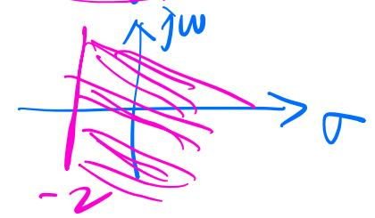

$F(s)$ to be

$$
= f _ {- \infty} ^ {v o} e ^ {- 2 t} u (t) e ^ {- s t} d t
$$

$$
\frac {\nabla > - 2}{-}
$$

$$
= \int_ {0} ^ {\infty} e ^ {- (s + 2) t} d t = - \frac {e ^ {- (s + 2) t}}{s + 2} = \left| _ {0} ^ {\infty} = 0 + \frac {1}{s + 2} = \frac {1}{s + 2} \right.
$$

$$
e ^ {- (s + 2) t} \Rightarrow 0 \Rightarrow s + 2 > 0 \Rightarrow s > - 2
$$

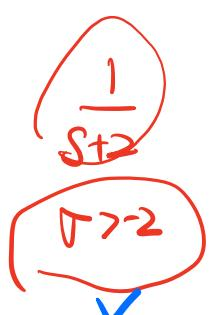

B站up: 信号与系统\_谷哥

因果信号

公众号：通信考研小马哥

双边长

(易loc)

考点2: 拉氏变换的收敛域(Region of Convergence, ROC)

1、选择合适衰减因子 $(\sigma)$ 才能使得整体满足绝对可积，即该条件成为象函数的收敛域ROC

2、以因果信号单边e指数为例, 求 $f(t)=e^{-2t}u(t)$ 的LT

$$
\int_ {- \infty} ^ {\infty} e ^ {- 2 t} u (t) e ^ {- s t} d t = \int_ {0} ^ {\infty} e ^ {- (s + 2) t} d t = - \left. \frac {e ^ {- (s + 2) t}}{s + 2} \right| _ {0} ^ {\infty} = 0 + \frac {1}{s + 2} = \frac {1}{s + 2}
$$

$$
e ^ {- (s + 2) t} = 0 \Rightarrow s + 2 > 0 \Rightarrow s > - 2 \Rightarrow \sigma > - 2
$$

$$
R e [ s ] > - 2
$$

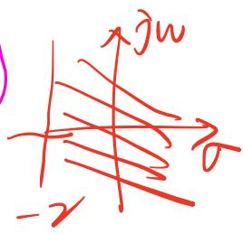

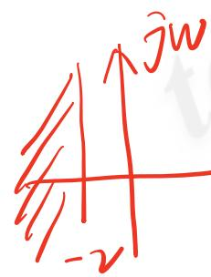

3、以反因果信号为例, 求 $f(t) = e^{-2t} u(-t)$ 的 $LT$

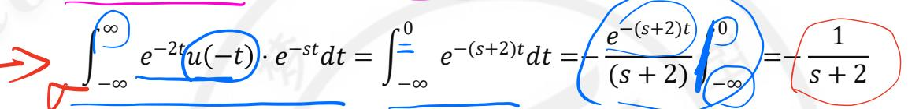

当 $t\to\infty$ 时， $e^{-(s+2)t}=0\Rightarrow s+2<0\Rightarrow s<-2\Rightarrow\sigma<-2$ 或 Re[s]<-2。

4、以双边信号为例，求 $f(t) = e^{-2t}u(t) + e^{3t}u(-t)$ 的LT

A个
B个
A和B个

$$
\begin{array}{r l} & {\int_ {- \infty} ^ {\infty} [ e ^ {- 2 t} u (t) + e ^ {3 t} u (- t) ] \cdot e ^ {- s t} d t} \\ & {= \overline {{\int_ {- \infty} ^ {\infty}}} e ^ {- 2 t} u (t) \cdot e ^ {- s t} d t + \overline {{\int_ {- \infty} ^ {\infty}}} e ^ {3 t} u (- t) \cdot e ^ {- s t} d t} \\ & {= \overline {{\int_ {0} ^ {\infty}}} e ^ {- (s + 2) t} d t + \overline {{\int_ {- \infty} ^ {0}}} e ^ {- (s - 3) t} d t} \\ & {= \frac {e ^ {- (s + 2) t}}{- (s + 2)} \bigg | _ {0} ^ {\infty} + \frac {e ^ {- (s - 3) t}}{- (s - 3)} \bigg | _ {- \infty} ^ {0} = \frac {- 5}{s ^ {2} - s - 6}} \end{array}
$$

$$
- 2 <   \sqrt {3}
$$

当 $t\to \infty$ 时， $e^{-(s + 2)t} = 0\Rightarrow s + 2 > 0\Rightarrow s > - 2\Rightarrow \sigma > - 2$ 当 $t\rightarrow -\infty$ 时， $e^{-(s - 3)t} = 0\Rightarrow s - 3 <   0\Rightarrow s <   3\Rightarrow \sigma <  3$ 。

$\sigma > -2$ 和 $\sigma < 3$ 同时存在，则 $-2 < \sigma < 3$ 。

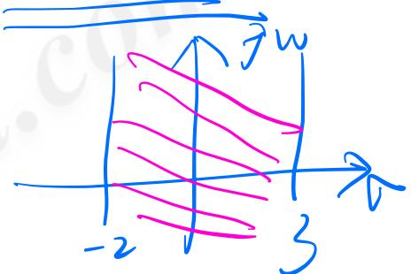

5、信号 LT 存在的 ROC 规律——结论：针对因果信号，一般。。。。。。

(1) 因果信号: 右边域

(2) 反因果信号: 左边域

(3) 双边信号: 条形域

(4) 有限长信号

官网：tongxi nkaoyan. con

B站up: 信号与系统\_谷哥

## 考点3：常见信号的单边拉氏变换

1、冲激信号的 LT

$$
\delta (t) \leftrightarrow 1
$$

$$
\operatorname{d} t a c \stackrel {F I} {\rightarrow} 1
$$

$$
\int_ {0 _ {-}} ^ {\infty} \underline {{\delta (t) e ^ {- s t}}} d t = f (0) = 1
$$

2 冲激偶信号的 LT

$$
\delta^ {\prime} (t) \leftrightarrow s
$$

$$
\sigma^ {\prime} (t) \leftrightarrow j w
$$

$$
\int_ {0 _ {-}} ^ {\infty} \delta^ {\prime} (t) e ^ {- s t} d t = - \left[ e ^ {- s t} \right] ^ {\prime} | _ {t = 0} = - \left[ - s e ^ {- s t} \right] _ {t = 0} = \boxed {s}
$$

3、阶跃信号的 LT

$$
u + t _ {1} \rightarrow \pi d i w _ {1} + j \frac {1}{w}
$$

$$
u (t) \rightarrow \frac {1}{s}
$$

$$
\int_ {0 _ {-}} ^ {\infty} u (t) e ^ {- s t} d t = \left(\int_ {0} ^ {\infty}\right) e ^ {- s t} d t = \frac {e ^ {- s t}}{- s} \bigg | _ {0} ^ {\infty} = 0 + \frac {1}{s} = \frac {1}{s}, \sigma > 0
$$

4、直流分量的LT

$$
E \leftrightarrow \frac {E}{s}
$$

单灯 $\frac{1}{s}$

$$
\int_ {0} ^ {\infty} E \cdot e ^ {- s t} d t = \left(\frac {E}{s}\right)
$$

单边e指数的 LT

$$
e ^ {- \alpha t} u (t) \leftrightarrow \frac {1}{s + \alpha}
$$

$$
e ^ {- v _ {u + e _ {1}} ^ {t} \rightarrow \frac {1}{s + 2}}
$$

$$
\int_ {0 _ {-}} ^ {\infty} e ^ {- \alpha t} u (t) e ^ {- s t} d t = \int_ {0} ^ {\infty} e ^ {- (s + \alpha) t} d t = \frac {1}{s + \alpha}, \sigma > - \alpha
$$

学习目的：逆变换→联想（时域分析时解形式）

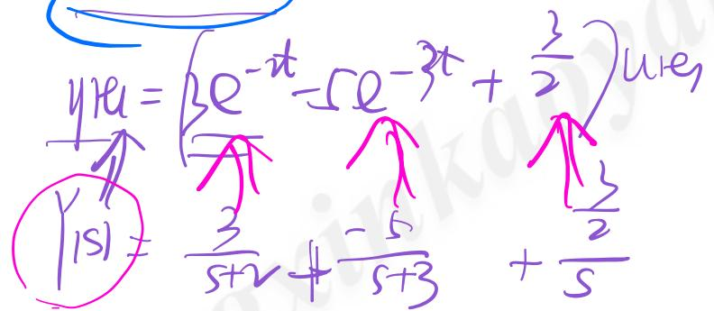

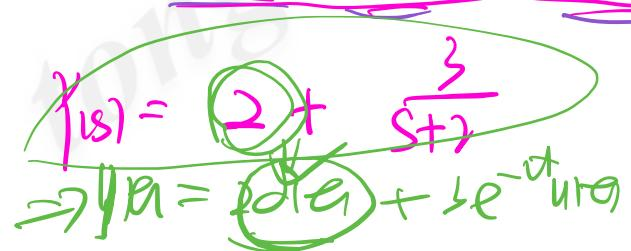

B站up: 信号与系统\_谷哥

10 补充信号<1>

公众号：通信考研小马哥

考点4: LT变换的性质 $2^{\circ}$ 相质+性质

1、线性——复合信号分解为多个常见信号例子：

$$
\begin{array}{l} {6 \quad \frac {\sin w _ {0} u (t)}{=} \leftrightarrow \frac {w _ {0}}{s ^ {2} + w _ {0} ^ {2}}} \\ {7 \quad \cos w _ {0} u (t) \leftrightarrow \frac {s}{s ^ {2} + w _ {0} ^ {2}}} \end{array}
$$

$$
<   - 2 \frac {1}{s + 2}
$$

$$
\cos \omega_ {0} t u (t) = \frac {e ^ {j \omega_ {0} t} + e ^ {- j \omega_ {0} t}}{2}
$$

$$
e ^ {j \omega_ {0} t} u (t) \leftrightarrow \frac {1}{s - j \omega_ {0}}; e ^ {- j \omega_ {0} t} u (t) \leftrightarrow \frac {1}{s + j \omega_ {0}}
$$

$$
\frac {1}{2 j} \left[ \frac {1}{s - j \omega_ {0}} - \frac {1}{s + j \omega_ {0}} \right] = \frac {1}{2 j} \left[ \frac {2 j \omega_ {0}}{(s - j \omega_ {0}) (s + j \omega_ {0})} \right] = \frac {\omega_ {0}}{s ^ {2} + \omega_ {0} ^ {2}}
$$

$$
{\frac {1}{2}} \left[ {\frac {1}{s - j \omega_ {0}}} + {\frac {1}{s + j \omega_ {0}}} \right] {\frac {1}{2}} \left[ {\frac {2 s}{(s - j \omega_ {0}) (s + j \omega_ {0})}} \right] = {\frac {s}{s ^ {2} + \omega_ {0} ^ {2}}}
$$

2、尺度变换性质：若 $f(t) \leftrightarrow F(s)$ 则 $f(at) \xleftarrow{a>0} \frac{1}{a} F\left(\frac{s}{a}\right)$

$$
f (a t) \xrightarrow {a \text {正负}} \frac {1}{| a |} f (\frac {w}{a})
$$

華①

3、时域移位性质：若 $f(t) \leftrightarrow F(s)$ ，则 $f(t - t_0)u(t - t_0) \leftrightarrow F(s)e^{-st_0}(t_0 > 0)$

$f\left( {t - 1}\right) u\left( {t - 1}\right)$

4、S域移位性质：若 $f(t) \leftrightarrow F(s)$ ，则 $f(t)e^{-s_{0}t} \leftrightarrow F(s + s_{0})(s_{0}$ 为复常数

$f(x) \rightarrow f(s)$ $f(t)e^{-x} \hookrightarrow F(s+x)$

【梦马班点拨】一方平移，另一方乘e指数(看到e指数，想到对方平移)；时，不变；不时，则变(符号问题)

$$
\rightarrow e ^ {- 2} \cdot e ^ {- 2 (t - 1)} u (t - 1)
$$

例 1: 求 $e^{-2t}u(t-1)$ 的拉普拉斯变换。

$$
\begin{array}{r l}{e ^ {- 2 t} u (t)}&{\rightarrow \frac {1}{s + 2}}\\{\downarrow^ {t / f}}&{\quad \frac {1}{s + 2} e ^ {- s}}\\{e ^ {- 2 (t - 1)} u (t - 1)}&{\quad \downarrow}\\&{\quad e ^ {- 2}}\end{array}
$$

【梦马班点拨】时域移位必须前后配对出现，要根据 $u$ 小括号里的项进行配对

B站up: 信号与系统\_谷哥

公众号：通信考研小马哥

已知 $y^{i}t_{1}+2y^{i}t_{1}=f^{i}(t)$ $y^{i}t_{1}+3y^{i}t_{1}+2y^{i}t_{1}=f^{i}(t)+3f^{i}(t)$

5、时域微分性质：

$$
\begin{array}{l}{f + a \rightarrow F (w)}\\{f ^ {\prime \prime m} (t) \mapsto (j ^ {n}) ^ {n} F (w)}\end{array}
$$

若 $f(t)\leftrightarrow F(s)$ 则

$$
\begin{array}{r l} {f ^ {\prime \prime} (t)} & {\to s ^ {3} F (s) - s ^ {2} f (u -) - s f ^ {\prime} (u -) - f ^ {\prime \prime} (u -)} \\ & {\qquad f ^ {\prime} (t) \leftrightarrow s F (s) - f (0 _ {-})} \\ & {\qquad f ^ {\prime \prime} (t) \leftrightarrow s ^ {2} F (s) - s f (0 _ {-}) - f ^ {\prime} (0 _ {-})} \end{array}
$$

$$
f (t) \rightarrow S \cdot F (s) - f (0)
$$

一阶导: $f'(t) \leftrightarrow sF(s) - f(0_-)$ (s·原函数的 LT - 原函数 0\_值)
二阶导: $f'(t) \rightarrow S[sF(s) - f(0-1)] - f'(0-) = S^2F(s) - Sf(0-1) - f'(0-)$

例2: 求 $\frac{d}{dt} [e^{-t} \sin 3tu(t)]$ 的拉普拉斯变换。

多貧法

sin3t u(t)

$$
\leftrightarrow \frac {3}{s ^ {2} + 9}
$$

s程

$$
\frac {3}{(s + 1) ^ {2} + 9}
$$

$$
s f (s) - f (v)
$$

$$
\frac {d}{d t}
$$

$$
\frac {3 s}{(s + 1) ^ {2} + 9}
$$

6、时域积分

若 $f(t)\stackrel {LT}{\leftrightarrow}F(s)$ ，则

$$
\int_ {- \infty} ^ {t} f (\tau) d \tau \leftrightarrow \frac {F (s)}{s} + \frac {f ^ {(- 1)} (0 _ {-})}{s}
$$

eg:

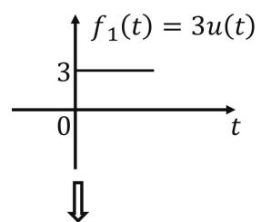

$$
f _ {2} (t) = 2 + u (t)
$$

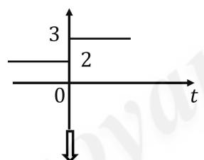

$$
f _ {1} ^ {\prime} (t) = 3 \delta (t)
$$

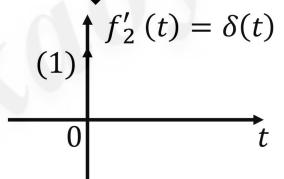

按定义来求 LT:

$$
f _ {1} (t) \overset {L T} {\leftrightarrow} \frac {3}{s}; f _ {2} (t) \overset {L T} {\leftrightarrow} \frac {2}{s} + \frac {1}{s} = \frac {3}{s}
$$

按积分性质求 LT:

$$
3 \delta (t) = f _ {1} ^ {\prime} (t) {\overset {L T} {\leftrightarrow}} 3; \delta (t) = f _ {2} ^ {\prime} (t) {\overset {L T} {\leftrightarrow}} 1
$$

$$
f _ {1} (t) \leftrightarrow \frac {3}{s} + \frac {f (0 _ {-})}{s} = \frac {3}{s}; f _ {2} (t) \leftrightarrow \frac {1}{s} + \frac {f (0 _ {-})}{s} = \frac {3}{s}
$$

例3: 已知因果信号 $f(t)$ 的单边拉氏变换 $F(s)=\frac{1}{s^{2}+s-1}$ ，求下列各信号的单边拉氏变换：

$$
(1) y (t) = e ^ {- 3 t} f (3 t)
$$

$$
\begin{array}{l} (2) y (t) = \frac {d f \left(\frac {1}{3} t - 2\right)}{d t} \\ (3) y (t) = \int_ {0} ^ {t} f (\tau) e ^ {\tau} d \tau \end{array}
$$

$$
\begin{array}{l}f | t | \rightarrow f _ {| 3 + 1}\\\downarrow\\F (s)\end{array}\quad\begin{array}{l}\frac {1}{2} F (\frac {s}{3})\end{array}
$$

$$
\Rightarrow e ^ {- 3 t} f (3 t) \frac {1}{3} F (\frac {5 + 3}{3})
$$

$$
\frac {1}{3} \frac {1}{(\frac {5 + 3}{3}) ^ {2} + \frac {5 + 3}{3} - 1}
$$

$$
\begin{array}{l}{f (t)}\\{+}\\{F (s)}\end{array}\rightarrow\begin{array}{l}{f (t) e ^ {t}}\\{+}\\{F (s - 1)}\end{array}\rightarrow\begin{array}{l}{\int_ {0} ^ {t} f (t) e ^ {t} d t}\\{\frac {F (s - 1)}{s}}\end{array}
$$

7、S域微分性质：若 $f(t) \leftrightarrow F(s)$ ，则 $t^n f(t) \leftrightarrow (-1)^n \frac{d^n F(s)}{ds^n}$

8、S域积分性质：若 $f(t) \leftrightarrow F(s)$ ，则 $\frac{f(t)}{t} \leftrightarrow \int_{s}^{\infty} F(\eta) d\eta$

$$
\begin{array}{l} \frac {t ^ {n} f (t) \quad \stackrel {F} {\leftarrow} \quad j ^ {n} \frac {d F (w)}{d w ^ {n}}}{t ^ {n} f (t) \quad \stackrel {I} {\leftarrow} \quad (-) ^ {n} \frac {d F (s)}{d s ^ {n}}} \end{array}
$$

9、时域卷积定理：

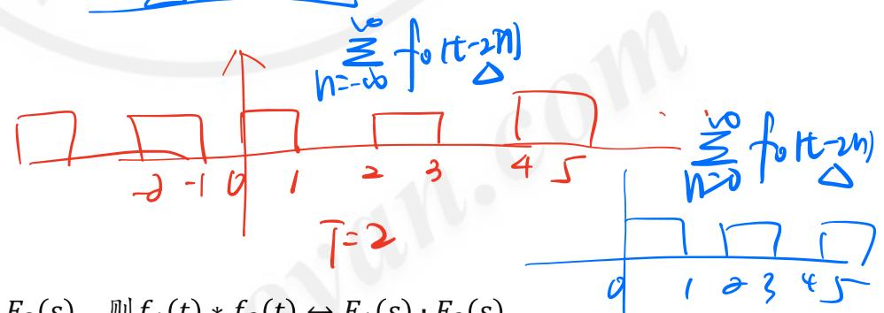

若 ${f}_{1}\left( t\right)  \leftrightarrow  {F}_{1}\left( s\right)$ , ${f}_{2}\left( t\right)  \leftrightarrow  {F}_{2}\left( s\right)$ ,则 ${f}_{1}\left( t\right)  * {f}_{2}\left( t\right)  \leftrightarrow  {F}_{1}\left( s\right)  \cdot  {F}_{2}\left( s\right)$ 。

$n = -\infty$ 时 $f(t) * \sum_{n=-\infty}^{\infty} \delta(t-nT_0)$ ①

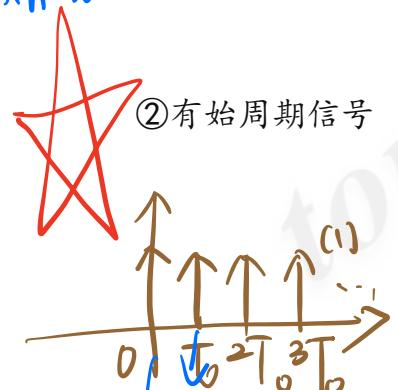

$$
f (t) \xrightarrow {} \text {系统} \xrightarrow {} y (t) \frac {y (t) = x (t) * h (t)}{Y (s) = X (s) H (s)} \xrightarrow {\frac {v}{h}} y (t)
$$

$$
\sum_ {n = 0} ^ {\infty} \delta (t - n T _ {0}) \stackrel {L T} {\leftrightarrow} \sum_ {n = 0} ^ {\infty} \frac {e ^ {- s T _ {0}}}{e ^ {- n s T _ {0}}} = \frac {1}{(1 - e ^ {- s T _ {0}})}
$$

$$
\begin{array}{c} \delta (t) + \delta (t - T _ {0}) + \delta (t - 2 T _ {0}) + \dots \\ \downarrow \quad \downarrow \quad \downarrow \\ 1 \cdot e ^ {- s T _ {0}} \cdot e ^ {- s \cdot 2 T _ {0}} \end{array}
$$

比数列 $\sum_{n=0}^{\infty} g^{n}$ 梦马班讲义

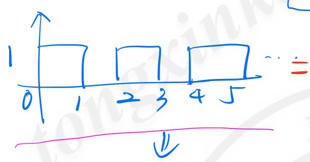

B站up: 信号与系统\_谷哥

② $\mathop{\sum }\limits_{{n = 0}}^{\infty }\delta \left  {\left( {t - {2n}}\right)  \rightarrow  \frac{2}{1 - {e}^{-{2n}}}\text{公众号：通信考研小马哥}$

证明：

$$
\delta (t) \leftrightarrow 1
$$

$$
\delta (t - n T _ {s}) \leftrightarrow 1 \cdot e ^ {- s n T _ {s}} \Rightarrow \sum_ {n = 0} ^ {\infty} \delta (t - n T _ {0}) \overset {L T} {\leftrightarrow} \sum_ {n = 0} ^ {\infty} e ^ {- n s T _ {s}} = \frac {1}{1 - e ^ {- s T _ {s}}}
$$

推广： $\sum_{n = 0}^{\infty}f_0(t - nT_s) = f_0(t)*\sum_{n = 0}^{\infty}\delta (t - nT_s)\overset {LT}{\leftrightarrow}F_0(s)\cdot \frac{1}{1 - e^{s\lambda Ts}}$

设 $f_{0}(s)=\frac{1}{s}(1-e^{-s})$ $f_{1}(s)=\frac{1}{1-e^{-2s}}$

$$
\frac {1}{1 - e ^ {- 2 s}}
$$

老头题：

$$
\begin{array}{r l} {\mathrm{则}} & {f _ {0} (t) = \frac {u (t) - u (t - 1)}{\infty}} \\ & {f _ {1} (t) = \sum_ {n = 0} ^ {\infty} \delta (t - 2 n)} \\ & {f _ {1} (t) = f _ {0} (n) * f _ {1} (t) = 1.} \end{array}
$$

$\frac{1}{1-e^{-st}}$ 等式
分子共轭数式

老知plus

$$
\frac {1 - e ^ {- s}}{(1 + e ^ {- s}) (1 - e ^ {- s})} = \frac {1 - e ^ {- s}}{1 - e ^ {- x}}
$$

$$
(a - b) (a + b) = a ^ {2} - b ^ {2}
$$

$$
\begin{array}{r l} {F _ {0} (s)} & {= 1 - e ^ {- s} \Rightarrow f _ {0} (t) = \sqrt {(t - 2 n)} - d (t - 1)} \\ {F _ {1} (s)} & {= \frac {1}{1 - e ^ {- 2 s}}} \\ & {\Rightarrow f _ {1} (t) = \sum_ {n = 0} ^ {\infty} \delta (t - 2 n)} \end{array}
$$

$\Rightarrow  {f}_{\left| t\right| } = {f}_{0}\left| t\right|  \times  {f}_{1}\left| t\right|$

$$
= \sum_ {n = 0} ^ {1 0} f _ {0} (t - 2 n)
$$

10、频域卷积定理

$$
f _ {1} (t) \cdot f _ {2} (t) \leftrightarrow \frac {1}{2 \pi j} F _ {1} (s) * F _ {2} (s)
$$

11、初值定理：设 $f(t) \leftrightarrow F(s)$

(1) $F(s)$ 为真分式的情况下，则 $f(0_{+})=\limsup_{s\to\infty}sF(s)$

(2) $F(s)$ 为假分式的情况下，则长除法 $F(s)=$ 多项式 $+F_{0}(s)$ (真分式)

$$
f (0 _ {+}) = f _ {0} (0 _ {+}) = \lim _ {s \to \infty} s F _ {0} (s)
$$

说明：

用初值定理 $f(0_{+})=\lim _{s\to\infty}sF(s)$ 求函数的初值，如果 $F(s)$ 是有理代数式，则 $F(s)$ 必须是真分式，即 $F(s)$ 分子的最高次数应低于分母的最高次数。如果 $F(s)$ 不是真分式，则应利用长除法，使 $F(s)$ 中出现真分式项 $F_{0}(s)$ ，而初值 $f(0_{+})$ 等于真分式 $F_{0}(s)$ 之逆变换式 $f_{0}(t)$ 的初值 $f_{0}(0_{+})$ ，即

$$
f (0 _ {+}) = f _ {0} (0 _ {+}) = \lim _ {s \to \infty} F _ {0} (s)
$$

下面证明上式的正确性。

设对于 $F(s)$ 长除后有

$$
F (s) = \sqrt {K _ {m} s ^ {m} + K _ {m - 1} s ^ {m - 1} + \cdots + K _ {0}} + F _ {0} (s)
$$

式中， $F_{0}(s)$ 是真分式。对上式取逆变换

$$
f (t) = K _ {m} \delta^ {(m)} (t) + K _ {m - 1} \delta^ {(m - 1)} (t) + \dots + K _ {0} \delta (t) + f _ {0} (t), \quad \text {Was} s F o (s)
$$

其中冲激函数及其各阶导数在 $t = 0_{+}$ 时刻全为零，于是

$$
f (0 _ {+}) = f _ {0} (0 _ {+}) = \lim _ {s \rightarrow \infty} s F _ {0} (s)
$$

B站up: 信号与系统\_谷哥

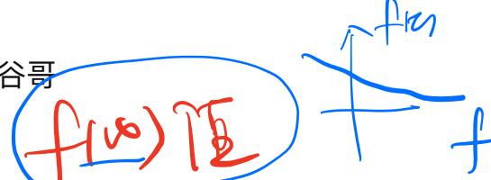

公众号：通信考研小马哥

12、终值定理：关于终值定理，应注意只有在 $f(t)$ 的终值存在的情况下，才能利用式

$$
\lim _ {t \to \infty} f (t) = \lim _ {s \to 0} s F (s)
$$

【梦马班点拨】求 $f(t)$ 的终值。根据 $F(s)$ 的极点与时域的对应关系, 如果 $\lim_{t\to\infty}f(t)$ 是一确定的有限值(包括零), 则 $F(s)$ 的极点应全部落在左半s平面或在s=0处只有一阶极点。若 $F(s)$ 的极点不满足该条件, 则终值 $\lim_{t\to\infty}f(t)$ 不存在。

例 4: 求 $F(s)=\frac{3s}{(s+3)(s+2)}$ 的初值和终值。

无问值

$$
\begin{array}{r l} {f (u +)} & {= \lim _ {s \to \infty} s F (s) = 3} \\ {f (w)} & {= \lim _ {s \to 0} s F (s) = 0 \frac {3 s ^ {2}}{(s + 3) (s + w)}} \end{array}
$$

例5：已知信号的拉氏变换函数如下，求原信号的初值与终值。

貞獻

$$
(1) F (s) = \frac {s ^ {2} + 2 s + 1}{(s - 1) (s + 2) (s + 3)}
$$

$$
f (0 + 1) = 1 \sqrt {\frac {A _ {0}}{S} x _ {0} S F (s)}
$$

$$
f (w) = \frac {v}{\leq 0} \frac {S (S ^ {2} + w + 1)}{(s - 1) (s + 2) (s + 3)} \times 0
$$

$$
(2) F (s) = \frac {s ^ {3} + s ^ {2} + 2 s + 1}{(s + 1) (s + 2) (s + 3)}
$$

不在 $f\left( 0\right)$

$$
(k _ {1} + k _ {2} e ^ {- t}) u (x)
$$

道

$$
(3) F (s) = \frac {1}{s (s + 1)}
$$

$$
f (0 + 1) = \lim _ {s \to \infty} s f (s) = \lim _ {s \to \infty} \frac {1}{s + 1} = 0
$$

$$
\frac {k _ {1}}{s - 1} + \frac {k _ {2}}{s + 2} + \frac {k _ {3}}{s + 3}
$$

$$
f (u) = \lim _ {s \to 0} s F (s) = \lim _ {s \to 0} \frac {1}{s + 1} = 1
$$

$$
F _ {0} (s) \lim _ {s \to \infty} s F _ {0} (s) = - 5
$$

$$
(2) f (w) = \lim _ {s \to 0} s F (s) = \frac {s}{1}
$$

$$
S ^ {2} (S + 1)
$$

$$
\frac {\frac {1}{s ^ {2}}}{t u r e} \quad \begin{array}{l l} & \overline {{s + 1}} \\ & e ^ {- t u r e} \end{array}
$$

占安损

$$
\Rightarrow f (t) = \frac {\sqrt {t}}{2}
$$

$$
f (0 + 1) = \left[ \frac {\partial i + 1}{\underline {{\underline {{\partial}}}}} - e ^ {- t} \underline {{\underline {{u + t}}}} \right] / t = 0 +
$$

$$
\frac {s ^ {2}}{s + 1} = \frac {(s + 1) ^ {2} - 2 s - 1}{s + 1} = \frac {(s + 1) ^ {2} - 2 (s + 1) + 2}{s + 1}
$$

常见信号的拉氏变换结果

<table><tr><td colspan="2">常见信号表达式</td><td>常见信号的拉氏变换结果</td></tr><tr><td></td><td> $\delta(t)$ </td><td>1 √</td></tr><tr><td></td><td> $\delta^{(n)}(t)$ </td><td> $s^n$  √</td></tr><tr><td></td><td>u(t)</td><td> $\frac{1}{s}$  √</td></tr><tr><td></td><td>直流分量E</td><td> $\frac{E}{s}$  √</td></tr><tr><td> $t^n \to$  $t \to$ </td><td> $t^n(n \text{是正整数})$ </td><td>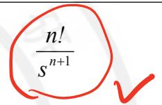</td></tr><tr><td></td><td> $\sin \omega tu(t)$ </td><td> $\frac{\omega}{s^2 + \omega^2}$ </td></tr><tr><td></td><td> $\cos \omega tu(t)$ </td><td> $\frac{s}{s^2 + \omega^2}$  √</td></tr><tr><td></td><td> $Ee^{-\alpha t}u(t)$ </td><td>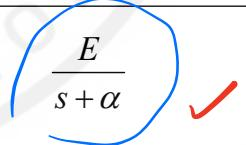</td></tr><tr><td></td><td> $t \Leftrightarrow \frac{1}{s^2}$  $t e^{-\alpha t} \Leftrightarrow \frac{1}{(s+1)^2}$ </td><td></td></tr><tr><td></td><td> $t^2 \Leftrightarrow \frac{2}{s^3}$  $e^{-\alpha t}$   $Et^2 e^{-\alpha t}u(t)$   $\frac{2}{(s+1)^3}$ </td><td> $\frac{2E}{(s+\alpha)^3}$  =  $\frac{1}{(s+1)^2}$ </td></tr><tr><td></td><td> $\sum_{n=0}^{\infty} \delta(t-nT)$ </td><td> $\frac{1}{1-e^{-sT}}$  √</td></tr><tr><td></td><td> $\sum_{n=0}^{\infty} f_0(t-nT)$ </td><td> $\frac{F_0(s)}{1-e^{-sT}}$  √</td></tr></table>

【常见性质一览表】

<table><tr><td>#</td><td>性质名称</td><td>时间函数 $f(t)$ </td><td>复频域函数 $F(s)$ </td></tr><tr><td>1</td><td>线性</td><td> $C_1f_1(t)+C_2f_2(t)$ </td><td> $C_1F_1(s)+C_2F_2(s)$ </td></tr><tr><td>2</td><td>时移</td><td> $f(t-t_0)u(t-t_0), t_0>0$ </td><td> $F(s)e^{-st_0}, t_0>0$ </td></tr><tr><td>3</td><td>尺度变换</td><td> $f(at), a>0$ </td><td> $\frac{1}{a}F\left(\frac{s}{a}\right)$ </td></tr><tr><td>4</td><td>频移</td><td> $f(t)e^{-s_0t}, s_0$ 为复常数</td><td> $F(s+s_0), s_0$ 为复常数</td></tr><tr><td rowspan="2">5</td><td rowspan="2">时间微分</td><td> $\frac{df(t)}{dt}$ </td><td> $sF(s)-f(0-)$ </td></tr><tr><td> $\frac{df^n(t)}{dt^n}$ </td><td>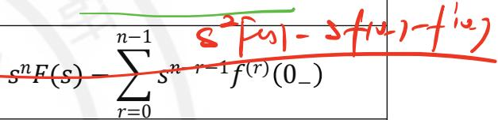</td></tr><tr><td>6</td><td>时间积分</td><td> $\int_{-\infty}^t f(\tau)d\tau$ </td><td> $\frac{F(s)}{s}+\frac{f^{-1}(0-)}{s}$ </td></tr><tr><td>7</td><td>时域卷积定理</td><td> $f_1(t)*f_2(t)$ </td><td> $F_1(s)\cdot F_2(s)$ </td></tr><tr><td>8</td><td>复频域卷积定理</td><td> $f_1(t)\cdot f_2(t)$ </td><td> $\frac{1}{2\pi j}F_1(s)*F_2(s)$ </td></tr><tr><td>9</td><td>复频域微分性</td><td> $t^n f(t)$ </td><td> $(-1)^n\frac{d^nF(s)}{ds^n}$ </td></tr><tr><td>10</td><td>复频域积分性</td><td> $\frac{f(t)}{t}$ </td><td> $\int_s^\infty F(\eta)d\eta$ </td></tr><tr><td rowspan="2">11</td><td rowspan="2">初值定理</td><td> $F(s)$ 是真分式</td><td> $\lim_{t\to 0+}f(t)=f(0_+)=\lim_{s\to\infty}sF(s)$ </td></tr><tr><td> $F(s)$ 是假分式</td><td> $F(s)\xrightarrow{\text{长除法}}$ 多项式+ $F_1(s)$ 真分式 $\lim_{t\to 0+}f(t)=f(0_+)=\lim_{s\to\infty}sF_1(s)$ </td></tr><tr><td>12</td><td>终值定理</td><td colspan="2"> $f(\infty)=\lim_{s\to 0}\frac{sF(s)}{s}=0$ 在收敛域内。即终值存在,才能用终值定理</td></tr></table>

下一节课 内容.

$\frac{1}{s(s+1)(s+2)(s+3)(s+4)} = \frac{k_1}{s} + \frac{k_2}{s+1}$ $\text{宽度换} y_{(s)} \xrightarrow{\frac{1}{4}} y_{(t+1)} \xrightarrow{\text{常见结论}} \frac{\text{多个常见的} < T^2 \text{和}}{\text{true} (-) s^{\frac{1}{2}}}$