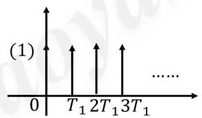
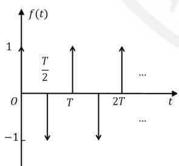
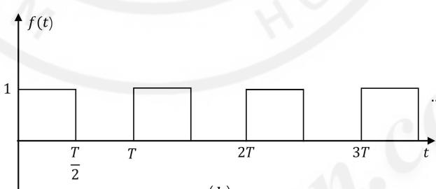

## 专题2 拉氏逆变换

$F(s)=\frac{\text{分子关于}s\text{多项式}}{\text{分母关于}s\text{多项式}}=\frac{A(s)}{B(s)},\quad A(s)=0\text{的点称为}F(s)\text{的零点},\quad B(s)=0\text{的点称为}F(s)\text{的极点}$

部分分式展开法原理：

$$
F (s) = \sum_ {k} A _ {k} \frac {1}{s + s _ {k}} \rightarrow f (t) = \sum_ {k} A _ {k} e ^ {- s _ {k} t}
$$

$$
\begin{array}{c} {F (s) = \frac {2 s + 3}{s (s + 1)} = \frac {k _ {0}}{s} + \frac {k _ {1}}{s + 1} = \frac {3}{s} + \frac {- 1}{s + 1}} \\ {\Rightarrow f (t) = 3 u (t) - e ^ {- t} u (t)} \end{array}
$$

①求 $k_{0}$ ：两边同乘以s

$$
\mathrm{令} s = 0
$$

夢馬考研

②求 $k_{1}$ :

两边同乘以 $s + 1$ ，得

令 $s = -1$

建议步骤如下：

$$
F (s) = \frac {2 s + 3}{s (s + 1)} = \frac {k _ {0}}{s} + \frac {k _ {1}}{s + 1}
$$

$$
\left(k _ {0} = s f (s) \right| _ {s = 0} = \frac {2 s + 3}{s + 1} \Big | _ {s = 0} = \frac {3}{1} = 3
$$

$$
\left\{k _ {1} = (s + 1) f (s) \big | _ {s = - 1} = \frac {2 s + 3}{s} \right| _ {s = - 1} = \frac {- 2 + 3}{- 1} = - 1
$$

$$
\therefore f (t) = 3 u (t) - e ^ {- t} u (t)
$$

## 考点1 一般情况的拉氏逆变换

1、极点为单阶实数极点(互不相等的实数)

$$
F (s) = \frac {3 s}{s ^ {2} + 5 s + 6} \stackrel {\text {分母因式分解}} {=} \frac {3 s}{(s + 3) (s + 2)} \stackrel {\text {分母有几项展几项}} {=} \frac {k _ {1}}{s + 3} + \frac {k _ {2}}{s + 2}
$$

2、极点为单阶的共轭复数(配方法)【结合正、余弦来凑】

$$
F (s) = \frac {2 s + 3}{s ^ {2} + 2 s + 1 0}
$$

例 6: 求下列函数的拉普拉斯逆变换。

$$
F (s) = \frac {s + 2}{s ^ {2} + 2 s + 2}
$$

3、极点为单阶的实数和共轭复数并存

$$
F (s) = \frac {s + 5}{s (s ^ {2} + 2 s + 5)}
$$

例 7: 求下列函数的拉普拉斯逆变换。

$$
X (s) = \frac {5 s + 1 3}{s (s ^ {2} + 4 s + 1 3)}
$$

## 考点5 极点有重极点

(一般只考察到 2 重极点，要注意系数问题)

示例：

$$
F (s) = \frac {s}{(s + 1) (s + 4) ^ {2}} \underset {\mathrm{几重根按降幂展几项}} {\overset {\mathrm{单根按照单根展}} {=}} \frac {k _ {1}}{s + 1} + \frac {k _ {2}}{(s + 4) ^ {2}} + \frac {k _ {3}}{s + 4}
$$

求 $k_{3}$ 的第二种方法：

$$
F (s) = \frac {s}{(s + 1) (s + 4) ^ {2}} = \frac {k _ {1}}{s + 1} + \frac {k _ {2}}{(s + 4) ^ {2}} + \frac {k _ {3}}{s + 4}
$$

$$
k _ {1} = \left. (s + 1) F (s) \right/ _ {s = - 1} = \overline {{\frac {s}{(s + 4) ^ {2}}}} \Big / _ {s = - 1} = \frac {- 1}{9}
$$

$$
k _ {2} = \left. (s + 4) ^ {2} F (s) \right/ _ {s = - 4} = \frac {s}{s + 1} \Big / _ {s = - 4} = \frac {4}{3}
$$

即

$$
F (s) = \frac {s}{(s + 1) (s + 4) ^ {2}} = \frac {\frac {- 1}{9}}{s + 1} + \frac {\frac {4}{3}}{(s + 4) ^ {2}} + \frac {k _ {3}}{s + 4}
$$

令 $s = 0$ ，则

例 8: 求下列函数的拉普拉斯逆变换。

$$
X (s) = \frac {s ^ {2} + 2 s + 5}{(s + 3) (s + 5) ^ {2}}
$$

解析：

## 考点6： $F(s)$ 为假分式的拉氏逆变换

1、方法：假分式 $=$ 多项式 $+$ 真分式

2、原理：同次幂，出现常数，分子次幂高，出现含s多项式:

$$
\delta (t) \leftrightarrow 1, \delta^ {\prime} (t) \leftrightarrow s
$$

例 9: 求下列函数的拉普拉斯逆变换。

$$
F (s) = \frac {s ^ {3} + 5 s ^ {2} + 9 s + 7}{s ^ {2} + 3 s + 2}
$$

## 考点7: $F(s)$ 含有 $e^{as}$ 项的拉氏逆变换

1、方法： $e^{as}$ 项不参与，仅仅是时移性质

2、步骤：

$$
F (s) = F _ {1} (s) e ^ {\alpha s}
$$

则

$$
f (t) = f _ {1} (t + \alpha)
$$

例 10: 求 $F(s) = \frac{(2s+5)e^{-2s}}{s^2 + 5s + 6}$ 的拉普拉斯逆变换。

例 11: 求下列函数的拉普拉斯逆变换。

(1) $F(s) = \frac{1 - e^{-2s}}{s + 1}$

(2) $F(s)=\frac{e^{-(s-1)}}{s-1}$

(3) $F(s) = \frac{(1 - e^{-s}) + se^{-s}}{s - 1}$

## 考点7：有始周期信号的拉氏逆变换

1、有始周期冲激函数的LT

  
$\delta(t) \stackrel{LT}{\leftrightarrow} 1$

$$
\delta (t - n T _ {1}) \overset {L T} {\leftrightarrow} 1 \cdot e ^ {- s n T _ {1}}
$$

$$
\sum_ {n = 0} ^ {\infty} \delta (t - n T _ {1}) \Rightarrow \sum_ {n = 0} ^ {\infty} e ^ {- n s T _ {1}} = \frac {1}{1 - e ^ {- s T _ {1}}}
$$

2、有始周期信号的拉氏逆变换

$$
\begin{array}{c} \sum_ {n = 0} ^ {\infty} f _ {0} (t - n T _ {1}) = f _ {0} (t) * \sum_ {n = 0} ^ {\infty} \delta (t - n T _ {1}) \\ \mathcal {L} [ f (t) ] = F _ {0} (s) \cdot \frac {1}{1 - e ^ {- s T _ {1}}} \end{array}
$$

例 12：求如图所示在 t=0 时接入的有始周期信号 $f(t)$ 的象函数 $F(s)$ 。

  
(a)

  
(b)

3、有始周期信号的拉氏逆变换步骤

(1)化成标准形式 $F(s)=F_{0}(s)\cdot\frac{1}{1-e^{-sT}}$ ;

(2)对 $F_{0}(s)$ 进行拉氏逆变换得 $f_{0}(t)$ ;

(3)则 $f(t)=f_{0}(t)*\sum_{n=0}^{\infty}\delta(t-nT)$ ，可适当考虑画图，便于简化表达式。

例13：求该象函数 $\frac{\pi(1 + e^{-s})}{(s^2 + \pi^2)(1 - e^{-2s})}$ 的逆变换并画图。

例 14: 求 $\frac{1}{1+e^{-s}}$ 的原函数。

## 考点9： $s$ 域积分的拉氏逆变换

1、原理：

若 $f(t)\leftrightarrow F(s)$ ，则

$$
\frac {f (t)}{t} \leftrightarrow \int_ {s} ^ {\infty} F (\eta) d \eta
$$

2、步骤

$$
[ l n   x ] ^ {\prime} = \frac {1}{x}   \text {且}   l n \frac {x}{y} = l n   x - l n   y
$$

则

$$
\int_ {s} ^ {\infty} \frac {1}{\eta} d \eta = l n x \Big | _ {s} ^ {\infty} = l n \infty - l n s
$$

例15: 求 $F(s) = \ln \frac{s - 1}{s}$ 的拉普拉斯逆变换。

解析：