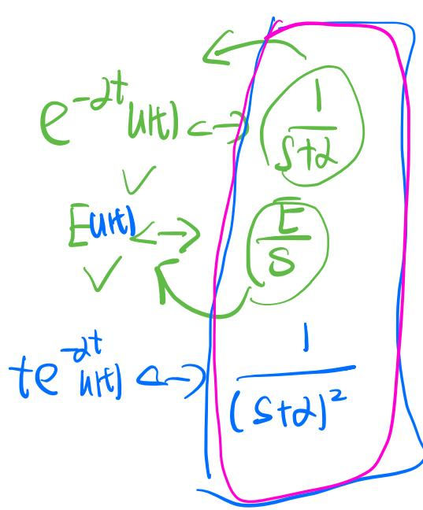
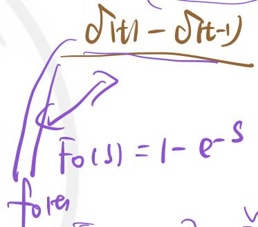
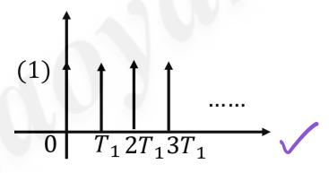
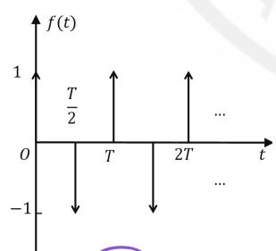
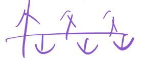
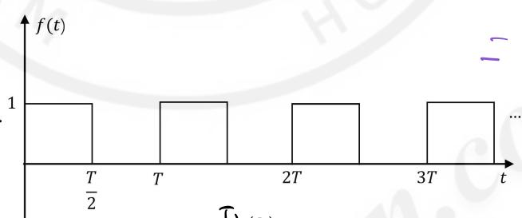
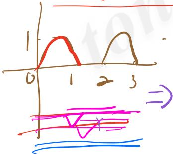
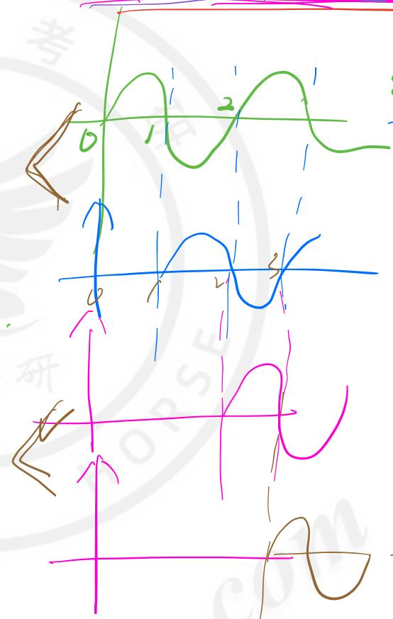
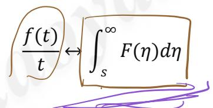

Laplace 逆度损

10 常见信号 Caplace 传录

$2^{\circ} \angle T$ 杆质 (多杆质结合)

$$
\xrightarrow {\text {过程}} y _ {(s)} \xrightarrow {\frac {x}{y}} y _ {(y)}
$$

$$
e q: Y _ {| S |} = \frac {1}{S (s + 1)} = \frac {A _ {1}}{S} + \frac {A _ {2}}{s + 1}
$$

$$
Y _ {(S)} | f (s) \xrightarrow [ \text {度形} ]{\text {分析}} \sum_ {\substack {A _ {1}, \\ S + \alpha_ {1}}} ^ {A _ {1}} \frac {A _ {1}}{S + \alpha_ {1}} + \frac {A _ {2}}{S + \alpha_ {2}} + \dots
$$

$$
\Rightarrow | s | = \frac {1}{s} + \frac {- 1}{s + 1} \quad (A _ {1} e ^ {\frac {1}{2} - 2 t} + A _ {2} e ^ {- 2 t}) \tag {1.14}
$$

$$
A _ {1} + A _ {2} = 0 \quad A _ {1} = 1 \Rightarrow A _ {1} = 1, A _ {2} = - 1 \Rightarrow y | t | = (1 - e ^ {- t}) u | t |
$$

B站up: 信号与系统\_谷哥

eq: $F(s)=\frac{(s+1)(s+2)}{s}$

## 专题2 拉氏逆变换

$F(s)=\frac{\text{分子关于}s\text{多项式}}{\text{分母关于}s\text{多项式}}=\frac{A(s)}{B(s)},\quad A(s)=0\text{的点称为}F(s)\text{的零点},\quad B(s)=0\text{的点称为}F(s)\text{的极点}$

部分分式展开法原理：

$\vartheta: F(s) = \frac{2s + 3}{s(s + 1)}$

$$
F (s) = \sum_ {k} A _ {k} \frac {1}{s + s _ {k}} \rightarrow f (t) = \sum_ {k} A _ {k} e ^ {- s _ {k} t}
$$

1° 按极点来展法

$$
= \frac {k _ {0}}{s} + \frac {k _ {1}}{s + 1}
$$

$$
\frac {k _ {0}}{s} + \frac {f _ {1}}{s + 1}
$$

2° 榜东

$$
F (s) = \frac {2 s + 3}{s (s + 1)} = \frac {k _ {0}}{s} + \frac {k _ {1}}{s + 1} = \frac {3}{s} + \frac {- 1}{s + 1}
$$

$$
k _ {0} = S F (s) / s = 0 = \frac {2 S + 3}{S + 1} / s = 0 = \frac {3}{1} = 3
$$

①求 $k_{0}$ ：两边同乘以s

$$
\Rightarrow f (t) = 3 u (t) - e ^ {- t} u (t)   S F (s) = \frac {2 s + 3}{s + 1} = k _ {0} + \frac {k _ {1} s}{s + 1} = \frac {2 s + 3}{s} / s = - 1 = \frac {1}{- 1} = - 1
$$

令s=0

$$
3 = \frac {3}{1} = \frac {2 s + 3}{s + 1} \bigg | _ {s = 0} = k _ {0}
$$

②求 $k_{1}$ :
两边同乘以 $s+1$ ，得

$$
(s + 1) F (s) = \frac {2 s + 3}{s} = \frac {k _ {0} (s + 1)}{s} + k _ {1}
$$

$$
- 1 = \frac {1}{- 1} = \left. \frac {2 s + 3}{s} \right| _ {s = - 1} = k _ {1}
$$

令 $s = -1$

建议步骤如下:

$$
F (s) = \frac {2 s + 3}{s (s + 1)} = \frac {k _ {0}}{s} + \frac {k _ {1}}{s + 1}
$$

展12

要求：

$$
\therefore f (s) = \frac {3}{s} + \frac {- 1}{s + 1} \Rightarrow \therefore f (t) = 3 u (t) - e ^ {- t} u (t) = \frac {1}{- 1} = - 1
$$

考点1 一般情况的拉氏逆变换

1、极点为单阶实数极点(互不相等的实数)

$$
F (s) = \frac {3 s}{s ^ {2} + 5 s + 6} \stackrel {\text {分母因式分解}} {=} \frac {3 s}{(s + 3) (s + 2)} \stackrel {\text {分母有几项展几项}} {=} \frac {k _ {1}}{s + 3} + \frac {k _ {2}}{s + 2}
$$

的

$$
k _ {1} = (s + 3) F (s) / _ {s = - 3} = \frac {3 s}{s + 2} / _ {s = - 3} = \frac {- 9}{- 3 + 2} = \frac {- 9}{- 1} = 9
$$

$$
f (g) = \frac {9}{s + 3} - \frac {6}{s + 2}
$$

$$
\begin{array}{r l} {k _ {2}} & {= (s + 2) F (s) \bigg | _ {s = - 2} = \frac {3 s}{s + 3} \bigg | _ {s = - 2} = \frac {- 6}{- 2 + 3} = \frac {- 6}{1} = - 6} \\ {\therefore F (s)} & {= \frac {9}{s + 3} + \frac {(- 6)}{s + 2} \Rightarrow f (t) = (9 e ^ {- 3 t} - 6 e ^ {- 2 t}) u (t) g} \end{array}
$$

2、极点为单阶的共轭复数(配方法)【结合正、余弦来凑】

$$
\begin{array}{r l} {[ S \mathrm{域移位} ]} & {F (s) = \frac {2 s + 3}{s ^ {2} + 2 s + 1 0}} \\ {F (s) = \frac {2 s + 3}{(s + 1) ^ {2} + 9}} & {= \frac {2 (s + 1) + 1}{(s + 1) ^ {2} + 3 ^ {2}}} \\ & {= \frac {2 (s + 1)}{(s + 1) ^ {2} + 3 ^ {2}} + \frac {\frac {1}{3} \cdot 3}{(s + 1) ^ {2} + 3 ^ {2}}} \\ & {\Rightarrow f (t) = e ^ {- t} (2 \cos 3 t + \frac {1}{3} \sin 3 t) u (t)} \end{array}
$$

例 6: 求下列函数的拉普拉斯逆变换。

$$
\begin{array}{r l} {F (s)} & {= \frac {s + 2}{s ^ {2} + 2 s + 2}} \\ & {= \frac {s + 2}{(s + 1) ^ {2} + 1}} \\ & {= \frac {s + 1 + 1}{(s + 1) ^ {2} + 1}} \\ & {= \frac {s + 1}{(s + 1) ^ {2} + 1 ^ {2}} + \frac {1}{(s + 1) ^ {2} + 1}} \\ & {\Rightarrow f (t) = e ^ {- t} [ \cos t + \sin t ] (t)} \end{array}
$$

3、极点为单阶的实数和共轭复数并存

$$
F (s) = \frac {s + 5}{s (s ^ {2} + 2 s + 5)} = \frac {k _ {0}}{s} + \frac {k _ {1} s + k _ {2}}{s ^ {2} + 2 s + 5}
$$

$$
k _ {0} = S F (s) \bigg | _ {s = 0} = \frac {s + 5}{s ^ {2} + 2 s + 5} \bigg | _ {s = 0} = \frac {5}{5} = 1
$$

$$
\begin{array}{r l} {\mathrm{张一}: \frac {k _ {1} s + k _ {2}}{s ^ {2} + 2 s + 5}} & {= f (s) - \frac {1}{s} = \frac {s + 5}{s (s ^ {2} + 2 s + 5)} - \frac {1 (s ^ {2} + 2 s + 5)}{s (s ^ {2} + 2 s + 5)}} \\ & {= \frac {(s + 5 - s ^ {2} - x - 5)}{s (s ^ {2} + 2 s + 5)} = - s ^ {2} - s} \end{array}
$$

张二：特殊顶层

$$
= \frac {- (s + 1)}{s ^ {2} + 2 s + 5}
$$

$$
\underline {{S = - 5}}
$$

$$
0 = \frac {1}{- 5} + \frac {- 5 k _ {1} + k _ {2}}{2 5 - 1 0 + 5}
$$

联立

$$
S = 1 \quad \frac {6}{1 + 2 + 5} = \frac {1}{1} + \frac {k _ {1} + k _ {2}}{1 + 2 + 5}
$$

$$
\therefore F (S) = \frac {1}{S} + \frac {- (S + 1)}{S ^ {2} + 2 S + 5} = \frac {1}{S} + \frac {- (S + 1)}{(S + 1) ^ {2} + 2 ^ {2}}
$$

$$
\Rightarrow f | t | = (1 - e ^ {- t} \cos 2 t) | u | t |
$$

例 7: 求下列函数的拉普拉斯逆变换。

$$
\begin{array}{r l} {X (s) = \frac {5 s + 1 3}{s (s ^ {2} + 4 s + 1 3)}} & {= \frac {k _ {0}}{8} + \frac {k _ {1} s + k _ {2}}{s ^ {2} + 4 s + 1 3}} \\ {k _ {0} = S X (s) / s = 0 = \frac {5 s + 1 3}{s ^ {2} + 4 s + 1 3} / s = 0 = \frac {1 3}{1 3} = 1} \\ {\frac {k _ {1} s + k _ {2}}{s ^ {2} + 4 s + 1 3} = x (s) - \frac {1}{s} = \frac {- s + 1}{s ^ {2} + 4 s + 1 3}} & {\Rightarrow x (s) = \frac {1}{8} + \frac {- s + 1}{(s + 2) ^ {2} + 3 ^ {2}}} \\ {\therefore x (t) = \left[ 1 + e ^ {- 2 t} (- \cos 3 t + \sin 3 t) \right] u (t)} & {= \frac {1}{8} + \frac {- (s + 2) + 3}{(s + 2) ^ {2} + 3 ^ {2}}} \\ & {= \frac {1}{8} + \frac {- (s + 2)}{(s + 2) ^ {2} + 3 ^ {2}} + \frac {3}{(s + 2) ^ {2} + 3 ^ {2}}} \end{array}
$$

考点5 极点有重极点

(一般只考察到2重极点，要注意系数问题)

示例：

若本模型 $te^{-\alpha t}(|t|)\leftrightarrow\frac{1}{(St\alpha)^{2}}$ 设 $(Cit+G)e^{-\alpha t}\leftrightarrow(\frac{C_{1}}{(St\alpha)^{2}})+\frac{C_{2}}{St\alpha}$

$F(s)=\frac{s}{(s+1)(s+4)^{2}}$ 单根按照单根展 = $\frac{k_{1}}{s+1}+\frac{k_{2}}{(s+4)^{2}}+\frac{k_{3}}{s+4}$ [集13] 几重根按降幂展几项

$$
k _ {1} = (s + 1) F (s) / s = - 1 = \frac {S}{(s + 4) ^ {2}} / s = - 1 = \frac {- 1}{3 ^ {2}} = - \frac {1}{9}
$$

$$
\begin{array}{r l} {k _ {2}:} & {(s + 4) ^ {2} f (s) = \frac {s}{s + 1} = \frac {k _ {1} (s + 4) ^ {2}}{s + 1} + k _ {2} + (s + 4) k _ {3}} \\ {\checkmark} & {\sqrt {2} s = - 4 \left. \frac {- 4}{- 3} - \frac {s}{s + 1} \right| _ {s = - 4} = k _ {2}} \\ & {\qquad = \frac {4}{3}} \end{array}
$$

$$
(S + 4) F (s) = \frac {S}{(S + 1) (S + 4)} = \frac {k _ {1} (s + 4)}{s + 1} + \frac {k _ {2}}{s + 4} + k _ {3}
$$

X 求不出来

两边对 $S$ 样

$$
\frac {d \frac {s}{s + 1}}{d s} = \mathrm{合} (s + 4) + 0 + k _ {3}
$$

$$
\begin{array}{l} {\mathrm{班级}: \mathrm{特殊值法}} \\ {\mathrm{令} S = 0} \\ {0 = \frac {- \frac {1}{9}}{1} + \frac {\frac {4}{3}}{1 6} + \frac {k _ {3}}{4} = 2 k _ {3} = \frac {1}{9}} \\ {\mathrm{梦马班讲义}} \end{array}
$$

B站up: 信号与系统\_谷哥

求 $k_{3}$ 的第二种方法：

$$
\begin{array}{l} \text {统_谷哥} \\ \text {方法:} \\ k _ {3} = \frac {d \frac {s}{s + 1}}{a s} / s = - 4 = \frac {(s + 1) - s}{(s + 1) ^ {2}} / s = - 4 = \frac {1}{9} \\ F (s) = \frac {s}{(s + 1) (s + 4) ^ {2}} = \frac {k _ {1}}{s + 1} + \frac {k _ {2}}{(s + 4) ^ {2}} + \frac {k _ {3}}{s + 4} \\ k _ {1} = \left. (s + 1) F (s) \right/ _ {s = - 1} = \frac {s}{(s + 4) ^ {2}} / _ {s = - 1} = \frac {- 1}{9} \\ k _ {2} = (s + 4) ^ {2} F (s) / _ {s = - 4} = \frac {s}{s + 1} / _ {s = - 4} = \frac {4}{3} \end{array}
$$

即

$$
F (s) = \frac {s}{(s + 1) (s + 4) ^ {2}} = \frac {\frac {- 1}{9}}{s + 1} + \frac {\frac {4}{3}}{(s + 4) ^ {2}} + \frac {k _ {3}}{s + 4}
$$

令 $s = 0$ ，则

$$
\begin{array}{r l} {\mathrm{则}} & \\ {F (s)} & {= \frac {- \frac {1}{9}}{s + 1} + \frac {\frac {4}{3}}{(s + 4) ^ {2}} + \frac {\frac {1}{9}}{s + 4} \Rightarrow f (t) = - \frac {1}{9} e ^ {- t} u (t)} \\ & {+ \frac {4}{3} t e ^ {- 4 t} u (t) + \frac {1}{9} e ^ {- 4 t} u (t)} \\ {\Rightarrow f (t)} & {= [ - \frac {1}{9} e ^ {- t} + (\frac {4}{3} t + \frac {1}{9}) e ^ {- 4 t} ] u (t)} \end{array}
$$

例 8: 求下列函数的拉普拉斯逆变换。

$$
X (s) = \frac {s ^ {2} + 2 s + 5}{(s + 3) (s + 5) ^ {2}}
$$

解析：

$$
x (s) = \frac {k _ {0}}{s + 3} + \frac {k _ {1}}{(s + 5) ^ {2}} + \frac {k _ {2}}{(s + 5)}
$$

$$
k _ {0} = (s + 3) \times (s) / s = - 3 = \frac {s ^ {2} + 2 s + 5}{(s + 5) ^ {2}} / s = - 3 = \frac {8 - 6 + 5}{4} = \frac {8}{4} = 2
$$

$$
k _ {1} = (s + 5) ^ {2} \times (s) / s = - 5 = \frac {s ^ {2} + 2 s + 5}{s + 3} / s = - 5 = \frac {2 \sqrt {- 1 0 + 5}}{- 5 + 3} = \frac {2 0}{- 2} = - 1 0
$$

$$
\begin{array}{r l} {k _ {2}} & {= \left. \frac {d}{d s} \frac {s ^ {2} + 2 s + 5}{s + 3} \right| _ {s = - 5} = \frac {(2 s + 2) (s + 3) - (s ^ {2} + 2 s + 5)}{(s + 3) ^ {2}} \Bigg | _ {s = - 5} = \frac {- 8 \times (- 2) - (2 s - 1 0 + 5)}{4}} \\ {\therefore x (s)} & {= \frac {2}{s + 3} + \frac {- 1 0}{(s + 5) ^ {2}} + \frac {- 1}{s + 5}} \\ & {= \frac {+ 1 6 - 2 0}{4} = - 1} \end{array}
$$

官网：tongxi nkaoyan.com

$$
\therefore x (t) = \left[ 2 e ^ {- 3 t} - (1 0 t + 1) e ^ {- 5 t} \right] u (t) \quad \mathrm{梦马班讲义}
$$

$$
\begin{array}{r l} & {\mathrm{分配根}} \\ & {= \frac {k _ {0}}{s} + \frac {k _ {1}}{(s + 1) ^ {3}} + \frac {k _ {2}}{(s + 1) ^ {2}} + \frac {k _ {3}}{s + 1}} \\ & {k _ {0} = - \dots / s = 0 = 1} \\ & {k _ {1} = (s + 1) ^ {3} F (s) / s = - 1 = \frac {1}{s} / s = - 1} \\ & {k _ {2} = \left. \frac {d}{d s} \frac {1}{s} \right| _ {s = - 1} = \frac {- 1}{s ^ {2}} / s = - 1 = - 1} \\ & {k _ {3} = [ \mathrm{特压压} ]} \\ & {\mathrm{令} s = 1 \quad \frac {1}{8} = 1 + \frac {- 1}{8} + \frac {- 1}{4} + \frac {k _ {3}}{2} = \frac {8 k _ {1} - 2 + 4 k _ {3}}{8}} \\ & {\mathrm{持相}} \\ & {k _ {3} = \left. \frac {- 1}{2} d ^ {2} (\frac {1}{s}) \right| _ {s = - 1} = \frac {1}{2} (- \frac {1}{s ^ {2}}) ^ {1} = \frac {1}{2} \frac {0 - (- 1) \cdot 2 s}{s ^ {4}} = \frac {1}{2} \frac {2}{s ^ {3}} / s = - 1 = - 1} \end{array}
$$

Laplac 运变换 (图设流程)

10 单阶良数. 现境变数

$2^{\circ} =$ 画根（三）

$$
y ^ {\prime} | t | + y | t | = f ^ {\prime \prime} | t | + 2 f ^ {\prime \prime} | c | + 2 f ^ {\prime} | c | + 3 f _ {t},
$$

$$
\begin{array}{r l} {\varphi} & {:= f (t) = \frac {s}{s + 1} \mathrm{假设式}} \\ & {= \frac {s + 1 - 1}{s + 1} = 1 + \frac {- 1}{s + 1}} \\ & {\Rightarrow f (t) = \delta (t) - e ^ {- t} u (t)} \end{array}
$$

$$
\begin{array}{r l} {f (s)} & {= \frac {s ^ {2}}{s + 1} = \frac {(s + 1) ^ {2} - 2 s - 1}{s + 1}} \\ & {\qquad = \frac {(s + 1) ^ {2} - 2 (s + 1) + 1}{s + 1}} \\ & {\qquad = (s + 1) - 2 + \frac {1}{s + 1}} \\ & {\qquad = s - 1 + \frac {1}{s + 1}} \\ {\therefore f (t)} & {= \frac {s ^ {\prime} (t) - d (t) + e ^ {- t} u (t)}{d ^ {\prime} (t) - d (t) + e ^ {- t} u (t)}} \end{array}
$$

考点 6: $F(s)$ 为假分式的拉氏逆变换

1、方法：假分式=多项式+真分式

2、原理：同次幂，出现常数，分子次幂高，出现含s多项式：

$$
\underline {{\delta (t)}} \leftrightarrow 1, \delta^ {\prime} (t) \leftrightarrow s
$$

例 9: 求下列函数的拉普拉斯逆变换。

$$
F (s) = \frac {s ^ {3} + 5 s ^ {2} + 9 s + 7}{s ^ {2} + 3 s + 2}
$$

$$
\begin{array}{r l} {f (s)} & {= (s + 2) + \frac {s + 3}{(s + 1) (s + 2)}} \\ & {= (s + 2) + \frac {2}{s + 1} + \frac {- 1}{s + 2}} \\ {\therefore f (t)} & {= d ^ {\prime} (t) + 2 d ^ {\prime} (t) + (2 e ^ {- t} - e ^ {- 2 t}) u (t + 1)} \\ & {= (d ^ {\prime} (t) + 2 d ^ {\prime} (t) + 2 e ^ {- t} - e ^ {- 2 t}) u (t + 1)} \end{array}
$$

考点 7: $F(s)$ 含有 $e^{as}$ 项的拉氏逆变换

1、方法： $e^{as}$ 项不参与，仅仅是时移性质

2、步骤：

$$
F (s) = F _ {1} (s) e ^ {\alpha s}
$$

$$
f (t) = f _ {1} (t + \alpha)
$$

则

$$
S + 2
$$

$$
(s - 1) + \frac {1}{s + 1}
$$

$$
\begin{array}{l} {\mathrm{众号:通信考研小马哥}} \\ {S + 1 \sqrt {\frac {S - 1}{s ^ {2}}}} \\ {\frac {s ^ {2} + s}{- s}} \\ {- s - 1} \\ {\mathrm{①}} \end{array}
$$

$\frac{1}{10} f(t) \xleftarrow{2T} F(x)$ $\Rightarrow f(t-1) \xleftarrow{2T} F(x)e^{-s}$ $f(t)$

$$
\begin{array}{r} {s ^ {3} + 5 s ^ {2} + 9 s + 7} \\ {s ^ {3} + 3 s ^ {2} + 2 s} \\ {\hline 2 s ^ {2} + 7 s + 7} \\ {2 s ^ {2} + 6 s + 4} \\ {\hline 8 + 3} \end{array}
$$

当 $f$ 为正方形, 则要得 $\sqrt[23]{10}$ 也成立.

的？

例 10: 求 $F(s) = \frac{(2s+5)e^{-2s}}{s^2+5s+6}$ 的拉普拉斯逆变换。

$$
\therefore f (t) = f _ {1} (t - 2)
$$

$$
f (s) = F _ {1} (s) \cdot e ^ {- 2 s}
$$

$$
\begin{array}{r l} & {\mathrm{变换。}} \\ & {2 F _ {1} (s) = \frac {2 s + 5}{s ^ {2} + 3 s + 6} = \frac {2 s + 5}{(s + 2) (s + 3)} = \frac {k _ {1}}{s + 2} + \frac {k _ {2}}{s + 3}} \\ & {\qquad k _ {1} = 1, \quad k _ {2} = 1} \\ & {\therefore F _ {1} (s) = \frac {1}{s + 2} + \frac {1}{s + 3}} \\ & {\therefore f _ {1} (t) = (e ^ {- 2 t} + e ^ {- 3 t}) u (t)} \\ & {\therefore f (t) = [ e ^ {- 2 (t - 2)} + e ^ {- 3 (t - 2)} ] u (t - 2)} \end{array}
$$

例 11: 求下列函数的拉普拉斯逆变换。

$$
(1) F (s) = \frac {1 - e ^ {- 2 s}}{s + 1}
$$

$$
(2) F (s) = \frac {e ^ {- (s - 1)}}{s - 1}
$$

$$
(3) F (s) = \frac {(1 - e ^ {- s}) + s e ^ {- s}}{s - 1} \overbrace {\frac {1}{s - 1} - \frac {e ^ {- s}}{s - 1} + \left(\frac {s}{s - 1}\right) e ^ {- s}}
$$

$$
\begin{array}{r l} {f _ {1} (s) = \frac {1}{s + 1}} & {\Rightarrow f _ {1} (t) = e ^ {- t} u (t)} \\ {\frac {1}{s + 1} + \frac {- 1}{s + 1} \cdot e ^ {- 2 s}} \\ {\downarrow} & {\downarrow} \\ {f _ {1} (t + 1)} & {- f _ {1} (t - 2)} \\ {\frac {s}{t}} & {e ^ {- s}} \end{array}
$$

## 考点7：有始周期信号的拉氏逆变换

1、有始周期冲激函数的LT

$$
e y: F _ {y 1} = \frac {1}{1 - e ^ {- x}}
$$

$$
\Rightarrow T _ {1} = 2
$$

$$
\delta (t) \stackrel {L T} {\leftrightarrow} 1
$$

$$
\delta (t - n T _ {1}) \overset {L T} {\leftrightarrow} 1 \cdot e ^ {- s n T _ {1}}
$$

$$
\boxed {\sum_ {n = 0} ^ {\infty} \underbrace {\delta (t - n T _ {1})} _ {=}} \Rightarrow \sum_ {n = 0} ^ {\infty} \underbrace {e ^ {- n s T _ {1}}} _ {=} = \frac {1}{1 - e ^ {- s T _ {1}}}
$$

$$
\begin{array}{r l} {=} & {\sum_ {n = 0} ^ {\infty} \delta (t - 2 n)} \\ {\mathrm{if} f (s) =} & {\frac {1}{(1 + e ^ {- s})} \frac {1 - e ^ {- s}}{(1 - e ^ {- s})}} \\ {=} & {\frac {1 - e ^ {- s}}{1 - e ^ {- 2 s}}} \end{array}
$$

2、有始周期信号的拉氏逆变换

$$
\sum_ {n = 0} ^ {\infty} f _ {0} (t - n T _ {1}) = f _ {0} (t) * \sum_ {n = 0} ^ {\infty} \delta (t - n T _ {1})
$$

$$
\mathcal {L} [ f (t) ] = F _ {0} (s) \cdot \frac {1}{1 - e ^ {- s T _ {1}}}
$$

$$
f (t) = [ d (t - d (t - 1)) ] \times \sum_ {n = 0} ^ {\infty} d (t - 2 n)
$$

例 12: 求如图所示在 t=0 时接入的有始周期信号 $f(t)$ 的象函数 $F(s)$ 。

$$
= \sum_ {n = 0} ^ {\infty} (- 1) ^ {n} d (t - n)
$$

$$
f _ {0} (t) = \delta (t) - \delta (t - \frac {T}{2})
$$

$$
f _ {0} (t) = \frac {1}{c} \left| \begin{array}{l l} \overline {{u}} | t | - u (t - \frac {I}{2}) & (b) \\ \overline {{\frac {I}{2}}} & \end{array} \right.
$$

$$
f (t) = f _ {0} (t) \times \frac {\sum_ {n = 0} ^ {\infty} \int (t - n T _ {1})}{n}
$$

$$
. F _ {0} (s) = 1 - e ^ {- \frac {I}{2} s}
$$

$$
\begin{array}{r l} {\therefore f _ {0} (s) = \frac {1}{s} - \frac {1}{s} \cdot e ^ {- \frac {T}{2} s}} \\ & {= \frac {1}{s} (1 - e ^ {- \frac {T}{2} s})} \end{array}
$$

$$
\Rightarrow F (s) = F _ {0} (s).
$$

$$
\therefore F (s) = \frac {1 - e ^ {- \frac {T}{2} s}}{1 - e ^ {- s T}} = \boxed {\frac {1}{1 + e ^ {- \frac {T}{2} s}}}
$$

$$
\therefore F (s) = \frac {1 - e ^ {- \frac {T}{2} s}}{s (1 - e ^ {- s T})} = \frac {1}{s (1 + e ^ {- \frac {T}{2} s})}
$$

3、有始周期信号的拉氏逆变换步骤

(1)化成标准形式 $F(s)=F_{0}(s)\cdot\frac{1}{1-e^{-sT}}$ ;

(2)对 $F_{0}(s)$ 进行拉氏逆变换得 $f_{0}(t)$ ;

(3)则 $f(t)=f_{0}(t)*\sum_{n=0}^{\infty}\delta(t-nT)$ ，可适当考虑画图，便于简化表达式。

例 13: 求该象函数 $\frac{\pi(1+e^{-s})}{(s^{2}+\pi^{2})(1-e^{-2s})}$ 的逆变换并画图。

$\sin \pi t [u|t| - u|t-1] * \sum_{n=0}^{\infty} \sqrt{(t-2n)} = \frac{\pi}{(s^2 + \pi^2)} \cdot \frac{1}{1 - e^{-s}}$ $\Rightarrow \frac{\pi}{s^2 + \pi^2} \xrightarrow{x_n} \sin \pi t \cdot u(t)$ $\sin \pi t \cdot u(t) * \sum_{n=0}^{\infty} \sqrt{(t-n)}$ $\equiv n = 0$ $\sin \pi (t-n) u(t-n)$ 例 14: 求 $\frac{1}{1 + e^{-s}}$ 的原函数。

画图 $= >$ 正页文著 $(-1)^n$

$$
\star \sigma (\pi - 1)
$$

$$
* \partial (t - 2)
$$

$$
* o (t -)
$$

$a^{2}-b^{2}=[a+b](a-b)$ $-1-e^{-x}s=(1+e^{-x})(1-e^{-x})$

## 考点9：s域积分的拉氏逆变换

Ln.

1、原理：

若 $f(t)\leftrightarrow F(s)$ ，则

2、步骤

$$
[ \ln x ] ^ {\prime} = \frac {1}{x} \text {且} \ln \frac {x}{y} = \ln x - \ln y
$$

则

$$
\int_ {s} ^ {\infty} \frac {1}{\eta} d \eta = l n x \Big | _ {s} ^ {\infty} = l n \infty - l n s
$$

例 15: 求 $F(s) = \ln \frac{s-1}{s}$ 的拉普拉斯逆变换。

$$
\begin{array}{r l} {\mathrm{解析:}} & {F (s) = \ln \frac {s - 1}{s} = \ln (s - 1) - \ln s} \\ & {\Rightarrow \frac {d f (t)}{d s} = \frac {1}{s - 1} - \frac {1}{s}} \\ & {\Rightarrow - t f (t) = [ e ^ {t} - 1 ] u (t)} \\ & {\Rightarrow f (t) = \frac {1 - e ^ {t}}{t} u (t)} \end{array}
$$

$f(t) \Rightarrow f_{W}$ $\text{if } f(t) \to -\frac{dF_{W}}{dS}$

$$
\ln \frac {s - 1}{s} = \ln (s - 1) - \ln s
$$

$$
\mathrm{质理} = \int_ {S} ^ {\infty} \frac {1}{\eta} d \eta - \int_ {S} ^ {\infty} \frac {1}{\eta - 1} d \eta
$$

$$
\begin{array}{r l} & {\ln x / _ {8} ^ {\infty} - \ln (x + 1) / _ {8} ^ {\infty}} \\ & {= (\ln \omega - \ln s) - [ \ln \omega - \ln s ]} \\ & {= \ln (s + 1) - \ln s} \end{array}
$$

$$
\begin{array}{l} {\mathrm{if:} \quad \ln \frac {s - 1}{s} = \ln (s - 1) - \ln s} \\ {\qquad \qquad = [ \ln (s - 1) - \ln s ] - [ \ln (s - 1) - \ln (s - 1) ]} \\ {\qquad = \int_ {s} ^ {\infty} (\frac {1}{\eta}) d \eta - \int_ {s} ^ {\infty} \frac {1}{\eta - 1} d y} \\ {\qquad = \frac {u (t)}{t} - \frac {e ^ {t u (t)}}{t} = \frac {1 - e ^ {t}}{t} u (t)} \\ {\mathrm{官网:tongxinkaoyan.com}} \\ {\mathrm{梦马班讲义}} \end{array}
$$

$f(s)$ 部分式展开方程 → $f(ε)$ $1^{\circ}$ 真式
    = { 单共轭: sin/αs + 时移 } (√23) > 特值方程
    = 重根 te^{-2t\_{urei}}. $2^{\circ}$ 假分式 → { 多项式 + 真式 } (0时及各阶元素组合) $3^{\circ}$ 合 e $^{2s}$ 项
    全 $F(s) = F_i(s) e^{2s}$ 时移. u(t-a→时移)
    = 1 ± e^{-sT}
    f(t-a) = \sum\_{n=0}^{v\_0} f\_0(t-nT\_n) = f\_0(n + \sum\_{n=0}^{T\_0} d\pi-nT\_n)
    ⇒ f(s) = F\_0(s) \cdot \frac{1}{1 - e^{-sT\_1}} \text{ [画图来化简表式] }
    5^{\circ} s^{-a} \text{ 积分 }
    2n