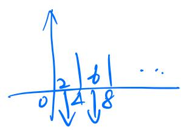

## 【第24节】课后作业

1、求下列函数的拉普拉斯逆变换。

课后作业
解: (1) $f(s)=\frac{3}{(s+4)/(s+2)}=\frac{k_{1}}{s+2}+\frac{k_{2}}{s+4}$

(1) $\frac{3}{(s + 4)(s + 2)}$

(2) $\frac{3s}{(s + 4)(s + 2)}$

$$
k _ {1} = (s + 2) F (s) \bigg | _ {s = - 2} = \frac {3}{s + 4} \bigg | _ {s = - 2} = \frac {3}{2}
$$

(3) $\frac{1}{(s^2 + 3)^2}$

(4) $\frac{e^{-s}}{4s(s^2 + 1)}$

$$
k _ {2} = (s + 4) F (s) / s = - 4 = \frac {3}{s + 2} / s = - 4 = \frac {3}{- 2}
$$

(5) $\ln \left( \frac{s}{s + 9} \right)$

(3) $F(s) = \frac{1}{(s^{2}+3)^{2}}$

$$
\therefore F (s) = \frac {\frac {3}{2}}{s + 2} + \frac {- \frac {3}{2}}{s + 4}
$$

$\sin\sqrt{3}(t+1) \rightarrow \frac{\sqrt{3}}{s^{2}+3}$

$$
\therefore f (t) = \frac {3}{2} (e ^ {- 2 t} - e ^ {- 4 t}) u (t)
$$

$\left( {\frac{\sqrt{3}}{18}\sin \sqrt{3}t - \frac{t}{6}\cos \sqrt{3}t}\right)_{\mathrm{{uni}}}(2)\;F\left( s\right)  = \frac{3S}{\left( {S + 4}\right) \left( {S + 2}\right) } = \frac{{k}_{1}}{S + 4} + \frac{{k}_{2}}{S + 2}$

$\frac{1}{\sqrt{3}} + \sin \sqrt{5} + u(t) \rightarrow  \frac{2S}{\left( {{S}^{2} + 3}\right) ^{2}}$

$\frac{1}{2\sqrt{3}}t\sin\sqrt{3}t(u(t))\rightarrow\frac{s}{(s^{2}+3)^{2}}$

$$
\frac {1}{2 \sqrt {3}} \int_ {0} ^ {t} \tau \sin \sqrt {3} \tau d \tau
$$

$$
k _ {1} = (S + 4) F (S) / S = - 4 = \frac {3 S}{8 + 2} / 8 = - 4 = \frac {- 1 2}{- 2} = 6
$$

∠T积分性质

$$
\frac {1}{(5 ^ {2} + 3) ^ {2}} \Leftrightarrow \int_ {0} ^ {t} \frac {1}{2 \sqrt {3}} \tau \sin \sqrt {3} \tau (u t) d \tau
$$

$$
k _ {2} = (s + 2) F (s) / s = - 2 = \frac {3 s}{s + 4} / s = - 2 = \frac {- 6}{2} = - 3
$$

$$
\therefore F (s) = \frac {6}{s + 4} + \frac {- 3}{s + 2}
$$

$$
(4) _ {2} ^ {\lambda} F (s) = \frac {e ^ {- s}}{4 s (s ^ {2} + 1)}, F _ {1} (s) = \frac {1}{4 s (s ^ {2} + 1)}
$$

$$
F _ {1} (s) = \frac {1}{4 s (s ^ {2} + 1)} = \frac {k _ {0}}{s} + \frac {k _ {1} s + k _ {2}}{s ^ {2} + 1}
$$

$$
k _ {0} = S F _ {1} (s) / s = 0 = \frac {1}{4 (s ^ {2} + 1)} / s = 0 = \frac {1}{4 \times 1} = \frac {1}{4}
$$

$$
\therefore F _ {1} (s) = \frac {1}{4 s} + \frac {- s}{4 (s ^ {2} + 1)}
$$

$$
\frac {k _ {1} s + k _ {2}}{s ^ {2} + 1} = \frac {1}{4 s (s ^ {2} + 1)} - \frac {1}{4 s} = \frac {1 - s ^ {2} - 1}{4 s (s ^ {2} + 1)} = \frac {- s}{4 (s ^ {2} + 1)}
$$

$$
\therefore f (t) = \frac {1}{4} (1 - \cos t) u (t)
$$

$$
\therefore f (t) = f _ {1} (t - 1) = \frac {1}{4} [ 1 - \cos (t - 1) ] u (t - 1)
$$

$$
\therefore f (t) = (6 e ^ {- 4 t} - 3 e ^ {- x t}) u (t)
$$

(5) $F(s) = \ln \frac{s}{s+9} = 2n s - 2n (s+9)$ $= \left[ \ln \infty - \ln (s+9) \right]$ $- \left[ \ln \infty - \ln s \right]$ $= \int_{s}^{\infty} \frac{1}{\eta + 9} dy - \int_{s}^{\infty} \frac{1}{\eta} dy$ $= \frac{e^{-9t}(u(t))}{t} - \frac{u(t)}{t}$ $= \frac{1}{t} (e^{-9t} - 1)(u(t))$

2、下列象函数 $F(s)$ 的原函数 $f(t)$ 是t=0接入的有始周期信号，求周期T并写出其第一个周期 $(0<t<T)$ 的时间函数表达式 $f_{0}(t)$ 。

(1) $\frac{1}{s(1 + e^{-2s})}$

(2) $\frac{\pi(1 + e^{-s})}{(s^2 + \pi^2)(1 - e^{-s})}$

(1) $F\left( S\right)  = \frac{1}{S\left( {1 + {e}^{-2S}}\right) }$

令 ${F}_{1}\left( S\right)  = \frac{1}{1 + {e}^{-{2s}}} = \frac{1 - {e}^{-{2s}}}{1 - {e}^{-4s}}$ (2) 令 $F_{0}(s) = \frac{\pi}{s^{2} + \pi^{2}}$ $\Rightarrow f_{0}(t) = \sin\pi t(u(t))$

令 ${f}_{2}\left( S\right)  = \frac{1}{1 - e - {4s}} \Rightarrow  {f}_{2}\left| t\right|  = \mathop{\sum }\limits_{{n = 0}}^{\infty }\rho \left| {t - {4n}}\right|$

则 $F_{1}(s)=\frac{F_{0}(s)}{1-e-s}$ 逆变损得

$$
\therefore F _ {1} (s) = F _ {2} (s) (1 - e ^ {- x s})
$$

$$
f _ {1} (t) = f _ {0} (t) * \frac {\sum_ {n = 0} ^ {\infty} \delta (t - n)}{n}
$$

$$
\therefore f _ {1} (t) = f _ {2} (t) - f _ {2} (t - 2) = \frac {\sum_ {n = 0} ^ {\infty} [ \sqrt {(t - 4 n)} - \sqrt {(t - 2 - 4 n)} ]}{n !} f _ {1} (t) = \sum_ {n = 0} ^ {\infty} \sin \pi (t - n) u (t - n)
$$

$$
F _ {0} (s) = \frac {1}{s} \Rightarrow f _ {0} (t) = u (t)
$$

$$
\because F (s) = F _ {1} (s) (1 + e ^ {- s})
$$

$$
\therefore f (t) = \sum_ {n = 0} ^ {\infty} [ u (t - 4 n) - u (t - 2 - 4 n) ]
$$

$$
\therefore f (t) = f _ {1} (t) + f _ {1} (t - 1)
$$

可见周期为4s. 前一个周期内为 $u(t) - u(t-2)$

$$
= \sum_ {n = 0} ^ {\infty} \left[ \sin \pi (t - n) u (t - n) \right] + \left[ \sin \pi (t - 1 - n) u (t - 1 - n) \right]
$$

可见周娟为15.

第一个同期内

$\sin \pi t [u|t-1 - u(t-1)]$

3、求下列函数的逆变换。

$$
(1) X (S) = \frac {k _ {0}}{S} + \frac {k _ {1}}{S + 1} + \frac {k _ {2} S + k _ {3}}{S ^ {2} + 4 S + 8}
$$

$$
(1) X (s) = \frac {2 s ^ {3} + 8 s ^ {2} + 4 s + 8}{s (s + 1) (s ^ {2} + 4 s + 8)}
$$

$$
(2) X (s) = \frac {4}{(s + 1) (s + 2) ^ {3}}
$$

$$
(3) X (s) = \frac {s ^ {2} + 4 s + 2}{(s + 1) (s + 2)}
$$

(4) $X(s) = \frac{se^{-2s} + 1}{(s + 1)(s + 2)}$

3 (1) 真分式 $x(s)=\frac{A_{0}}{s}+\frac{A_{1}}{s+1}+\frac{A_{2}s+A_{3}}{s^{2}+4s+8}$

$$
\left\{ \begin{array}{l l} {S = 1 \text {   时   }} & {\frac {2 + 8 + 4 + 8}{1 \times 2 \times (1 + 4 + 8)} = 1 + \frac {- 2}{2} + \frac {A _ {2} + A _ {3}}{1 + 4 + 8}} \\ {S = 2 \text {   时   }} & {\frac {1 6 + 3 2 + 8 + 8}{2 \times 3 \times (4 + 8 + 8)} = \frac {1}{2} + \frac {2}{3} + \frac {2 A _ {2} + A _ {3}}{2 0}} \\ {\Rightarrow A _ {2} = 3} & {A _ {3} = 8} \end{array} \right.
$$

(5) $X(s) = \frac{1}{(s + 1)(s^2 + 4)}$

$$
\begin{array}{r l} {A _ {0}} & {= \frac {0 + 0 + 0 + 8}{1 \times 8} = 1} \\ {A _ {1}} & {= \frac {- 2 + 8 - 4 + 8}{- 1 \times (1 - 4 + 8)} = \frac {1 0}{- 5} = - 2} \end{array}
$$

$\uparrow$ 也可以代直

(6) $X(s) = \frac{1}{1 + e^{-2s}}$

$$
- (S ^ {3} + 5 S ^ {2} + 1 2 S + 8) + 2 (S ^ {3} + 4 S ^ {2} + 8 S)
$$

$$
\begin{array}{r l} {y (s)} & {= \frac {1}{s} + \frac {- 2}{s + 1} + \frac {3 s + 8}{s ^ {2} + 4 s + 8}} \\ & {= \frac {1}{s} + \frac {- 2}{s + 1} + \frac {3 (s + 2) + 2}{(s + 2) ^ {2} + 4}} \\ & {= \frac {1}{s} + \frac {- 2}{s + 1} + \frac {3 (s + 2)}{(s + 2) ^ {2} + 4} + \frac {2}{(s + 2) ^ {2} + 4}} \end{array}
$$

$$
\therefore N (t) = \left[ 1 - 2 e ^ {- t} + e ^ {- 2 t} (3 \cos 2 t + \sin 2 t) \right] u (t)
$$

$$
X (s) = \frac {4}{(s + 1) (s + 2) ^ {3}} = \frac {k _ {0}}{s + 1} + \frac {k _ {1}}{(s + 2) ^ {3}} + \frac {k _ {2}}{(s + 2) ^ {2}} + \frac {k _ {3}}{s + 2}
$$

$$
k _ {0} = (s + 1) \times (s) / s = - 1 = \frac {4}{(s + 2) ^ {3}} / s = - 1 = \frac {4}{1} = 4
$$

$$
k _ {1} = (s + 2) ^ {3} \times (s) / s = - 2 = \frac {4}{s + 1} / s = - 2 = \frac {4}{- 1} = - 4
$$

$$
k _ {2} = \left. \frac {d}{d s} (\frac {4}{s + 1}) \right| _ {s = - 2} = \frac {- 4}{(s + 1) ^ {2}} / _ {s = - 2} = \frac {- 4}{1} = - 4
$$

$$
k _ {3} = \left(\frac {1}{2} \frac {d ^ {2}}{d s ^ {2}} (\frac {4}{s + 1})\right) | _ {s = - 2} = \left. \frac {1}{2} \frac {0 + 4 . 2 (s + 1)}{(s + 1) ^ {4}} \right| _ {s = - 2} = \frac {- 4}{1} = - 4
$$

$$
\therefore x (s) = \frac {4}{s + 1} + \frac {- 4}{(s + 2) ^ {3}} + \frac {- 4}{(s + 2) ^ {2}} + \frac {1}{s + 2}
$$

$$
\therefore x (t) = \left[ 4 e ^ {- t} + (- 2 t ^ {2} - 4 t - 4) e ^ {- 2 t} \right] u (t)
$$

(6)

$$
\begin{array}{r l} {x (s)} & {= \frac {s ^ {2} + 4 s + 2}{(s + 1) (s + 2)} = 1 + \frac {s}{(s + 1) (s + 2)} = 1 + \frac {- 1}{s + 1} + \frac {2}{s + 2}} \\ {\therefore x (t)} & {= \sqrt {(t)} + (- e ^ {- t} + 2 e ^ {- 2 t}) u (t)} \end{array}\tag{3}
$$

$$
x (s) = \frac {S e ^ {- 2 s} + 1}{(s + 1) (s + 2)}
$$

$$
\begin{array}{r l} & {\mathrm{令} x _ {3} (s) = \frac {1}{(s + 1) (s + 2)} - s + 1 - s + 2} \\ & {\therefore x (t) = x _ {2} (t) + x _ {3} (t) = (e ^ {- t} - e ^ {- x t}) u (t) + [ - e ^ {- (t - 2)} + 2 e ^ {- 2 (t - 2)} ] u (t - 2)} \end{array}
$$

$$
\begin{array}{r l} {(5) \times (s)} & {= \frac {1}{(s + 1) (s ^ {2} + 4)} = \frac {k _ {0}}{s + 1} + \frac {k _ {1} s + k _ {2}}{s ^ {2} + 4}} \\ & {k _ {0} = (s + 1) \times (s) / s = - 1 = \frac {1}{s ^ {2} + 4} / s = - 1 = \frac {1}{1 + 4} = \frac {1}{5}} \\ & {\frac {k _ {2} s + k _ {2}}{s ^ {2} + 4} = \frac {1}{(s + 1) (s ^ {2} + 4)} - \frac {\frac {1}{5}}{s + 1} = \frac {1 - \frac {1}{5} (s ^ {2} + 4)}{(s + 1) (s ^ {2} + 4)} = \frac {\frac {1}{5} (- s)}{s ^ {2} + 4}} \\ & {\therefore x (s) = \frac {\frac {1}{5}}{s + 1} + \frac {\frac {1}{5} (- s)}{s ^ {2} + 4} = \frac {\frac {1}{5}}{s + 1} + \frac {- \frac {1}{5} s}{s ^ {2} + 2 ^ {2}} + \frac {2 \cdot \frac {1}{1 0}}{s ^ {2} + 2 ^ {2}}} \\ & {\therefore x (t) = \frac {1}{5} e ^ {- t} u (t) + (- \frac {1}{5} \cos 2 t + \frac {1}{1 0} \sin 2 t) u (t)} \end{array}
$$

$$
x (s) = \frac {1}{H e ^ {- 2 s}} = \frac {1 - e ^ {- 2 s}}{1 - e ^ {- 4 s}}
$$

$$
\hat {y} _ {2} (x _ {0} | s) = 1 - e ^ {- x} \quad \mathrm{则} \quad x _ {0} | t | = \sqrt {| t |} - \sqrt {| t - 2 |}
$$

$$
\frac {1}{1 - e ^ {- 4 s}} \Rightarrow \sum_ {n = 0} ^ {\infty} \delta (t - 4 n)   \mathrm{for} x (t) = x _ {0} (t) * \sum_ {n = 0} ^ {\infty} \delta (t - 4 n) = \sum_ {n = 0} ^ {\infty} [ \delta (t - 4 n) - \delta (t - 2 - 4 n) ] = \frac {\sum_ {n = 0} ^ {\infty} (- 1) ^ {n} \delta (t - 2 n)}{n !}
$$