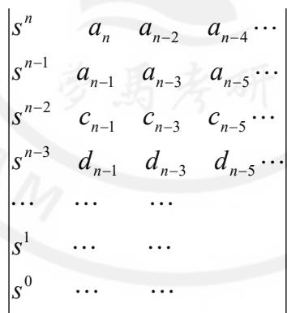
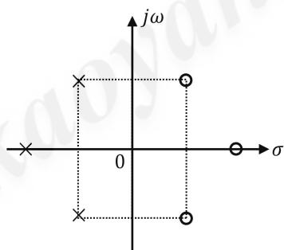

## 专题4 系统内在特性的判断

## 考点1：极点与ROC关系

1、零极点与ROC的关系：ROC内无极点，ROC是以极点为边界的；

例 21: $H(s)=\frac{1}{(s+1)(s+3)}$ 的所有可能 ROC。

## 2、零极点与 $H(s)$ 的关系

(1) $H(s)\rightarrow$ 零极点图是确定型

(2)零极点图 $\rightarrow H(s)$ 含待定系数, 需借助其它信息, 例如 $h(0_{+})$ 、 $H(s_0)$ 、 $\int_{-\infty}^{\infty} f(t) dt$ 的值。

示例：零点为 0 ，极点为 -1 和 -2 。设

考点2：系统函数零极点决定时域波形和频域特性

## 考点3：系统特性判断s域方法

1、因果系统：ROC为某直线的右侧，即 $h(t)$ 是 $u(t)$ 型；

2、稳定系统：ROC内包含虚轴；

(1)若 $H(s)$ 分母多项式为一阶或者二阶—求极点，然后看极点位置

例 22: $H(s)=\frac{1}{s^{2}+3s+2-k}$ 若系统稳定，求常数 k 应满足的条件？

(3)罗斯矩阵

$$
\mathsf {c} _ {n - 1} = \frac {- 1}{a _ {n - 1}} \left| \begin{array}{c c} a _ {n} & a _ {n - 2} \\ a _ {n - 1} & a _ {n - 3} \end{array} \right|,   \mathsf {c} _ {n - 3} = \frac {- 1}{a _ {n - 1}} \left| \begin{array}{c c} a _ {n} & a _ {n - 4} \\ a _ {n - 1} & a _ {n - 5} \end{array} \right|... \tag {1.1}
$$

$$
\mathrm{d} _ {n - 1} = \frac {- 1}{c _ {n - 1}} \left| \begin{array}{c c} a _ {n - 1} & a _ {n - 3} \\ c _ {n - 1} & c _ {n - 3} \end{array} \right|, \mathrm{d} _ {n - 3} = \frac {- 1}{a _ {n - 1}} \left| \begin{array}{c c} a _ {n - 1} & a _ {n - 5} \\ c _ {n - 1} & c _ {n - 5} \end{array} \right|...
$$

以此类推，把第一列数值全部算出来

稳定的充要条件：第一列全部为正数

若第一列系数符号不同，符号改变次数是极点在右半平面个数

若 $H(s)$ 为二阶多项式 $s^{2}+\alpha s+\beta$ ，只需 $\alpha>0,\beta>0$ .

例23：系统函数分母多项式为 $2s^{4} + s^{3} + 3s^{2} + 5s + 7$ ，该系统是否为稳定系统？

例24：一系统函数分母多项式 $s^3 + 3ks^2 + (k + 2)s + 4$ ，为使系统稳定，求 $k$ 的范围

夢馬考研

(4)因果稳定系统：ROC为某直线右侧且包含虚轴，即系统函数所有极点全部位于s平面的左半平面；

3、全通系统：极点全部在左半平面，零点全部在右半平面，零极点关于虚轴镜像；

全通系统的幅频特性 $\left|H(\omega)\right|$ 是常数

4、最小相移系统：零点全部位于左半平面或虚轴上

5、滤波特性：判断系统是低通、高通、带通还是带阻

①求系统函数 $H(s)$ 的零极点，并画出零极点分布图；

②取虚轴上一点 P，连接各零极点到 P 点的矢量图；

③幅频特性 $\left|H(\omega)\right|=\frac{所有零点线段长度乘积}{所有极点线段长度乘积}$

相频特性 $\varphi(\omega)=\left(\text{所有零点夹角之和}\right)-\left(\text{所有极点夹角之和}\right)$

④根据幅频特性曲线走势判断滤波器类型;

低通：高低走势

高通：低高走势

带通：低高低走势

带阻：高低高走势

例25：判断系统 $H(s) = \frac{s}{(s + 1)(s + 2)}$ 的滤波特性。

6、可逆系统的求解

$$
\begin{array}{r l} & \xrightarrow {f (t)} \xrightarrow {h _ {1} (t)} \xrightarrow {y (t)} \xrightarrow {h _ {2} (t)} \xrightarrow {f (t)} \\ & \quad \text {原系统} \quad \text {逆系统} \\ & \quad y (t) = f (t) * h _ {1} (t) \\ & \quad f (t) = y (t) * h _ {2} (t) \\ & \quad f (t) = f (t) * h _ {1} (t) * h _ {2} (t) \end{array}
$$

$\Rightarrow$ 总系统：

$$
\begin{array}{c} h (t) = h _ {1} (t) * h _ {2} (t) = \delta (t) \\ \Rightarrow H _ {1} (s) \cdot H _ {2} (s) = 1 \end{array}
$$

即逆系统的系统函数可用原系统的系统函数求倒数获得。

# 连续时间系统响应求解的时域分析（回顾）

1、连续时间系统三要素——微分方程、激励和系统 0-状态；

2、经典法——3、5、跳、代

3、双零法

1）零输入响应——3、代

2）零状态响应——3、5、跳、代

4、如果系统只求完全响应（包括自由和强迫，未提及双零响应）——经典法

5、如果系统求解包含双零响应——一律用双零法

## 连续时间系统响应求解的 S 域分析（回顾）

1、系统函数

2、零状态相应的求解