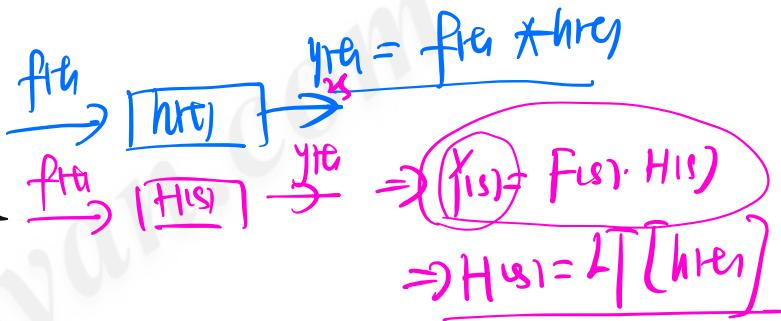
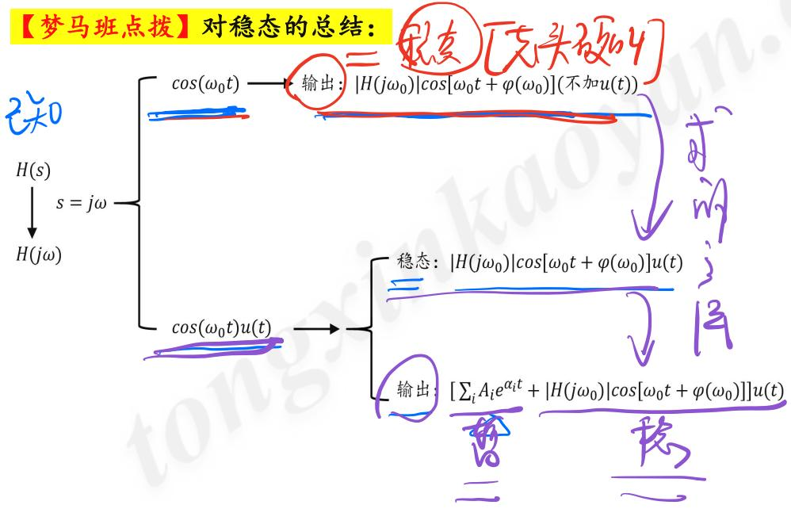

## - Laplace 速度换

单即实极点

单阶共轭极点 $\xrightarrow{原分层}\cos/\sin+\sin^{2}$

$$
\rightarrow f (s) = f _ {1} (s) \stackrel {e ^ {2 s}} {=}
$$

$I^{0}$ $\ln$ $\rightarrow$ $s$ 故分

$$
1 - e ^ {- s T _ {1}}
$$

$$
f ^ {\prime} (u) \leftarrow S f (s) - f (v)
$$

$$
\frac {h (t) + 2 h (t)}{\downarrow} = \delta (t) \neq h (t)
$$

$$
S H (s) + 2 H (s) = 1
$$

$$
S ^ {Y} (s) + 2 Y (s) = F (s)
$$

## 二．连层系统响应

定知两应

$$
r _ {n} (t) + r _ {p} (t)
$$

$$
r _ {i} (t) + r _ {x h} (t) + r _ {x p} (t) = 2 k ^ {2} k ^ {3}
$$

$$
t \rightarrow 0 \text {   时   } = 0 \text {   iPb   }
$$

$^{2}$ 冲振响应古阶跃响应 (表纪录总)

$$
y _ {x} (t) = f (c _ {1} * h (c _ {1})
$$

非常规方程

$$
\frac {h ^ {\prime} (t) + 2 h (t) = \delta^ {\prime} (t)}{\downarrow \quad \downarrow \quad \downarrow}
$$

$$
y ^ {\prime} (t) + 2 y (t) = f ^ {\prime} (t)
$$

$$
S H (S) + 2 H (S) = S
$$

$$
\Rightarrow H (s) = \frac {8}{s + 2} = 1 + \frac {- 2}{s + 2}
$$

$$
\Rightarrow h (t) = d (t) - 2 e ^ {- x} u (t)
$$

B站up: 信号与系统\_谷哥

$$
H (u) = \frac {\sqrt {b}}{\sqrt {2}} = \frac {1 1 s}{F (s)} = \frac {1}{s + 2}
$$

公众号：通信考研小马哥

专题3 系统函数及应用考点1: 系统函数的定义及意义
1. 定义:

$$
H (s) = \frac {R (s)}{E (s)}
$$

零状态响应的拉氏变换与激励的拉氏变换之比。

## 2、物理意义：

系统函数的逆拉氏变换即为系统的冲激响应，即 $h(t) = \mathcal{L}^{-1}[H(s)]$ 。

$h(t)$ 为冲激响应，取决于系统本身的结构，描述了系统的固有性质； $H(s)$ 也仅仅决定于系统结构， $H(s)$ 是表征系统特性的重要参数。冲激响应 $h(t)$ 与系统函数 $H(s)$ 从时域和变换域两方面表征了同一系统的特性。

对给定的激励 $e(t)$ ，其零状态响应为 $r_{zs}(t)=\mathcal{L}^{-1}[H(s)E(s)]$ 。

## 考点2：系统函数的求解

1. 定义法：给定系统的输入和零状态响应，严格按照两者拉氏变换结果之比求解；

2、直接由冲激响应求，即 $H(s)=\mathcal{L}[h(t)]$ ;

3. 从零状态系统的微分方程出发, 两端取拉氏变换求 $H(s)$ , 即 $H(s) = \frac{R(s)}{E(s)} = \frac{\text{右边形式}}{\text{左边形式}}$ ;

4、从零状态s域电路模型出发，按基本定义式求响应的拉氏变换与激励的拉氏变换的比，即 $H(s)=\frac{R(s)}{E(s)}$ ;【后续学习】

5、从系统的框图/流图出发，通过梅森公式直接写出系统函数。【后续学习】例 16: 已知激励信号为 $e(t) = e^{-t}u(t)$ ，零状态响应为 $r(t) = (\frac{1}{2}e^{-t} - e^{-2t} + 2e^{3t})u(t)$ ，求系统函数。

2x

$$
H (s) = \frac {R (s)}{E (s)}
$$

例 17: 已知系统微分方程 $r''(t) + 3r'(t) + 2r(t) = e'(t) + 3e(t)$ ，求系统函数 H(S)

学：两边caplace

$$
S ^ {2} R (s) + 3 S R (s) + 2 R (s) = S E (s) + 3 E (s)
$$

H(s)= $\frac{右边}{120}$ 式

$$
(s ^ {2} + 3 s + 2) R (s) = (s + 3) E (s)
$$

$$
\Rightarrow H (s) = \frac {f (s)}{E (s)} = \frac {s + 3}{s ^ {2} + 3 s + 2}
$$

问：

$$
H (s) = \frac {R (s)}{E (s)} = \frac {s + 3}{s ^ {2} + 3 s + 2}
$$

$$
H (w) = \frac {1}{j w + 2}
$$

$$
\frac {1}{\sqrt {4 + \infty}} = \frac {1}{2 \sqrt {2}}
$$

$$
\frac {y ^ {\prime} (a + 2 y) e = f (e)}{f (w) (w + 2) (w) \equiv f (w)}
$$

B站up: 信号与系统\_谷哥

$f^{-1} = e^{-2t_{1}(t^{-1})}$ |u+t| 公众号：通信考研小马哥
h@5900 总结

方程顺

## 考点3: 系统函数的应用

1、求解系统方程 $H(s)=\frac{R_{zs}(s)}{E(s)}=\frac{右边形式}{左边形式}$

2、求解系统的冲激响应： $H(s)\xrightarrow{\text{逆变换}}h(t)$

$$
\begin{array}{r l} {g ^ {\prime} (t)} & {= h (t)} \\ {S G (s) - g (0, t)} & {= 0 = H (s)} \\ & {\Rightarrow S G (s) = H (s)} \end{array}
$$

3、求解系统的阶跃响应: $G(s) = \frac{H(s)}{s} \xrightarrow{\text{逆变换}} g(t)$

4、求解系统的零状态响应： $R_{zs}(s)=H(s)\cdot E(s)\xrightarrow{逆变换}r_{zs}(t)$

例 18: 已知微分方程 $r''(t) + 3r'(t) + 2r(t) = e'(t) + 3e(t)$ ， $e(t) = e^{-4t}u(t)$ ，求 $h(t)$ 、 $g(t)$ 、

$r_{zs}(t)$ 。 $y: H(S)=\frac{8+3}{S^{2}+3S+2}=\frac{8+3}{(S+1)(S+2)}=\frac{2}{S+1}+\frac{-1}{S+2}\Rightarrow h(H)=\left(2e^{-t}-e^{-2t}\right)(H(t))$

$$
R _ {2} S (S) = E (S) \cdot H (S) = \frac {S + 3}{(S + 1) (S + 2) (S + 4)} = \frac {\frac {2}{3}}{S + 1} + \frac {- \frac {1}{2}}{S + 2} + \frac {- \frac {1}{6}}{S + 4} \Rightarrow R _ {2} (H) = (\frac {2}{3} e ^ {- b} - \frac {1}{2} e ^ {- 2 a} - \frac {1}{6} e ^ {4 a}) (W)
$$

5、求解系统某一特征值的复频域响应

若输入为 $e^{s_0t}$ ，则对应输出为 $H(s_0)e^{s_0t}$ 【要求 $s_0$ 在ROC内， $s_0$ 为复常数】，

当 $s_0 = 0$ 时，输入为直流信号 $E = E \cdot e^{0 \cdot t}$ (E看为系数)，则对应的输出

$$
E \cdot H (0) \cdot e ^ {0 \cdot t} = E \cdot H (0)
$$

$$
\begin{array}{l} {\mathrm{eq:} e \mathrm{Ht} = e ^ {S _ {0} t} \cdot h (\tau)} \\ {r \mathrm{Ht} = e \mathrm{Ht} * h (\tau)} \\ {= \int_ {- \infty} ^ {\infty} h (\tau) \cdot e ^ {t - \tau) d \tau}} \\ {= \int_ {- \infty} ^ {\infty} h (\tau) e ^ {S _ {0} (t - \tau)} d \tau} \\ {= e ^ {S _ {0} t} \sqrt {\int_ {- \infty} ^ {\infty} h (\tau) \cdot e ^ {- S _ {0} \tau} d \tau}} \\ {\mathrm{H(S)} = \int_ {- \infty} ^ {\infty} h (\tau) e ^ {- s t} d t} \\ {\mathrm{H(w)} = \int_ {- \infty} ^ {\infty} h (\tau) e ^ {- j w t} d t} \\ {\mathrm{H(w)} = \int_ {- \infty} ^ {\infty} h (\tau) e ^ {- j w t} d t} \end{array}
$$

6、系统零极点分布判断系统内在特性【详见下一节内容】

秋志响应

【新增引例与分析】

$$
y _ {| U - 1} = 1
$$

且 $f\left( {t + 1}\right)  = u\left( {t + 1}\right)$ .

$$
y _ {n} (t) = A e ^ {- 2 t}
$$

$$
y _ {p} H I = \frac {1}{2}
$$

$$
y _ {(0 + 1)} = y _ {(4)} = 1
$$

$$
y (x + 1) = A + \frac {1}{2} = 1 \Rightarrow A = \frac {1}{2}
$$

$r(t)$ . $t \to \infty$ , 所有 $p > \frac{\pi}{2}$

$$
9: \mathrm{nt} = \frac {(2 e ^ {- t} + 3 e ^ {- 2 t} + \frac {3}{2}) u r e}{\mathrm{总} _ {0}}
$$

$$
r + t = \frac {(2 e ^ {- t} + 3 e ^ {- 2 t} - 4 e ^ {- 4 t}) (1 0 e)}{\mathrm{全为营.无极与}}
$$

$$
\begin{array}{r l} {y (v _ {+})} & {= 2} \\ {\mathrm{Ht}} & {= A e ^ {- x t}} \end{array}
$$

$$
\begin{array}{r l} {x _ {2} y _ {p} H _ {u}} & {= e ^ {- t}} \\ {- B e ^ {- t} + 2 B e ^ {- t}} & {= e ^ {- t}} \end{array}
$$

$$
\Rightarrow y (t) = (\frac {1}{2} e ^ {- x t} + \frac {1}{2}) u r e 1
$$

$$
\Rightarrow B = 1 y _ {p (t)} = e ^ {- t (u (t))}
$$

(1) 系统响应分解: 自由+强迫, 零输入+零状态, 稳态+暂态; (2) 稳态存在的条件:

$\frac{\text{最良状态}}{\text{输入 WHI}}$ 有40周期 ⇒ 存在稳态
(3) 如果稳态存在，一定存在于。。。。。响应中。

① 若 $f(t) = \cos 2t \cdot u(t)$

Gaplace

$\frac{1}{4}[\sqrt{2}\cos(2t+\frac{\pi}{4})]$ (here)

$$
y ^ {\prime} (t) + 2 y (t) = f (t).
$$

$y_{\infty}(t) = -\frac{1}{4} e^{-2t} + \frac{1}{4} (\cos 2t + \sin 2t) u(t)$ 预估

税志

$$
\begin{array}{r l} {Y _ {x (s)} = H (s) \cdot f (s)} & {= \frac {1}{s + 2} \cdot \frac {S}{S ^ {2} + 4}} \\ & {= \frac {k _ {1}}{s + 2} + \frac {k _ {1} s + k _ {2}}{S ^ {2} + 4}} \end{array}
$$

$$
k _ {1} = \left. \frac {8}{5 ^ {2} + 4} \right| _ {s = - 3} = \frac {- 2}{4 + 4} = - \frac {1}{4}
$$

$$
\therefore y _ {S} (s) = \frac {- \frac {1}{4}}{s + 2} + \frac {\frac {1}{4} s + \frac {1}{2}}{s ^ {2} + 4}
$$

$$
\frac {\frac {1}{4} S}{S ^ {2} + 4} + \frac {\frac {1}{4} \cdot 2}{S ^ {2} + 2 ^ {2}}
$$

$$
\begin{array}{c} \frac {H (s) = \frac {1}{s + 2}}{H (w) = \frac {1}{j w + 2}} \\ W _ {0} = 2 \\ H (W _ {0}) = \frac {1}{j ^ {2 + 2}} \end{array}
$$

由 $f(t) = \cos 2t \Rightarrow$ 式抽出 $[3 + t]$ $(H(w_0) / \cos [\omega t + \varphi(w_0))$

例20: 已知 $H(s)=\frac{s+2}{s^{2}+5s+4}$ , 激励为 $e(t)=5cos(2t)u(t)$ , 求输出信号。

$\therefore H(S)=\frac{S+2}{(S+1)(S+4)}\cdot\frac{5S}{S^{2}+4}$

$$
k _ {1} e ^ {- t} + k _ {2} e ^ {- 4 t}
$$

$\frac{3}{2}z = y_{ss}(t) = \sqrt{2}\cos(2t - \frac{\pi}{4})(1 + t)$

$$
k _ {1} = \frac {1 \times (- 5)}{3 \times 5} = - \frac {1}{3}
$$

$$
k _ {2} = \frac {- 2 \times (- 2 0)}{(- 3) \times 2 0} = \frac {4 0}{- 6 0} = - \frac {2}{3}
$$

$$
\Rightarrow y (t) = \left(- \frac {1}{3} e ^ {- t} - \frac {2}{3} e ^ {- 4 t}\right) u (t)
$$

$$
+ \sqrt {2} \cos (x - \frac {\pi}{4}) u (t)
$$

## 7、求稳态响应

(1)稳态响应存在的条件：当输入为阶跃信号或者有始周期信号时，稳定系统的完全响应分解为稳态+暂态，其中稳态通常由阶跃信号或有始周期信号组成；如果输入非阶跃信号或非有始周期信号或系统为不稳定系统，则完全响应不能按此分解，在输入为阶跃或有始周期信号时，稳定系统的强迫响应也称稳态响应。

(2)在完全响应中，当 $t\to\infty$ 时，等于0的部分称之为瞬(暂)态响应，剩余部分称之为稳态响应。

(3)激励为三角信号时的稳态响应

若激励为 $e(t) = E_{m}\sin (\omega_{0}t)$ 或 $e(t) = E_{m}\cos (\omega_{0}t)$

则系统稳态响应结果： $r_{ss}(t) = E_mH_0\sin (\omega_0t + \varphi_0)$ 或 $r_{ss}(t) = E_mH_0\cos (\omega_0t + \varphi_0)$

(4)稳态响应的求解步骤:

①根据 $e(t)$ 明确 $E_{m}$ 和 $\omega_{0}$ 的大小

② $H(j\omega_{0})=H(s)\bigg/_{s=j\omega_{0}}$ ，将 $H(j\omega_{0})$ 化成一个复数 $z=a+bj$ （明确实部和虚部）

③ $H_{0} = \left|H(j\omega_{0})\right|$ ， $\varphi_{0}$ 为相角【 $z = a + bj$ $\left|z\right| = \sqrt{\left(a^{2} + b^{2}\right)}$ $\varphi = \arctan{\frac{b}{a}}$ 】

④将 $E_{m},\omega_{0},H_{0},\varphi_{0}$ 带入结论。

例 19: 已知 $H(s)=\frac{s+2}{s^{2}+5s+4}$ ，激励为 $e(t)=5\cos(2t)u(t)$ ，求稳态响应。

解: $H(s) = \frac{s + 2}{s^2 + 3s + 4}$ . $e(1 + 1) = 5(\cos(12t))$ . 求 $8\sqrt{3}$ 时.

$-w^{2} = (jW)^{2}$ 若 $H(W) = \frac{jW + 2}{-W^{2} + 3jW + 4}$ $\xrightarrow{W = 2}$ $\frac{j2 + 2}{10j} = \frac{1}{5} - \frac{1}{5}j$ $|HR)| = \sqrt{(\frac{1}{5})^{2} + (-\frac{1}{5})^{2}} = \sqrt{\frac{2}{25}} = \frac{\sqrt{2}}{5}$ $\varphi(2) = \arctan \frac{-\frac{1}{5}}{\frac{1}{5}} = -\frac{\pi}{4}$ $\therefore y(H) = 5 \cdot \frac{\sqrt{2}}{5} \cos(2t - \frac{\pi}{4}) = \sqrt{2} \cos(2t - \frac{\pi}{4})$ 例1.9. 解： $\sqrt{2} \cos(2t - \frac{\pi}{4}) uH)$

(5) 激励为三角信号时的响应 (严格不能称之为稳态响应)

若激励为 $e(t) = E_{m}\sin (\omega_{0}t)$ 或 $e(t) = E_{m}\cos (\omega_{0}t)$

则系统稳态响应结果:

$$
r _ {s s} (t) = E _ {m} H _ {0} \sin (\omega_ {0} t + \varphi_ {0}) \mathrm{或} r _ {s s} (t) = E _ {m} H _ {0} \cos (\omega_ {0} t + \varphi_ {0})
$$

稳态存在条件：① 积总系数 ② 插入. $u(t)$ 或有方周期

【梦马班点拨】对稳态的总结：

  
官网：tongxi nkaoyan. con

梦马班讲义

H(S)求解

$$
H (S) = \frac {y (S)}{F (S)}
$$

$$
= \frac {\mathrm{右边}}{\sqrt {2} \mathrm{边}} \mathrm{开式}
$$

$2^{\circ} \text{ H(S)}$ 应用

3° 特殊输入
不带n+1不用考虑基本议项
S域做分式

$$
f _ {x} (s) = F (s) \cdot H (s) \xrightarrow {\frac {v}{g}} y _ {x} (s)
$$

和税志响应

代化还原H(S) $\xrightarrow{S=j\omega} H(\omega)$

条件: 税定式化, 拨入 u(t) 或有方的支 $\begin{cases}\cos w o t / \sin w o t \xrightarrow{\text{(反热)}} \text{输出[也可以硬叫税态]} \\ \cos w o t \xrightarrow{\text{(受热)}} \left\{ \begin{array}{l} \text{输出} e^{\text{折变}} + [ \downarrow] \text{u(t)} \\ \text{标志} y_{\text{eff}} = [ \downarrow] \text{u(t)}\end{array} \right. \\ u(t) \to \left\{ \begin{array}{l} \text{输入(互换反)} \\ \text{税志} = \text{常否} u(t)\end{array} \right.\end{cases}$

g:

$$
y ^ {\prime} | t | + 2 y | t | = f (t), \quad \cos 2 t
$$

写：

$$
H (S) = \frac {1}{s + 2} \Rightarrow H (W) = \frac {1}{f w + 2}
$$

$$
H (2) = H (w) / w = 2 = \frac {1}{j ^ {2} + 2}
$$

$$
| H (2) | = \frac {\sqrt {2}}{4}. \quad \varphi (2) = - \frac {\pi}{4}
$$

$$
\therefore y _ {n} = \frac {\sqrt {3}}{4} \cos (2 t - \frac {\pi}{4})
$$

9:

[Signature]

$$
\begin{array}{r l} {Y _ {(S F} H (S) \cdot F (S)} & \\ & = \frac {1}{s + 2} \cdot \frac {s}{s ^ {2} + 4} \\ & = \frac {k _ {1}}{s + 2} + \frac {k _ {2} s + k _ {3}}{s ^ {2} + 4} \end{array}
$$

$$
k _ {1} = (s + 2) \left| Y (s) \right| _ {s = - 2} = \frac {s}{s ^ {2} + 4} \bigg | _ {s = - 2} = \frac {- 2}{8} = - \frac {1}{4}
$$

求解4

${f}_{1 + 1} = \cos {2\pi }$ 求状态

$$
\begin{array}{r l} {H (s)} & {= \frac {1}{s + 2} \Rightarrow H (w) = \frac {1}{f w + 2}} \\ {H (2)} & {= H (w) / w = 2 = \frac {1}{f ^ {2} + 2}} \\ {| H (2) |} & {= \frac {\sqrt {2}}{4} \cdot \varphi (2) = - \frac {\pi}{4}} \\ {\therefore y _ {s s} ^ {(t)}} & {= \frac {\sqrt {3}}{4} \cos (2 t - \frac {\pi}{4}) (1 1 t)} \end{array}
$$

$$
f (a) = \cos 2 t u (t)
$$

式抽出

$$
H (s) = \frac {1}{s + 2} \Rightarrow H (w) = \frac {1}{f w + 2}
$$

$$
H (2) = H (w) / w = 2 = \frac {1}{7 2 + 2}
$$

$$
\vert H (2) \vert = \frac {\sqrt {2}}{4}. \varphi (2) = - \frac {\pi}{4}
$$

$$
y _ {s s} ^ {(t)} = \frac {\sqrt {3}}{4} \cos (2 t - \frac {\pi}{4}) (1 1 t)
$$

$$
\therefore y (t) = - \frac {1}{4} e ^ {- 2 t} u (t) + \frac {\sqrt {2}}{4} \cos (2 t - \frac {2}{4}) u (t)
$$

三涉及内容：

授权