$f(t) \xleftrightarrow{Roe} F(s)$

H(S) 的应用 ① H(S) → h(t) ③ $Y_{2}(S) = H(S) \cdot F(S) \rightarrow Y_{2}(t)$ ② $G(S) = \frac{H(S)}{S} \rightarrow g(t)$ ④ 内在特性

ROC及常见信号的ROC

u(右)型 因某信号 (右边信号) $e^{-2t}$ $u(t)$ $\leftrightarrow$ $\frac{1}{s+2}$ $Re[s] > -2$

同某、
致远、
可逆、
波浪、

$$
\frac {e ^ {- x t} u (t) - e ^ {- 3 t} u (- t)}{\sigma > 2 \quad \sigma <   3}
$$

$$
\left\{ \begin{array}{l l} {\delta (t + 1)} & {\hookrightarrow 1} \\ {\delta (t - 1)} & {\hookrightarrow e ^ {- s}} \\ {\delta (t + 1)} & {\hookrightarrow e ^ {s}} \\ {\delta (t + 1) + \delta (t - 1)} & {\hookrightarrow e ^ {- s} + e ^ {s}} \end{array} \right. \quad \left\{ \begin{array}{l l} {S _ {2}} \\ {\mathrm{}} \\ {\mathrm{}} \\ {\mathrm{}} \\ {\mathrm{}} \end{array} \right.
$$

$$
\begin{array}{r l} {q: \int_ {- \infty} ^ {\infty} e ^ {- v t} u _ {t + 1} e ^ {- s t} d t} \\ & {= \int_ {0} ^ {\infty} e ^ {- (s + 2) t} d t} \\ & {= - \frac {e ^ {- (s + 2) t}}{s + 2} / _ {0} ^ {\infty}} \\ & {= \frac {1}{s + 2}} \end{array}
$$

$$
\begin{array}{l}e _ {0} ^ {- 1 (s + 2) \cdot \frac {b}{4}} \rightarrow 0\\\frac {s + 2 > 0}{s > - 2}\\\frac {1}{x + y n}\end{array}
$$

1° 研究信号：同象(右边) → ROC: 0 > 数

设 $H\left( s\right)$

$$
\sqrt {H (s)} = \frac {s}{s + 1}
$$

专题4 系统内在特性的判断

$$
H (s) = \frac {s}{(s + 1) ^ {2}}
$$

考点1: 极点与ROC关系

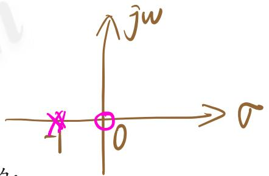

1、零极点与 ${ROC}$ 的关系： ${ROC}$ 内无极点, ${ROC}$ 是以极点为边界的；

$H(S)=\frac{A(S)}{B(S)}=0$ 等先 √ 0
切点 √

要权兵国

例 21: $H(s) = \frac{1}{(s+1)(s+3)}$ 的所有可能 ROC。

$$
\left\{ \begin{array}{l l} \sigma > - 1 \\ \sigma <   - 3 \\ - 3 <   \sigma <   - 1 \end{array} \right.
$$

权总1和-3

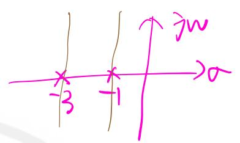

2、零极点与 $H(s)$ 的关系

(1) $H(s)\rightarrow$ 零极点图是确定型

(2)零极点图→ $H(s)$ 含待定系数,需借助其它信息,例如 $h(0_{+})$ 、 $H(s_{0})$ 、 $\int_{-\infty}^{\infty}f(t)dt$

示例：零点为 0，极点为 -1 和 -2。设

$$
H (S) = \int_ {- \infty} ^ {\infty}
$$

$$
H (s) = \frac {s}{(s + 1) (s + 2)} x
$$

是极点 $\Rightarrow  0$

$$
H (1) = 1
$$

$$
\underline {{H (0)}} = 1
$$

$$
H (\mathfrak {s} _ {0})
$$

$$
\frac {1}{6} f (t) = e ^ {2 t} \rightarrow y (t) = 3 e ^ {2 t} \Rightarrow H (2) = 3
$$

$\int_{-10}^{\infty}f(t)dt = H(0)\text{值}$

$$
H _ {U S F} = \frac {k (s + 1)}{(s + 2) (s + 3)}
$$

初值过程 $h(u+1)=\lim_{s\to\infty}sH(s)=2$

确定型

不确定型

$$
H (1) = 1
$$

$$
e ^ {2 t} \rightarrow 3 e ^ {2 t} \Rightarrow H (2) = 3
$$

不同ROC下Laplace适度换 (若共3)

① $H(s) = \frac{s}{(s+1)(s+2)}$ 向不同20C下速度按分类讨论 $h(t)$ 所有可否的 $H(s) = \frac{-1}{s+1} + \frac{2}{s+2}$ $1^{\circ} \sigma > -1$ $2^{\circ} \sigma < -2$ $h|t| = (-e^{-t} + 2e^{-2t})u|t|$ $h|h| = (e^{-t} - 2e^{-2t})u|h|$ $3^{\circ}(-2\sigma < -1)$ $h|h| = e^{-t}u|h| + 2e^{-2t}u|h|$ $\sqrt{e^{-2t}}u|h| \rightarrow \frac{1}{s+2} \quad \sigma > -2$ $\sqrt{-e^{-2t}}u|-t| \rightarrow \frac{1}{s+2} \quad \alpha < -2$

②害怕 (共多引)
Laplaa 大题 (3-6问)
前(问 H(s) → h(t))
g(H)
y\_s(H)
} 题目
信息
马夫从 => 10类

## 考点2: 系统函数零极点决定时域波形和频域特性

## 一. 一阿莫根

右半轴
左半轴
原点

一所共扼根

右半平两

左半平而

$$
H (s) = \frac {1}{s - 2}
$$

蔗油

$$
H (s) = \frac {1}{s + 2}
$$

$$
h (t) = e ^ {2 t} u (t)
$$

$$
\rightarrow h (t) = e ^ {- 2 t} (u (t))
$$

$$
H (S) = \frac {1}{s}
$$

$$
h (t) = u (t)
$$

$$
H (s) = \frac {1}{(s - 1) ^ {2} + 1} \rightarrow h (t) = e ^ {t} \sin t (t)
$$

$$
H (s) = \frac {1}{(s + 1) ^ {2} + 1} \rightarrow h (t) = e ^ {- t} \sin t (u t)
$$

$$
H (s) = \frac {1}{s ^ {2} + 1} \Rightarrow h (t) = \sin t (u t)
$$

收敛

常及

发散

收敛

涨幅振荡

## 二、二阶极点

右半轴

左半羽

顾

$$
H (s) = \frac {1}{(s - 1) ^ {2}} \rightarrow h (t) = t e ^ {t} u (t)
$$

$$
H (s) = \frac {1}{(s + 1) ^ {2}} \rightarrow h (t) = t e ^ {- t} u (t)
$$

$$
H (s) = \frac {1}{s ^ {2}} \Rightarrow h (t) = t u (t)
$$

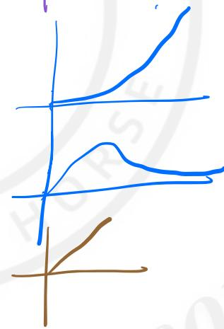

uQeq

发散

二阶共轭叔兵

右半平向

发期

$$
H (s) = \frac {2 (s - 1)}{[ (s - 1) ^ {2} + 1 ] ^ {2}}
$$

左半平

$$
H (s) = \frac {2 (s + 1)}{[ (s + 1) ^ {2} + 1 ] ^ {2}} \rightarrow h (t) = t e ^ {- t} \sin t (u t) \mathrm{取}
$$

旋轴

$$
H (s) = \frac {2 s}{(s ^ {2} + 1) ^ {2}} \rightarrow h (t) = t \sin (u + t)
$$

所有权关系位于S方半平面线段：有权负位于S右半面，=阶右座的

发发

官网：tongxi nkaoyan.com : 一阶在虚轴

B站up: 信号与系统\_谷哥

$h(t) \xleftarrow{L} H(s)$

$H(w)=f_{-w}^{w}h(t)e^{-j\omega t}dt$

$H(B) = P_{-B}^{vo} \quad h \mid a \rho^{-s t} \text{cdt}$

公众号：通信考研小马哥

$\Rightarrow  H\left| s\right| _{s = {jw}} = H\left| w\right|$

## 考点3：系统特性判断s域方法

1、因果系统：ROC为某直线的右侧，即h(t)是u(t)型；

2、稳定系统：ROC内包含虚轴； $\liminf\limits_{{k \to  \infty }}\left| {h}^{k}\right|  + \left| {d}^{k}\right|  < \infty$ 稳定 $\Rightarrow  {PT}$ 存在 $\Rightarrow  {21}$ 存在

(1)若 $H(s)$ 分母多项式为一阶或者二阶—求极点，然后看极点位置

颖：s古半6

例 22: $H(s) = \frac{1}{s^{2} + 3s + 2 - k}$ 若系统稳定, 求常数 $k$ 应满足的条件?

不成立：发为1平方

$$
\begin{array}{l} 2 - k > 0 \\ k <   2 \end{array}
$$

化交

松：k>0

临界承定：一阶在底轴

的.由罗斯可知

$$
S ^ {2} + 2 S + \beta
$$

不积：k<0

$$
\sqrt {1 0} \cdot k = 0
$$

(3)罗斯矩阵

$$
H (s) = \frac {A (s)}{B (s)}
$$

$$
B (s) = a _ {n} s ^ {n} + a _ {n - 1} s ^ {n - 1} + a _ {n - 2} s ^ {n - 2} + \dots + a _ {1} s + a _ {0}
$$

方程: $y^{i}t + 3y^{i}t + 2y^{i}t =$

不稳定条件：铁项

$$
H (s) = \frac {A (s)}{\Delta s ^ {2} + 3 s + 2}
$$

$^{20}$ 系数顾数

$$
\left| \begin{array}{c c c c} s ^ {n} & a _ {n} & a _ {n - 2} & a _ {n - 4} \dots \\ s ^ {n - 1} & a _ {n - 1} & a _ {n - 3} & a _ {n - 5} \dots \\ s ^ {n - 2} & c _ {n - 1} & c _ {n - 3} & c _ {n - 5} \dots \\ s ^ {n - 3} & d _ {n - 1} & d _ {n - 3} & d _ {n - 5} \dots \\ \dots & \dots & \dots \\ s ^ {1} & \dots & \dots \\ s ^ {0} & \dots & \dots \end{array} \right|
$$

$= {2\pi }{s}^{2} + {2s} + \beta$

不缺项目京及均为正

$$
\left| \begin{array}{l l l} s ^ {2} & 1 & \beta \\ s ^ {1} & \alpha & 0 \\ s ^ {0} & \beta & \end{array} \right|
$$

$$
\mathbf {c} _ {n - 1} = \frac {- 1}{a _ {n - 1}} \left| \begin{array}{l l} a _ {n} & a _ {n - 2} \\ a _ {n - 1} & a _ {n - 3} \end{array} \right|, \mathbf {c} _ {n - 3} = \frac {- 1}{a _ {n - 1}} \left| \begin{array}{l l} a _ {n} & a _ {n - 4} \\ a _ {n - 1} & a _ {n - 5} \end{array} \right| \dots
$$

罗斯

$$
\mathbf {d} _ {n - 1} = \frac {- 1}{c _ {n - 1}} \left| \begin{array}{c c} a _ {n - 1} & a _ {n - 3} \\ c _ {n - 1} & c _ {n - 3} \end{array} \right|, \mathbf {d} _ {n - 3} = \frac {- 1}{a _ {n - 1}} \left| \begin{array}{c c} a _ {n - 1} & a _ {n - 5} \\ c _ {n - 1} & c _ {n - 5} \end{array} \right|...
$$

$$
= - \frac {1}{2} | _ {\alpha_ {0}} ^ {\beta} | = \beta
$$

以此类推，把第一列数值全部算出来

稳定的充要条件: 第一列全部为正数

若第一列系数符号不同，符号改变次数是极点在右半平面个数

若 $H(s)$ 为二阶多项式 $s^{2}+\alpha s+\beta$ ，只需 $\alpha>0,\beta>0$ .

例23：系统函数分母多项式为 $2s^{4} + s^{3} + 3s^{2} + 5s + 7$ ，该系统是否为稳定系统？

不缺项. 录权均为正 $\Rightarrow$ 罗斯

先列中后负数后在三不稳定 [一7 结束]
有2个极点在右半平而

例 24: 一系统函数分母多项式 $s^{3} + 3ks^{2} + (k + 2)s + 4$ ，为使系统稳定，求 k 的范围

$$
\begin{array}{r l} {\mathrm{学、不缺项.均正}} & {\stackrel {k > 0} {\underset {k \neq - 2} {\longrightarrow}} \stackrel {k > 0} {\underset {k + 2 > 0} {\longrightarrow}} \stackrel {\mathrm{希腊}} {\Rightarrow} s ^ {3} \quad 1 \quad k + 2 \quad 0} \\ {- \frac {1}{3 k} \left| \begin{array}{l l} 1 & k + 2 \\ 3 k & 4 \end{array} \right|} & \\ {- \frac {1}{3 k} \left[ 4 - 3 k (1 + 2) \right]} & \\ & \end{array}
$$

(4)因果稳定系统：ROC为某直线右侧且包含虚轴，即系统函数所有极点全部位

于 $s$ 平面的左半平面；

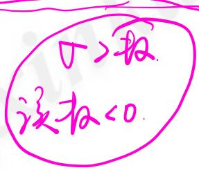

1. Roc 与极点

2. 内在特性

12集：RVC：>权

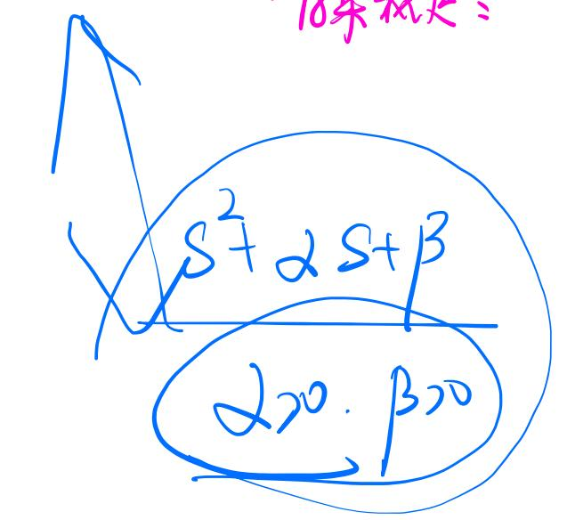

频谱： $^{1}$ 泛度谱与本位谱
→ 位对称

理解：

3、全通系统：极点全部在左半平面，零点全部在右半平面，零极点关于虚轴镜

像；

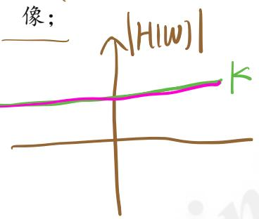

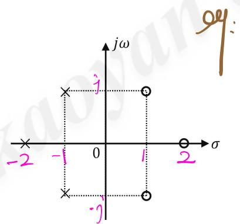

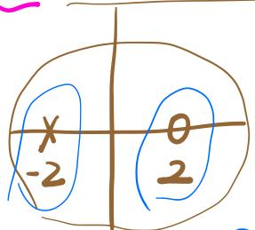

$$
H (s) = \frac {k [ s - 2 ]}{s + 2} \Rightarrow H (w) = \frac {k [ w - 2 ]}{j w + 2}
$$

全通系统的幅频特性 $|H(\omega)|$ 是常数

$$
H (w) = \frac {k [ \sqrt {(- 2) ^ {2} + w ^ {2}} ]}{\sqrt {2 ^ {2} + w ^ {2}}} = k
$$

1° 已知 $H(s)/3^{2}$ 程 $\Rightarrow$ 链道？(马极点分布级别)

$\therefore$ 全通部分正极角 $\Rightarrow$ 求 $H(s)$ $\Rightarrow$ 其它正极角

4、最小相移系统：零点全部位于左半平面或虚轴上

5、滤波特性：判断系统是低通、高通、带通还是带阻

①求系统函数 $H(s)$ 的零极点，并画出零极点分布图；

②取虚轴上一点P，连接各零极点到P点的矢量图；

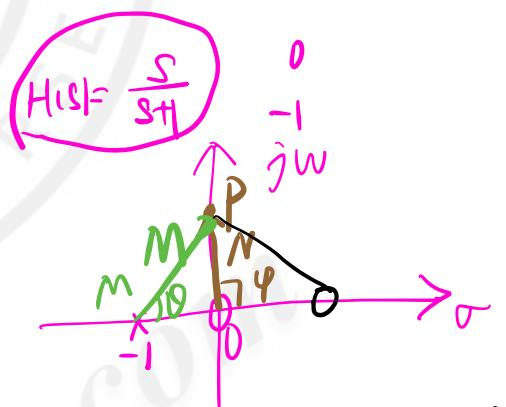

③幅频特性 $\left|H(\omega)\right|=\frac{\text{所有零点线段长度乘积}}{\text{所有极点线段长度乘积}}$

相频特性 $\varphi(\omega)=\left(\text{所有零点夹角之和}\right)-\left(\text{所有极点夹角之和}\right)$

④根据幅频特性曲线走势判断滤波器类型；

$$
\frac {\vec {p} = N _ {1} e ^ {j \varphi_ {1}} N _ {2} e ^ {j p _ {2}}}{\vec {m} = M e ^ {j \theta} \| _ {j \varphi_ {1}}}
$$

低通：高低走势

高通：低高走势

带通：低高低走势

$$
N _ {1} N _ {2} \cdot e ^ {i (Q _ {F _ {B}})}
$$

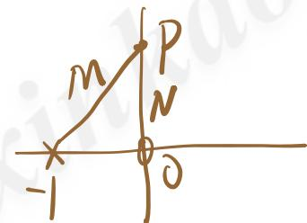

$$
\frac {N e ^ {j \varphi}}{M e ^ {j \theta}}
$$

带阻：高低高走势

$$
\left| H (w) \right| = \frac {N}{M}
$$

$$
\left| \begin{array}{l} H (w) \\ \varphi (w) \end{array} \right| = \frac {N}{n}
$$

$$
\begin{array}{l} {p _ {\mathrm{农}} \mathrm{厚知}} \\ {p _ {\mathrm{双}} \mathrm{无}} \end{array}
$$

$$
N = 0, M = 1
$$

$$
N = \infty . M = d o
$$

$$
\begin{array}{l} {[ H (0) ] = 0} \\ {[ H (1 0 0) ] = 1} \end{array}
$$

9: H(S) = $\frac{1}{s+1}$ 向派泪特性

$$
\underline {{\underline {{H (w)}}}}
$$

呼：

$$
H (W) = H (S) / s = j W = \frac {1}{j W + 1}
$$

$$
| H (w) | = \frac {1}{\sqrt {w ^ {2} + 1}}
$$

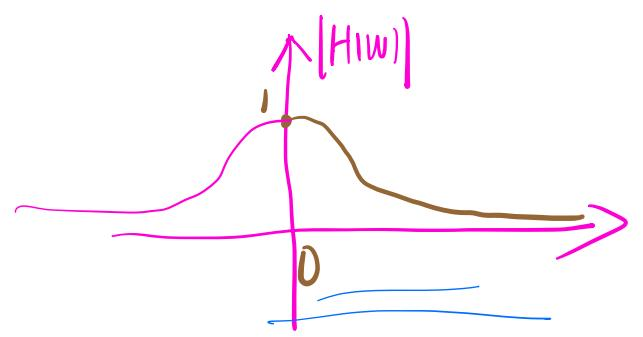

取点

$$
W = D
$$

$$
| H (0) | = 1
$$

$$
W = \infty
$$

$$
\{H (w) \} = 0
$$

⇒ 低通

$$
(0 \rightarrow \infty)
$$

g:

$$
H (S) = \frac {s}{s + 1}
$$

$$
H (w) = \frac {j w}{j w + 1}
$$

$$
\vert H (w) \vert = \frac {\vert w \vert}{\sqrt {w ^ {2} + 1}}
$$

取点

$$
W = D
$$

$$
\left| H (0) \right| = 0
$$

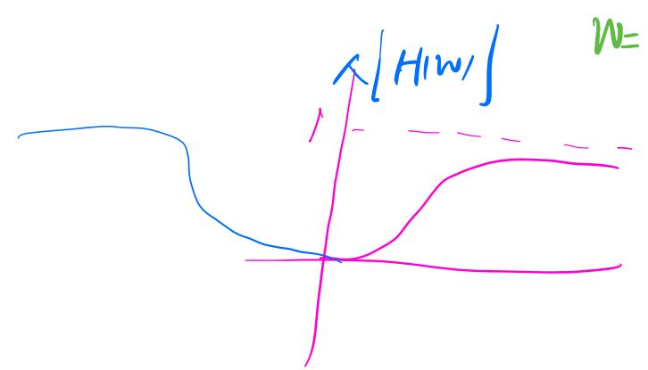

$$
w = \infty
$$

$$
| H (w) | = 1
$$

高道

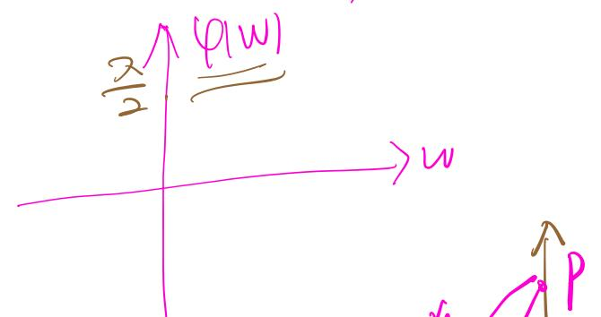

$$
\varphi_ {| w |} = \varphi - (\theta_ {1} + \theta_ {2})
$$

P=原点

$$
\varphi = \frac {\pi}{2}, \theta_ {1} = 0, 2 = 0
$$

$$
p = 1.
$$

$$
\varphi = \frac {\pi}{2} \theta_ {1} = \frac {\pi}{4}
$$

$$
\varphi = \frac {\lambda}{2} \cdot \theta_ {1} = \theta_ {2} = \frac {\lambda}{2}
$$

B站up: 信号与系统\_谷哥

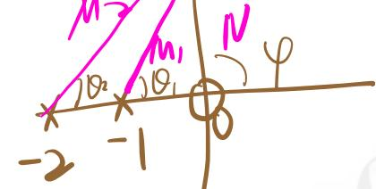

例 25: 判断系统 $H(s)=\frac{s}{(s+1)(s+2)}$ 的滤波特性。

学术派

正规
表达式

$$
H (S) = \frac {S}{S ^ {2} + 3 S + 2}
$$

取点

$$
H (W) = \frac {j w}{- w ^ {2} + 3 j w + 2}
$$

$$
W = 0
$$

$$
w = 1
$$

$$
\begin{array}{r l} {| H (w) |} & {= \frac {| w |}{\sqrt {(2 - w ^ {2}) ^ {2} + 9 w ^ {2}}}} \\ & {= \frac {| w |}{\sqrt {w ^ {4} + 5 w ^ {2} + 4}}} \end{array}
$$

$$
W = 1 0
$$

$$
\varphi (w) = \pm \frac {\pi}{2} - \arctan \frac {3 w}{2 - w ^ {2}}
$$

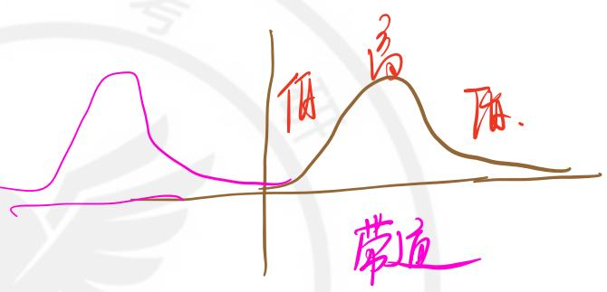

6、可逆系统的求解

$$
\xrightarrow {f (t)} \text {原系统} \xrightarrow {h _ {1} (t)} y (t) \xrightarrow {h _ {2} (t)} \text {逆系统} \xrightarrow {f (t)}
$$

$$
y (t) = f (t) * h _ {1} (t)
$$

$$
f (t) = y (t) * h _ {2} (t)
$$

$$
f (t) = f (t) * h _ {1} (t) * h _ {2} (t)
$$

$\Rightarrow$ 总系统：

$$
\begin{array}{c} h (t) = h _ {1} (t) * h _ {2} (t) = \delta (t) \\ \Rightarrow H _ {1} (s) \cdot H _ {2} (s) = 1 \end{array}
$$

公众号：通信考研小马哥

$$
H (w) = \frac {N}{M _ {1} \cdot M _ {2}}
$$

常通

$$
| H (w) | = 0
$$

$$
N = 0, M _ {1} = 1, M _ {2} = 2
$$

即逆系统的系统函数可用原系统的系统函数求倒数获得。

$$
P = 1. N = 1. M _ {1} = \sqrt {2}. M _ {2} = \sqrt {f} | H (v) | = \sqrt {\frac {1}{1 0}}
$$

$$
\infty N = \infty , M _ {1} = \infty M _ {2} = \infty | H (u) | > 0
$$

$$
| H (1) | = \frac {1}{\sqrt {1 0}}
$$

$$
\vert H (0) \vert = 0
$$

$\therefore {S}_{\Delta AOB} = {S}_{\Delta BHA} + {S}_{\Delta CBA} - {S}_{\Delta DCE}$

$$
\mathrm{间} \frac {1}{2} H (8) = \frac {1}{H _ {1} (8)}
$$

派派特性 [表式法 + 关键性]

$^{1}2^{0}$ 判断 $\times$ 关键点 学术派一并的失
学术派去去
文章法去判断.

(一) ROC 与权关系 $\frac{1^{\circ} \text{ ROC 占权负}}{\text{边界}} \Rightarrow \text{ROC 所右可能} \Rightarrow \left\{ \begin{array}{l} \text{原函数 可理性} \\ \text{因果是性} \end{array} \right.$ $2^{\circ} \text{ 虎权负因}$ $H(S) \xrightarrow{\text{不成立型}} \text{互权复同}$ $e^{S_{0}t} \Rightarrow H(S_0)e^{S_{0}t}$

(2) 内态变化

1° 时点 → $\frac{2S^{2}+2S+\beta\cdot\alpha>0.\beta>0}{\text{罗斯}}$ 2° 科点 → $\boxed{\text{罗斯}}$ 3° 星点

4° 全球

5° 好人和哥

6° 深河 → 赵式.关键词

7° 可逆

# 连续时间系统响应求解的时域分析（回顾）

1、连续时间系统三要素——微分方程、激励和系统 0-状态；

2、经典法——3、5、跳、代

3、双零法

1）零输入响应——3、代

2）零状态响应——3、5、跳、代

4、如果系统只求完全响应（包括自由和强迫，未提及双零响应）——经典法

5、如果系统求解包含双零响应——一律用双零法

## 连续时间系统响应求解的 S 域分析（回顾）

1、系统函数

2、零状态相应的求解

官网：tongxi nkaoyan.com