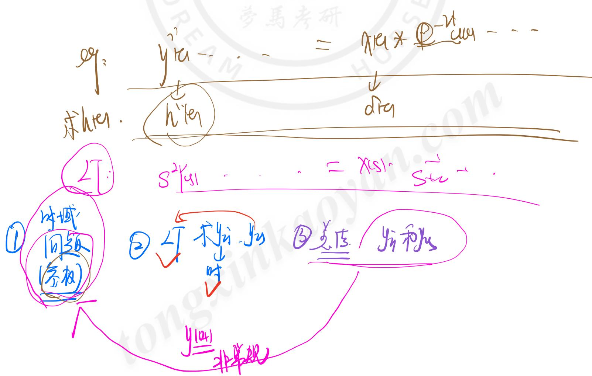
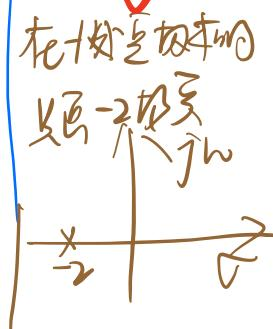
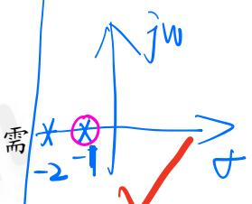

DF免费QQ群6156981432723

$$
\begin{array}{r l} {9:} & {e ^ {| t |} = 2 e ^ {- 3 t} u ^ {| t |}} \\ & {r ^ {| t |} = H [ e ^ {| t |} ]} \\ & {H [ \frac {d}{d t} e ^ {| t |} ] = - 3 r ^ {| t |} + e ^ {- t} u ^ {| t |} \quad \mathrm{求} u ^ {| t |}} \end{array}
$$

DF免费QQ群615698143 双零点(时域)

1. 定义、无由

2. 三等式：方程 f(x₁, y'(x₂))

3. 求的流程 $\left\{\begin{array}{l}y_{2i}(t) \rightarrow 3代 \\ y_{x1t} \rightarrow 35线式 \\ 号数且 y_{x1(t)} = h(t) * f(t)\end{array}\right.$

4. ① = 阶方程， $f(t)$ [最大次、既变]

② $f(t) = e^{-x} u(t)$ ，且 $|n|$ 向 $y_{p}(t) = ct e^{-2t}$ ③ = 阶

$\text{eq: } y^{t} | t + 3y| | t + y| t = f^{\prime}|t + 3f|t$ = 重根 $(C_{1}t + C_{2})e^{-t}$ $f|t| = e^{-t} u|t$ ③步 $e^{-x} u|t$ $y^{t} | t + 3y| | t + 2y| t = f^{\prime} | t + f| t.$

$\text{eq: } y(t) + 2y(t) = f(t), \quad f(t) = e^{-t}(u(t)) \quad y(0) = 1$

设: $y_{2i|t|} = A e^{-2t}$ $y_{2i|0+1} = y_{10-1} = A = 1$ $\Rightarrow y_{2i|t|} = e^{-2t} u_{1|t|}$ $y_{2s|t|} = B e^{-2t}$ $t > 0$ 时 $e^{-t} u_{1|t|}$ $t > 0$ 时 $e^{-t} \Rightarrow C e^{-t}$ $-C e^{-t} + 2C e^{-t} = e^{-t} \Rightarrow c = 1$ $\therefore e^{-t}$ $\Rightarrow y_{x|t|} = B e^{-t} + e^{-t}$ $y_{x|0+1} = y_{x|0-1} = 0 = B + 1 \Rightarrow B = -1$ $\Rightarrow \sqrt{y_x|t|} = (-e^{-2t} + e^{-t}) u_{1|t|}$

$$
y (0 - 1) = y ^ {2} (0 - 1) = 1
$$

$$
y _ {x}
$$

解: $y_{i+1} = Ae^{-t} + Be^{-2t}$ $y_{i}(u_0) = A + B = 1$ $y_{i}(u_f) = -A - 2B = 1$ $\Rightarrow \begin{cases} A = 3 \\ B = -2 \end{cases} \Rightarrow y_{i+1} = (Be^{-t} - 2e^{-2t}) / u_{i+1}$ PDF免费QQ群615698143

$$
y _ {u p} | t | = \frac {1}{2}
$$

$$
\Rightarrow y _ {3} \cdot e _ {1} = C e ^ {- t} + D e ^ {- 2 t} + \frac {1}{2}
$$

$$
y _ {x} ^ {\prime \prime} | a = a d i a + b \Delta u | c u \Rightarrow a = 1
$$

$$
y _ {3} (0 + 1) = C + D + \frac {1}{2} = 0
$$

$$
y _ {2 5} ^ {\prime} u _ {1} = a \Delta u (y) \Rightarrow y _ {2 5} ^ {\prime} u (u + 1) = y _ {2 5} ^ {\prime} (u - 1) + a = 1
$$

$$
\begin{array}{r l} {y _ {2 1 (4)} = - C - 2 D = 1} \\ {\Rightarrow \quad - D + \frac {1}{2} = 1} \end{array}
$$

$$
y _ {y} p a = a t \Delta u r e 1 \Rightarrow y _ {x} (u +) = y _ {x} (0, - 1) \Rightarrow
$$

$$
\Rightarrow y _ {2} | a = (- \frac {1}{2} e ^ {- i t} + \frac {1}{2}) | u | e _ {1}
$$

$$
\left\{ \begin{array}{l l} {H (s) = \frac {s + 1}{s ^ {2} + 3 s + 2} = \frac {1}{s + 2}} \\ {F (s) = \frac {1}{s} \quad \frac {1}{2} - \frac {1}{2}} \\ {\Rightarrow y _ {B} (s) = \frac {1}{s (s + 2)} = \frac {1}{s} + \frac {1}{s + 2}} \\ {\Rightarrow y _ {B} (a) = (\frac {1}{2} - \frac {1}{2} p - a) u (e)} \end{array} \right.
$$

$y_{i}$ 为 $f(a)$ 元，由 $y_{i}(a)$ 引起。 $y_{i}$ 为 $a + 2y_{i}a = f(a)$ ，求 $y_{i}$ 到 $y_{i}$ 为 $(s) - y_{i}(a) + 2y_{i}(s) = 0$ $y_{i}$ 为 $(s) = \frac{b g}{f(2)} = \frac{y_{(2)}}{s+2}$ 由 $y_{i}$ 为 $(a,1)$ 引起。 $y_{i}$ 为 $(a+2y_{i}a) = f(a)$ ，求 $y_{i}$ 到 $y_{i}(a) = f(a)$ ，求 $y_{i}$ 的二次函数， $f(a) = e^{-\frac{t}{2}}$ $y_{i}$ 为 $(s) - y_{i}(a) + 2y_{i}(s) = 0$ $[s]_{2i}(s) - y_{2i}(a) = 0$ $x_{2i}(s) = \frac{y_{2i}(a)}{s+2} = y_{(2)} = \frac{1}{s+2}$ PDF免费QQ群615698143

专题5 双零法的LT求解

考点1：零输入响应的s域求解

1、原理：

$$
\begin{array}{r l} {\frac {d}{b} f (a)} & {\hookrightarrow F (s)} \\ {f ^ {\prime} (t) \leftrightarrow s F (s) - f (0 _ {-})} \\ {f ^ {\prime \prime} (t) \leftrightarrow s ^ {2} F (s) - s f (0 _ {-}) - f ^ {\prime} (0 _ {-})} \end{array}
$$

2、步骤：零输入响应满足齐次，方程两边同时进行拉氏变换，然后写出 $R_{zi}(s)$ 表达式，最后逆变换。

无强要求 [之素]
< $\frac{叶域求 y_{2i}}{2T 求 y_{2j}}$

例 26: $r''(t)+3r'(t)+2r(t)=e'(t)+3e(t), r(0_{-})=1, r'(0_{-})=2$ ，求 $r_{zi}(t)$ 。

解析：

$$
\begin{array}{r l} {\mathrm{下}: R _ {2 i} (s)} & {= \frac {S n (L) + r ^ {i} (u - 1) + 3 n (u - 1)}{S ^ {2} + 3 S + 2}} \\ & {= \frac {S + 2 + 3 = S + 5}{(S + 1) (S + 2)}} \\ & {= \frac {4}{S + 1} + \frac {- 3}{S + 2}} \end{array}
$$

$$
\begin{array}{r l} & {r _ {2 i} ^ {\prime \prime} r a + 3 r _ {2 i} ^ {\prime} r a + 2 r _ {2 i} r a = 0} \\ & {+ 3 [ s R _ {2 i} (s) - r _ {2 i} (u _ {1}) ] \leq R _ {2 i} (s)} \\ & {[ s ^ {2} R _ {2 i} (s) - s R _ {2 i} (u _ {1}) - r _ {2 i} (u _ {2}) ]} \\ {\mathrm{or:}} & {s n (u _ {1}) + r _ {2 i} (u _ {1}) + 3 r _ {2 i} (u _ {2})} \end{array}
$$

$$
\Rightarrow r _ {x} | a = (4 e ^ {t} - 3 e ^ {- x}) u | e q
$$

时域: $r_{2i}|u| = Ae^{-t} + Be^{-2t}$ $r_{2i}(u+1) = r(u-1) = A + B = 1$ $r_{2i}'(u_+) = r'(u-1) = -A \cdot 2B = 2$ $\Rightarrow$ $\left\{\begin{array}{l} A=4 \\ B=-3 \end{array}\right.$

官网：tongxi nkaoyan. con

PDF免费QQ群 $^{梦马班讲义}$ 615698143

$$
\begin{array}{r l} & {\mathrm{考点2:零状态响应的} s \mathrm{域求解}} \\ & {R _ {z s} (s) = H (s) \cdot E (s) \xrightarrow [ ]{\mathrm{逆变换}} r _ {z s} (t)} \end{array}
$$

道 $\Rightarrow  {y}_{n}\left| n\right|$

考点 3：系统完全响应的求解流程

零状态一律用LT，零输入尽量用时域(除非题目要求s域)

$$
\begin{array}{r l} & \text {微分方程} \rightarrow \left\{ \begin{array}{l l} & {\text {已知} r ^ {(k)} (0 _ {-}) \rightarrow \left\{ \begin{array}{l l} & {\text {时域} r _ {z i} (t) \rightarrow r (t) = r _ {z i} (t) + r _ {z s} (t)} \\ & {\text {LT} r _ {z s} (t) \rightarrow r (t) = r _ {z i} (t) + r _ {z s} (t)} \end{array} \right.} \\ & {\text {已知} r ^ {(k)} (0 _ {+}) \rightarrow \left\{ \begin{array}{l l} & {\text {解形式}} \\ & {\text {时域} r (t) \rightarrow r ^ {(k)} (0 _ {+}) \rightarrow r (t) \rightarrow r _ {z i} (t) = r (t) - r _ {z s} (t)} \\ & {\text {特解}} \end{array} \right.} \\ & {\text {设} r _ {z i} (t) \text {解(含系数)} \rightarrow r (t) \text {完全(含系数)} \xrightarrow {r ^ {(k)} (0 _ {+})} r _ {z i} (t) \text {和} r (t)} \end{array} \right. \text {时域:}
$$

例 27: 描述某LTI系统的微分方程为

$$
y ^ {\prime \prime} (t) + 3 y ^ {\prime} (t) + 2 y (t) = f ^ {\prime} (t) + 4 f (t)
$$

求在下列条件下的零输入响应和零状态响应。

$$
(1) f (t) = e ^ {- 2 t} u (t), y (0 _ {-}) = 1, y ^ {\prime} (0 _ {-}) = 1.
$$

$$
(2) f (t) = e ^ {- 2 t} u (t), y (0 _ {+}) = 1, y ^ {\prime} (0 _ {+}) = 2 。
$$

$\dot{n}_{f} = \begin{pmatrix} 1 \\ 0 \end{pmatrix}$

$$
\begin{array}{r l} {y _ {i} | t |} & {= A _ {1} e ^ {- t} + A _ {2} e ^ {- 2 t}} \\ {y _ {i} | (t) |} & {= A _ {1} + A _ {2} = 1} \\ {\int_ {x} | t | + 1} & {= - A _ {1} - 2 A _ {2} = 1 \quad \Rightarrow \left\{ \begin{array}{l l} {A _ {1}} & {= 3} \\ {A _ {2}} & {= - 2} \end{array} \right.} \\ {\Rightarrow y _ {i} | t |} & {= (3 e ^ {- t} - 2 e ^ {- 2 t}) u | t |} \end{array}
$$

$$
\begin{array}{r l} {P _ {S} (s)} & {= H (s) \cdot F (s) = \frac {s + 4}{(s + 1) (s + 2)} \cdot \frac {1}{s + 2} = \frac {s + 4}{(s + 1) (s + 2) ^ {2}}} \\ & {= \frac {3}{s + 1} + \frac {- 2}{(s + 2) ^ {2}} + \frac {- 3}{s + 2}} \end{array}
$$

$$
\Rightarrow y _ {x \mid t} = \left[ 3 e ^ {- t} - (2 t + 3) e ^ {- x} \right] u (t)
$$

$$
\begin{array}{r l} {Y _ {S (S)} = H (S) \cdot F (S)} & {= \frac {S + 4}{(S + 1) (S + 2)} \cdot \frac {1}{S + 2} = \frac {S + 4}{(S + 1) (S + 2) ^ {2}}} \\ & {= \frac {3}{S + 1} + \frac {- 2}{(S + 2) ^ {2}} + \frac {- 3}{S + 2}} \end{array}
$$

$$
\begin{array}{l} {3 1 2 \mathrm{一}: \quad \mathrm{的式}} \\ {y (t) = A e ^ {- t} + B e ^ {- 2 t} - 2 t e ^ {- 2 t}} \end{array}
$$

$$
\Rightarrow y _ {x \mid t} = \left[ 3 e ^ {- t} - (2 t + 3) e ^ {- x t} \right] u (t)
$$

$$
\begin{array}{r l} {3 B _ {1}} & {=: y _ {1} a = A _ {1} e ^ {- t} + A _ {2} e ^ {- 2 t}} \\ {y _ {1} a} & {= (A _ {1} + 3) e ^ {- t} - (2 t + 3 - A _ {2}) e ^ {- 2 t}} \\ {\Rightarrow y _ {0 + 1}} & {\uparrow y ^ {\prime} | 0 + 1 \uparrow} \end{array}
$$

PDF免费QQ群 $^{梦马班讲义}$ 615698143例 28: 已知初始状态为 $y(0_{-})$ ，单位冲激响应为 $h(t) = e^{-2t} u(t)$ 的连续 LTI 系统在信号 $x_{1}(t)$ 的作用下输出的全响应信号为 $y_{1}(t) = (2e^{-2t} - e^{-3t}) u(t)$ ，若初始状态不变，输入为 $x_{2}(t) = \frac{d}{dt} x_{1}(t)$ 时全响应信号为 $y_{2}(t) = (3e^{-3t} - e^{-2t}) u(t)$ ，求 $x_{1}(t)$ 和初始状态 $y(0_{-})$ 。

原式法： $y_{1}|t| = y_{2}|t| + x_{1}|t| * h|r|$ ①

则 $y_{2}|t| = y_{2}|t| + x_{2}|t| * h|t|$ $= y_{2}|t| + x_{2}|t| * h|t|$

可以的决
非 常观形式题

$$
\frac { \begin{array}{l} ② - ① \\ x _ {1} (t) * h (t) - x _ {1} (t) * h (t) = y _ {2} - y _ {1} \\ [ x _ {1} (t) - x (t) ] * h (t) = y _ {2} - y _ {1} \end{array} }{}
$$

$$
[ S - 1 ] x _ {1} (s) \cdot H (s) = y _ {2} (s) - y _ {1} (s)
$$

考点4：系统函数可约性对系统分析的影响

【引例】

1、微分方程的隐含信息

(1)阶数(特征根的个数、极点的个数): 看方程的左边, 与右边无关

(2)零输入响应的解形式

(3)零状态响应的解形式：左边方程+激励 $\Rightarrow y_{zs}(t)$ 解形式一般性

(4) 完全响应的解形式

(5) 系统函数 $\leftrightarrow$ 微分方程

以 $y''(t)+3y'(t)+2y(t)=f'(t)+4f(t)$ 为例：

$$
\begin{array}{r l} & {\text {①} f (t) = e ^ {- 3 t} u (t)} \\ & {\qquad \Rightarrow y _ {z i} (t) = A _ {1} e ^ {- t} + A _ {2} e ^ {- 2 t} \Rightarrow y _ {z s} (t) = A _ {3} e ^ {- t} + A _ {4} e ^ {- 2 t} + B e ^ {- 3 t}} \end{array}
$$

$$
\begin{array}{r l} & {\text {②} f (t) = e ^ {- 2 t} u (t)} \\ & {\qquad \Rightarrow y _ {z i} (t) = A _ {1} e ^ {- t} + A _ {2} e ^ {- 2 t} \Rightarrow y _ {z s} (t) = A _ {3} e ^ {- t} + A _ {4} e ^ {- 2 t} + B t e ^ {- 2 t}} \end{array}
$$

## 2、系统函数的可约性

以 $y''(t)+3y'(t)+2y(t)=f'(t)+f(t),f(t)=e^{-3t}u(t),y(0_{-})=1,y'(0_{-})=1$ 为例：

(1)由方程可列 $y_{zi}(t)$ 的形式为：

代入 $y^{(k)}(0_{-})$ 值后可得:

$$
\left. \begin{array}{l} y _ {z i} (t) = A _ {1} e ^ {- t} + A _ {2} e ^ {- 2 t} \\ y _ {z i} (t) = (e ^ {- t} - 2 e ^ {- 2 t}) u (t) \end{array} \right\} \text {时} y _ {z i}
$$

(2)由方程和激励可列 $y_{zs}(t)$ 的形式为:

$$
\begin{array}{r l} & {y _ {z s} (t) = A _ {3} e ^ {- 3 t} + A _ {4} e ^ {- 2 t} + B e ^ {- 3 t}} \\ & {H (s) = \frac {\text {右边}}{\text {左边}} = \frac {s + 1}{s ^ {2} + 3 s + 2} = \frac {s + 1}{(s + 1) (s + 2)} = \frac {1}{(s + 2)}} \\ & {\Rightarrow Y _ {z s} (s) = H (s) \cdot F (s) = \frac {1}{(s + 2)} \cdot \frac {1}{(s + 3)}} \\ & {\Rightarrow y _ {z s} (t) = (e ^ {- 2 t} - e ^ {- 3 t}) u (t)} \end{array}
$$

HT y

由上例可见，系统函数可约性对系统分析的影响，具体如下：

$$
H (S) = \frac {S + 1}{(S + 1) (S + 2)}
$$

(1) 对零输入响应的计算和解形式均无影响;

(2)可以简化零状态响应的计算, 解形式中会缺少某些极点(特征根)信息;

(3)零极点分布: 不影响零极点个数和求解, 但有部分零点和极点相同, 零极点图对应位置可以不画 (提前说明已约分) 或同时画零极点符号;

总点-1
段次-1和-2

(4) 系统函数与微分方程

①(直接、间接)已知系统函数表达式,求方程时,该系统函数直接转换;

②(直接、间接)已知系统函数表达式, 若有 (阶数、零输入或其他隐含信息), 需要额外考虑方程阶数。

H(s) 与微分子程.
9: H(s) = $\frac{1}{s+1}$ eg: 班agon H(s) → 直接 H(s) 显式程 (大题)
y'∈a + y'∈a = f'∈a
→ 小题 (多段所办) 至 t - p

在1处定点本的

$$
H (s) = \frac {f (s)}{F (s)} = \frac {s + 2}{(8 + 1) (s + 2)} = \frac {1}{s + 1}
$$

② 18362

$$
y ^ {2} + a + y x = f (x)
$$

$$
y ^ {\prime} | a + 3 y ^ {\prime} | a + 2 y | a = f ^ {\prime} | a + 2 f ^ {\prime} | c
$$