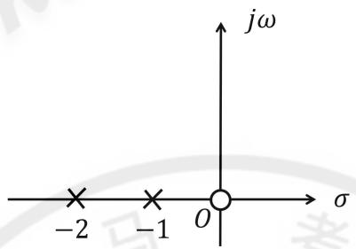
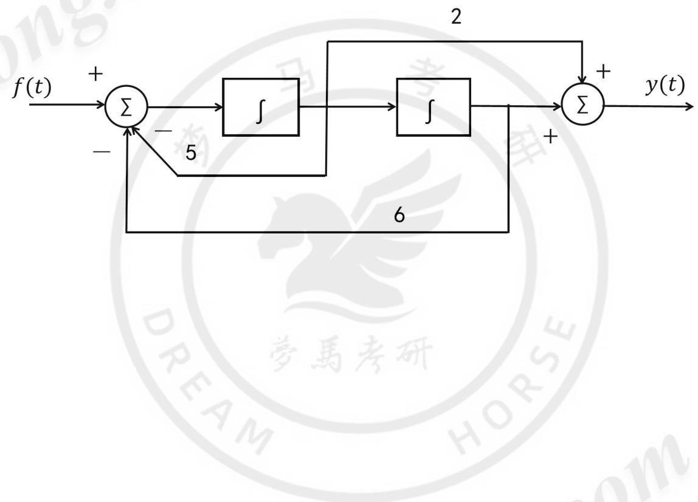

## 【第27节】课后作业

1、【2024 陕西理工大学】

已知某连续LTI系统的零、极点分布如图所示， $h(0_{+})=6$ ，

(1) 求系统的系统函数 $H(s)$ , 如果系统是因果系统, 判断其稳定性;

(2) 写出该系统的微分方程。

## 2、【2024 陕西理工大学】

已知LTI连续因果系统框图如图所示，试求：

(1) 系统函数 $H(s)$ ;

(2) 确定因果系统的收敛域, 判断系统的稳定性;

(3) 冲激响应 $h(t)$ ;

(4) 写出系统的微分方程;

(5) 若系统的初始状态 $y(0_{-})=1$ ， $y'(0_{-})=1$ ，求零输入响应 $y_{zi}(t)$ 。

## 3、【2024 天津科技大学】

某因果 LTI 系统的系统函数为

$$
H (s) = \frac {s + 2}{s ^ {2} + 7 s + 1 2}
$$

求

(1) 该系统函数的零极点;

(2) 判断该系统的稳定性;

(3) 该系统是否是无失真传输系统。

## 4、【2024 中国矿业大学】

已知某LTI系统的单位冲激响应为： $h(t)=(10e^{-5t}-8e^{-\frac{3}{2}t})u(t)$ ，且已知初值 $r(0_{-})=a,r'(0_{-})=b$ ，求：

(1) 系统的微分方程，且判断系统是否稳定；

（2）当输入 $e(t)=3e^{-3t}u(t)$ ，计算得到了全响应为 $r_{1}(t)$ ，但是使用MATLAB计算得到了一个新的全响应 $r_{2}(t)$ ，且 $r_{2}(t)-r_{1}(t)=\frac{8}{7}(-e^{-5t}+8e^{-\frac{3}{2}t})u(t)$ ，错误原因是a，b输入反了，现在重新调整，a=2，请求处b的值；

(3) 根据 (2) 求 $r_1(t)$ ; (注: 应与 $r_2(t)$ 一致)

(4) 若输入为 $e(t) = e^{-3t} \sin tu(t)$ ，无初始值，求系统的全响应 $r_3(t)$ 。

## 5、【2024 湖南师范大学】

描述某LTI连续时间系统的微分方程为

$$
y ^ {\prime \prime \prime} (t) + 4 y ^ {\prime \prime \prime} (t) + 1 2 y ^ {\prime \prime} (t) + 3 2 y ^ {\prime} (t) + 1 6 y (t) = f ^ {\prime \prime} (t) + 3 f ^ {\prime} (t)
$$

(1) 求该系统的系统函数 $H(s)$ ;

(2) 判断系统是否稳定，说明理由。

## 6、【2024 华南理工大学】

假定关于某个因果LTI系统，已知下列信息：

①系统函数 $H(s)$ 是有理的，且仅有两个极点，已知一个极点为-1-j;

②若输入为 $x_{1}(t)=1$ ，则输出为 $y_{1}(t)=0$ ;

③若输入为 $x_{2}(t)=tu(t)$ ，则系统的输出 $y_{2}(t)$ 不是绝对可积信号；

④ $H(s)$ 在无穷远处有一个零点；

⑤单位冲激响应 $h(t)$ 在 $t=0^{+}$ 时的值时4;

根据以上信息，确定该系统的系统函数 $H(s)$

## 7、【2024 大连理工大学】

已知某连续因果LTI系统的系统函数为

$$
H (s) = \frac {- (s + 6)}{(s + 1) (s + 2)}
$$

(1) 求单位冲激响应 $h(t)$ , 并写出系统的微分方程;

(2) 判断系统的稳定性，并判断是何种滤波器；

(3) 已知 $r_{zi}(0) = 2, r_{zi}'(0) = -1$ , 以及 $e(t) = 4e^{-3t}u(t)$ , 求系统的零输入响应、零状态响应和全响应，并判断自然、受迫，瞬态和稳态响应分量。

夢馬考研