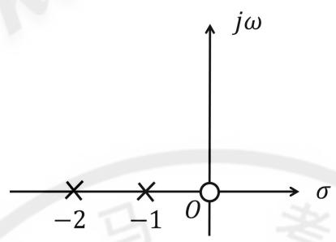
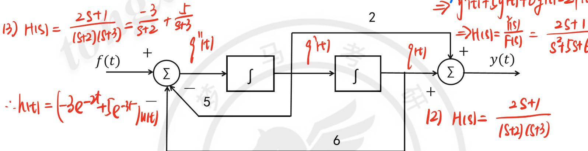
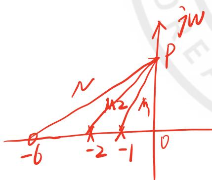

## 【第27节】课后作业

1、【2024 陕西理工大学】

已知某连续LTI系统的零、极点分布如图所示， $h(0_{+})=6$ ，

(1) 求系统的系统函数 $H(s)$ , 如果系统是因果系统, 判断其稳定性;

(2) 写出该系统的微分方程。

(1) 由零极点图可列

$$
H (S) = \frac {k S}{(s + 1) (s + 2)}
$$

$$
h (0 + 1) = \lim _ {s \to \infty} s H (s) = \frac {k s ^ {2}}{s ^ {2} + 3 s + 2} = k = 6
$$

(2) $H(s)=\frac{6s}{s^{2}+3s+2}=\frac{y(s)}{f(s)}$

$$
S ^ {2} f (s) + 3 S f (s) + 2 f (s) = 6 S F (s)
$$

则方程为 $y'(t) + 3y'(t) + 2y'(t) = 6f'(t)$

故 $H(S)=\frac{6S}{(S+1)(S+2)}$

若系统因导则 ROC 为 $\sigma > -1$ 说明 ROC 内包含应轴. 故系统稳定

2、【2024 陕西理工大学】这个题考察Messon

已知LTI连续因果系统框图如图所示，试求：
(1) 系统函数 $H(s)$ ; 在未学习Messon公式情况下需先3程后HIS

(2) 确定因果系统的收敛域, 判断系统的稳定性;

(3) 冲激响应 $h(t)$ ;

(4) 写出系统的微分方程;

(5) 若系统的初始状态 $y(0_{-}) = 1$ ， $y'(0_{-}) = 1$ ，求零输入响应 $y_{zi}(t)$ .

(1) 分程 $9^{i}(t)=f(t)-59^{i}(t)-69^{i}(t)$ $\Rightarrow f(t)=9^{i}(t)+59^{i}(t)+69^{i}(t)$ $y(t)=29^{i}(t)+9^{i}(t)$

(3) $H(S)=\frac{2S+1}{(S+2)(S+3)}=\frac{-3}{S+2}+\frac{5}{S+3}$

$$
\Rightarrow y ^ {\prime \prime} (t) + 5 y ^ {\prime} (t) + 6 y (t) = 2 f ^ {\prime} (t) + f (t)
$$

(5) 设 $y_{i}(t)=Ae^{-2t}+Be^{-3t}$

$$
y _ {2 1} (v + 1) = y (v - 1) = A + B = 1
$$

$$
y _ {2 1} ^ {\prime} (0 + 1) = y ^ {\prime} (0 - 1) = - 2 A - 3 B = 1
$$

$$
\Rightarrow A = 4, B = - 3
$$

$$
\Rightarrow y _ {2 i} (t) = (4 e ^ {- 2 t} - 3 e ^ {- 3 t}) u (t)
$$

(2) $H(s)=\frac{2s+1}{(s+2)(s+3)}$

因果求元 则 ROC 为 0 > -2
ROC 内包含定轴
故系统称定

## 3、【2024 天津科技大学】

某因果 LTI 系统的系统函数为

求

(1) 该系统函数的零极点;

(2) 判断该系统的稳定性;

(3) 该系统是否是无失真传输系统。

$$
H (s) = \frac {s + 2}{s ^ {2} + 7 s + 1 2}
$$

(1) 零点： $S + 2 = 0 \Rightarrow  S =  - 2$

极点: $S^{2}+7S+12=(S+3)(S+4)=0\Rightarrow S_{1}=-3$ $S_{2}=-4$

(2) 图案系式: 故R/C为 $\sigma > -3$ 说明 R/C 内包含底轴, 故系统稳定

(3)

$$
\begin{array}{r l} {H (w)} & {= H (s) / s = j w = \frac {j w + 2}{- w ^ {2} + 1 2 + 7 j w}} \\ {| H (w) |} & {= \frac {\sqrt {w ^ {2} + 4}}{\sqrt {(- w ^ {2} + 1 2) ^ {2} + 4 9 w ^ {2}}} = \frac {\sqrt {w ^ {2} + 4}}{\sqrt {w ^ {4} + 2 5 w ^ {2} + 1 4 4}}} \end{array}
$$

可见|H1|W|对应全域来看不腾大常数
故不是无关真传输单元

## 4、【2024 中国矿业大学】

已知某LTI系统的单位冲激响应为： $h(t) = (10e^{-5t} - 8e^{-\frac{3}{2}t})u(t)$ ，且已知初值 $r(0_{-}) = a, r'(0_{-}) = b$ ，求：

(1) 系统的微分方程，且判断系统是否稳定；

(2) 当输入 $e(t) = 3e^{-3t}u(t)$ ，计算得到了全响应为 $r_1(t)$ ，但是使用 MATLAB 计算得到了一个新的全响应 $r_2(t)$ ，且 $r_2(t) - r_1(t) = \frac{8}{7} (-e^{-5t} + 8e^{-\frac{3}{2}t})u(t)$ ，错误原因是 a，b 输入反了，现在重新调整，a = 2，请求处 b 的值；

(3) 根据 (2) 求 $r_1(t)$ ; (注: 应与 $r_2(t)$ 一致)

(4) 若输入为 $e(t) = e^{-3t} \sin t u(t)$ , 无初始值, 求系统的全响应 $r_3(t)$ 。

(1) $h(t) = (10e^{-5t} - 8e^{-\frac{3}{2}t})u(t) \xrightarrow{2T} H(s) = \frac{10}{s+5} + \frac{-8}{s+\frac{3}{2}} = \frac{10s+15-8s-40}{(s+5)(s+\frac{3}{2})}$ 故方程为 $r^{i}(t) + \frac{13}{2}r(t) + \frac{15}{2} = 2e^{i(t)} - 2[eh]$ $h(t)$ 为对象号. 故函数为 $\nu > -\frac{3}{2}$

(2) $r^{*}(t)$ 值不影响 $r_{2}(t)$ . 且 e(t) 相同. $r_{1}(t)$ 与 $r_{2}(t)$ 中成立状态部分相同

故 $r_{2}(t) - r_{1}(t)$ 为零输入属性 (齐次的一开式)

$$
r _ {2 i} (t) = A e ^ {- 5 t} + B e ^ {- \frac {3}{2} t} \Rightarrow r _ {2 i} (v _ {+}) = A + B. r _ {2 i} (u _ {+}) = - 5 A - \frac {3}{2} B
$$

当 $r(u-1)=a=2,\ r(u-1)=b$ 时

$$
\begin{array}{r l} {r _ {2 i _ {1}} (u +)} & {= A + B = 2, \quad r _ {2 i _ {1}} ^ {\prime} (u +) = - 5 A - \frac {3}{2} B = b} \\ & {\Rightarrow B = \frac {2}{7} (1 0 + b)} \end{array}
$$

$$
\frac {2}{7} (5 b + 2) - \frac {2}{7} (1 0 + b) = \frac {6 4}{7} \Rightarrow b = 1 0
$$

(3) $r_{2i}(t+1)$ 申 $B = \frac{2}{7} \times 20 = \frac{40}{7}$ , $A = 2 - \frac{40}{7} = -\frac{26}{7} \Rightarrow \sqrt{2} i, |t| = \left(-\frac{26}{7} e^{-\sqrt{t} + \frac{40}{7} e^{-\frac{3}{2}}} t\right)$ 官网：www.tongxinkaoyan.com $R_{2S}(s) = H(S) \cdot E(S) = \frac{3(2S - 2S)}{(s + 3)(s + 5)(s + \frac{3}{2})} = \frac{31}{s + 3} + \frac{-15}{s + 5} + \frac{-16}{s + \frac{3}{2}}$ $\Rightarrow r_{2S}(t) = (31e^{-3t} - 15e^{-5t} - 16e^{-\frac{3}{2}t})$ 梦马班作业

PDF免费QQ群615698143

DF免费QQ群615698143
B站up: 信号与系统\_谷哥

$\Rightarrow  {r}_{1}\left| t\right|  = \left( {{3l}{e}^{-3t} - \frac{13l}{7}{e}^{-5t} - \frac{72}{7}{e}^{-\frac{3}{2}t}\left| n\right| t}\right)$ 公众号：通信考研小马哥

(4) $E(s)=\frac{1}{(s+3)^{2}+1}$

无初始值.即 ${R}_{3}\left( S\right)  = {E}_{1}\left( S\right)  \cdot  H\left( S\right)$

5、【2024 湖南师范大学】

描述某LTI连续时间系统的微分方程为

$$
\frac {2 s - 2 s}{(s + 5) (s + \frac {3}{2}) [ (s + 1) ^ {2} + 1 ]} = \frac {2}{s + 5} + \frac {\frac {- 3 2}{1 3}}{s + \frac {3}{2}} + \frac {\frac {6}{1 3} (s + 3)}{(s + 3) ^ {2} + 1}
$$

$$
y ^ {\prime \prime \prime} (t) + 4 y ^ {\prime \prime \prime} (t) + 1 2 y ^ {\prime \prime} (t) + 3 2 y ^ {\prime} (t) + 1 6 y (t) = f ^ {\prime \prime} (t) + 3 f ^ {\prime} (t)
$$

$$
+ \frac {\frac {1 0 0}{1 3}}{(5 + 3) ^ {2} + 1}
$$

(1) 求该系统的系统函数 $H(s)$ ;

(2) 判断系统是否稳定, 说明理由。

(1)

$$
H (s) = \frac {Y (s)}{F (s)} = \frac {s ^ {2} + 3 s}{s ^ {4} + 4 s ^ {3} + 1 2 s ^ {2} + 3 2 s + 1 6}
$$

$$
\begin{array}{r l} {r _ {3 1 + 1}} & {= \left(\frac {6}{1 3} e ^ {- 3 t} \cos t \right.} \\ & {\quad + \frac {1 0 0}{1 3} e ^ {- 3 t} \sin t} \\ & {\quad \left. + 2 e ^ {- 5 t} - \frac {3 2}{1 3} e ^ {- \frac {3 t}{2}}\right)} \\ & {(4 t)} \end{array}
$$

(2)

$$
\begin{array}{l l l l} s ^ {4} & 1 & 1 2 & 1 6 \\ s ^ {3} & 4 & 3 2 & 0 \\ s ^ {2} & 4 & 1 6 & 0 \\ s ^ {1} & 1 6 & 0 & 0 \\ s ^ {0} & 1 6 \end{array}
$$

可见为一列全部大于0.故系统稳定

## 6、【2024 华南理工大学】

假定关于某个因果LTI系统，已知下列信息：

①系统函数 $H(s)$ 是有理的，且仅有两个极点，已知一个极点为-1-j;

②若输入为 $x_{1}(t) = 1$ ，则输出为 $y_{1}(t) = 0$

③若输入为 $x_{2}(t) = tu(t)$ ，则系统的输出 $y_{2}(t)$ 不是绝对可积信号；

④ $H(s)$ 在无穷远处有一个零点；

⑤单位冲激响应 $h(t)$ 在 $t=0^{+}$ 时的值时4;

根据以上信息，确定该系统的系统函数 $H(s)$

由①可知分母为 $(s+1)^{2}+1=s^{2}+2s+2$

由②可知 $x_{1}|t|=1 \rightarrow y_{1}|t|=H(0) \cdot 1=0 \Rightarrow H(0)=0$

由②可知 $x_{1}|t|=1 \rightarrow y_{1}|t=-1$ (即
由②可知 $y_{2}(s)=x_{2}(s) \cdot H(s)$ 中分母为 $s^{2}(s^{2}+2s+2)$ 中 2OC 不包含 应轴
也就是说分母中有 $s=0$ 存在, 即分子无 $s^{2}$

由③可知 $H(s)$ 只有一个零点. 设 $s-a$

由⑤可知 $H(s)=\frac{k(s-9)}{s^{2}+2s+2}\Rightarrow h(w+)=\lim_{s\to\infty}sH(s)=k=4$

$$
H (s) = \frac {4 (s - a)}{s ^ {2} + x + 2} \quad \underline {{\underline {{H (0) = 0}}}} \quad H (0) = \frac {- 4 a}{2} = 0 \Rightarrow a = 0
$$

$$
\therefore H (s) = \frac {4 s}{s ^ {2} + x _ {s} + 2}
$$

## 7、【2024 大连理工大学】

已知某连续因果LTI系统的系统函数为

$$
H (s) = \frac {- (s + 6)}{(s + 1) (s + 2)}
$$

(1) 求单位冲激响应 $h(t)$ ，并写出系统的微分方程；

(2) 判断系统的稳定性, 并判断是何种滤波器;

(3) 已知 $r_{zi}(0) = 2, r_{zi}'(0) = -1$ ，以及 $e(t) = 4e^{-3t}u(t)$ ，求系统的零输入响应、

零状态响应和全响应，并判断自然、受迫，瞬态和稳态响应分量。

(1) $H(s)=\frac{-(s+6)}{(s+1)(s+2)}=\frac{-5}{s+1}+\frac{4}{s+2}\Rightarrow h(t)=(-5e^{-t}+4e^{-2t})(u(t))$

$$
H (s) = \frac {R (s)}{E (s)} = \frac {- (s + 6)}{(s + 1) (s + 2)} = \frac {- s - 6}{s ^ {2} + 3 s + 2}
$$

故3程为 $r'(t) + 3r'(t) + 2r(t) = -e'(t) - 6e(t)$

(2) 因某系统故 $RVC$ 为 $\sigma > -1$ , $ZUC$ 内包含应轴故系统数定

$$
r _ {2 1} ^ {\prime} (v) = - A - 2 B = - 1
$$

$$
r _ {2 i} | t | = A e ^ {- t} + B e ^ {- x}
$$

$$
r _ {2 1} (0) = A + \beta = 2
$$

$$
(H (w) \mid = \frac {N}{M _ {1} \cdot M _ {2}}
$$

官网：www.tongxinkaoyan.com

$$
\begin{array}{r l} {\Rightarrow A = 3} & {B = - 1} \\ {\Rightarrow B (t) =} & {(3 e ^ {- t} - e ^ {- 2 t}) u (t)} \end{array}
$$

$$
N = 6. M _ {1} = 1. M _ {2} = 2. \left\lfloor H (0) \right\rfloor = 3
$$

$$
\vert H (1) \vert = \frac {\sqrt {3 7}}{\sqrt {1 0}} <   3
$$

$$
N = \sqrt {3 7}, M _ {1} = \sqrt {2}, M _ {2} = \sqrt {5}
$$

(3)

$$
p = \infty
$$

$$
\vert H (w) \vert = 0
$$

$$
u _ {1} = u _ {2} = v _ {0}
$$

$$
N = \infty
$$

故 $0 \to \infty$ 是高顶走势. 故为低道波浪落

$$
\begin{array}{r l} {R _ {2 s | s |} = H (s) \cdot E (s)} & {= \frac {- 4 (s + 6)}{(s + 1) (s + 2) (s + 3)}} \\ & {= \frac {- 1 0}{s + 1} + \frac {1 6}{s + 2} + \frac {- 6}{s + 3}} \end{array}
$$

$$
\Rightarrow r _ {2 s} (t) = (- 1 0 e ^ {- t} + 1 6 e ^ {- 2 t} - 6 e ^ {- 3 t}) (u (t))
$$

$$
\Rightarrow n (t) = (- 7 e ^ {- t} + 1 5 e ^ {- x} - 6 e ^ {- 3 t} \mathrm{梦马班作业}
$$

DF免费QQ群615698143

$$
\begin{array}{r l} {r _ {h} (t)} & {= (- 7 e ^ {- t} + 1 5 e ^ {- 2 t}) u (t)} \\ {r _ {p} (t)} & {= - 6 e ^ {- 3 t} u (t)} \end{array}
$$

立即为瞬态、无稳态