## 连续时间系统的系统分析

1、核心问题——求响应和内在特性判断

2、基本结构

3、连续系统的表示形式

（1）第1章：系统作用【基础 $\rightarrow$ 明确研究对象： 】和框图

(2) 第 2 章: 微分方程和 ht

(3) 第 3 章: Hw

(4) 第 4 章: Hs

4、宏伟蓝图

官网：tongxinkaoyan.com

## (真题鉴赏)

## (2025年苏州大学)

四、已知LTI系统的 $H(s)=\frac{s+5}{s^{2}+5s+6}$ ，激励 $e(t)=e^{-t}\varepsilon(t)$ ， $r(0)=2$ ， $r'(0)=1$ 。

(1)求零状态响应 $r_{zs}(t)$ ，零输入响应 $r_{zi}(t)$ 和全响应 $r(t)$ ;

(2)画出描述该系统的模拟框图；

(3)画出系统极点零点图，判断系统是否稳定，并说明原因。[公粽号：通信考研小马哥]

## (2025年北京理工大学)

4、求二阶因果系统的单位冲激响应 $h(t)$ 和单位阶跃响应 $g(t)$ 。[官网：tongxinkaoyan.com]

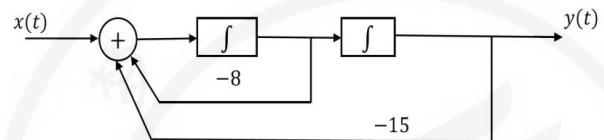

四、

已知因果系统微分方程描述如下：

$$
y ^ {\prime \prime} (t) + 5 y ^ {\prime} (t) + 6 y (t) = 2 f ^ {\prime} (t) + 6 f (t), f (t) = u (t), y (0 _ {-}) = 2, y ^ {\prime} (0 _ {-}) = 5
$$

(1) 画出直接 I 型和正准型模拟图。

(2) 画出零极点图，并判断是否稳定。

(3) 求出单位冲激响应。

(4) 求出零输出、零状态和全响应。[官网：tongxinkaoyan.com]

## (2025 年成都信息工程大学)

八、已知一因果连续LTI系统，输入为 $f(t)$ ，输出为 $y(t)$ ，该系统流图如下：

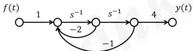

(1) 求系统函数 $H(s)$ 并判断其稳定性

(2) $y(t) = 2(e^{-t} - e^{-2t})u(t)$ ，求 $f(t)$

## 专题1 梅森公式与信号流图

## 考点1：信号流图

1、连续系统的表示形式（见图）

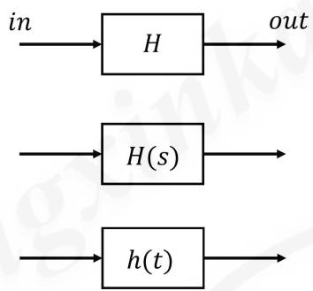

## 2、模拟框图

如图所示，由加法器、倍乘器和积分器构成的连续系统：

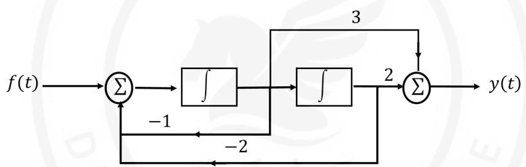

【模拟框图是将关系用时域符号的形式给出的】

<table><tr><td>模拟框图(时域符号)</td><td>信号流图(s 域和简化的符号)</td></tr><tr><td>结(节)点:t 的函数</td><td>结(节)点:s 的函数</td></tr><tr><td>加法器</td><td>加法器</td></tr><tr><td>倍乘器</td><td>倍乘器</td></tr><tr><td>积分器</td><td>积分器</td></tr></table>

【将上述模拟框图转换为信号流图】

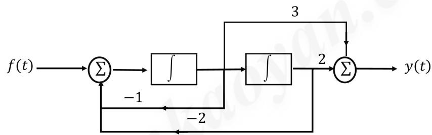

## 3、信号流图

用结点、带有箭头(信号传输方向)的支路和转移函数构成的连续系统

(1) 结点: 表示系统中变量或信号的点

(2) 转移函数：两个结点之间的增益

(3) 支路: 连接两个结点之间的定向线段, 支路的增益即为转移函数

(4) 输入结点 (源点), 输出结点 (汇点, 也称阱点): 系统的输入结点和输出结点, 对应自变量和因变量

(5)前向通路及前向通路增益：从源点到汇点的通路，任何结点不多于一次的全部路径：前向通路经过的所有支路转移函数的乘积是该前向通路增益

(6)环路及环路增益:通路的终点是通路的起点,且其他结点不多于一次。环路的支路转移函数的乘积就是环路增益。

(7) 不接触：没有任何的公共结点。

## 考点2：梅森公式的一般形式

梅森公式为

$$
H = \frac {1}{\varDelta} \sum_ {i} P _ {i} \varDelta_ {i}
$$

式中

$$
\varDelta = 1 - \sum_ {j} L _ {j} + \sum_ {m, n} L _ {m} L _ {n} - \sum_ {p, q, r} L _ {p} L _ {q} L _ {r} + \dots
$$

$\Delta$ 称为信号流图的特征行列式，其中：

$\sum_{j}L_{j}$ 是所有不同回路的增益之和。

$\sum_{m,n}L_mL_n$ 是所有两两不接触回路的增益乘积之和。

$\sum_{p,q,r}L_pL_qL_r$ 是所有三个都互不接触回路的增益乘积之和。

i表示由源点到汇点的第i条前向通路的标号。

$P_{i}$ 是由源点到汇点的第i条前向通路增益。

$\Delta_{i}$ 称为第 $i$ 条前向通路特征行列式的余因子，它是与第 $i$ 条前向通路不相接触的子图的特征行列式。

例 1: 求下图信号流图的系统函数。

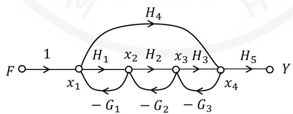

## 考点 3：简易型梅森公式

1、简易型梅森公式的原则

(1)所有环路均接触;

(2)任一前向通路与所有环路均接触，即 $\Delta_{i}=1$ 。

2、简易型梅森公式定义

$$
H (s) = \frac {\text {所有前向通路增益之和}}{1 - [ \text {所有环路增益之和} ]} = \frac {\sum_ {i} P _ {i}}{1 - \sum_ {j} L _ {j}}
$$

例 2 已知系统信号流图如图所示:

(1) 求系统的冲激响应 $h(t)$

(2) 判断系统的稳定性、写出极点、零点分布图

(3) 若初始状态为 0，输入为 $f(t) = 2e^{-3t}u(t)$ ，求系统的零状态响应 $y_{zs}(t)$

(4) 求 $H(\omega)$ 的幅频特性

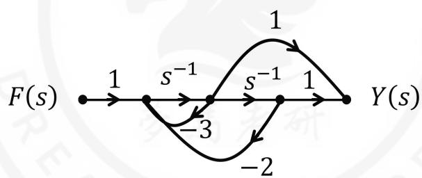

(2025年北京理工大学)

4、求二阶因果系统的单位冲激响应 $h(t)$ 和单位阶跃响应 $g(t)$ 。[官网：tongxinkaoyan.com]

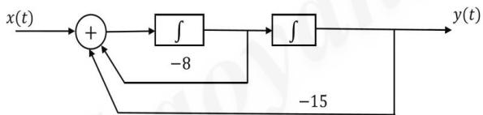

(2025年成都信息工程大学)

八、已知一因果连续 LTI 系统，输入为 $f(t)$ ，输出为 $y(t)$ ，该系统流图如下：

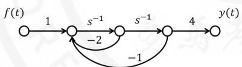

(1) 求系统函数 $H(s)$ 并判断其稳定性

(2) $y(t) = 2(e^{-t} - e^{-2t})u(t)$ , 求 $f(t)$

## 考点4：三种结构的信号流图

## 1、直接型信号流图

(1)将系统函数严格化成标准形式:

$$
H (s) = \frac {s ^ {- 1} \text {多项式}}{s ^ {- 1} \text {多项式}} = \frac {\text {所有前向通路增益之和}}{1 - [ \text {所有环路增益之和} ]}
$$

(2)观察分子、分母中 $s^{-1}$ 的最高次幂，最高次幂数表明积分器(积分支路)的个数；

(3)根据分子画前向通路，根据分母括号内画所有环路【需全部接触】

例3： $H(s) = \frac{(s + 1)(s^2 + 2s + 2)}{(s + 3)(s^2 + 1)}$ ，画出直接型信号流图。

## 2、级联型 $H(s) = \prod_{i}H_{i}(s)$

(1)将系统函数分子、分母分别因式分解;

(2)将系统函数化成连乘的形式, 切记尽可能采用纯阶结构; 纯阶结构指分子、分母中 $s^{-1}$ 的最高次幂相同;

(3)每个子系统函数分别按照直接型画，然后首尾相连即可。

例 4: $\frac{s^{2}+s+2}{(s+2)(s^{2}+2s+2)}$ ，画出级联型信号流图。

3、并联型 $H(s) = \sum_{i}H_{i}(s)$

利用部分分式展开法将系统函数化成连加形式；【大部分考察真分式，如果是假分式，考察的是同阶次的假分式，即假分式=常数+真分式，常数为一条独立前向通路，真分式按照直接型画图】

例 5: $H(s)=\frac{s+3}{s^{2}+3s+2}$ ，画出并联型信号流图

例 6: $H(s)=\frac{s^{2}+s+1}{s^{2}+3s+2}$ ，画出并联型信号流图

例 7: $H(s)=\frac{s+3}{s^{2}+3s+2}$ ，画出三种信号流图。

## 考点 5：模拟框图下梅森公式的应用

例 10: 求下图信号流图的系统函数。

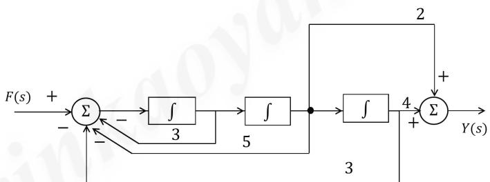

## (真题鉴赏)

## (2025年苏州大学)

四、已知LTI系统的 $H(s)=\frac{s+5}{s^{2}+5s+6}$ ，激励 $e(t)=e^{-t}\varepsilon(t)$ ， $r(0)=2$ ， $r'(0)=1$ 。

(1)求零状态响应 $r_{zs}(t)$ ，零输入响应 $r_{zi}(t)$ 和全响应 $r(t)$ ;

(2)画出描述该系统的模拟框图；

(3)画出系统极点零点图，判断系统是否稳定，并说明原因。[公粽号：通信考研小马哥]

四、

已知因果系统微分方程描述如下：

$$
y ^ {\prime \prime} (t) + 5 y ^ {\prime} (t) + 6 y (t) = 2 f ^ {\prime} (t) + 6 f (t), f (t) = u (t), y (0 _ {-}) = 2, y ^ {\prime} (0 _ {-}) = 5
$$

(1) 画出直接 I 型和正准型模拟图。

(2) 画出零极点图，并判断是否稳定。

(3) 求出单位冲激响应。

(4) 求出零输出、零状态和全响应。[官网：tongxinkaoyan.com]

## 【梦马班点拨】信号流图到系统函数的转换

直接型: 梅森公式

观察信号

级联型： $H(s) = \prod_{i}H_{i}(s)$

原图结构

并联型: $H(s) = \sum_{i} H_{i}(s)$

混联型 $\left\{ \begin{array}{l}\text{分析系统结构组成，由结构和各结构特点来求} H(s)\\ \text{无结构或难分析结构类型梅森公式的一般形式} \end{array} \right.$

例 8: 已知流程图如下:

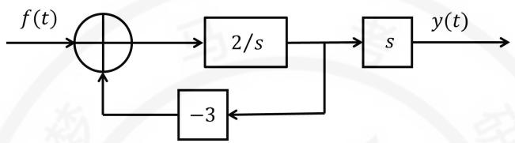

(1)求系统函数 $H(s)$ ;

(2)求系统的微分方程。

夢馬考研

例 9: 系统的信号流图如下图所示, 试求系统函数 $H(s) = \frac{R(s)}{E(s)}$ 。

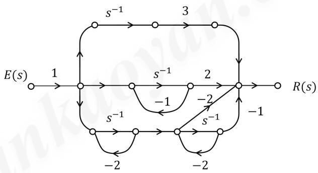

考点6：简易框图下梅森公式的应用

例 11: 求出其系统函数 $H(s)$ 。

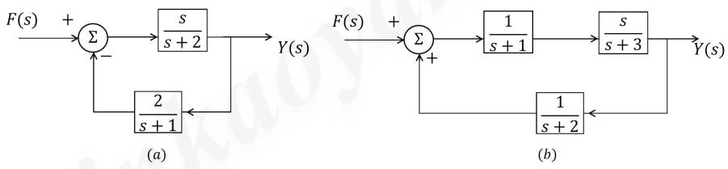

官网：tongxinkaoyan.com

考点7：连续系统表示形式的相互转换

连续系统表示形式的相互转换 $\leftrightarrow$ 选择从 $H(s)$ 中转的方法

例 12：某连续时间系统的信号流图如下图所示，试求：

(1)系统函数 $H(s)$ ;

(2)系统的冲激响应 $h(t)$ ;

(3)若系统的初始状态 $y(0_{-})=0,\quad y'(0_{-})=1$ ，求系统的零输入响应 $y_{zi}(t)$ ;

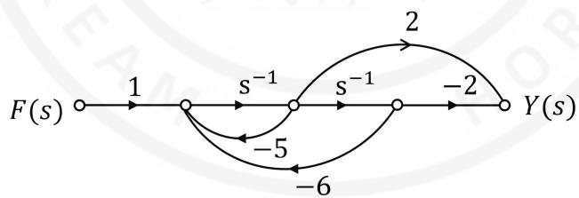

例 13: 已知某连续LTI因果系统结构框图如下图所示

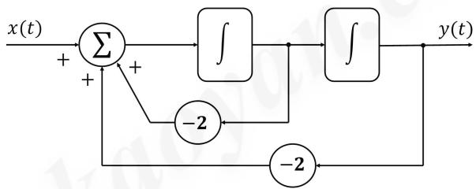

(1)画出其复频域信号流图，并求出系统函数 $H(s)$ ;

(2)写出关于框图输入—输出的微分方程;

(3)当初始状态为 $y(0_{-})=1,\quad y'(0_{-})=-1$ 时，求零输入响应 $y_{zi}(t)$ 。

例 14: 已知描述一个连续时间因果 LTI 系统框图如下所示, 若当输入 $f(t) = e^{-2t}u(t)$ 时, 其输出全响应 $y(t) = [(t + 1)e^{-t}]u(t)$ 。试回答下列问题:

(1)求系统函数 $H(s)$ ，单位冲激响应 $h(t)$ ;

(2)判断系统是否稳定;

(3)写出关联输入—输出的微分方程;

(4)求该系统的初始状态 $y(0_{-})$ ， $y'(0_{-})$ 。

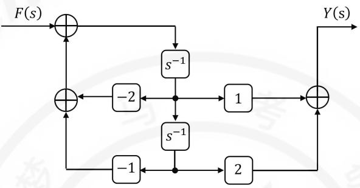  
夢馬考研

四、已知因果系统的信号流图如下图所示：

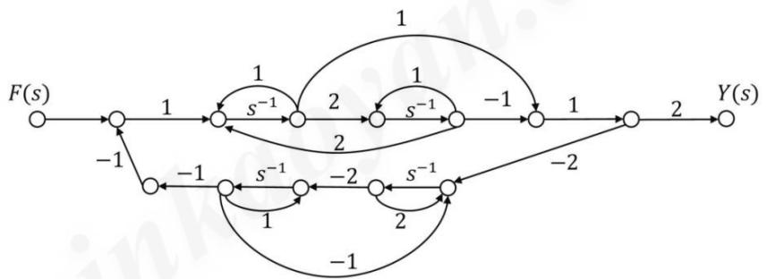

1、试求 $H(s)$ ，并写出系统的微分方程。

[A] 提取文字 更多

公粽号：通信考研小马哥

2、简述全通系统和最小相移系统的零极点分布特点，并判断图示系统是否为全通系统和最小相移系统，说明理由。

官网：www.tongxinkaoyan.com