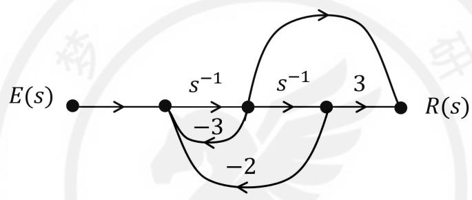
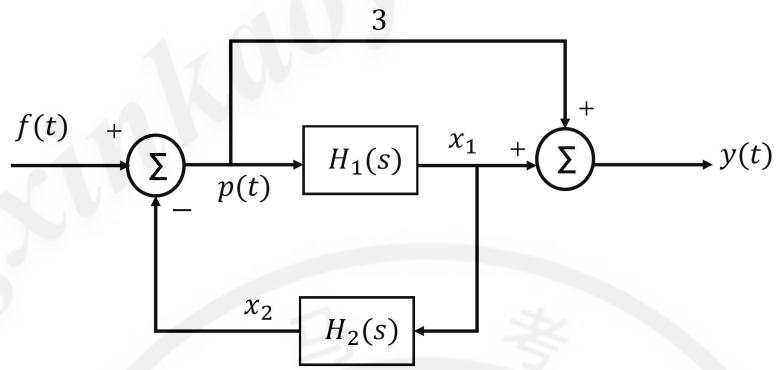

## 专题2 状态变量分析

考点1：流图/框图视角下状态变量分析

1、基础：在信号流图或者模拟框图的基础上进行状态变量分析

2、目的：列写状态方程和输出方程，并给出矩阵形式

3、选取原则：【PS 不管流图还是框图】选择各积分器的输出端作为状态变量

4、状态方程：利用状态变量和输入表示各积分器的输入端

5、输出方程：利用状态变量和输入表示输出

例 15：对流图所示系统进行状态变量分析，列写输出方程和状态方程。

  
夢馬考研

例 16: 已知描述某系统的微分方程为

$$
\frac {d ^ {3}}{d t} r (t) + 7 \frac {d ^ {2}}{d t} r (t) + 1 0 \frac {d}{d t} r (t) = 5 \frac {d}{d t} e (t) + 5 e (t)
$$

试用三种不同结构画出该系统的流图表示，并且列出对应的状态方程。

考点 2：结构图下的状态变量分析

例 17: 如图所示由两个一阶子系统连接而成的连续系统, 其子系统的系统函数分别为 $H_{1}(s) = \frac{2}{s + 3}$ , $H_{2}(s) = \frac{s + 4}{s + 1}$ , 写出其状态方程和输出方程

  
夢馬考研