## 连续时间系统的系统分析

1、核心问题——求响应和内在特性判断

2、基本结构
当(余元)→out

$y_{H}(t)=f(x)$

3、连续系统的表示形式
(1) 第1章: 系统作用【基础→明确研究对象: LPS. 确定思想号】

(2) 第2章: 微分方程和 $h$ t

(3) 第 3 章: Hw

】和框图 $\Rightarrow$ 右边开1式 右边开1式

(4) 第4章: Hs 右边、左边

4、宏伟蓝图

(时)

(S)

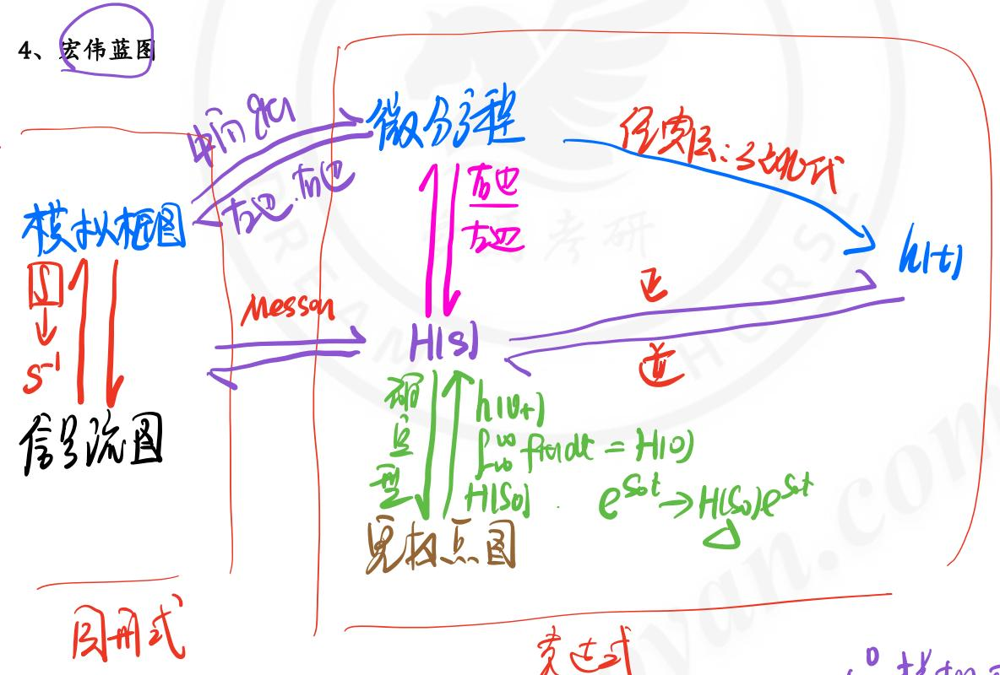

周开式

克越

1° 模拟技术和法国

2° MESSON 35°
30° 公式应用

(真题鉴赏)

(2025年苏州大学)

四、已知LTI系统的 $H(s)=\frac{s+5}{s^{2}+5s+6}$ ，激励 $e(t)=e^{-t}\varepsilon(t)$ ， $r(0)=2$ ， $r'(0)=1$ 。

(1)求零状态响应 $r_{zs}(t)$ ，零输入响应 $r_{zi}(t)$ 和全响应 $r(t)$ ;

(2)画出描述该系统的模拟框图；

(3)画出系统极点零点图，判断系统是否稳定，并说明原因。[公粽号：通信考研小马哥]

## (2025年北京理工大学)

4、求二阶因果系统的单位冲激响应 $h(t)$ 和单位阶跃响应 $g(t)$ 。[官网：tongxinkaoyan.com]

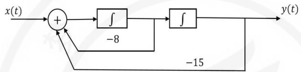

四、

已知因果系统微分方程描述如下：

$$
y ^ {\prime \prime} (t) + 5 y ^ {\prime} (t) + 6 y (t) = 2 f ^ {\prime} (t) + 6 f (t), f (t) = u (t), y (0 _ {-}) = 2, y ^ {\prime} (0 _ {-}) = 5
$$

(1) 画出直接 I 型和正准型模拟图。

(2) 画出零极点图，并判断是否稳定。

(3) 求出单位冲激响应。

(4) 求出零输出、零状态和全响应。[官网：tongxinkaoyan.com]

(2025 年成都信息工程大学)

八、已知一因果连续 LTI 系统，输入为 $f(t)$ ，输出为 $y(t)$ ，该系统流图如下：

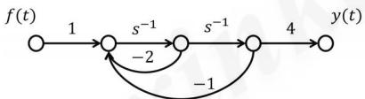

(1) 求系统函数 $H(s)$ 并判断其稳定性

(2) $y(t) = 2(e^{-t} - e^{-2t})u(t)$ ，求 $f(t)$

## 专题 1 梅森公式与信号流图

考点1：信号流图

1、连续系统的表示形式（见图）

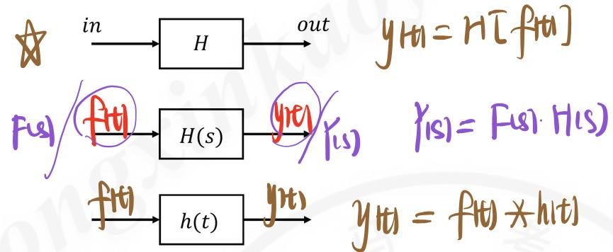

2、模拟框图

多in直out 如图所

如图所示, 由加法器、倍乘器和积分器构成的连续系统:

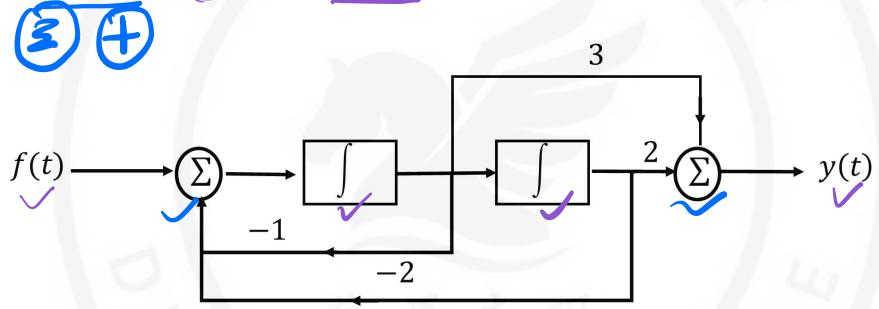

【模拟框图是将关系用时域符号的形式给出的】

<table><tr><td>模拟框图(时域符号)</td><td>信号流图(s域和简化的符号)</td></tr><tr><td>结(节)点:t的函数加法器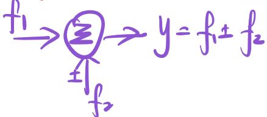倍乘器 $\begin{array}{c}f\rightarrow\boxed{a}\rightarrow y\\f\rightarrow\boxed{a}\rightarrow y\end{array}$  $y=a\cdot f$ 积分器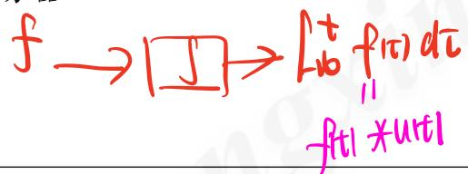 $\Rightarrow f(s)\cdot\frac{1}{s}$ </td><td>结(节)点:s的函数加法器倍乘器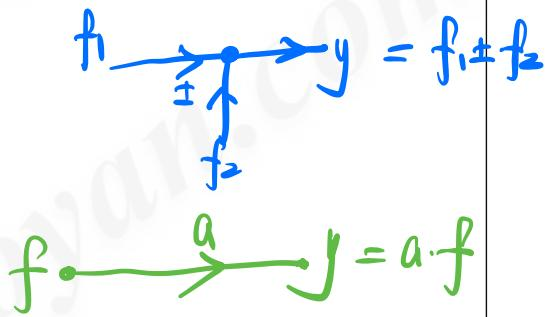积分器 $F(s)$  $s^{-1}$  $f(s)=F(s)\cdot\frac{1}{s}$ 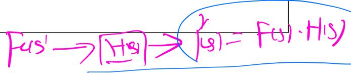</td></tr></table>

【将上述模拟框图转换为信号流图】

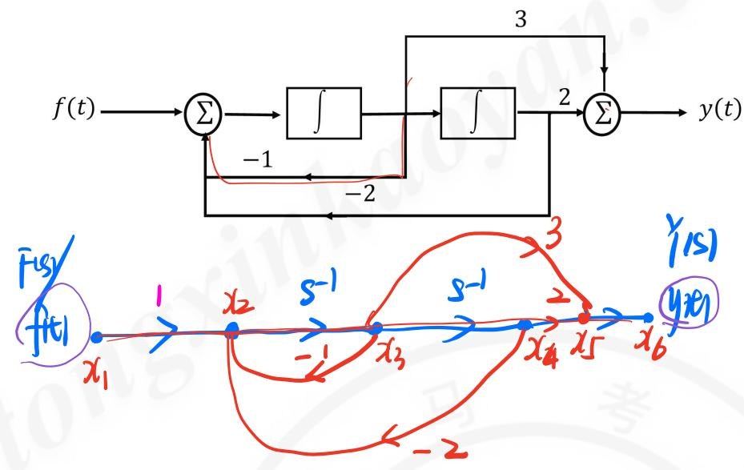

支路 $x_{2} \stackrel{S^{-1}}{\rightarrow} x_{3}$ $\Rightarrow x_{3}|s| = x_{2}|s \cdot s^{-1}$

3、信号流图

用结点、带有箭头(信号传输方向)的支路和转移函数构成的连续系统

(1) 结点: 表示系统中变量或信号的点

(2)转移函数：两个结点之间的增益 a 或 $s^{-1}$

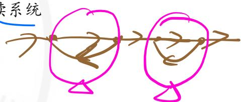

(3) 支路: 连接两个结点之间的定向线段, 支路的增益即为转移函数

(4) 输入结点 (源点)，输出结点 (汇点，也称阱点): 系统的输入结点和输出结点，对应自变量和因变量

(5)前向通路及前向通路增益：从源点到汇点的通路，任何结点不多于一次的全部路径：前向通路经过的所有支路转移函数的乘积是该前向通路增益

$$
3 s ^ {- 1}
$$

(6)环路及环路增益:通路的终点是通路的起点, 且其他结点不多于一次。环路的支路转移函数的乘积就是环路增益。

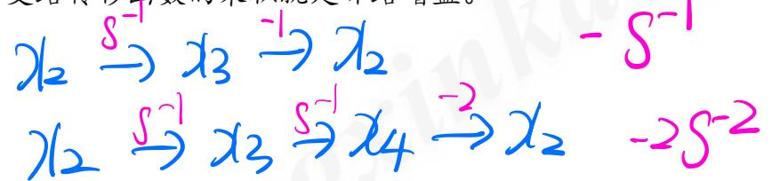

(7)不接触: 没有任何的公共结点。

DF免费QQ群615698143

B站：信号与系统\_谷哥

陈掉支节，穿越好跑环路再开心
公众号：通信考研小马哥

P: 抛前向远路(苏溪)

考点2：梅森公式的一般形式

梅森公式为

$$
\int_ {D} \sum_ {i = 1} ^ {n} p _ {i} \Delta_ {i}
$$

$$
H = \frac {1}{\Delta} \sum_ {i} P _ {i} \Delta_ {i} \quad \begin{array}{l} \frac {\mathrm{分子}}{\mathrm{分则}} \mathrm{多时} \\ H (S) <   \frac {\mathrm{Messon}}{H (S)} = \frac {\mathrm{图}}{\Delta} \end{array}
$$

B同

$$
\Delta = 1 - \sum_ {j} L _ {j} + \sum_ {m, n} L _ {m} L _ {n} - \sum_ {p, q, r} L _ {p} L _ {q} L _ {r} + \dots
$$

$\Delta$ 称为信号流图的特征行列式, 其中:

$\sum_{j} L_{j}$ 是所有不同回路的增益之和。

100% 同频 $1 - \left[\frac{10\sqrt{10}}{400}\right]$

## A和B C和D

$\sum_{m,n} L_m L_n$ 是所有两两不接触回路的增益乘积之和。

$$
+ [ \frac {8 1 3}{2} + a) ]
$$

$\sum_{p,q,r}L_pL_qL_r$ 是所有三个都互不接触回路的增益乘积之和。

i表示由源点到汇点的第i条前向通路的标号。

$P_{i}$ 是由源点到汇点的第 $i$ 条前向通路增益。

$\Delta_{i}$ 称为第 $i$ 条前向通路特征行列式的余因子，它是与第 $i$ 条前向通路不相接触的子

图的特征行列式。

例 1: 求下图信号流图的系统函数。

前向之路：

1 - [ ]

$$
P _ {1}: F \rightarrow x _ {1} \rightarrow x _ {2} \rightarrow x _ {3} \rightarrow x _ {4} \rightarrow 5 H _ {1} H _ {2} H _ {3} H _ {5}
$$

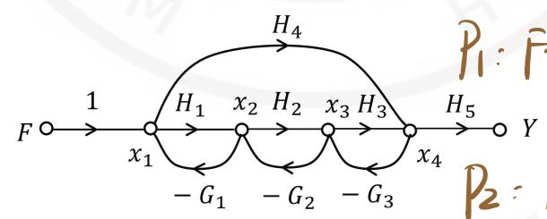

图路：

$\angle 1 : x_{1} \rightarrow x_{2} \rightarrow x_{1} - H_{1}G_{1}$

不接触 ∠1和∠3

$$
P _ {1} \Delta_ {1} + P _ {2} \Delta_ {2}
$$

L2: $x_{2} \rightarrow x_{3} \rightarrow x_{2}$ $-H_{2}G_{2}$

与 $p$ 不同的回路 $y$ 个 $\Rightarrow  {\Delta }_{1} = 1$

$\angle 3 : x_{3} \rightarrow x_{4} \rightarrow x_{3} - H_{3}G_{3}$

与 ${P}_{2}$ 不是相同的交点 $\angle 2 \Rightarrow  \Delta _{2} =$

$$
1 - [ - H _ {2} G _ {2} ]
$$

4: ${x}_{1} \rightarrow  {x}_{4} \rightarrow  {x}_{3} \rightarrow  {x}_{2} \rightarrow  {x}_{1} - {H}_{4}{G}_{1}{G}_{2}{G}_{3}$

分母: $\Delta = 1 - (-H_{1}G_{1} - H_{2}G_{2} - H_{3}G_{3} - H_{4}G_{1}G_{2}G_{3}) + H_{1}G_{1}H_{2}G_{3}$

$H_{1}H_{2}H_{3}H_{5} + H_{4}H_{5}[1+H_{2}G_{2}]$ 梦马班讲义

官网：tongxinkaoyan.com

H(S)= $\frac{1}{\sqrt{n}}$ PDF免费QQ群615698143

## 考点 3: 简易型梅森公式

1、简易型梅森公式的原则

1、简易型梅森公式的原则

(1)所有环路均接触； $\Rightarrow$ 分隔 $1 - [\text{阶后回填储蓄之和}]$

(2)任一前向通路与所有环路均接触,即 ${\Delta }_{i} = 1$ 。

2、简易型梅森公式定义

$$
H (s) = \frac {\text {所有前向通路增益之和}}{1 - [ \text {所有环路增益之和} ]} = \frac {\sum_ {i} P _ {i}}{1 - \sum_ {j} L _ {j}}
$$

例 2 已知系统信号流图如图所示:

(1)求系统的冲激响应 $h(t)$

(2) 判断系统的稳定性、写出极点、零点分布图

(3) 若初始状态为 0，输入为 $f(t) = 2e^{-3t}u(t)$ ，求系统的零状态响应 $y_{zs}(t)$

(4) 求 $H(\omega)$ 的幅频特性

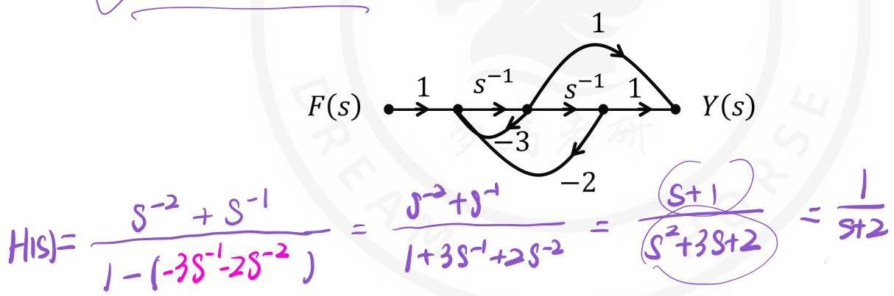

校森 Messon 对称同. 框同一样的

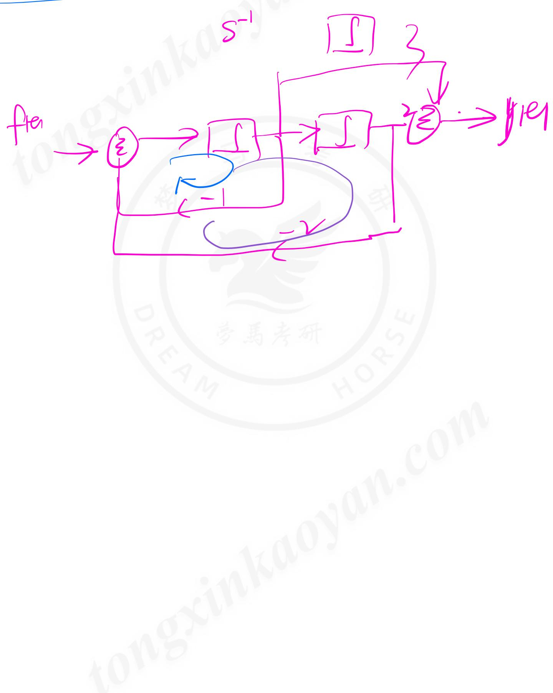

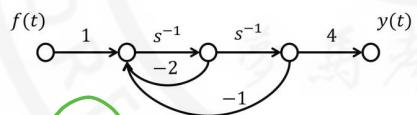

(2025年北京理工大学)

4、求二阶因果系统的单位冲激响应 $h(t)$ 和单位阶跃响应 $g(t)$ 。[官网：tongxinkaoyan.com]

$$
\begin{array}{r l} {y ^ {\prime \prime} t 1} & {= x (t) - 8 y ^ {\prime} t 1 - 1 5 y (t)} \\ & {\Rightarrow y ^ {\prime \prime} t a + 8 y ^ {\prime} t a + 1 5 y (t a) = x (t)} \\ & {\quad H (s) =} \end{array}
$$

$$
H (S) = \frac {S ^ {- 2}}{1 - (- 8 S ^ {- 1} - 1 5 S ^ {- 2})} = \frac {1}{S ^ {2} + 8 S + 1 5}
$$

$$
= \frac {1}{(s + 3) (s + 5)}
$$

$$
G (s) = \frac {H (s)}{s}
$$

(2025年成都信息工程大学)

八、已知一因果连续 LTI 系统，输入为 $f(t)$ ，输出为 $y(t)$ ，该系统流图如下：

$$
\sqrt {(2) y (t) = 2 (e ^ {- t} - e ^ {- 2 t}) u (t)}, \mathrm{求} f (t)
$$

(1)求系统函数 $H\left( s\right)$ 并判断其稳定性

$$
Y _ {(S)} = H (S) \cdot F (S)
$$

$$
\begin{array}{r l} {(1) H (s)} & {= \frac {4 s ^ {- 2}}{1 - (- 2 s ^ {- 1} - s ^ {- 2})}} \\ {\frac {\Delta_ {2} - 1}{\mathrm{点点}}} & {= \frac {4}{| s + 1 | ^ {2}}} \end{array}
$$

DF免费QQ群615698143

B站：信号与系统\_谷哥

考点4: 三种结构的信号流图

1、直接型信号流图

(1)将系统函数严格化成标准形式:

$$
\mathrm{既} O H (S) = \frac {S + 1}{S ^ {2} + 4 S + 5}
$$

$$
2 ^ {0} \frac {\sqrt {8 0}}{1 - [ ]} \text {   时   } \text {   同得   } s ^ {2} = \frac {s ^ {- 1} + s ^ {- 2}}{1 - (- 4 s ^ {- 1} - 5 s ^ {- 2})}
$$

$H(s)=\frac{s^{-1}$ 多项式 $s^{-1}$ 多项式 $=\frac{所有前向通路增益之和}{1-\left[所有环路增益之和\right]}$

10 秋端 $S^{-1}$

(2)观察分子、分母中 $s^{-1}$ 的最高次幂，最高次幂数表明积分器(积分支路)的个数；

(3)根据分子画前向通路, 根据分母括号内画所有环路【需全部接触】

例3： $H(s) = \frac{(s + 1)(s^2 + 2s + 2)}{(s + 3)(s^2 + 1)}$ ，画出直接型信号流图。

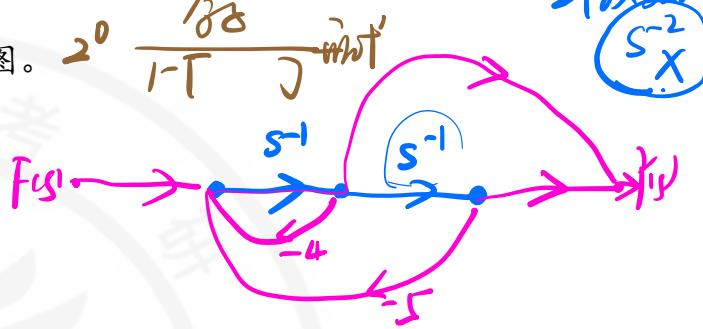

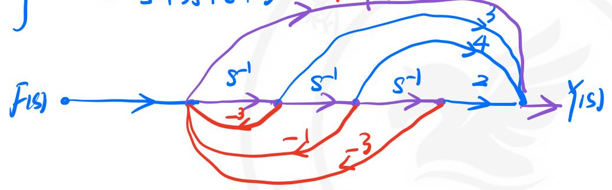

2、级联型 $H(s) = \prod_{i}H_{i}(s)$

(1)将系统函数分子、分母分别因式分解;

(2)将系统函数化成连乘的形式，切记尽可能采用纯阶结构：纯阶结构指分子、分母中 $s^{-1}$ 的最高次幂相同；同阶(分子)

(3)每个子系统函数分别按照直接型画，然后首尾相连即可。

例 4: $\frac{s^{2}+s+2}{(s+2)(s^{2}+2s+2)}$ , 画出级联型信号流图。

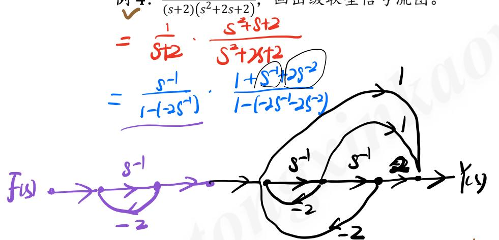

$$
\begin{array}{r l} {\mathrm{eq:}} & {H (s) = \frac {s + 3}{s ^ {2} + 3 s + 2}} \\ & {= \frac {s + 3}{(s + 1) (s + 2)}} \\ & {= \frac {s + 3}{(s + 1)} \cdot \frac {1}{s + 2}} \\ & {= \frac {1 + 3 s ^ {- 1}}{1 - (- s ^ {- 1})} \cdot \frac {s ^ {- 1}}{1 - (- 2 s ^ {- 1})}} \end{array}
$$

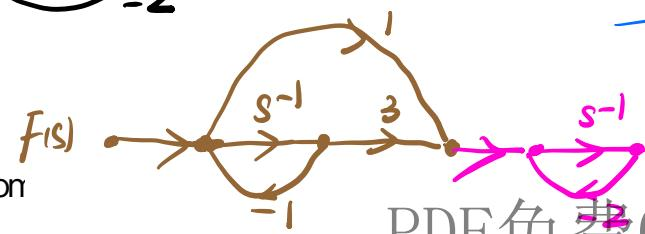

$$
\frac {A}{B \cdot C} = \frac {A \cdot \frac {1}{B C}}{X} = \frac {A}{B} \cdot \frac {1}{C}
$$

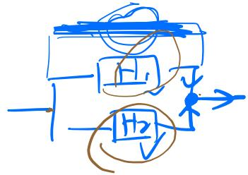

3、并联型 $H(s) = \sum_{i} H_{i}(s)$

$$
H _ {\mathrm{总}} = H _ {1} + H _ {2}
$$

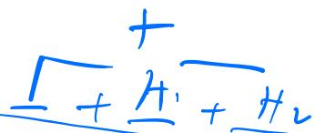

利用部分分式展开法将系统函数化成连加形式；【大部分考察真分式，如果是假分式，考察的是同阶次的假分式，即假分式=常数+真分式，常数为一条独立前向通路，真分式按照直接型画图】

$$
\begin{array}{r l} {H (s) = \frac {s + 3}{s ^ {2} + 3 s + 2}, \text {画出并联型信号流图}} & \\ {= \frac {s + 3}{(s + 1) (s + 2)} = \frac {2}{s + 1} + \frac {- 1}{s + 2}} & \\ {= \frac {2 s ^ {- 1}}{1 - (- s ^ {- 1})} + \frac {- s ^ {- 1}}{1 - (- 2 s ^ {- 1})}} & \\ {\mathrm{F(s)}} & \\ {\mathrm{s-1}} & \\ {\mathrm{s-1}} & \\ {\mathrm{-2}} & \end{array}
$$

例6： $H(s) = \frac{s^2 + s + 1}{s^2 + 3s + 2}$ ，画出并联型信号流图

$$
\frac {s ^ {2} + 3 s + 2 \sqrt {\frac {1}{s ^ {2} + s + 1}}}{s ^ {2} + 3 s + 2} {- x - 1}
$$

$$
\begin{array}{r l} {H (s) = 1 + \frac {- 2 s - 1}{(s + 1) (s + 2)}} \\ & {= 1 + \frac {1}{s + 1} + \frac {- 3}{s + 2}} \\ & {= 1 + \frac {s ^ {- 1}}{1 - (- s ^ {- 1})} + \frac {- 3 s ^ {- 1}}{1 - (- 2 s ^ {- 1})}} \end{array}
$$

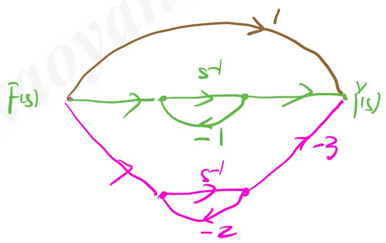

例 7: $H(s)=\frac{s+3}{s^{2}+3s+2}$ ，画出三种信号流图。

直
权
役
并

## 考点 5：模拟框图下梅森公式的应用

例 10: 求下图信号流图的系统函数。

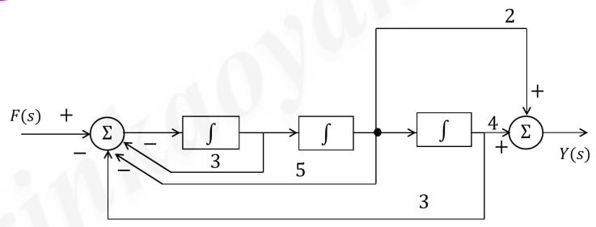

$$
4 s ^ {- 3} + 2 s ^ {- 2}
$$

$$
1 - (- 3 s ^ {- 1} - 5 s ^ {- 2} - 3 s ^ {- 3})
$$

## (真题鉴赏)

(2025年苏州大学)

四、已知LTI系统的 $H(s)=\frac{s+5}{s^{2}+5s+6}$ ，激励 $e(t)=e^{-t}\varepsilon(t)$ ， $r(0)=2$ ， $r'(0)=1$ 。

(1)求零状态响应 ${r}_{zs}\left( t\right)$ ,零输入响应 ${r}_{zi}\left( t\right)$ 和全响应 $r\left( t\right)$ ；

(2)画出描述该系统的模拟框图：

(3)画出系统极点零点图, 判断系统是否稳定, 并说明原因。[公粽号：通信考研小马哥]

四、

已知因果系统微分方程描述如下：

$$
y ^ {\prime \prime} (t) + 5 y ^ {\prime} (t) + 6 y (t) = 2 f ^ {\prime} (t) + 6 f (t), f (t) = u (t), y (0 _ {-}) = 2, y ^ {\prime} (0 _ {-}) = 5
$$

(1) 画出直接 I 型和正准型模拟图。

(2) 画出零极点图,并判断是否稳定。

(3) 求出单位冲激响应。

(4)求出零输出、零状态和全响应。[官网：tongxinkaoyan.com]

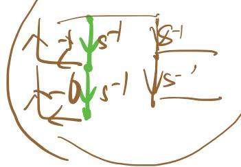

【梦马班点拨】信号流图到系统函数的转换

直接型：梅森公式

观察信号
原图结构

级联型: $H(s)=\prod_{i}H_{i}(s)$

并联型: $H(s) = \sum_{i} H_{i}(s)$

混联型

分析系统结构组成，由结构和各结构特点来求 $H(s)$ 无结构或难分析结构类型梅森公式的一般形式

例 8: 已知流程图如下:

(1)求系统函数 $H\left( s\right)$ ;

(2)求系统的微分方程。

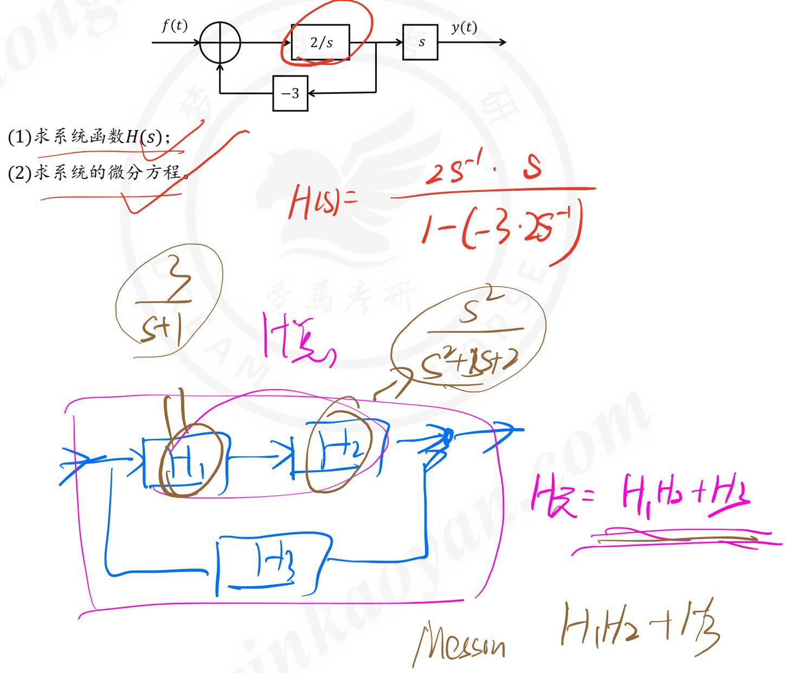

例 9: 系统的信号流图如下图所示, 试求系统函数 $H(s) = \frac{R(s)}{E(s)}$ 。

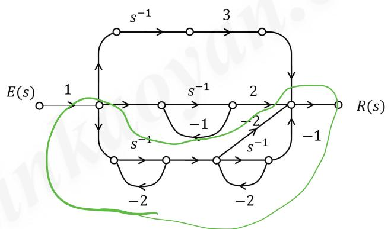

$$
H (s) = \frac {3 s ^ {- 1}}{v} + \frac {2 s ^ {- 1}}{1 - (- s ^ {- 1})} + \frac {s ^ {- 1}}{1 - (- 2 s ^ {- 1})} \cdot \frac {- 2 - s ^ {- 1}}{1 - (- 2 s ^ {- 1})}
$$

明确结构 $\Rightarrow$ 右右上下昆虫落集

图.

结构不清晰

第2条(不清晰) [Messon - 玻化] $\frac{-s^{-2}-2s^{-1}}{1-(-2s^{-1}-2s^{-1})+4s^{-2}}$

考点6：简易框图下梅森公式的应用

例 11: 求出其系统函数 $H(s)$ 。

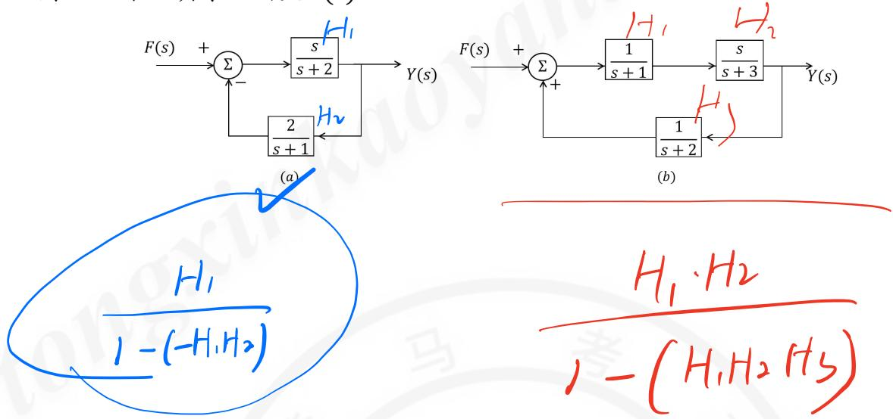

考点7: 连续系统表示形式的相互转换  
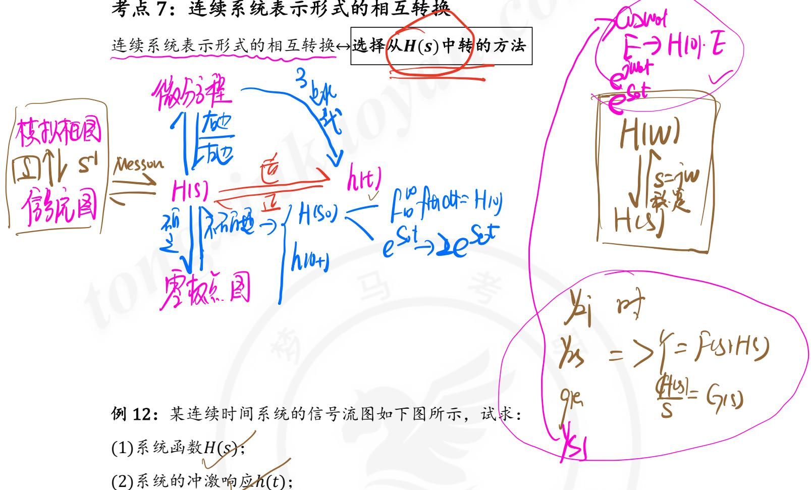

例 12: 某连续时间系统的信号流图如下图所示, 试求:

(1)系统函数 $H(s)$ ;

(2)系统的冲激响应 $h(t)$ ;

(3)若系统的初始状态 $y(0_{-})=0,\quad y'(0_{-})=1$ ，求系统的零输入响应 $y_{zi}(t)$ ;

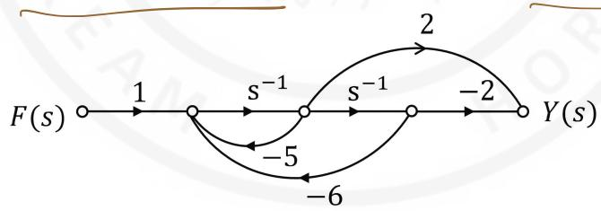

例 13: 已知某连续LTI因果系统结构框图如下图所示

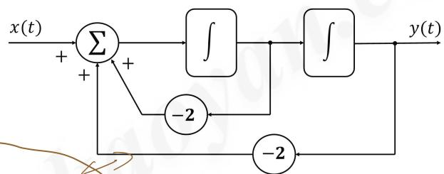

(1)画出其复频域信号流图，并求出系统函数 $H(s)$ ;

(2)写出关于框图输入—输出的微分方程;

(3)当初始状态为 $y(0_{-})=1$ ， $y'(0_{-})=-1$ 时，求零输入响应 $y_{zi}(t)$ 。

例 14: 已知描述一个连续时间因果 LTI 系统框图如下所示, 若当输入 $f(t)=e^{-2t}u(t)$ 时, 其输出全响应 $y(t)=[(t+1)e^{-t}]u(t)$ 。试回答下列问题:

(1)求系统函数 $H(s)$ ，单位冲激响应 $h(t)$ ;

(2)判断系统是否稳定;

(3)写出关联输入—输出的微分方程;

(4)求该系统的初始状态 $y(0_{-})$ ， $y'(0_{-})$ 。

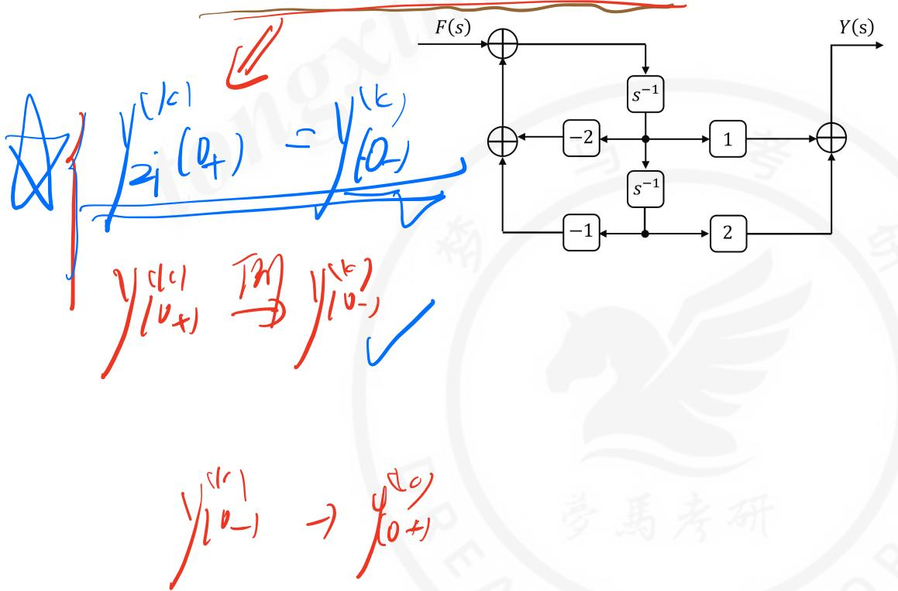

四、已知因果系统的信号流图如下图所示：

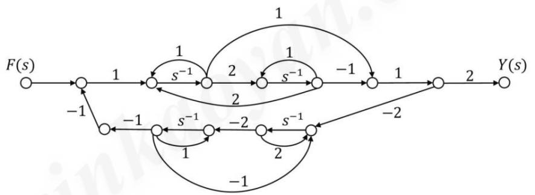

公粮号:通信考研小马哥
官网: www.tongxinkaoyan.com
2、简述全通系统和最小相移系统的零极点分布特点, 并判断图示系统是否为全通系统和最小相移系统, 说明理由。