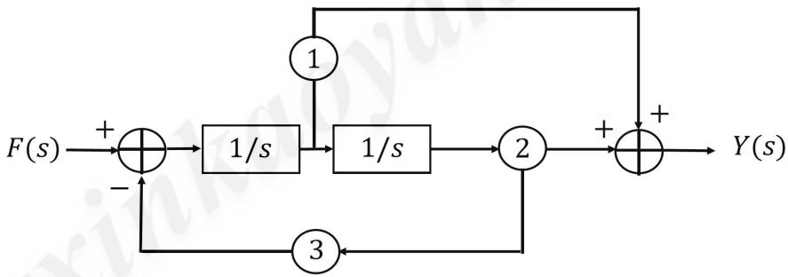
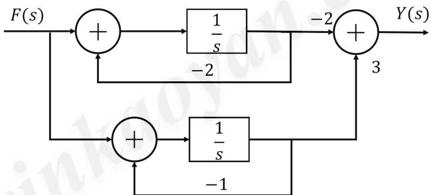
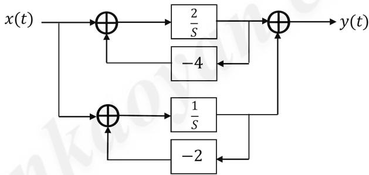
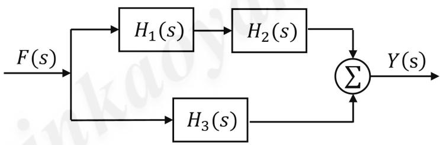
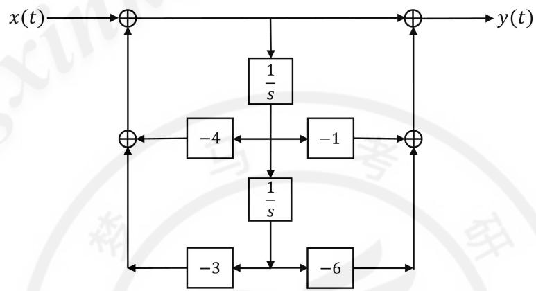
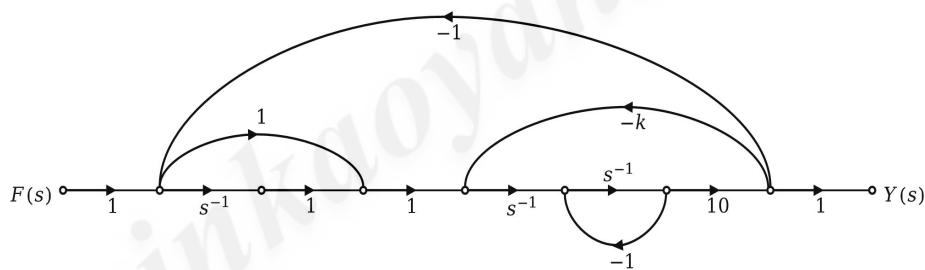

1、已知描述某系统的微分方程为

$$
\frac {d ^ {3}}{d t ^ {3}} r (t) + 5 \frac {d ^ {2}}{d t ^ {2}} r (t) + 8 \frac {d}{d t} r (t) + 4 r (t) = \frac {d}{d t} e (t) + 3 e (t)
$$

试用三种形式画出该系统的信号流图表示。

2、某由基本运算器组成的线性系统如图所示，求系统函数 $H(s)$ ，并写出描述系统输入输出关系的微分方程。

  
夢馬考研

3、某一连续线性LTI因果系统的系统框图如图所示，求：

(1)写出该系统的微分方程;

(2)求系统函数 $H(s)$ 和单位冲激响应 $h(t)$ ;

(3)当 $f(t)=u(t)$ 时，求系统的零状态响应。

夢馬考研

4、一个线性时不变，输入 $x(t)$ 与输出 $y(t)$ 满足以下微分方程

$$
\frac {d ^ {2}}{d t ^ {2}} y (t) + 5 \frac {d}{d t} y (t) + 4 y (t) = 3 \frac {d}{d t} x (t) + 2 x (t)
$$

(1)求出系统函数 $H(s)$ ;

(2)画出系统为因果时，对应的变换域直接型框图；

(3)画出系统零、极点图，分析系统可能的收敛域，并计算不同收敛域对应的单位冲激响应 $h(t)$ ，并判断稳定性和因果性。

5、已知一系统的系统框图如图所示：

（1）确定该系统框图满足的关于 $x(t)$ 和 $y(t)$ 的微分方程；

(2) 求单位冲激响应 $h(t)$ ;

(3) 给定 $y(0_{-})=3$ ， $y'(0_{-})=-5$ ，当输入 $x(t)=e^{-4t}u(t)$ 时，求输出 $y(t)$ ;

(4) 初始条件同 (3)，对于一个输入 $x(t) = 2e^{-4t}u(t - 2)$ ，求输出 $y(t)$ 。

夢馬考研

6、下图所示系统由三个子系统组成，其中 $H_{1}(s)=\frac{1}{s}$ ， $H_{2}(s)=\frac{1}{s+2}$ ， $H_{3}(s)=\frac{e^{-s}}{s+1}$ ，求整个系统冲激响应 $h(t)$ 。

7、已知一因果连续线性时不变系统的系统框图如下图所示，求：

(1) 系统的微分方程;

(2) 系统的单位冲激响应 $h(t)$ ;

(3) 判断该系统的稳定性，并确定系统的频率响应；

(4) 初始状态为 $y(0_{-}) = 1$ ， $y'(0_{-}) = \frac{1}{2}$ ，输入 $x(t) = e^{-2t}u(t)$ ，求系统的全响应。

  
夢馬考研

8、已知线性时不变连续系统的信号流图如下图所示， $F(s)$ 为激励信号的象函数， $Y(s)$ 为响应信号的象函数。

(1)求系统函数 $H(s)$ ;

(2)若系统处于临界稳定状态，确定其常数 $k$ 的值；

(3)系统临界稳定时，画出系统的零、极点图。

夢馬考研