1、已知描述某系统的微分方程为

$$
\frac {d ^ {3}}{d t ^ {3}} r (t) + 5 \frac {d ^ {2}}{d t ^ {2}} r (t) + 8 \frac {d}{d t} r (t) + 4 r (t) = \frac {d}{d t} e (t) + 3 e (t)
$$

试用三种形式画出该系统的信号流图表示。

$$
H (S) = \frac {s + 3}{s ^ {3} + 5 s ^ {2} + 8 s + 4} = \frac {s + 3}{(s + 1) (s + 2) ^ {2}} = \frac {2}{s + 1} + \frac {- 1}{(s + 2) ^ {2}} + \frac {- 2}{s + 2}
$$

直接型：

$$
H (S) = \frac {S ^ {- 2} + 3 S ^ {- 3}}{1 - (- 5 S ^ {- 1} - 8 S ^ {- 2} - 4 S ^ {- 3})}
$$

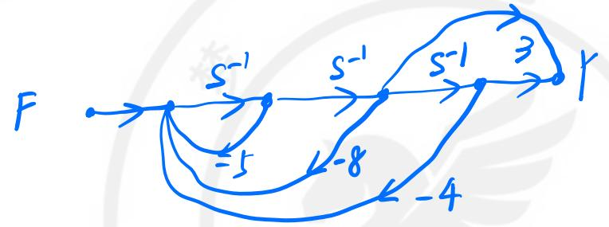

级联型：

$$
H (S) = \frac {S + 3}{S + 1} \cdot \frac {1}{S + 2} \cdot \frac {1}{S + 2} = \frac {1 + 3 S ^ {- 1}}{1 - (- S ^ {- 1})} \cdot \frac {S ^ {- 1}}{1 - (2 S ^ {- 1})} \cdot \frac {S ^ {- 1}}{1 - (- 2 S ^ {- 1})}
$$

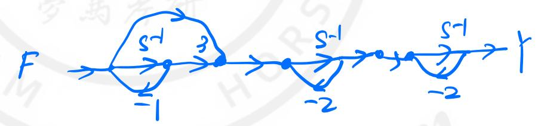

并联型

$$
\begin{array}{r l} {H (s)} & {= \frac {2}{s + 1} + \frac {- 1}{(s + 2) ^ {2}} + \frac {- 2}{s + 2}} \\ & {= \frac {2}{s + 1} + \frac {- 1 - 2 (s + 2)}{(s + 2) ^ {2}} = \frac {2}{s + 1} + \frac {- 2 s - 5}{(s + 2) ^ {2}} = \frac {2}{s + 1} + \frac {- 2 s - 5}{s ^ {2} + 4 s + 4}} \\ & {= \frac {2 s ^ {- 1}}{1 - (- s ^ {- 1})} + \frac {- 2 s ^ {- 1} - 5 s ^ {- 2}}{1 - (- 4 s ^ {- 1} - 4 s ^ {- 2})}} \end{array}
$$

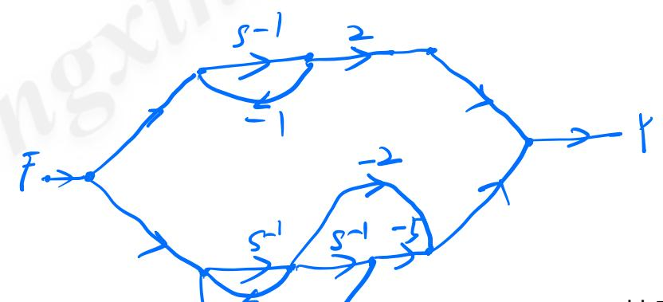

官网：tongxi nkaoyan. con

4 PDF免费QQ群 $^{梦马班作业}$ 615698143

2、某由基本运算器组成的线性系统如图所示，求系统函数 $H(s)$ ，并写出描述系统输入输出关系的微分方程。

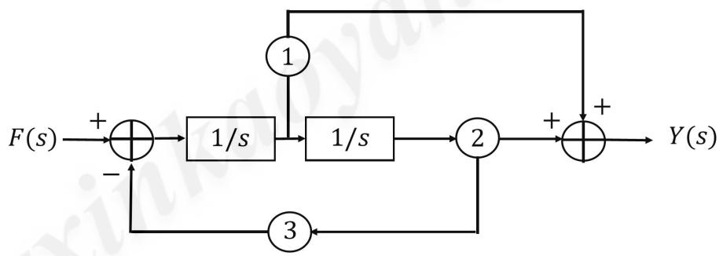

$$
H (s) = \frac {8 ^ {- 1} + 2 s ^ {- 2}}{1 - (- 6 s ^ {- 2})} = \frac {8 ^ {- 1} + 2 s ^ {- 2}}{1 + 6 s ^ {- 2}} = \frac {s + 2}{s ^ {2} + 6}
$$

$$
\therefore y ^ {\prime \prime} (t) + 6 y (t) = f ^ {\prime} (t) + 2 f (t)
$$

3、某一连续线性LTI因果系统的系统框图如图所示，求：

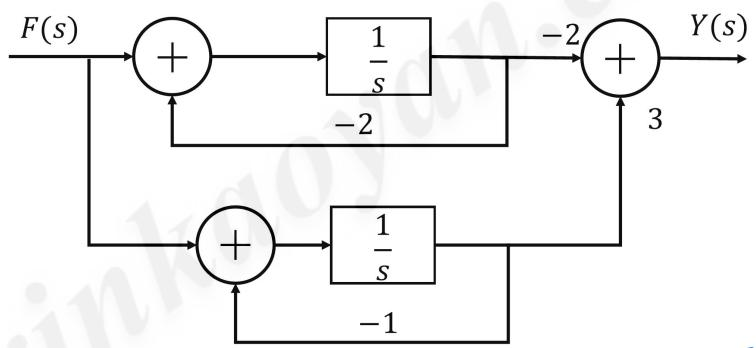

(1)写出该系统的微分方程;

$$
H (s) = \frac {- 2 s ^ {- 1}}{1 - (- 2 s ^ {- 1})} + \frac {3 s ^ {- 1}}{1 - (- s ^ {- 1})}
$$

(2)求系统函数 $H(s)$ 和单位冲激响应 $h(t)$ ;

(3)当 $f(t)=u(t)$ 时，求系统的零状态响应。

$$
\begin{array}{r l} {(3) f (s) = H (s) \cdot f (s)} & {= \frac {s + 4}{s (s + 1) (s + 2)}} \\ & {= \frac {2}{s} + \frac {- 3}{s + 1} + \frac {1}{s + 2}} \end{array}
$$

$$
\therefore y _ {| t |} = (2 - 3 e ^ {- t} + e ^ {- x}) u (t)
$$

$$
\begin{array}{r l} & {= \frac {- 2 s ^ {- 1}}{1 + x s ^ {- 1}} + \frac {3 s ^ {- 1}}{1 + s ^ {- 1}}} \\ & {= \frac {- 2}{s + 2} + \frac {3}{s + 1}} \\ & {= \frac {- x (s + 1) + 3 (s + 2)}{(s + 1) (s + 2)} = \frac {s + 4}{(s + 1) (s + 2)}} \end{array}
$$

$$
\mathrm{3程为} y ^ {\prime} (t) + 3 y ^ {\prime} (t) + 2 y (t) = f ^ {\prime} (t) + 4 f (t)
$$

$$
\begin{array}{r l} {(x) H (S)} & {= \frac {S + 4}{S ^ {2} + 3 S + 2} = \frac {- 2}{S + 2} + \frac {3}{S + 1}} \\ {\therefore u _ {t - 1}} & {= (- 2 e ^ {- x t} + 3 e ^ {- t}) (u _ {t - 1})} \end{array}
$$

4、一个线性时不变，输入 $x(t)$ 与输出 $y(t)$ 满足以下微分方程

$$
\frac {d ^ {2}}{d t ^ {2}} y (t) + 5 \frac {d}{d t} y (t) + 4 y (t) = 3 \frac {d}{d t} x (t) + 2 x (t)
$$

(1)求出系统函数 $H(s)$ ; $=\frac{s^{2}+5s+4}{s^{2}+5s+4}$ (2)画出系统为因果时，对应的变换域直接型框图； $H(s)=\frac{3s^{-1}+2s^{-2}}{1-(-5s^{-1}-4s^{-2})}$

(3)画出系统零、极点图, 分析系统可能的收敛域, 并计算不同收敛域对应的单位冲激响应 $h(t)$ , 并判断稳定性和因果性。

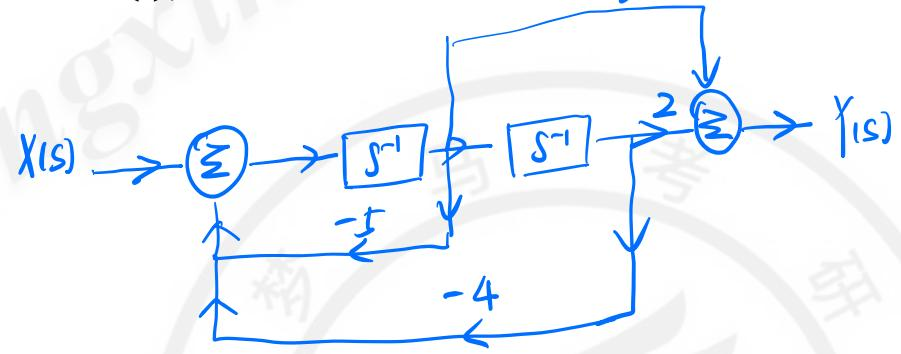

$$
H (s) = \frac {3 s + 2}{(s + 1) (s + 4)}
$$

零点为 $-\frac{2}{3}$ ，极点为-1和-4

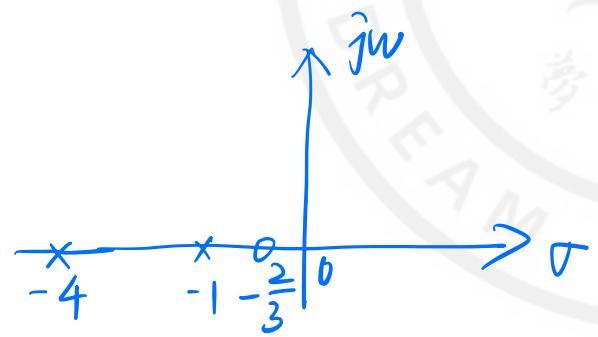

$$
H (s) = \frac {- \frac {1}{3}}{s + 1} + \frac {\frac {1 0}{3}}{s + 4}
$$

(1) $\sigma > -1$ 因某，成立

$$
h (t) = (- \frac {1}{3} e ^ {- t} + \frac {1 0}{3} e ^ {- 4 t}) h (t)
$$

$\sigma < -4$ 非同果不稳定

基础模型

$$
h (t) = (\frac {1}{3} e ^ {- t} - \frac {1 0}{3} e ^ {- 4 t}) u (- t)
$$

$$
\frac {1}{s + 2} \left\{ \begin{array}{l l} \sigma > - \alpha & e ^ {- \alpha t} u (t) \\ \sigma <   - \alpha & - e ^ {- \alpha t} u (- t) \end{array} \right.
$$

水的果 不稳定

$$
- 4 <   \sigma <   - 1
$$

$$
\begin{array}{r l} {\mathrm{Reom):}} & {- e ^ {- \alpha t} u (- t) \leftrightarrow \int_ {- \infty} ^ {\infty} - e ^ {- \alpha t} u (- t) e ^ {- s t} d t} \\ & {= - \int_ {- \infty} ^ {0} e ^ {- (s + \alpha) t} d t} \\ & {= + \frac {e ^ {- (s + \alpha) t}}{s + \alpha} / _ {- \infty} ^ {0} = \frac {1}{s + \alpha} + 0 = \frac {1}{s + \beta}} \\ & {\sigma <   - \alpha} \end{array}
$$

$$
h (t) = \frac {1}{3} e ^ {- t} u (t - t) + \frac {1 0}{3} e ^ {- 4 t} u (t)
$$

5、已知一系统的系统框图如图所示：

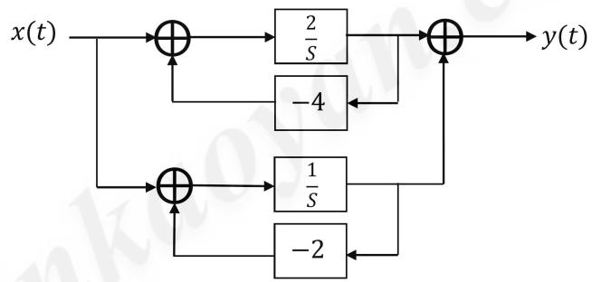

(1) 确定该系统框图满足的关于 $x(t)$ 和 $y(t)$ 的微分方程；

(2) 求单位冲激响应 $h(t)$ ;

（3）给定 $y(0_{-})=3,\quad y'(0_{-})=-5$ ，当输入 $x(t)=e^{-4t}u(t)$ 时，求输出 $y(t)$ ;

(4) 初始条件同 (3)，对于一个输入 $x(t) = 2e^{-4t}u(t - 2)$ ，求输出 $y(t)$ 。

$$
H (s) = \frac {2 s ^ {- 1}}{1 - (- 8 s ^ {- 1})} + \frac {s ^ {- 1}}{1 - (- 2 s ^ {- 1})} = \frac {2}{s + 8} + \frac {1}{s + 2} = \frac {3 s + 1 2}{(s + 8) (s + 2)}
$$

$$
\therefore y ^ {\prime \prime} (t) + 1 0 y ^ {\prime} (t) + 1 6 y ^ {\prime} (t) = 3 x ^ {\prime} (t) + 1 2 x (t)
$$

$$
H (s) = \frac {2}{s + 8} + \frac {1}{s + 2} \Rightarrow h (t) = (2 e ^ {- 8 t} + e ^ {- 2 t}) u (t)
$$

$$
y _ {2 i} | t | = A e ^ {- x t} + B e ^ {- 8 t}
$$

$$
B = - \frac {1}{6} \Rightarrow y _ {i} (t) = (\frac {1 9}{6} e ^ {- 2 t} - \frac {1}{6} e ^ {- 8 t}) (u (t))
$$

$$
y ^ {\prime} (0 + 1) = y ^ {\prime} (0 - 1) = - 2 A - 8 B = - 5
$$

$$
\therefore y _ {1} (t) = y _ {2 i} + y _ {3} = (\frac {1 1}{3} e ^ {- x t} - \frac {2}{3} e ^ {- 8 t}) (u r t)
$$

$$
x (t) = 2 e ^ {- 4 t} u (t - 2) = 2 e ^ {- 4 (t - 2)} u (t - 2) \cdot e ^ {- 8}
$$

$$
\begin{array}{r l} {\mathrm{故} y (t)} & {= y _ {2} (t) + 2 e ^ {- 8} y _ {2 s} (t - 2)} \\ & {= (\frac {1 9}{6} e ^ {- x t} - \frac {1}{6} e ^ {- 8 t}) u (t) + e ^ {- 8} [ e ^ {- 2 (t - 2)} - e ^ {- 8 (t - 2)} ] u (t - 2)} \end{array}
$$

官网：tongxi nkaoyan. con

$\left[e^{-3(t+2)}e^{-8(t-1)}\right]_{\text{梦马班作业}}$ 615698143

6、下图所示系统由三个子系统组成，其中 $H_{1}(s)=\frac{1}{s}$ ， $H_{2}(s)=\frac{1}{s+2}$ ， $H_{3}(s)=\frac{e^{-s}}{s+1}$ ，求整个系统冲激响应 $h(t)$ 。

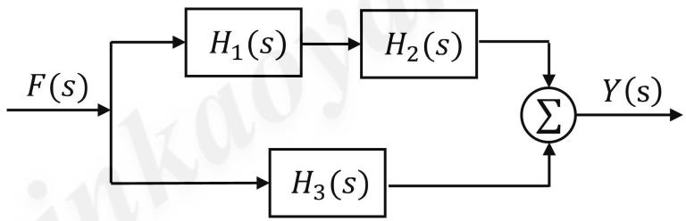

$$
\begin{array}{r l} {H (s)} & {= H _ {1} (s) \cdot H _ {2} (s) + H _ {3} (s)} \\ & {= \frac {1}{S (s + 2)} + \frac {e ^ {- s}}{s + 1}} \\ & {= \frac {\frac {1}{2}}{s} + \frac {- \frac {1}{2}}{s + 2} + \frac {e ^ {- s}}{s + 1}} \\ & {\Rightarrow h (t)} \\ & {= \frac {1}{2} (1 - e ^ {- 2 t}) u (t) + e ^ {- (t - 1)} u (t - 1)} \end{array}
$$

7、已知一因果连续线性时不变系统的系统框图如下图所示，求：

(1) 系统的微分方程;

(2) 系统的单位冲激响应 $h(t)$ ;

(3) 判断该系统的稳定性，并确定系统的频率响应；

(4) 初始状态为 $y(0_{-}) = 1$ ， $y'(0_{-}) = \frac{1}{2}$ ，输入 $x(t) = e^{-2t} u(t)$ ，求系统的全响应。

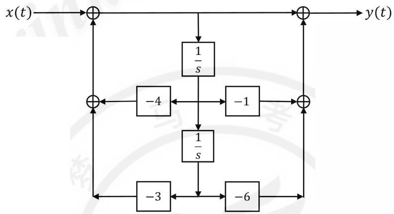

$$
H (s) = \frac {Y (s)}{X (s)} = \frac {1 - s ^ {- 1} - 6 s ^ {- 2}}{1 - (- 4 s ^ {- 1} - 3 s ^ {- 2})} = \frac {s ^ {2} - s - 6}{s ^ {2} + 4 s + 3}
$$

$$
y ^ {\prime \prime} (t) + 4 y ^ {\prime \prime} (t) + 3 y (t) = x ^ {\prime \prime} (t) - x ^ {\prime} (t) - 6 (x t)
$$

$$
H (s) = 1 + \frac {- 5 s - 9}{(s + 1) (s + 3)} = 1 + \frac {- 2}{s + 1} + \frac {- 3}{s + 3}
$$

$$
\therefore h (t) = \delta (t) - (2 e ^ {- t} + 3 e ^ {- 3 t}) (u (t))
$$

$\therefore a + b = 0$ 或 $b = -2\pi \cos x$ 的最大值，则 $a + b = 0$ 。

$$
H (w) = H (s) / s = j w = \frac {- w ^ {2} - 6 - j w}{- w ^ {2} + 3 + j 4 w}
$$

(4)

$$
\begin{array}{r l} & {y _ {2 i} | u | = A e ^ {- t} + B e ^ {- 3 t}} \\ & {y _ {2 i} (0 +) = A + B = 1 = y (0 -)} \\ & {y _ {2 i} (0 +) = - A - 3 B = \frac {1}{2} = y (0 -)} \\ & {\therefore y _ {2 i} (u) = (\frac {7}{4} e ^ {- t} - \frac {3}{4} e ^ {- 3 t}) (u (t)} \\ & {x (s) = \frac {1}{s + 2} \Rightarrow y _ {2 s} (s) = H (s) \cdot x (s) = \frac {(s + 2) (s - 3)}{(s + 1) (s + 2) (s + 3)} = \frac {s - 3}{(s + 1) (s + 3)}} \\ & {\qquad \qquad \qquad \qquad \qquad \qquad \qquad \qquad \qquad \qquad \qquad \qquad \qquad \qquad \qquad \qquad \qquad \qquad \qquad \qquad \qquad \qquad \qquad \qquad \qquad \qquad \qquad \qquad \qquad \qquad \qquad \qquad \qquad \qquad \mathrm{PDF免费QQ群6156981}} \\ & {\therefore y _ {2 s} | u | = (2 e ^ {- t} + 3 e ^ {- 3 t}) (u (t))} \\ & {\therefore y _ {1 a} = y _ {2 i} + y _ {2 s} = (- \frac {1}{4} e ^ {- t} + \frac {9}{4} e ^ {- 3 t}) (u (t))} \end{array}
$$

8、已知线性时不变连续系统的信号流图如下图所示， $F(s)$ 为激励信号的象函数， $Y(s)$ 为响应信号的象函数。

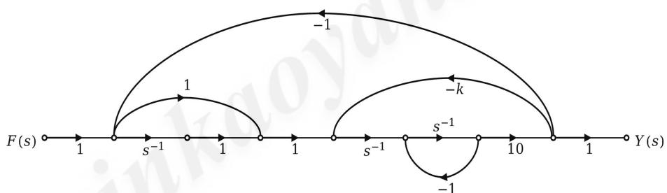

(1)求系统函数 $H(s)$ ;

(2)若系统处于临界稳定状态，确定其常数 $k$ 的值；

(3)系统临界稳定时，画出系统的零、极点图。

(1) 流图满足简易型

$$
H (S) = \frac {1 0 S ^ {- 3} + 1 0 S ^ {- 2}}{1 - (- S ^ {- 1} - 1 0 k S ^ {- 2} - 1 0 S ^ {- 3} - 1 0 S ^ {- 2})} = \frac {1 0 + 1 0 S}{S ^ {3} + S ^ {2} + (1 0 k + 1 0) S + 1 0}
$$

(2)

可见新致及时

$$
1 0 k > 0
$$

故临界稳定时 k = 0

(3) 当 k = 0 时

$$
H (s) = \frac {1 0 (s + 1)}{\underbrace {s ^ {3} + s ^ {2}} _ {s ^ {2} (s + 1)} + \underbrace {1 0 s + 1 0} _ {1 0 (s + 1)}} = \frac {1 0 (s + 1)}{(s ^ {2} + 1 0) (s + 1)}
$$

要点为-1

极负为1和± $\sqrt{10}$

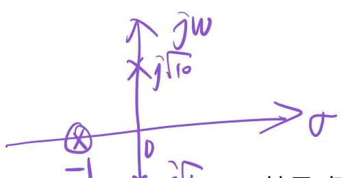

官网：tongxi nkaoyan. con

PDF免费QQ群615698143