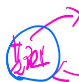
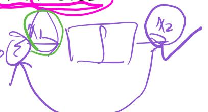
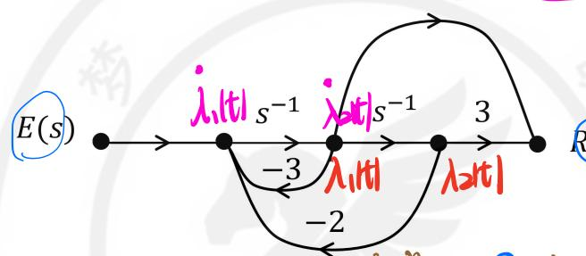
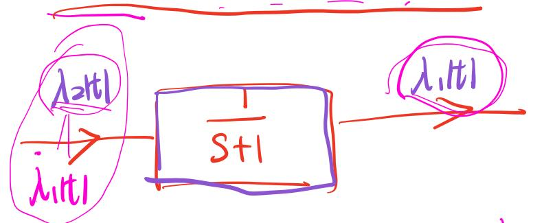
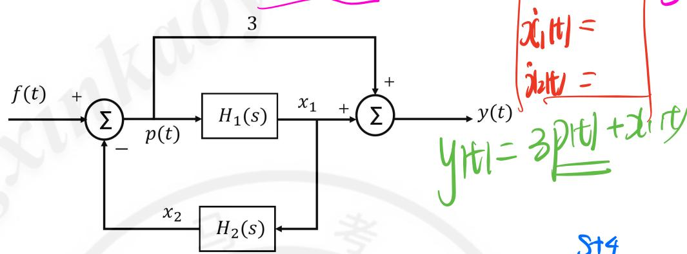

$R(s)$

y(t) = f(t) 关系：输入输出描述层
公众号：通信考研小马哥

DF免费QQ群615698143
B站up: 信号与系统\_谷哥
→ 求响应和内生特性

## 专题 2 状态变量分析

考点1: 流图/框图视角下状态变量分析

1、基础：在信号流图或者模拟框图的基础上进行状态变量分析

2、目的：列写状态方程和输出方程，并给出矩阵形式

(所取)
假设放弦

3、选取原则：【PS 不管流图还是框图】选择各积分器的输出端作为状态变量

4. 状态方程：利用状态变量和输入表示各积分器的输入端

5、输出方程：利用状态变量和输入表示输出

例 15：对流图所示系统进行状态变量分析，列写输出方程和状态方程。

$$
x _ {1} = f _ {1} t _ {1} + x _ {2}
$$

$$
x _ {1} ^ {\prime} = x _ {1}
$$

注：迭秋篇的编生师为状态变量,记作入(1)和右(1),如图示

$$
\dot {\lambda} _ {1} | t | = e | t | - 3 \lambda_ {1} | t | - 2 \lambda_ {2} | t |
$$

$$
\lambda_ {2} (t) = \lambda_ {1} (t)
$$

$$
r | t | = \lambda_ {1} | t | + 3 \lambda_ {2} | t |
$$

$$
\begin{array}{r l} & {\left[ \begin{array}{l} \dot {\lambda_ {1 | t |}} \\ \dot {\lambda_ {2 | t |}} \end{array} \right] = \left[ \begin{array}{l l} - 3 & - 2 \\ 1 & 0 \end{array} \right] \left[ \begin{array}{l} \lambda_ {1 | t |} \\ \lambda_ {2 | t |} \end{array} \right] + \left[ \begin{array}{l} 1 \\ 0 \\ B \end{array} \right] e (t)} \\ & {\quad r (t) = \left[ \begin{array}{l l} 1 & 3 \\ 0 & 0 \end{array} \right] \left[ \begin{array}{l} \lambda_ {1 | t |} \\ \lambda_ {2 | t |} \end{array} \right] + \left[ \begin{array}{l l} 0 & ] e (t)} \\ D & \end{array} \right] \end{array}
$$

$$
\dot {\lambda} _ {1} | t | = e | t |
$$

$$
\lambda_ {2} (t) = e (t) - \frac {1}{5} \lambda_ {3} (t)
$$

DF免费QQ群615698143
B站up: 信号与系统\_谷哥

公众号：通信考研小马哥

例 16: 已知描述某系统的微分方程为

$$
= \frac {1}{2} s ^ {- 1} + \frac {\frac {1}{6} s ^ {- 1}}{1 - (- 2 s ^ {\prime})} + \frac {- \frac {4}{3} s ^ {- 1}}{1 - (- 5 s ^ {\prime})}
$$

$$
\frac {d ^ {3}}{d t} r (t) + 7 \frac {d ^ {2}}{d t} r (t) + 1 0 \frac {d}{d t} r (t) = 5 \frac {d}{d t} e (t) + 5 e (t)
$$

试用三种不同结构画出该系统的流图表示, 并且列出对应的状态方程。

直妨近

$$
H (s) = \frac {5 s ^ {- 2} + 5 s ^ {- 3}}{1 - (- 7 s ^ {- 1} - 1 0 s ^ {- 2})}
$$

过precoding为极变号记作入11t1、入21t1和入31t1如右文

$$
\hat {\lambda} _ {1} (t) = e (t) - T \lambda_ {1} (t) - 1 0 \lambda_ {2} (t)
$$

$$
\begin{array}{l l} {\dot {\lambda} _ {2} (t)} & {= \lambda_ {1} (t)} \\ {\dot {\lambda} _ {3} (t)} & {= \lambda_ {2} (t)} \end{array} \quad \left[ \begin{array}{l} {- \dot {\lambda} _ {1} (t)} \\ {\dot {\lambda} _ {2} (t)} \\ {\dot {\lambda} _ {3} (t)} \end{array} \right] = \left[ \begin{array}{l l l} {- 7} & {- 1 0} & {0} \\ {1} & {0} & {0} \\ {0} & {1} & {0} \end{array} \right] \left[ \begin{array}{l} {\lambda_ {1} (t)} \\ {\lambda_ {2} (t)} \\ {\lambda_ {3} (t)} \end{array} \right] + \left[ \begin{array}{l} {1} \\ {0} \\ {0} \end{array} \right] e (t)
$$

$$
H (S) = \frac {5}{S} \cdot \frac {S + 1}{S + 2} \cdot \frac {1}{S + 5} = 5 S ^ {- 1} \cdot \frac {1 + S ^ {- 1}}{1 - (- 2 S ^ {- 1})} \cdot \frac {S ^ {- 1}}{1 - (- 5 S ^ {- 1})}
$$

$$
\begin{array}{r l} & E (s) \xrightarrow {\dot {\lambda} _ {1} (t) s ^ {- 1} 5} \overbrace {\lambda_ {1} (t)} ^ {\dot {\lambda} _ {2} (t) s ^ {- 1}} \overbrace {- 2 \lambda_ {2} (t)} ^ {\dot {\lambda} _ {3} (t) s ^ {- 1}} \overbrace {- 5 \lambda_ {3} (t)} ^ {\dot {\lambda} _ {4} (t) s ^ {- 1}} R (s) \\ & \quad \dot {\lambda} _ {1} (t) = e (t) \\ & \quad \dot {\lambda} _ {2} (t) = 5 \lambda_ {1} (t) - 2 \lambda_ {2} (t) \\ & \quad \dot {\lambda} _ {3} (t) = \lambda_ {2} (t) + | \dot {\lambda} _ {2} (t) - 5 \lambda_ {3} (t) \\ & \quad = 5 \lambda_ {1} (t) - \lambda_ {2} (t) - 5 \lambda_ {3} (t) \end{array}
$$

DF免费QQ群615698143

$$
\begin{array}{l}{6 1 5 6 9 8 1 4 3}\\{\rightarrow \boxed {s ^ {- 1} / \boxed {s}} \rightarrow}\end{array}
$$

$x_{1}$ 是 $x_{1}$ 的一阶等

$$
\begin{array}{r l} {x _ {1} ^ {\prime} (t)} & {= \dot {x} _ {1} (t)} \\ {\mathrm{Laplace}} \\ {s x _ {1} (s)} & {= \dot {x} _ {1} (s)} \end{array}
$$

让你求 $i$ (t) =

4. 知了程 (叶蛾)

逆

$(S + B_{f})$

$$
(S + 1) \lambda_ {1} (s) = \lambda_ {2} (s)
$$

$$
\underline {{s \lambda_ {1} (s)}} = \lambda_ {2} (s) - \lambda_ {1} (s)
$$

$$
\widehat {B} (m): s \lambda_ {1} (s) =
$$

考点2: 结构图下的状态变量分析 求 $H(S)$ 方程

例17：如图所示由两个一阶子系统连接而成的连续系统，其子系统的系统函数

分别为 $H_{1}(s) = \frac{2}{s + 3}, H_{2}(s) = \frac{s + 4}{s + 1}$ ，写出其状态方程和输出方程

$$
S \times 2 (S) = \dots
$$

H2(S) 级面言：

$$
\begin{array}{r l} & {x _ {2} (s) = x _ {1} (s) \cdot H _ {2} (s) = x _ {1} (s) \cdot \frac {s + 1}{s + 1}} \\ & {\Rightarrow (s + 1) x _ {2} (s) = (s + 4) x _ {1} (s)} \\ & {\Rightarrow s x _ {2} (s) = s x _ {1} (s) + 4 x _ {1} (s) - x _ {2} (s)} \\ & {\Rightarrow \dot {x} _ {2} (t) = \dot {x} _ {1} (t) + 4 x _ {1} (t) - x _ {2} (t)} \\ & {\quad \mathrm{2}} \end{array}
$$

H1(S)系瓦西 $\frac{2}{3}$

$$
X _ {1} (s) = P (s) \cdot H _ {1} (s) = P (s) \cdot \frac {1}{s + 3}
$$

$$
\Rightarrow (s + 3) \times (1 s) = 2 p (s)
$$

$$
\Rightarrow S X _ {1} (S) = 2 P (S) - 3 X _ {1} (S)
$$

$$
\Rightarrow (x _ {1} | t) = 2 p (t) - 3 x _ {1} (t)
$$

$$
p (t) = f (t) - x _ {2} (t)
$$