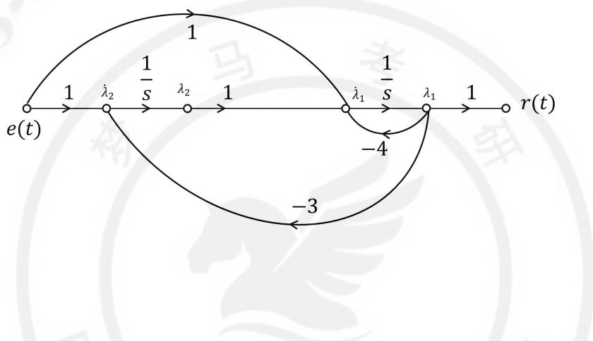

## 专题3 状态变量分析求解系统响应

## 考点1：求解系统响应

状态方程标准形式为

$$
\dot {\lambda} (t) = A \lambda (t) + B e (t)
$$

输出方程为

$$
r (t) = C \lambda (t) + D e (t)
$$

$$
\dot {\lambda} (t) = A \lambda (t) + B e (t) \Rightarrow s \lambda (s) - \lambda (0 _ {-}) = A \lambda (s) + B E (s) \Rightarrow (s I - A) \lambda (s) = \lambda (0 _ {-}) + B E (s)
$$

令 $\phi (s) = (sI - A)^{-1}$ 称为状态转移矩阵，则

$$
\lambda (s) = \phi (s) [ \lambda (0 _ {-}) + B E (s) ]
$$

输出方程

$$
\begin{array}{r l} r (t) & = C \lambda (t) + D e (t) \Rightarrow R (s) = C \lambda (s) + D E (s) = C \phi (s) [ \lambda (0 _ {-}) + B E (s) ] + D E (s) \\ R (s) & = C \phi (s) \lambda (0 _ {-}) + [ C \phi (s) B + D ] E (s) \\ & \quad \Downarrow \quad \quad \quad \quad \quad \quad \quad \quad \quad \quad \Downarrow \\ & = R _ {z i} (s) + R _ {z s} (s) \end{array}
$$

可见，系统函数

$$
H (s) = C \phi (s) B + D
$$

例 20：某连续时间系统的状态方程和输出方程分别为

$$
\left[ \begin{array}{l} \lambda_ {1} (t) \\ \lambda_ {2} (t) \end{array} \right] = \left[ \begin{array}{c c} 2 & 3 \\ 0 & - 1 \end{array} \right] \left[ \begin{array}{l} \lambda_ {1} (t) \\ \lambda_ {2} (t) \end{array} \right] + \left[ \begin{array}{c c} 0 & 1 \\ 1 & 0 \end{array} \right] \left[ \begin{array}{l} e _ {1} (t) \\ e _ {2} (t) \end{array} \right]
$$

$$
\left[ \begin{array}{l} y _ {1} (t) \\ y _ {2} (t) \end{array} \right] = \left[ \begin{array}{c c} 1 & 1 \\ 0 & - 1 \end{array} \right] \left[ \begin{array}{l} \lambda_ {1} (t) \\ \lambda_ {2} (t) \end{array} \right] + \left[ \begin{array}{c c} 1 & 0 \\ 1 & 0 \end{array} \right] \left[ \begin{array}{l} e _ {1} (t) \\ e _ {2} (t) \end{array} \right]
$$

初始状态和输入分别为

$$
\left[ \begin{array}{l} \lambda_ {1} (0 _ {-}) \\ \lambda_ {2} (0 _ {-}) \end{array} \right] = \left[ \begin{array}{l} 2 \\ - 1 \end{array} \right], \quad \left[ \begin{array}{l} e _ {1} (t) \\ e _ {2} (t) \end{array} \right] = \left[ \begin{array}{l} u (t) \\ \delta (t) \end{array} \right]
$$

(1)求状态转移矩阵 $\phi (s)$ 和 $\phi (t) = e^{At}$

(2)求系统函数 $H(s)$ 和 $h(t)$

(3)求系统响应

夢馬考研

例 21: 已知如图所示系统。

(1)列写状态方程与输出方程;

(2)求系统的微分方程;

(3)已知 $e(t)=u(t)$ 时的全响应

$$
r (t) = \frac {1}{3} + \frac {1}{2} e ^ {- t} - \frac {5}{6} e ^ {- 3 t}, t \geq 0
$$

求系统的零输入响应 $r_{zi}(t)$ 与起始状态 $\lambda(0_{-})$ ;

(4)求系统的单位冲激响应 $h(t)$ 。

  
夢馬考研

## 考点2：判断系统的内在特性

## 1、因果稳定性：

只需定出矩阵A的特征值 $Re\left[\alpha_{i}\right]<0$ ，则系统是因果稳定的；或者判定特征多项式 $|sI-A|$ 的特征根都位于s平面的左半平面。

## 2、可控性：

## (1)定义

当系统用状态方程描述时, 给定系统的任意初始状态, 可以找到容许的输入量(即控制变量), 在有限时间之内把系统的所有状态引向状态空间的原点(即零状态), 如果可以做到这一点, 则称系统是完全可控制的。如果只有对部分状态变量可以做到这一点, 则称系统是不完全可控制的。

## (2) 判断方法

方法 1: 若可控阵 $M = (B : AB : A^{2}B : \cdots : A^{k-1}B)$ 为满秩，则系统即为完全可控的，否则即为不完全可控的。

## 方法 2:

设系统的特征根为单根，系统为单输入，则系统状态完全可控的充要条件是：当矩阵 $\hat{A}$ 为对角阵时，矩阵 $\hat{B}$ 中无零元素。若 $\hat{B}$ 中出现零元素，则与该 $\hat{B}$ 中零元素相对应的状态变量就不能被输入变量控制。

## 3、可观性：

## (1)定义

如果系统用状态方程描述时，在给定控制后，能在有限时间间隔内 $(0 < t < t_1)$ 根据系统输出唯一地确定系统的所有起始状态，则称系统完全可观；若只能确定部分起始状态，则称系统不完全可观。

(2) 判断方法:

方法 1: 若可观阵

$$
N = \left( \begin{array}{c} C \\ \dots \\ C A \\ \dots \\ \vdots \\ \dots \\ C A ^ {k - 1} \end{array} \right)
$$

为满秩，则系统即为完全可观的，否则即为不完全可观的。

方法 2:

设系统的特征根为单根，系统为单输出，则系统状态完全可观的充要条件是：当矩阵 $\hat{A}$ 为对角阵时(此时各状态变量之间已无联系)，矩阵 $\hat{C}$ 中无零元素。若 $\hat{C}$ 中出现零元素，则与该零元素相对应的状态变量就不可观。

设系统的特征根为单根，系统为多输出，则系统状态完全可观的充要条件是：当矩阵 $\hat{\pmb{A}}$ 为对角阵时，矩阵 $\hat{\pmb{C}}$ 中无全为零元素的列。

例 22：若线性非时变系统的状态方程和输出方程为

$$
\left\{ \begin{array}{l} \dot {\boldsymbol {\lambda}} (t) = \boldsymbol {A} \boldsymbol {\lambda} (t) + \boldsymbol {B} \boldsymbol {e} (t) \\ \boldsymbol {r} (t) = \boldsymbol {C} \boldsymbol {\lambda} (t) \end{array} \right.
$$

$$
\boldsymbol {A} = \left( \begin{array}{c c c} - 1 & - 2 & - 1 \\ 0 & 3 & 0 \\ 0 & 0 & - 2 \end{array} \right), \boldsymbol {B} = \binom{2}{- 2} _ {1}, \boldsymbol {C} = (2 \quad 1 \quad - 1)
$$

(1)判断系统的可控性与可观性；

(2)求系统的转移函数。

夢馬考研