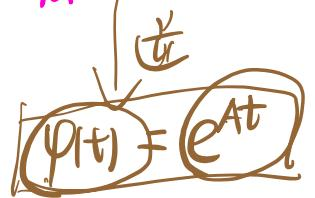
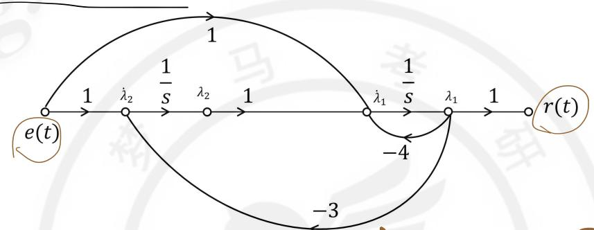
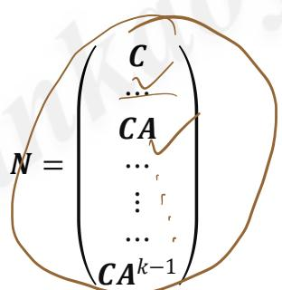

DF免费QQ群615698143
连点时间系统的st域分析 $y'(t) + 2y(t) = f'(t)$ $f(t) = e^{-3t}u(t), y(0-1)=1$ $y(t)$

设：对方程两边求(place $[s f(s) - y_{10-1}]$ + 2f(s) = [sF(s)] - f(0-2

$$
\frac {f (t) \text { 是 } u (t) \text { 型 }}{f (0 - 1) = 0}
$$

$$
\begin{array}{c} (s + 2) Y (s) = y (0 -) + s f (s) \\ \hline Y (s) = \left| \frac {y (4)}{s + 2} \right| + \left| \frac {s}{s + 2} F (s) \right| \\ \boxed {y _ {1}} \quad \boxed {y _ {2}} \end{array}
$$

$$
\begin{array}{l} y _ {3 i e 1} \dots \\ y _ {3 i e 2} \dots \\ h e _ {1} \dots \end{array}
$$

信号流图状态、过程
结论

$$
\begin{array}{r l} {\dot {i} (t)} & {= A \lambda (t) + B f (t)} \\ {y (t)} & {= C \lambda (t) + D f (t)} \end{array}
$$

$$
\begin{array}{l} {f (t) \mathrm{和} 0 - \mathrm{设} 0} \\ {\mathrm{y} (t) = ?} \end{array}
$$

$\lambda(t)$ , $f(t)$

表 入(t) 和 y(t)

$$
Y _ {(S)} = S \frac {\lambda (S)}{2} + D \sqrt {f (S)}
$$

$$
\hat {\lambda} | t | \rightarrow 1 0 ^ {- 2} \rightarrow^ {\lambda | t |}
$$

$$
S \lambda (s) - \lambda (0 - 1) = A \lambda (s) + B F (s)
$$

$$
\dot {\lambda} (t) = \frac {d \lambda (t)}{d t}
$$

$$
\Rightarrow (S I - A) \lambda (s) = \lambda (0 -) + B F (s)
$$

$$
\Rightarrow \overline {{\lambda (s)}} = (S I - A) ^ {- 1} \lambda (0 -) + (S I - A) ^ {- 1} B F (s)
$$

$$
\mathrm{令} \phi (s) = (s I - A) ^ {- 1} = \phi (s) \lambda (0 - 1) + \phi (s) B F (s)
$$

H(s)由ABCD决定

$$
\begin{array}{r l} {Y _ {(S)}} & {= C [ \phi (s) \lambda (0 -) + \phi (s) B F (s) ] + D F (s)} \\ & {= C (\phi (s)) \quad \lambda (0 -) + [ G \phi (s) B + D ] \quad F (s)} \\ & {\mathrm{PDF免费QQ群615698143}} \end{array}
$$

## 专题3 状态变量分析求解系统响应

## 考点1：求解系统响应

状态方程标准形式为

$$
\dot {\lambda} (t) = A \lambda (t) + B e (t)
$$

输出方程为

$$
r (t) = C \lambda (t) + D e (t)
$$

$$
\dot {\lambda} (t) = A \lambda (t) + B e (t) \Rightarrow s \lambda (s) - \lambda (0 _ {-}) = A \lambda (s) + B E (s) \Rightarrow (s I - A) \lambda (s) = \lambda (0 _ {-}) + B E (s)
$$

令 $\phi (s) = (sI - A)^{-1}$ 称为状态转移矩阵，则

$$
\lambda (s) = \phi (s) [ \lambda (0 _ {-}) + B E (s) ]
$$

输出方程

$$
\begin{array}{c} r (t) = C \lambda (t) + D e (t) \Rightarrow R (s) = C \lambda (s) + D E (s) = C \phi (s) [ \lambda (0 _ {-}) + B E (s) ] + D E (s) \\ R (s) = C \phi (s) \lambda (0 _ {-}) + [ C \phi (s) B + D ] E (s) \\ \Downarrow \quad \quad \quad \quad \quad \quad \quad \quad \quad \quad \quad \quad \Downarrow \\ = R _ {z i} (s) + R _ {z s} (s) \end{array}
$$

可见，系统函数

$$
H (s) = C \phi (s) B + D
$$

总传：

$\left\{ \begin{array} { l } { \text {微子程 } } \\ { \text {场子程 } } \end{array} \right.$

$$
\begin{array}{r l} {\dot {\lambda} (t)} & {= A \lambda (t) + B f (t)} \\ {y (t)} & {= C \lambda (t) + D f (t)} \end{array}
$$

$$
G (s) \rightarrow g (t)
$$

$$
Ⓩ y _ {2 i} (s) \rightarrow y _ {2 i} (t)
$$

$$
\frac {C \phi (8) B + D}{\rightarrow y _ {2 s} (t)}
$$

⑤ 令 $\phi(s)=(sI-A)^{-1}$ 状态转移矩阵 $\varphi(t)=e^{At}$

⊕ y|t|

$2^{0}$ 可取. 可持

⑥ 内解性质 |S| - A| = 0 的根

H(S) 的权点 全部位于 S 外半平的 $\phi(S) B + D = C (S| - A)^{-1} B + D = \frac{b}{b+1}$ PDE 必费QQ群 615698143例 20: 某连续时间系统的状态方程和输出方程分别为

$$
\left[ \begin{array}{l} \lambda_ {1} (t) \\ \lambda_ {2} (t) \end{array} \right] = \left[ \begin{array}{c c} 2 & 3 \\ 0 & - 1 \end{array} \right] \left[ \begin{array}{l} \lambda_ {1} (t) \\ \lambda_ {2} (t) \end{array} \right] + \left[ \begin{array}{c c} 0 & 1 \\ 1 & 0 \end{array} \right] \left[ \begin{array}{l} e _ {1} (t) \\ e _ {2} (t) \end{array} \right]
$$

$$
\phi (s) = (s I - A) ^ {- 1}
$$

$$
S I - A = \left[ \begin{array}{l l} S & 0 \\ 0 & S \end{array} \right] - \left[ \begin{array}{l l} 2 & 3 \\ 0 & - 1 \end{array} \right]
$$

$$
\left[ \begin{array}{l} y _ {1} (t) \\ y _ {2} (t) \end{array} \right] = \left[ \begin{array}{l l} 1 & 1 \\ 0 & - 1 \end{array} \right] \left[ \begin{array}{l} \lambda_ {1} (t) \\ \lambda_ {2} (t) \end{array} \right] + \left[ \begin{array}{l l} 1 & 0 \\ 1 & 0 \end{array} \right] \left[ \begin{array}{l} e _ {1} (t) \\ e _ {2} (t) \end{array} \right] = \left[ \begin{array}{l l} s - 2 & - 3 \\ 0 & s + 1 \end{array} \right]
$$

初始状态和输入分别为

$$
\left[ \begin{array}{l} \lambda_ {1} (0 _ {-}) \\ \lambda_ {2} (0 _ {-}) \end{array} \right] = \left[ \begin{array}{l} 2 \\ - 1 \end{array} \right], \quad \left[ \begin{array}{l} e _ {1} (t) \\ e _ {2} (t) \end{array} \right] = \left[ \begin{array}{l} u (t) \\ \delta (t) \end{array} \right]
$$

$$
(S 2 - A) ^ {- 1} = \frac {\left[ \begin{array}{l l} s + 1 & 3 \\ 0 & s - 2 \end{array} \right]}{(s - 2) (s + 1) - D}
$$

(1)求状态转移矩阵 $\phi(s)$ 和 $\phi(t)=e^{At}$

(2)求系统函数 $H(s)$ 和 $h(t)$

$$
\phi (s) = \left[ \begin{array}{l l} \frac {1}{s - 2} & \frac {3}{(s - 2) (s + 1)} \\ 0 & \frac {1}{s + 1} \end{array} \right]
$$

(3)求系统响应

$$
\begin{array}{r l} & {\mathrm{(2)} H (s) = C \phi (s) B + D \quad \psi (s) = e ^ {A t} = \left[ \begin{array}{l l} e ^ {- t} & e ^ {x - e} \\ 0 & e ^ {- t} \end{array} \right] u (t)} \\ & {\qquad = \left[ \begin{array}{l l} 1 & 1 \\ 0 & - 1 \end{array} \right] \left[ \begin{array}{l} \phi (s) \\ 0 \end{array} \right] \left[ \begin{array}{l l} 0 & 1 \\ 1 & 0 \end{array} \right] + \left[ \begin{array}{l l} 1 & 0 \\ 1 & 0 \end{array} \right]} \\ & {\qquad = \left[ \begin{array}{l l} 1 + \frac {1}{s - 2} & \frac {1}{s - 2} \\ 1 - \frac {1}{s + 1} & 0 \end{array} \right] \Rightarrow h (t) = \left[ \begin{array}{l l} \delta (t) + e ^ {x t} & e ^ {x t} \\ \delta (t) - e ^ {- t} & 0 \end{array} \right] u (t)} \\ & {(3) Y _ {X} = H (s) \cdot E (s) = H (b) \left[ \begin{array}{l l} 1 + s ^ {\frac {1}{2}} & s ^ {\frac {1}{2}} \\ 1 - s ^ {\frac {1}{2}} & 0 \end{array} \right] \left[ \begin{array}{l} \frac {1}{s} \\ 1 \end{array} \right] =} \end{array}
$$

$$
Y _ {2 i} = C \phi (s) \lambda (0 -)
$$

例 21: 已知如图所示系统。

(1)列写状态方程与输出方程;

(2)求系统的微分方程;

(3)已知 $e(t)=u(t)$ 时的全响应

$$
r (t) = \frac {1}{3} + \frac {1}{2} e ^ {- t} - \frac {5}{6} e ^ {- 3 t}, t \geq 0
$$

求系统的零输入响应 $r_{zi}(t)$ 与起始状态 $\lambda(0_{-})$ ;

(4)求系统的单位冲激响应 $h(t)$ 。

(1) $\dot{\lambda}_{1}|t| = e|h| - 4\lambda_{1}|t| + \lambda_{2}|t|$ $\dot{\lambda}_{2}|t| = e|h| - 3\lambda_{1}|t|$ $r|h| = \lambda_{1}|t|$

$$
\left[ \begin{array}{l} \dot {\lambda} _ {1} (t) \\ \dot {\lambda} _ {2} (t) \end{array} \right] = \left[ \begin{array}{l l} - 4 & 1 \\ - 3 & 0 \end{array} \right] \left[ \begin{array}{l} \lambda_ {1} (t) \\ \lambda_ {2} (t) \end{array} \right] + \left[ \begin{array}{l} 1 \\ 1 \end{array} \right] e (t)
$$

$$
n (t) = \left[ \begin{array}{l l} 1 & 0 \end{array} \right] \left[ \begin{array}{l} \lambda_ {1} (t) \\ \lambda_ {2} (t) \end{array} \right] + \left[ \begin{array}{l} 0 \end{array} \right] e (t)
$$

(2) $\frac{[ABCD]\text{老麻烦}}{[\text{图} \rightarrow \text{Messon}]}$ (费时间) $H(S)=\frac{S^{-1}+S^{-2}}{1-(-4S^{-1}-3S^{-2})}=\frac{S+1}{S^{2}+4S+3}$ $r''(t)+4r(t)+3r(t)=e^{i(t)}+e(t)$ $= \frac{1}{S+3}$ (3) $R_{2}(S)=H(S)\cdot E(S)=\frac{1}{S(S+3)}=\frac{\frac{1}{3}}{S}+\frac{-\frac{1}{3}}{S+3}$ $\Rightarrow r_{2}(t)=\frac{1}{3}(1-e^{-3t})u(t)$ $\Rightarrow r_{2}(t)=r(t)-r_{2}(t)=(\frac{1}{2}e^{-t}-\frac{1}{2}e^{-3t})u(t)$ 官网: tongxinkaoyan.com $R_{2}(S)=C(P(S)\lambda(u-1))$ 梦马班讲义
PDE免费QQ群615698143

## 考点2：判断系统的内在特性

## 1、因果稳定性：

只需定出矩阵A的特征值 $Re\left[\alpha_{i}\right]<0$ ，则系统是因果稳定的；或者判定特征多项式 $|sI-A|$ 的特征根都位于s平面的左半平面。

## 2、可控性：

## (1)定义

当系统用状态方程描述时, 给定系统的任意初始状态, 可以找到容许的输入量(即控制变量), 在有限时间之内把系统的所有状态引向状态空间的原点(即零状态), 如果可以做到这一点, 则称系统是完全可控制的。如果只有对部分状态变量可以做到这一点, 则称系统是不完全可控制的。

## (2)判断方法

方法1:若可控阵 $M = (B : AB : A^{2}B : \cdots : A^{k-1}B)$ 为满秩, 则系统即为完全可控的, 否则即为不完全可控的。 n阶 $\det(M) \neq 0$ 湯秩

## 方法 2:

设系统的特征根为单根，系统为单输入，则系统状态完全可控的充要条件是：当矩阵 $\hat{A}$ 为对角阵时，矩阵 $\hat{B}$ 中无零元素。若 $\hat{B}$ 中出现零元素，则与该 $\hat{B}$ 中零元素相对应的状态变量就不能被输入变量控制。

## 3、可观性：

## (1)定义

如果系统用状态方程描述时，在给定控制后，能在有限时间间隔内 $(0 < t < t_{1})$ 根据系统输出唯一地确定系统的所有起始状态，则称系统完全可观；若只能确定部分起始状态，则称系统不完全可观。

(2) 判断方法:

方法 1: 若可观阵

为满秩，则系统即为完全可观的，否则即为不完全可观的。

方法 2:

设系统的特征根为单根，系统为单输出，则系统状态完全可观的充要条件是:当矩阵 $\hat{A}$ 为对角阵时(此时各状态变量之间已无联系)，矩阵 $\hat{C}$ 中无零元素。若 $\hat{C}$ 中出现零元素，则与该零元素相对应的状态变量就不可观。

设系统的特征根为单根，系统为多输出，则系统状态完全可观的充要条件是：当矩阵 $\hat{\pmb{A}}$ 为对角阵时，矩阵 $\hat{\pmb{C}}$ 中无全为零元素的列。

例 22：若线性非时变系统的状态方程和输出方程为

k=3
k=π

$$
\begin{array}{c} \left\{ \begin{array}{l} \dot {\boldsymbol {\lambda}} (t) = \boldsymbol {A} \boldsymbol {\lambda} (t) + \boldsymbol {B} \boldsymbol {e} (t) \\ \boldsymbol {r} (t) = \boldsymbol {C} \boldsymbol {\lambda} (t) \end{array} \right. \\ \boldsymbol {A} = \left( \begin{array}{c c c} - 1 & - 2 & - 1 \\ 0 & 3 & 0 \\ 0 & 0 & - 2 \end{array} \right), \quad \boldsymbol {B} = \left( \begin{array}{c} 2 \\ - 2 \\ 1 \end{array} \right), \quad \boldsymbol {C} = (2 \quad 1 \quad - 1) \end{array}
$$

(1)判断系统的可控性与可观性;

(2)求系统的转移函数。

可控性：

$$
M = [ B; A B; A ^ {2} B; \dots A ^ {k - 1} B ]
$$

$$
\begin{array}{r l} & {\mathrm{M} = \left[ \begin{array}{l l l} 2 & (- 1 & - 2 & - 1) \\ - 2 & 0 & 3 & 0 \\ 1 & 0 & 0 & - 2 \end{array} \right] \left( \begin{array}{l} 2 \\ - 2 \\ 1 \end{array} \right) \left[ \begin{array}{l l l} - 1 & - 2 & - 1 \\ 0 & 3 & 0 \\ 0 & 0 & - 2 \end{array} \right] ^ {2} \left[ \begin{array}{l} 2 \\ - 2 \\ 1 \end{array} \right]} \\ & {= \left[ \begin{array}{l l l} 2 & 1 & 1 3 \\ - 2 & - 6 & - 1 8 \\ 1 & - 2 & 4 \end{array} \right]} \\ & {\frac {\text {节的} \times 6 + \text {直到} = \text {第3文}}{\frac {1 2}{- 1 2} \frac {1}{6} \frac {- 6}{- 2} \frac {- 1 8}{4}}} \\ & {\mathrm{可观:} N = \left(\frac {C}{C A} \right.} \\ & {\mathrm{官网:tongxinkeven.com}} \\ & {\mathrm{替马班讲义}} \end{array}
$$

PDF免费QQ群 $^{梦马班讲义}$ 615698143

DF免费QQ群615698143

1. 伏态度量分析法

$$
\begin{array}{r l} {\dot {\lambda} (t)} & {= A \lambda (t) + B f (t)} \\ {y (t)} & {= C \lambda (t) + D f (t)} \end{array} \quad \stackrel {\mathrm{推}} {\Longrightarrow} \quad \begin{array}{l} {\phi (s) = (\Omega - A) ^ {- 1}} \\ {H (s) = C \phi (s) \beta + D} \\ {Y _ {i}} \\ {Y _ {x}} \end{array}
$$

α. 状态、路程和衍生路程 $\lambda(0-1)$ 和 $f(1+)$

$$
| z | \rightarrow y _ {2 i} | \theta
$$

$$
y _ {x} \rightarrow y _ {u} (t)
$$

状态和抛物关系 (ABCD)

噪积点 可捉取见

[单in 单out] [Messon.天子38]

10 Messon + 流园

20 炫瓜豆类

栏板机具

结构图