非线性关系

## 专题 6 电路拓扑关系及节点电压法

## 考点1：元件约束关系——电压 $u(t)$ 与电流 $i(t)$

1、电流方向：正极流向负极

2、元件的电压与电流关系：

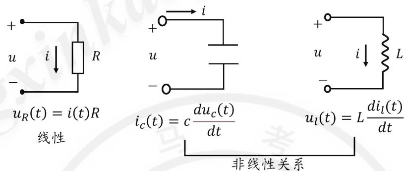

考点 2：网络拓扑关系——KCL 和 KVL

1、基尔霍夫电流定律 KCL——对于任一结点，流入电流之和等于流出电流之和

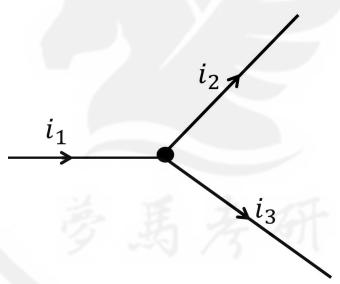

$$
i _ {1} = i _ {2} + i _ {3}
$$

2、基尔霍夫电压定律 KVL——对应闭环回路，沿回路绕行电压代数和为 0

$$
+ u _ {s _ {2}} - u _ {R _ {2}} - u _ {s _ {1}} + u _ {R _ {1}} = 0
$$

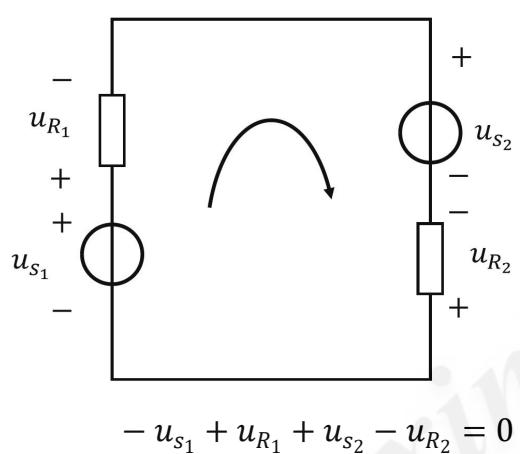

$$
- u _ {R _ {1}} + u _ {s _ {1}} + u _ {R _ {2}} - u _ {s _ {2}} = 0
$$

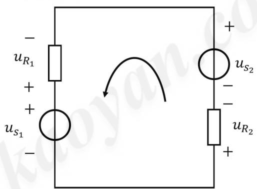

$$
u _ {s _ {1}} - u _ {R _ {1}} - u _ {s _ {2}} + u _ {R _ {2}} = 0
$$

各支路电压的代数和等于零

$$
u _ {s _ {1}} + u _ {R _ {2}} = u _ {R _ {1}} + u _ {s _ {2}}
$$

$$
u _ {R _ {1}} + u _ {s _ {2}} = u _ {s _ {1}} + u _ {R _ {2}}
$$

列写 KVL 方程前需要事先指定各支路电压参考方向和回路绕向, 回路绕向会影响代数和中各支路电压项前面的正负.

## 3、串联（级联）结构

例 29: 以电压源为激励, 以电阻 $R_{3}$ 电压为输出, 求输出.

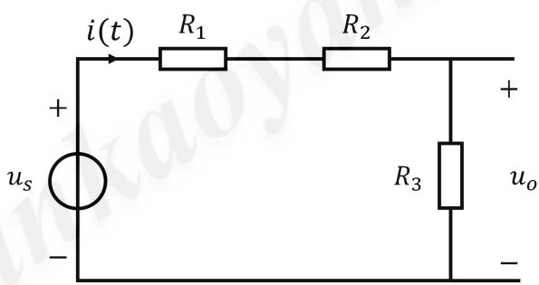

## 4、并联结构

例 30: 以电压源为激励, 以电阻 $R_{3}$ 电压为输出, 求输出。

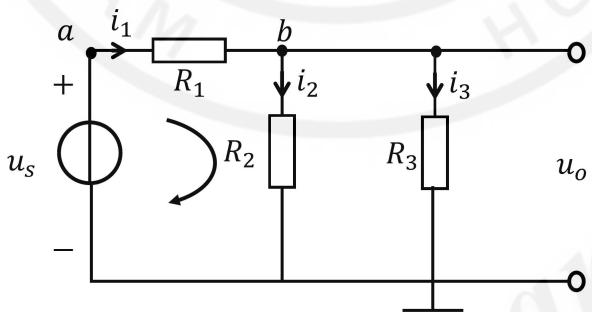

补充：电导 G=1/电阻 R

## 考点3：节点电压法

1、选择一个节点作为参考点，并令其电位为零。

2、利用 KVL 定理将各支路电流用节点电压表示。

3、只列写n-1个节点的KCL方程(n为所分析电路的节点数)。

4、整理得到的方程为标准形式，其中自电导等于接在该节点上所有支路的电导之和，互电导的电流源电流的代数和为负。

5、对于包含受控源的电路，需要特别处理。当电路中包含受控电流源时，先将其当作独立源列写方程，再将控制量用节点电压表示并代入方程。对于受控电压源，可以将其等效为受控电流源或直接将控制量表达式作为附加方程。

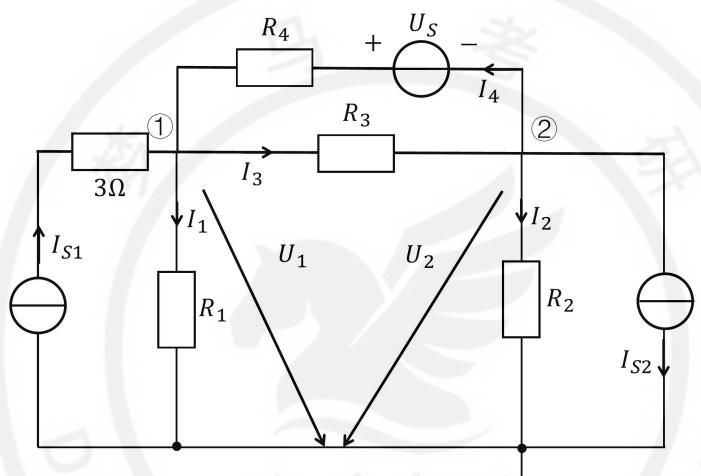

自导×本节点电压+Σ互导×相邻节点电压= $\sum I_{s}+\sum U_{sk}G_{sk}$

电流源流入节点为正，电压源正极性端与节点相连为正。

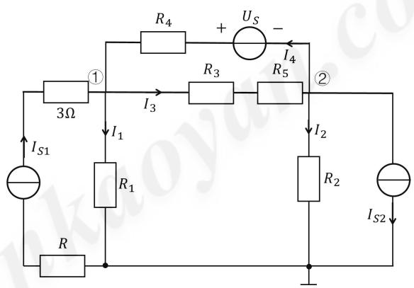

说明：

(1)两个电阻串联

$$
\frac {1}{R _ {3} + R _ {5}} \neq \frac {1}{R _ {3}} + \frac {1}{R _ {5}}
$$

(2)电流源串电阻

此电阻不在方程中出现

(3)互导总为负值

(4)参考点可任意选取

(5)方程中各项的量纲为电流的量纲

(6)在仅有独立源和二端电阻组成的电路中, 其节点电导矩阵具有对称性, 即 $G_{ij} = G_{ji}$

例 31: 列出图示电路的节点方程。

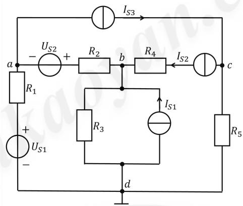

例 32：列出图示电路的节点方程。

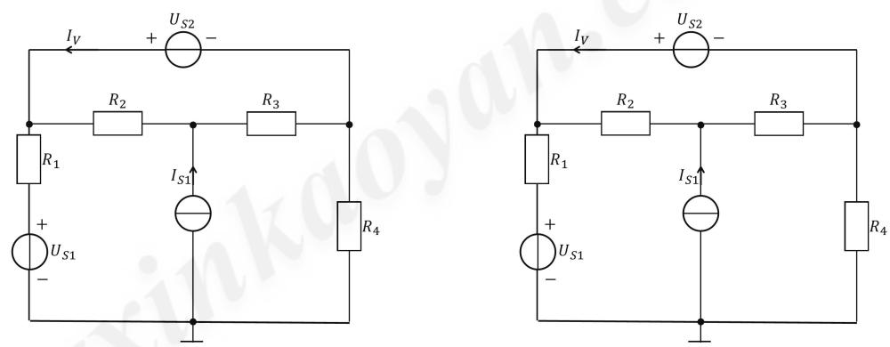

## 节点电压法:

## 无伴电压源的处理

方法一：设流过无伴电压源的电流，列写节点电压方程

方法二：优先选取无伴电压源支路中电压源的一端为参考点，另一端节点电压已知

## 受控源的处理：

1、将受控源按独立电源对待，按规律列写节点电压方程

2、列写控制变量与节点电压之间关系式作为补充方程

与电流源串联的电阻不计入自导和互导

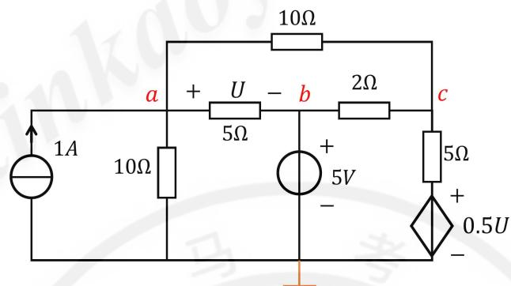

## 【梦马班点拨】总结：

(1)有 $n$ 个结点，选定参考结点(如果有独立电压源，选独立电压源一端作为参考结点)，列写 $n - 1$ 个节点KCL方程；

(2) 按照公式列写方程

自导 $\times$ 本节点电压 $+\sum$ 互导 $\times$ 相邻节点电压 $= \sum I_{s} + \sum U_{sk}G_{sk}$

电流源流入为正，电压源正极相连为正

电流源串联电阻，该电阻不算在方程中

(3)受控源按照独立源对待，增列一个受控变量的关系式