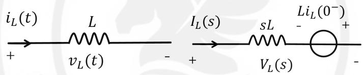
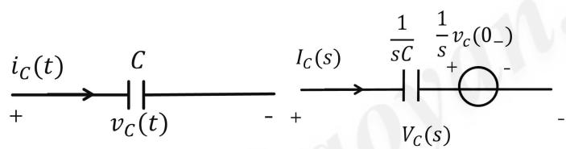
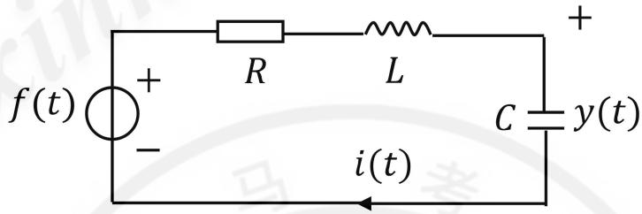
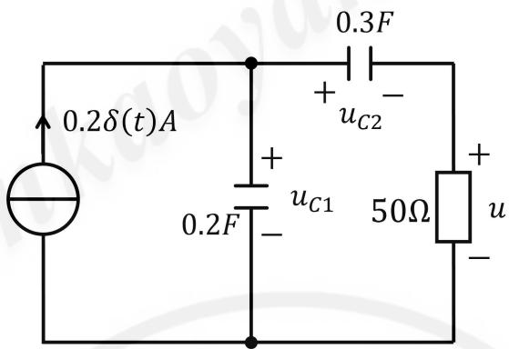
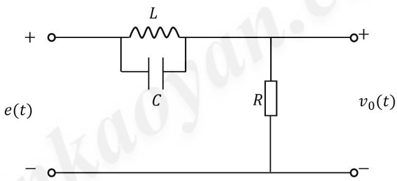
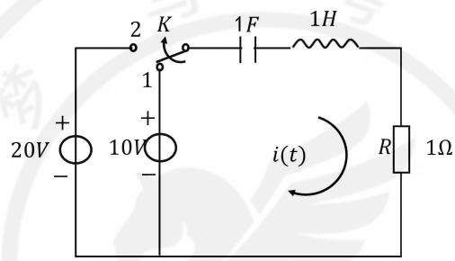
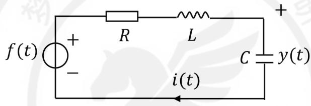
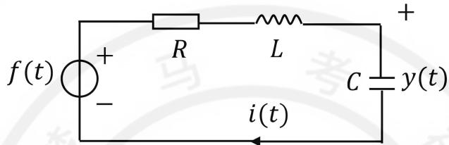
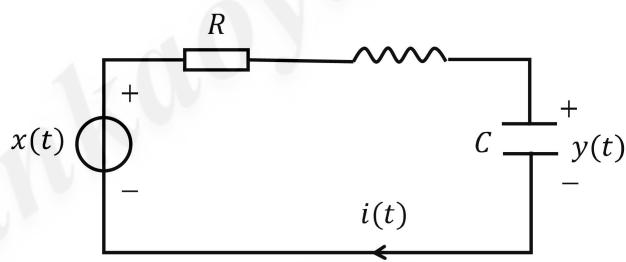

专题7 电路的s域分析

考点1：电路元件的s域模型

1、电阻：

$$
v _ {R} (t) = R i _ {R} (t)
$$

则

$$
V _ {R} (s) = R I _ {R} (s)
$$

2、电感：

$$
v _ {L} (t) = L \frac {d i _ {L} (t)}{d t}
$$

则

$$
V _ {L} (s) = s L I _ {L} (s) - L i _ {L} (0 _ {-})
$$

3、电容：

$$
v _ {c} (t) = \frac {1}{C} \int_ {- \infty} ^ {t} i _ {c} (\tau) d \tau
$$

则

$$
V _ {c} (s) = \frac {I _ {c} (s)}{C s} + \frac {v _ {c} (0 _ {-})}{s}
$$

## 【梦马班点拨】总结：

(1)s域模型均为阻性元件，要求能够列出其节点电压方程；

(2)电路的s域分析依托于s域电路模型，其前提是求解0\_状态值。

## 考点2：电路系统的s域求解

1、直接给定0\_状态，则直接使用

例 33: 某RLC电路如下图所示, $R = 3\Omega$ , $L = 1H$ , $C = \frac{1}{2}F$ , $u_{c}(0_{-}) = 1V$ , $i_{L}(0_{-}) = 1A$ , $f(t) = e^{-3t}u(t)$ 。通过对电路s域分析, 求 $t > 0$ 时的全响应 $y(t)$ , 并指出响应中的自由分量、强迫分量、瞬时分量、稳态分量。

2、求解的是零状态范畴，则0\_默认为0

例 34: 如下图所示, 求零状态响应 $u, u_{c1}, u_{c2}$ 。

例 35: 如图所示电路

(1)写出电压转移函数 $H(s)=\frac{V_{0}(s)}{E(s)}$ ;

(2)若 $L = 1H$ ， $C = \frac{1}{4} F$ ， $R = \frac{1}{4}\Omega$ ，画出零、极点分布图；

(3)满足(2)，若 $e(t)=\cos(2t)u(t)$ ，求 $v_{0}(t)$ 。

夢馬考研

3、换路题

换路原则【电路稳态时，电感相当于短路，电容相当于开路】

①根据换路前的稳态，求得电感电流和电容电压的起始状态；

②画换路后电路s域模型;

③根据换路后电路(此时电容电感均为电阻性质)KCL和KVL列s域方程;

④利用LT逆变换求解。

例 36: 电路如图所示, $t < 0$ 开关 $K$ 位于“1”且已达到稳态, $t = 0$ 时刻, 开关 $K$ 自“1”转至“2”, 试画出开关转到“2”后的复频域等效电路, 并计算 $t > 0$ 时的 $i(t)$ 。

解析：

夢馬考研

## 考点3：电路的双零法应用

1、电路零输入响应的求解：

(1)零输入响应与外接输入(电压源、电流源)无关。因此，求解电路零输入响应时外接电压源视为短路，外接电流源是为开路；

(2)在(1)的基础上进行s域分析，此时s域模型中仅包含与0\_状态有关的电压源/电流源；

(3)列写方程，利用拉氏逆变换求解零输入响应。

例 37: 某RLC电路如下图所示, $R = 3\Omega$ , $L = 1H$ , $C = \frac{1}{2}F$ , $u_{c}(0_{-}) = 1V$ , $i_{L}(0_{-}) = 1A$ , $f(t) = e^{-3t}u(t)$ 。通过对电路s域分析, 求零输入响应。

2、电路零状态响应的求解：

零状态响应与系统0\_状态无关，即电路s域模型中储能元件(电感、电容)的s域模型不再考虑产生的电压源/电流源，而是直接转换为线性阻抗。此时，电路仅有外接信号源产生的响应。

例 38: 某RLC电路如下图所示, $R = 3\Omega$ , $L = 1H$ , $C = \frac{1}{2}F$ , $u_{c}(0_{-}) = 1V$ , $i_{L}(0_{-}) = 1A$ , $f(t) = e^{-3t}u(t)$ 。通过对电路s域分析, 求零状态响应。

  
夢馬考研

3、电路题的其他知识求解

例 39：已知一电路图如图所示， $x(t)$ 为输入， $y(t)$ 为输入，其中 C = 0.1F, R = 10Ω, L = 2H。

(1) 求出电路描述的微分方程;

(2) 求 $H(s)$ ;

(3) 画出零极点图，并判断是否稳定；

(4) 若 $x(t) = 2\cos (2t - 1)$ ，求 $y(t)$ 。

夢馬考研