DF免费QQ群615698143
电路补充的响应分析
u=2:i

## 一、电阻构或电路 $\frac{y(t)=2f(t)}{y(s)=2f(s)}$

1. R: u = i \cdot R 线性(时, S)

$$
u _ {0} = \frac {R _ {3}}{R _ {1} + R _ {2} + R _ {3}} \cdot u _ {i}
$$

$$
R _ {1} = \frac {R R _ {2}}{R _ {1} + R _ {2}} = R _ {1} / R _ {2}
$$

$$
R _ {1} / / R _ {2} + R _ {3}
$$

$$
u _ {0} = \frac {R _ {3}}{R _ {1} + R _ {2} + R _ {3}} \cdot u _ {i}
$$

3. 书页见后式：优常（不作传物）

## 二 甲略系统 古传导线关联

$\frac{\frac{R}{CBL}}{非线性}$

做方程 $\Rightarrow$ 响底分析 (不好2者)

S域分析 (S域模型) → 响应分析 (抑药)

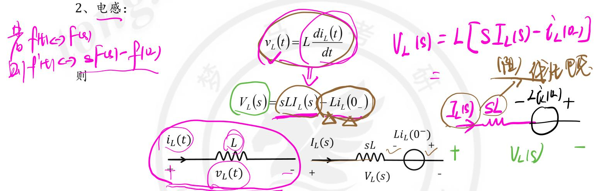

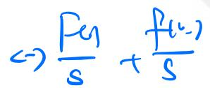

## 2.C构成

专题7

的s域分析

考点1: 电路元件的s域模型

1、电阻：

则

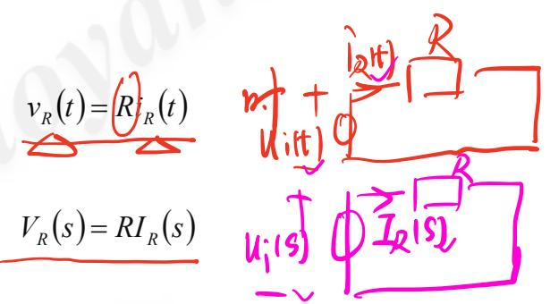

2、电感：

$\frac{1}{6}f(t1\Rightarrow F(u))$ 则 $f'(t1)\Rightarrow sF(u)-f(u)$

(18) 代化既

3、电容：

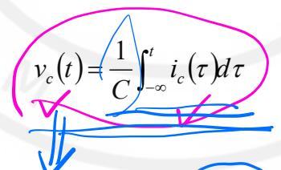

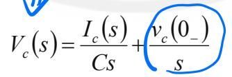

→阻性回落.

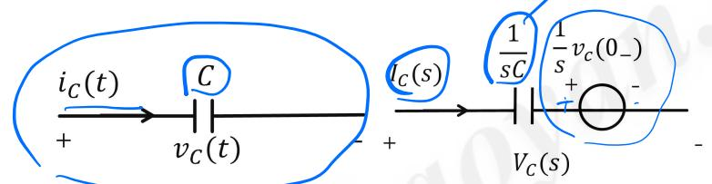

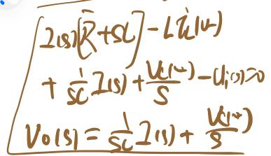

## 【梦马班点拨】总结：

(1)s域模型均为阻性元件，要求能够列出其节点电压方程；

(2)电路的s域分析依托于s域电路模型，其前提是求解0\_状态值。

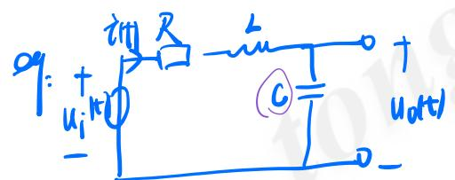

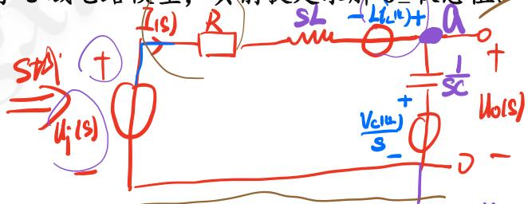

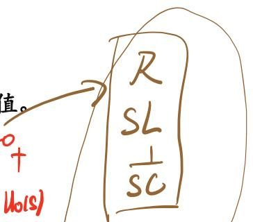

DF免费QQ群615698143
B站up: 信号与系统\_谷哥

考点2：电路系统的s域求解

$V_{c}(0-2)$ 和 $i_{k}(0-1)$ 公众号：通信考研小马哥

直接结论 0 值

默认值状态 0 = 0

① 求 0 值 ② ……

1、直接给定0\_状态，则直接使用

例 33: 某RLC电路如下图所示, $R = 3 \Omega$ , $L = 1 H$ , $C = \frac{1}{2} F$ , $u_{c}(0_{-}) = 1 V$ , $i_{L}(0_{-}) =$

1A, $f(t) = e^{-3t} u(t)$ 。通过对电路 $s$ 域分析, 求 $t > 0$ 时的全响应 $y(t)$ , 并指出响

应中的自由分量、强迫分量、瞬时分量、稳态分量。

S城枝型

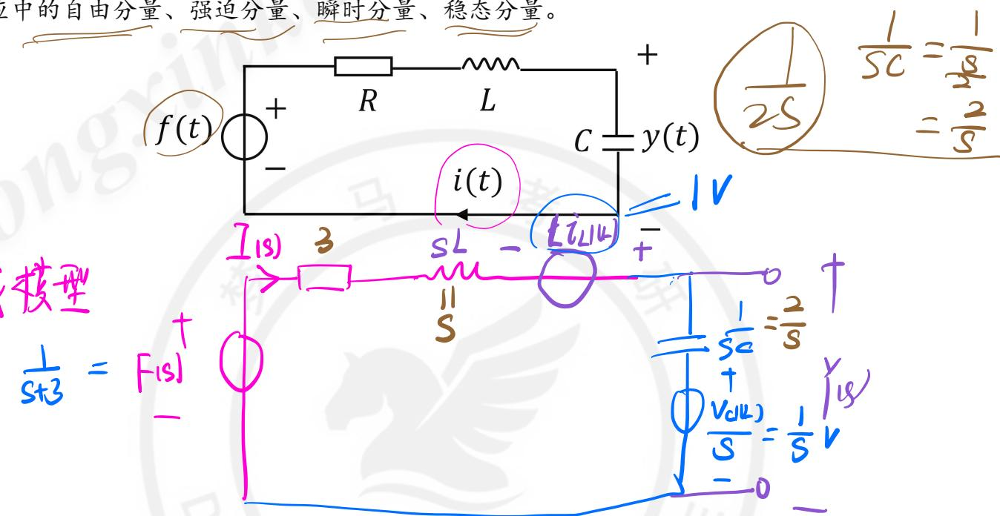

$$
(\frac {1}{3 + s} + \frac {s}{2}) Y (s) = \frac {F (s) + 1}{3 + s} + \frac {\frac {1}{s}}{\frac {2}{s}}
$$

$$
\begin{array}{r l} {Y _ {(s)}} & {= \frac {5}{s + 1} + \frac {- 5}{s + 2} + \frac {1}{s + 3}} \\ {\Rightarrow y _ {(t)}} & {= (5 e ^ {- t} - 5 e ^ {- x t} + e ^ {- 3 t}) u (t)} \end{array}
$$

DF免费QQ群615698143
B站up: 信号与系统\_谷哥 $y_{x}(t)$ . $h(t)$ . $g(t)$ $\Rightarrow$ 0 = 0

公众号：通信考研小马哥

2、求解的是零状态范畴，则0\_默认为0

例 34: 如下图所示, 求零状态响应 $u_{1}$ 、 $u_{c1}$ 、 $u_{c2}$ 。

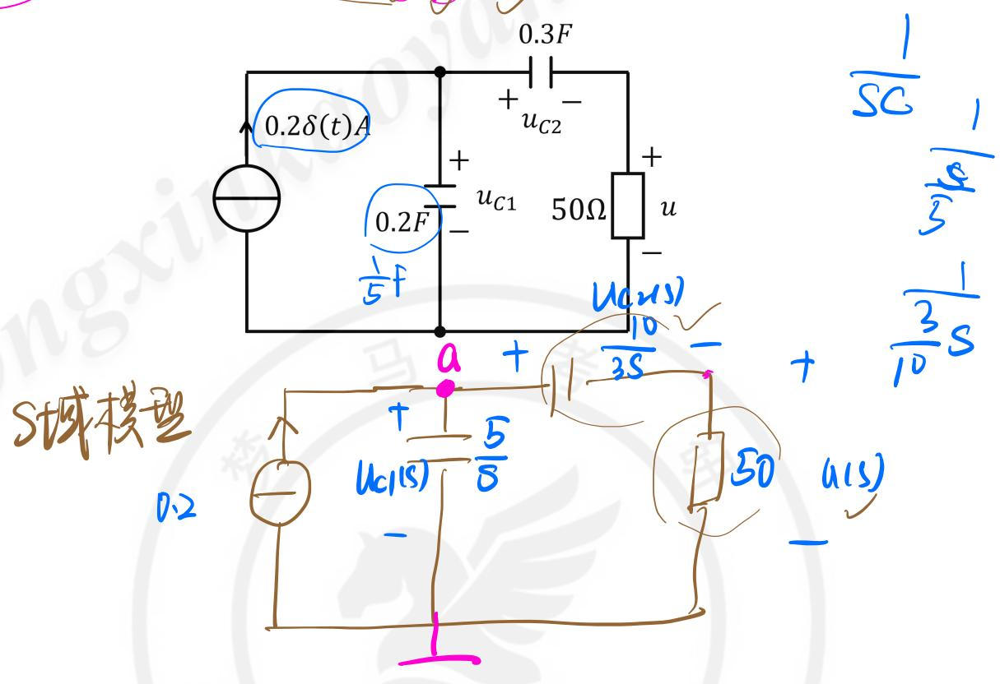

$$
\begin{array}{r l} {\left(\frac {s}{5} + \frac {1}{\frac {1 0}{3 s} + 5 0}\right) u _ {a}} & {= 0. 2} \\ {\underline {{u _ {a}}} = u _ {c 1}} & {u _ {c 2} = \frac {\frac {1 0}{3 s}}{\frac {1 0}{3 s} + 5 0}. u _ {a}} \\ {u} & {= u _ {a} - u _ {c 2}} \end{array}
$$

例 35: 如图所示电路

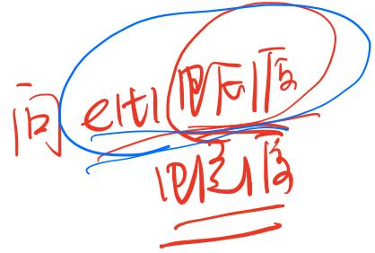

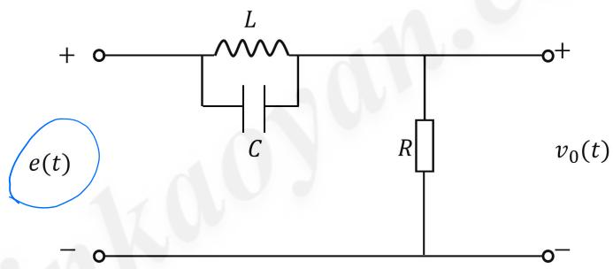

(1)写出电压转移函数 $H(s)=\frac{V_{0}(s)}{E(s)}$ ;

(2)若 $L = {1H},C = \frac{1}{4}F,R = \frac{1}{4}\Omega$ ,画出零、极点分布图；

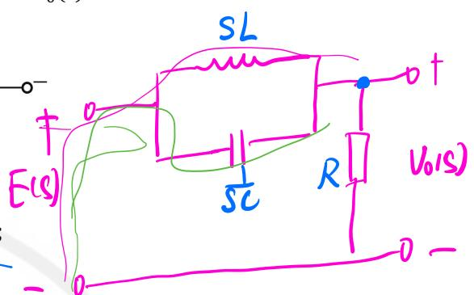

(3)满足(2)，若 $e(t)=\cos(2t)u(t)$ ，求 $v_{0}(t)$ 。

$$
H (s) = \frac {V _ {0} (s)}{E (s)} = \frac {R}{S L 1 1 \frac {1}{s c} + R}
$$

$$
\left(\frac {1}{S L} + S C + \frac {1}{R}\right) U _ {0} (S) = \frac {E (S)}{S L} + \frac {E (U)}{\frac {1}{S C}}
$$

$$
(2) H (s) = \frac {s ^ {2} + 4}{s ^ {2} + 4 s + 4}
$$

$$
u _ {0} (s) = H (s) \cdot E (s) = \frac {S ^ {2} + x}{(s + 2) ^ {2}} \cdot \frac {S}{s ^ {2} + 4}
$$

3、换路题

换路原则【电路稳态时，电感相当于短路，电容相当于开路】

①根据换路前的稳态，求得电感电流和电容电压的起始状态；求0—1匝（叶城）

②画换路后电路s域模型;

③根据换路后电路(此时电容电感均为电阻性质)KCL和KVL列s域方程;

④利用LT逆变换求解。

例 36: 电路如图所示, $t < 0$ 开关 $K$ 位于“1”且已达到稳态, $t = 0$ 时刻, 开关 $K$ 自“1”转至“2”, 试画出开关转到“2”后的复频域等效电路, 并计算 $t > 0$ 时的 $i(t)$ 。

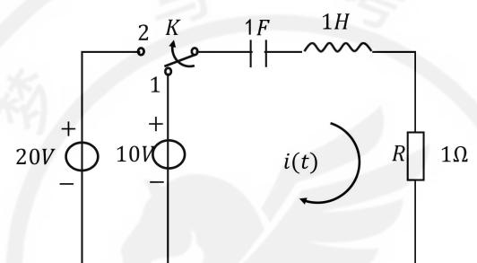

解析: t<0 时长 k 位于 “i” 且电路极态, 此叶四态视为短路. 电容视为开路

此时中国图为

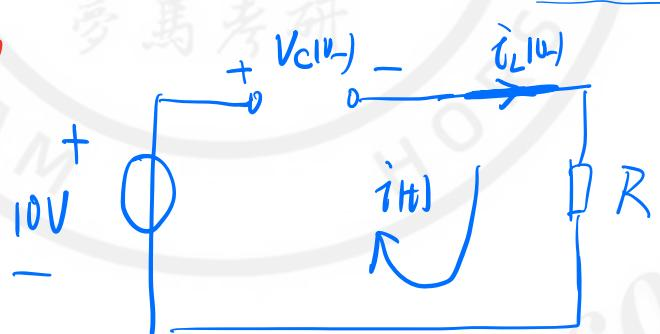

$$
i _ {L} (u) = D A
$$

$$
V _ {C} (V _ {-}) = 1 0 V
$$

t=0时开关k位于28城四路模型为

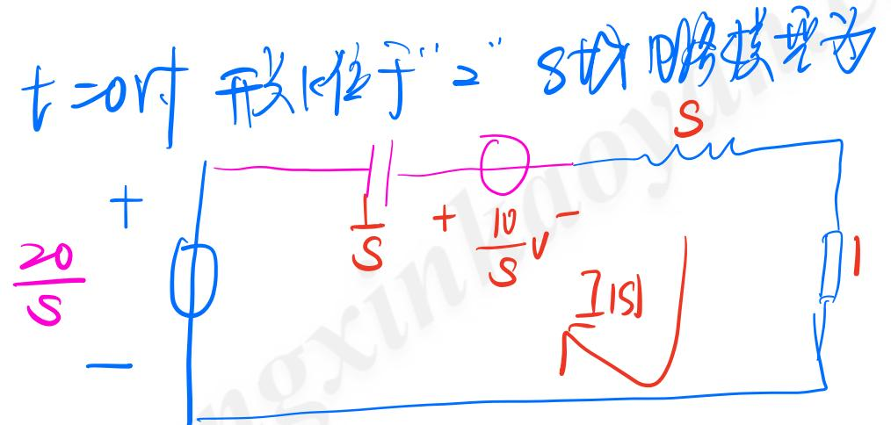

${kV}$ 3秒： $\left( {\frac{1}{s} + s + 1}\right) I\left( s\right)  + \frac{10}{s} - \frac{20}{s} = 0$

$\angle$ 和 $\angle$ 无电后 $\sqrt{a}$

## 考点 3: 电路的双零法应用

1、电路零输入响应的求解：

(1)零输入响应与外接输入(电压源、电流源)无关。因此，求解电路零输入响应时外接电压源视为短路。外接电流源是为开路；

(2)在(1)的基础上进行s域分析，此时s域模型中仅包含与0\_状态有关的电压源/电流源；

(3)列写方程，利用拉氏逆变换求解零输入响应。

例 37: 某RLC电路如下图所示, $R = 3\Omega$ , $L = 1H$ , $C = \frac{1}{2} F$ , $u_{c}(0_{-}) = 1V$ , $i_{L}(0_{-}) = 1A$ , $f(t) = e^{-3t} u(t)$ 。通过对电路s域分析, 求零输入响应。

无输入

{ 电广(√) : 短

$\frac{1}{2}$ $\sqrt[3]{3}$ : 开

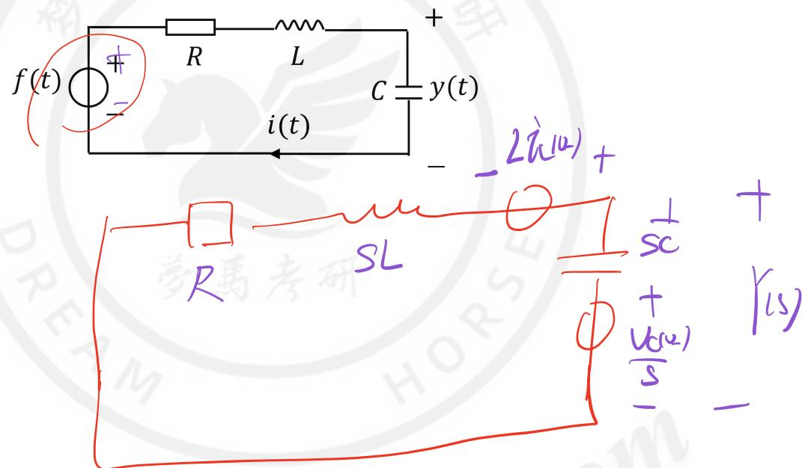

2、电路零状态响应的求解：

零状态响应与系统0\_状态无关，即电路s域模型中储能元件(电感、电容)的s域模型不再考虑产生的电压源/电流源，而是直接转换为线性阻抗。此时，电路仅有外接信号源产生的响应。

例 38: 某RLC电路如下图所示, $R = 3 \Omega$ , $L = 1H$ , $C = \frac{1}{2} F$ , $u_{c}(0_{-}) = 1V$ , $i_{L}(0_{-}) = 1A$ , $f(t) = e^{-3t} u(t)$ 。通过对电路s域分析, 求零状态响应。

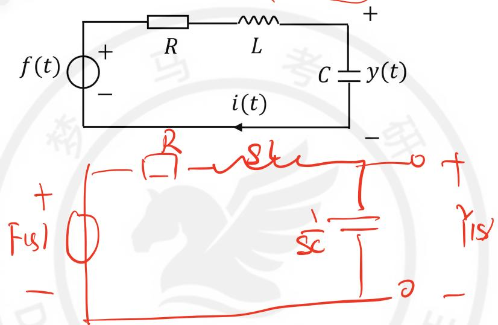

## 总结：电的响应分析

一. 元体的s域模型 R. L. C [串联传分]

1° 给度 0 - [Vc(4) 和 Vc(2)]

3° 技路题(概念)
(开关题)→

三. 双幂理 $\left\{\begin{array}{l} y_{x} \\ y_{y} \end{array}\right. \Rightarrow \left\{\begin{array}{l} y_{f} \text {后方程：知} \\ y_{f} \text {记方程：开} \end{array}\right.$ 官网：tongxinkaoyan.com

3、电路题的其他知识求解

例 39: 已知一电路图如图所示, $x(t)$ 为输入, $y(t)$ 为输入, 其中 $C = 0.1F$ , $R = 10\Omega$ , $L = 2H$ 。

$\begin{aligned} V_{L}(t) &= L \frac{d i_{L}(t)}{dt} \\ i_{C}(t) &= C \frac{d u_{C}(t)}{dt} \end{aligned}$

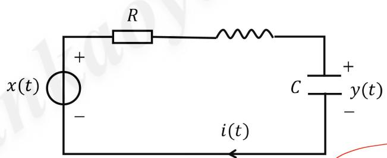

(1)求出电路描述的微分方程;

(2) 求 $H(s)$ ;

$$
\begin{array}{l} {k v _ {L}: \underbrace {V _ {R} (t) + V _ {L} (t) + y (t)} = x (t)} \\ {R \cdot \overrightarrow {(t)}} + L C \frac {d ^ {2} y (t)}{d t} + y (t) = x (t) \end{array}
$$

(3)画出零极点图，并判断是否稳定；

$$
i (t) = C \frac {d y (t)}{d t}
$$

(4) 若 $x(t)=2\cos(2t-1)$ ，求 $y(t)$ 。

$$
y ^ {\prime \prime} (t) + 5 y ^ {\prime} (t) + 5 y (t) = 5 x (t)
$$

那个公式

$$
H (s) = \frac {Y (s)}{x (s)} = \frac {\frac {1}{S C}}{R + S L + \frac {1}{S C}} = \frac {5}{s ^ {2} + 5 s + 5}
$$

不带n的，摇生

$$
\mathrm{第} u \mathrm{比} = \underbrace {y _ {x x}} _ {y _ {x x}} = 2 \mathrm{式} + - 3 p b
$$

$$
H (s) = \frac {5}{(s + \frac {5}{2}) ^ {2} - \frac {5}{4}}
$$

$$
- \frac {5}{2} \pm j \frac {\sqrt {5}}{2}
$$

$$
\operatorname{aswot}
$$

$$
\frac {[ H (w _ {0}) ] a s [ w _ {0} t + \varphi (w _ {0}) ]}{2}
$$

20 换路返