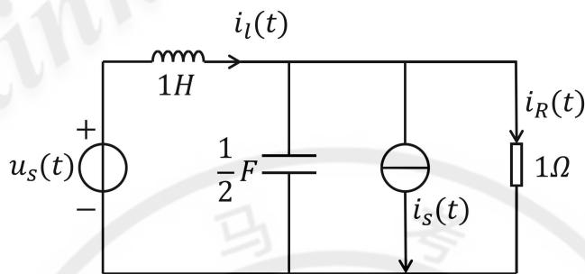
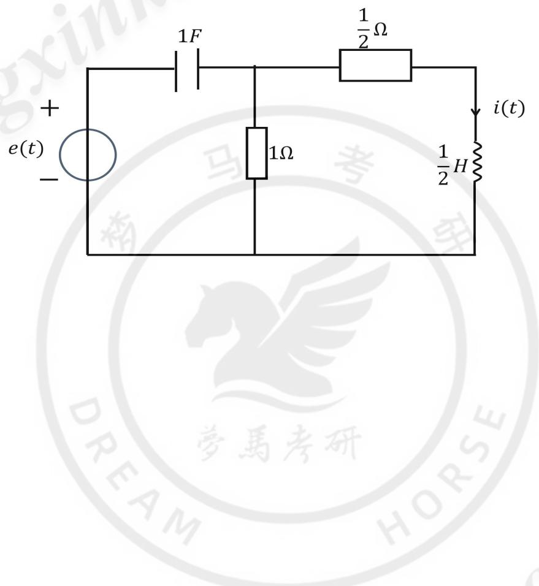
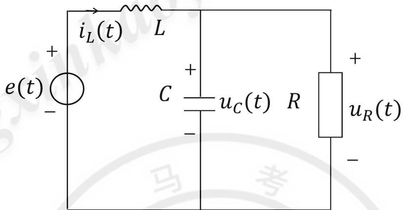
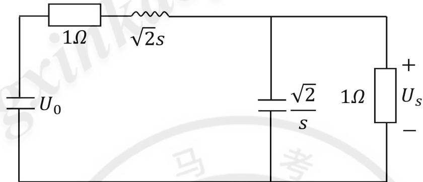
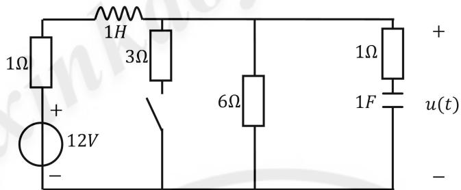
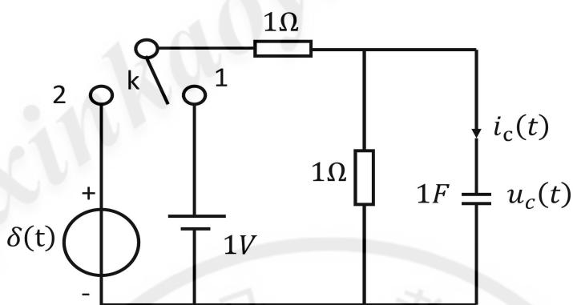
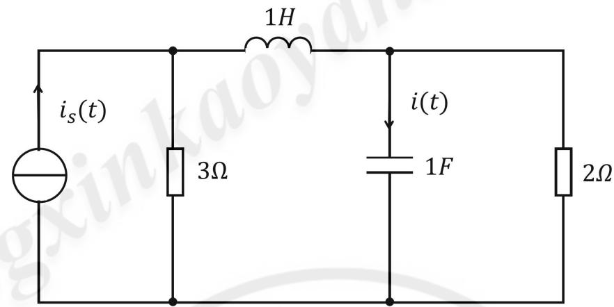
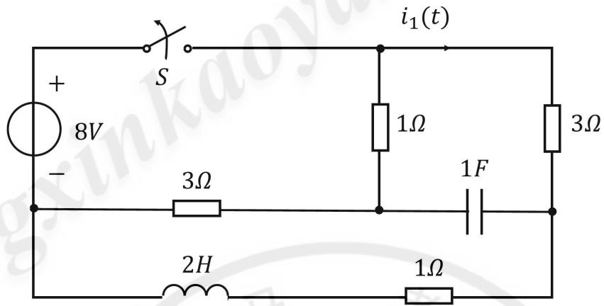
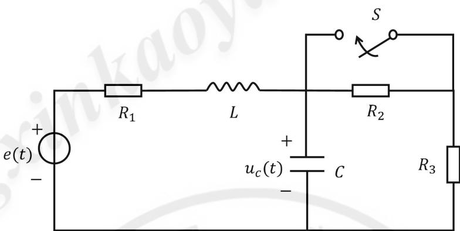
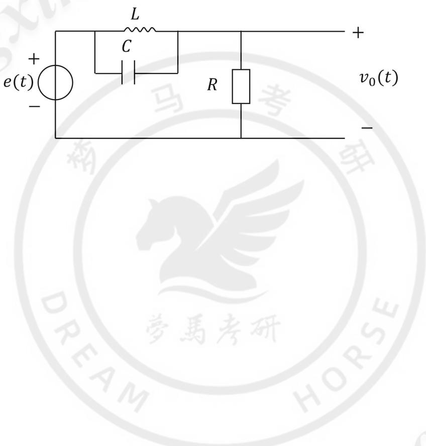

## 【第32节】课后作业

1、【2024 成都信息工程大学】

已知电路如图所示, 其中 $u_{c}(0_{-})=1V$ , $i_{l}(0_{-})=1A$ , $u_{s}(t)=u(t)V$ , $i_{s}(t)=u(t)A$ 。

(1) 画出s域模型;

(2) 求 $i_{R}(t)(t \geq 0)$ 的值。

夢馬考研

2、【2024 沈阳航空航天大学】

在下图所示电路系统中

(1) 画出系统的复频域模型;

(2) 求系统函数 $H(s)=\frac{I(s)}{E(s)}$ ，并画出零极点图；

(3) 判断该系统是否稳定？并求 $H(j\omega)$ 。

3、【2024 河海大学】

已知电路如图所示，其中 $R = 1\Omega$ ， $L = 2H$ ， $C = \frac{1}{2} F$ ， $u_{C}(0_{-}) = 1V$ ， $i_{L}(0_{-}) = 1A$ ， $e(t) = 2u(t)$ ，求 $u_{R}(t)$ 。

4、【2024 昆明理工大学】

已知一 RLC 电路如下图所示。

(1) 求系统函数 $H(s)=\frac{U_{s}}{U_{0}}$ ;

(2) 画出 $H(s)$ 的信号流图。

5、【2024 长春理工大学】

电路图如下图所示，当开关k闭合时，电路稳定，当t=0时，电路断开

(1) 画出电路的s域模型。

(2) 求 $u(t)$ ;

## 6、【2024 广州大学】

电路如图所示。在 $t = 0$ 之前开关K位于“1”端，电路已进入稳态， $t = 0$ 时刻开关从“1”转至“2”，求 $u_{c}(t), i_{c}(t)$ 。

## 7、【2024 西安石油大学】

对图示电路，列写关于电流 $i(t)$ 的微分方程。

8、【2024西安石油大学】电路如图所示，在t=0时刻开关S打开，已知换路前电路已经处于稳态。画出换路后电路的s域模型，利用初终值定理求电流初值 $i_{1}$

## 9、【2024 华北电力大学】

已知某电路图如图所示，t<0 时开关断开，电路处于稳定，t=0 时开关闭合，
激励 $e(t)=12V$ ，其中 $R_{1}=3\Omega$ ， $R_{2}=2\Omega$ ， $R_{3}=1\Omega$ ，L=1H，C=1F

（1）求电路初始状态 $u_{c}(0_{-})$ 、 $i_{L}(0_{-})$ ，并画出t>0时的等效电路；

(2) 以 $R_{3}$ 两端电压 $u(s)$ 为响应，求该系统的系统函数 $H(s)$ ;

(3) 在 (2) 的条件下, 求开关闭合后的零输入响应和零状态响应

## 10、【2024 福州大学】

电路图如下图所示

(1) 求 $H(s)=\frac{V_{0}(s)}{E(s)}$ ;

(2) 输入 $e(t)=\sin2tu(t)$ ，为使响应不含正弦稳态响应求LC约束；

(3) $R = 1, C = 1, L = 1, e(t) = \sin 2tu(t)$ 起始状态0，求 $v_{0}(t)$ 全响应，稳态响应，零状态响应。

