615698145
号与系统\_谷哥
[注意：为了不增加额外负担，一律采用节点化信
假步骤，简单四路步并联更快]

## 【第32节】课后作业

但共问单路带并联更快
但串点电压也万能.]

1、【2024 成都信息工程大学】

已知电路如图所示, 其中 $u_{c}(0_{-}) = 1V$ , $i_{l}(0_{-}) = 1A$ , $u_{s}(t) = u(t)V$ , $i_{s}(t) = u(t)A$ 。

(1) 画出s域模型;

(2) 求 $i_{R}(t)(t \geq 0)$ 的值。

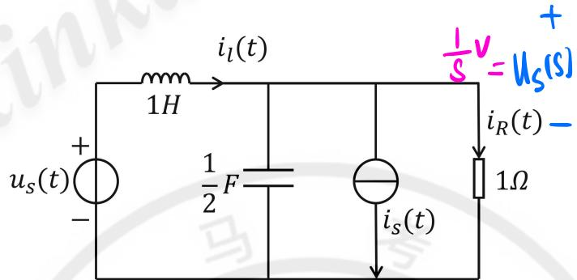

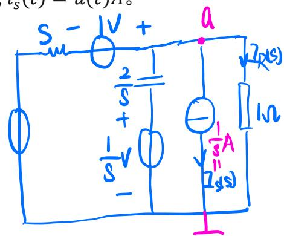

(2) 节点电压

$$
(\frac {1}{s} + \frac {s}{2} + \frac {1}{1}) u _ {a} = \frac {u _ {s} (s) + 1}{s} + \frac {\frac {1}{s}}{\frac {2}{s}} - I _ {s} (s)
$$

$$
\frac {s ^ {2} + 2 s + 2}{2 s} u _ {a} = \frac {s + 1}{s ^ {2}} + \frac {1}{2} - \frac {1}{s} = \frac {s ^ {2} + 2}{2 s ^ {2}}
$$

$$
\Rightarrow u _ {a} = \frac {s ^ {2} + 2}{2 s ^ {2}} \cdot \frac {2 s}{s ^ {2} + 2 s + 2} = \frac {s ^ {2} + 2}{s [ (s + 1) ^ {2} + 1 ]}
$$

$$
I _ {R} (s) = \frac {u _ {a} (s)}{1} = u _ {a} (s) = \frac {s ^ {2} + 2}{s [ (s + 1) ^ {2} + 1 ]} = \frac {k _ {1}}{s} + \frac {k _ {2} s + k _ {3}}{(s + 1) ^ {2} + 1}
$$

$$
k _ {1} = 1, k _ {2} = 0, k _ {3} = - 2
$$

$$
\therefore I _ {R} (s) = \frac {1}{s} + \frac {- 2 \times 1}{(s + 1) ^ {2} + 1}
$$

$$
\therefore i _ {R} | t | = (1 - 2 e ^ {- t} \sin t) u | t |
$$

2、【2024 沈阳航空航天大学】

在下图所示电路系统中

(1) 画出系统的复频域模型;

(2) 求系统函数 $H(s) = \frac{I(s)}{E(s)}$ ，并画出零极点图；

(3) 判断该系统是否稳定？并求 $H(j\omega)$ 。

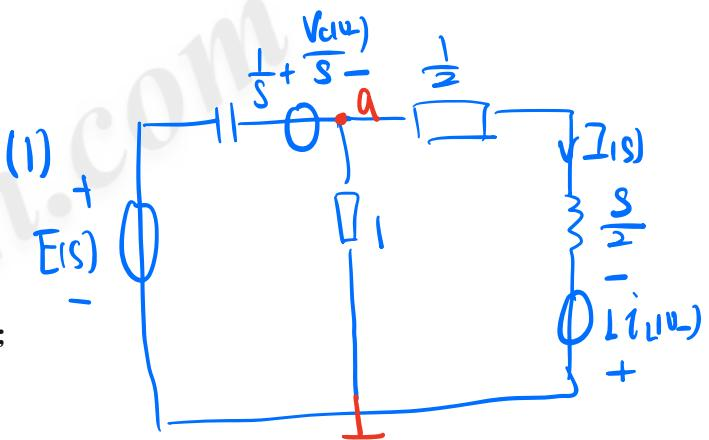

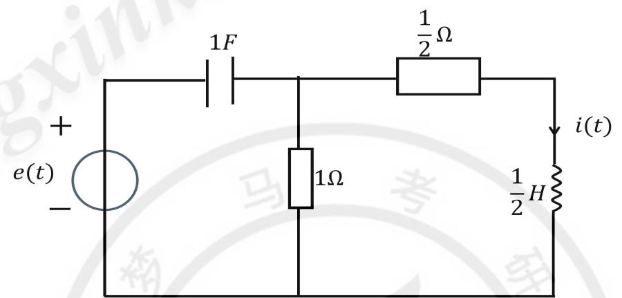

(2) 在宛状态、范畴内， $V_{C}(10-)=i_{L}(10-)=0$

$$
\begin{array}{r l} {(S + 1 + \frac {1}{\frac {1}{2} + \frac {S}{2}}) u a} & {= \frac {E (s)}{\frac {1}{s}}} \\ {\Rightarrow \frac {S ^ {2} + 2 s + 3}{s + 1} u _ {a} = s E (s)} \\ {\Rightarrow u a} & {= \frac {S (s + 1)}{S ^ {2} + 2 s + 3} \cdot E (s)} \end{array}
$$

$$
I (s) = \frac {u _ {0}}{\frac {1}{2} + \frac {s}{2}} = \frac {S (s + 1)}{s ^ {2} + 2 s + 3} \cdot E (s) \cdot \frac {2}{s + 1} = \frac {2 S}{s ^ {2} + 2 s + 3} \cdot E (s)
$$

$$
\therefore H (s) = \frac {I _ {(s)}}{E _ {(s)}} = \frac {2 s}{s ^ {2} + 2 s + 3} = \frac {2 s}{(s + 1) ^ {2} + 2}
$$

$\Rightarrow$ 宽角为0，极点为 $-1\pm\sqrt{2}$

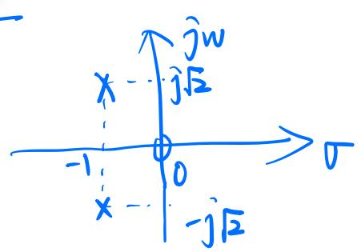

(3) 回路系统中极点位于8方半面

故事民称灵

$$
H (W) = H (s) \bigg | _ {s = j w} = \frac {2 j w}{- w ^ {2} + 2 j w + 3}
$$

3、【2024 河海大学】

已知电路如图所示，其中 $R = 1\Omega$ ， $L = 2H$ ， $C = \frac{1}{2} F$ ， $u_{C}(0_{-}) = 1V$ ， $i_{L}(0_{-}) = 1A$ ， $e(t) = 2u(t)$ ，求 $u_{R}(t)$ 。

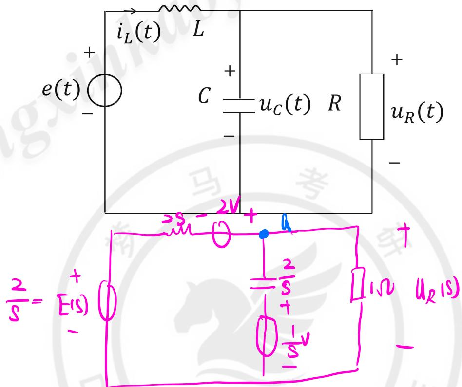

$$
(\frac {1}{2 s} + \frac {s}{2} + 1) u _ {R} (s) = \frac {2 + \frac {2}{s}}{2 s} + \frac {\frac {1}{s}}{\frac {2}{s}}
$$

$$
\frac {(s + 1) ^ {2}}{2 s} u _ {R (s)} = \frac {s ^ {2} + x s + 2}{2 s ^ {2}}
$$

$$
\therefore u _ {R} (s) = \frac {s ^ {2} + 2 s + 2}{2 s ^ {2}} \cdot \frac {2 s}{(s + 1) ^ {2}} = \frac {s ^ {2} + 2 s + 2}{s (s + 1) ^ {2}} = \frac {2}{s} + \frac {- 1}{(s + 1) ^ {2}} + \frac {- 1}{s + 1}
$$

$$
\therefore u _ {R} (t) = [ 2 - (t + 1) e ^ {- t} ] u (t)
$$

4、【2024 昆明理工大学】

已知一 RLC 电路如下图所示。

(1) 求系统函数 $H(s)=\frac{U_{s}}{U_{0}}$ ;

(2) 画出 $H(s)$ 的信号流图。

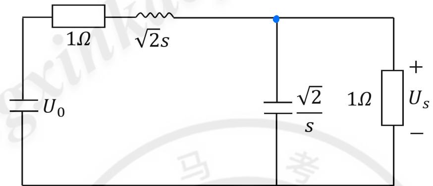

(1) 节贞电压程为

$$
\begin{array}{r l} & {\left(\frac {1}{1 + \sqrt {2} S} + \frac {S}{\sqrt {2}} + 1\right) u _ {s} = \frac {u _ {0}}{1 + \sqrt {2} S}} \\ & {\Rightarrow H (s) = \frac {u _ {s}}{u _ {0}} = \frac {\frac {1}{1 + \sqrt {2} S}}{\frac {1}{1 + \sqrt {2} S} + \frac {S}{\sqrt {2}} + 1} = \frac {\sqrt {2}}{\sqrt {2} S ^ {2} + 3 S + 2 \sqrt {2}} = \frac {1}{S ^ {2} + \frac {3}{\sqrt {2}} S + 2}} \\ & {H (s) = \frac {S ^ {- 2}}{1 + \frac {3}{\sqrt {2}} S ^ {- 1} - 2 S ^ {- 2})}} \end{array}
$$

(2)

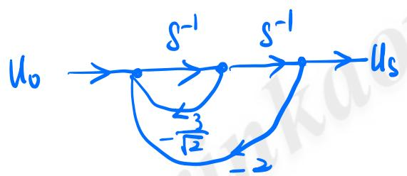

5、【2024 长春理工大学】

电路图如下图所示，当开关k闭合时，电路稳定，当t=0时，电路断开

(1) 画出电路的s域模型。

(2) 求 $u(t)$ ;

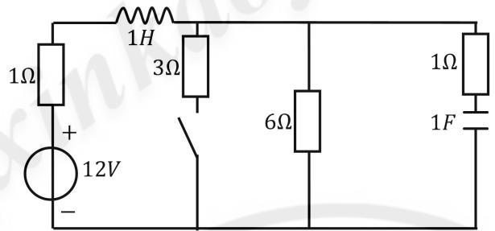

(2) 节员电压方程为：

$$
\begin{array}{r l} & {\left(\frac {1}{1 + s} + \frac {1}{6} + \frac {1}{1 + \frac {1}{s}}\right) u (s) = \frac {4 + \frac {1 2}{s}}{s + 1} + \frac {\frac {8}{s}}{1 + \frac {1}{s}}} \\ & {\quad \frac {7}{6} u (s) = \frac {1 2}{s}} \\ & {\therefore u (s) = \frac {1 2}{s} \cdot \frac {6}{7} = \frac {\frac {1 2}{7}}{s}} \\ & {\therefore u (t) = \frac {7 2}{7} u (t)} \end{array}
$$

(1) 开关闭后，电路稳定
此时电感视为短路。
电容视为开路。回路图为

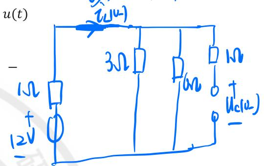

$$
i _ {L} (0 -) = \frac {1 2}{1 + 3 1 1 6} = \frac {1 2}{1 + 2} = 4 A
$$

$$
u _ {c} (v) = (3 1 1 6) \times 4 = 2 \times 4 = 8 V
$$

t=0 时开关断开. 电路st或共型为

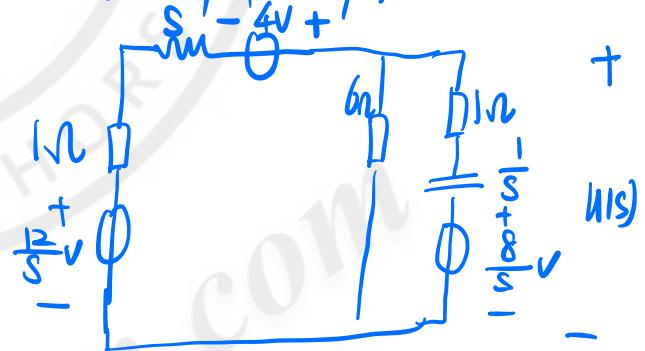

6、【2024 广州大学】

电路如图所示。在 $t = 0$ 之前开关K位于“1”端，电路已进入稳态， $t = 0$ 时刻开

关从 “1” 转至 “2”，求 $u_{c}(t)$ ， $i_{c}(t)$ 。

t=0 2前开关k位于“1”端

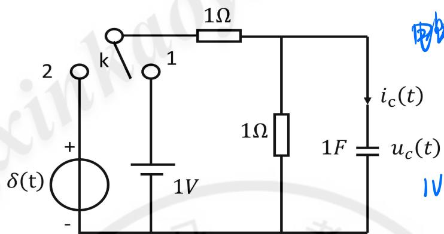

电路已进入状态、电容视为开路

图2.1.

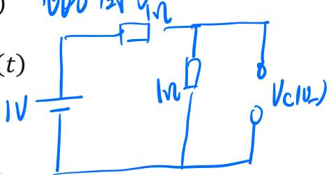

$$
\therefore V _ {C} (v -) = \frac {1}{1 + 1} \times 1 = \frac {1}{2} v
$$

t=0 时刻开关位于“2”，此时电路场接变为：

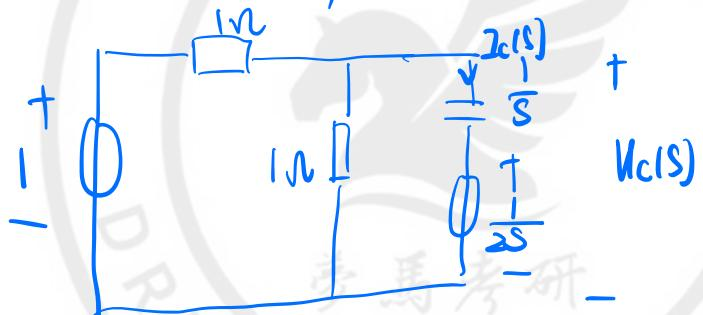

$$
(1 + 1 + s) u _ {c} (s) = \frac {1}{1} + \frac {\frac {1}{2 s}}{\frac {1}{s}}
$$

$$
u _ {C} (s) = \frac {\frac {3}{2}}{s + 2} \Rightarrow u _ {C} (t) = \frac {3}{2} e ^ {- 2 t} u (t)
$$

$$
u _ {C} (s) = \frac {1}{s} I _ {C} (s) + \frac {1}{2 s}
$$

$$
\therefore I _ {C} (s) = (\frac {\frac {3}{2}}{s + 2} - \frac {1}{2 s}) \cdot s = \frac {\frac {3}{2} s}{s + 2} - \frac {1}{2} = 1 + \frac {- 3}{s + 2}
$$

$$
\therefore i _ {c} (t) = \delta (t) - 3 e ^ {- 2 t} u (t)
$$

## 7、【2024 西安石油大学】

对图示电路，列写关于电流 $i(t)$ 的微分方程。

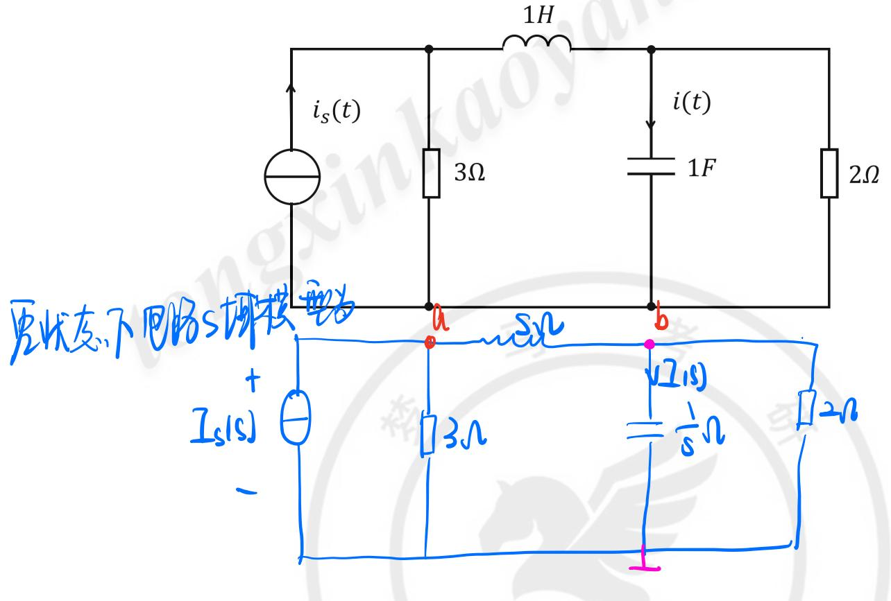

应状态下电路 $_{S}$ 模拟

$$
(\frac {1}{3} + \frac {1}{s}) u _ {a} - \frac {1}{s} u _ {b} = I _ {s} (s)
$$

$b : \left( {s + \frac{1}{2} + \frac{1}{s}}\right) {u}_{0} - \frac{1}{s}{u}_{a} = 0$

①②联立可得： ${u}_{b} = \frac{6}{{2S}^{2} + {7S} + 5}$ Is

$$
I _ {1} (s) = \frac {u _ {0}}{\frac {1}{s}} = \frac {6 s}{2 s ^ {2} + 7 s + 5} I _ {s} (s)
$$

$$
\therefore H (s) = \frac {I _ {(s)}}{I _ {s} (s)} = \frac {6 s}{2 s ^ {2} + 7 s + 5} = \frac {3 s}{s ^ {2} + \frac {7}{2} s + \frac {5}{2}}
$$

## 微分方程为：

$$
i ^ {\prime \prime} (t) + \frac {7}{2} i ^ {\prime} (t) + \frac {5}{2} i (t) = 3 i _ {s} ^ {\prime} (t)
$$

8、【2024西安石油大学】电路如图所示，在t=0时刻开关S打开，已知换路前电路已经处于稳态。画出换路后电路的s域模型，利用初终值定理求电流初值 $i_{1}$

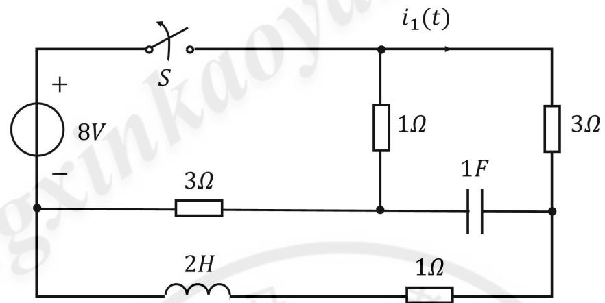

接路前 S 闭合. 电路处于状态. 电容视为开结. 电源视为短路.

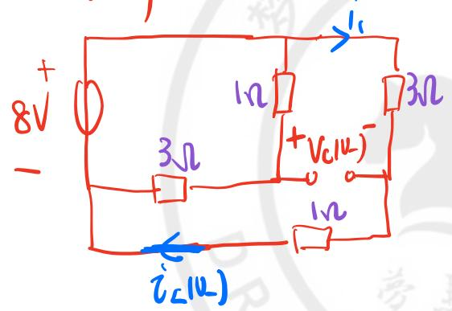  
回路结构为

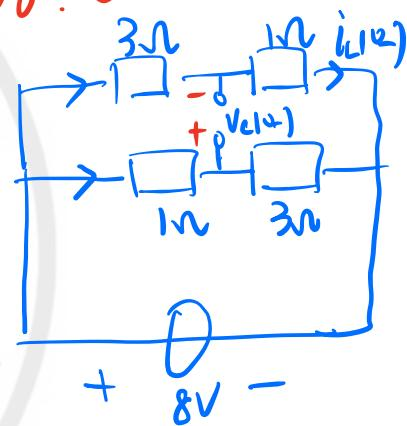

$$
i _ {2} (u) = \frac {8}{1 + 3} = 2 A
$$

$$
V _ {C} (V _ {-}) = (3 - 1) \times 2 = 4 V
$$

t=0 叶开关断开. St域模型为

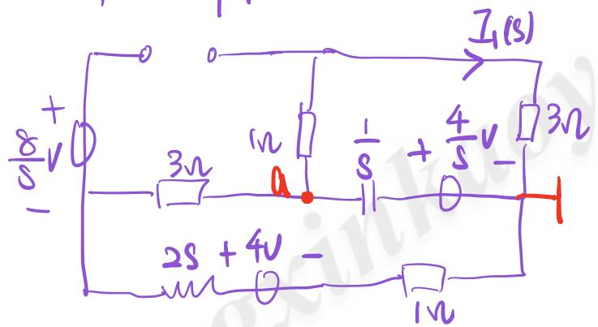

$$
\begin{array}{r l} & {\left(\frac {1}{4 + 2 S} + \frac {1}{4} + S\right) u _ {a} = \frac {4}{4 + 2 S} + \frac {\frac {4}{S}}{\frac {1}{S}}} \\ & {\Rightarrow u _ {a} = \frac {1 6 S + 4 0}{8 4 S ^ {2} + 9 S + 4} \Rightarrow I (s) = \frac {u _ {a}}{4} = \frac {4 S + 1 0}{4 S ^ {2} + 9 S + 4}} \\ & {\Rightarrow I _ {1} (v +) = \lim _ {S \to I _ {1} (S)} = \frac {4 S ^ {2} + 1 0 S}{(x ^ {2}) ^ {1 0} x ^ {1 0}} = 1 A} \end{array}
$$

官网：www.tongxinkaoyan.com

## 9、【2024华北电力大学】

已知某电路图如图所示，t < 0 时开关断开，电路处于稳定，t = 0 时开关闭合，

激励 $e(t)=12V$ ，其中 $R_{1}=3\Omega$ ， $R_{2}=2\Omega$ ， $R_{3}=1\Omega$ ，L=1H，C=1F

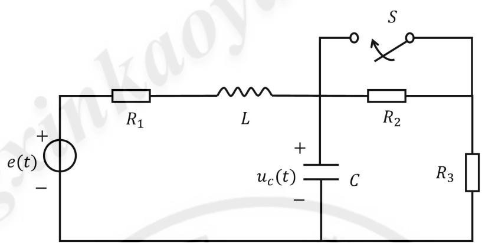

(1) 求电路初始状态 $u_{c}(0_{-})$ 、 $i_{L}(0_{-})$ ，并画出t>0时的等效电路；

(2) 以 $R_{3}$ 两端电压 $u(s)$ 为响应, 求该系统的系统函数 $H(s)$ ;

(3) 在 (2) 的条件下, 求开关闭合后的零输入响应和零状态响应

解: (1) $t<0$ 时开关断开, 电容处于状态, 因愿视为短路, 电容视为开路

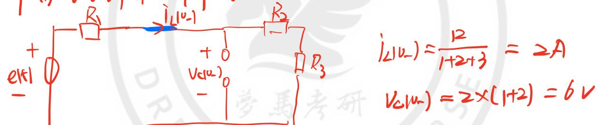

t>0 时开关闭方，包络S域模型

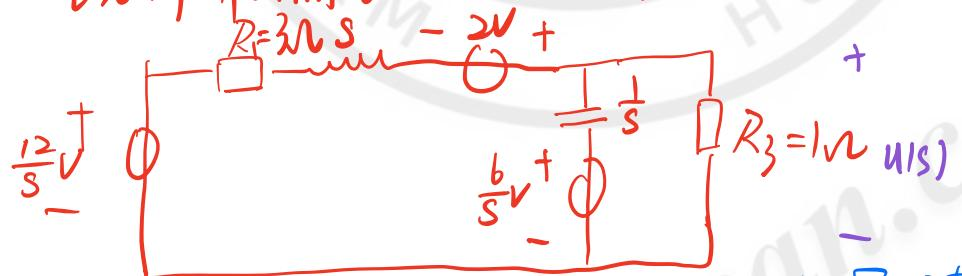

(2) 从 $e(t)$ 为输入, $u(t)$ 为输入. 故电路应状态下电路结构为

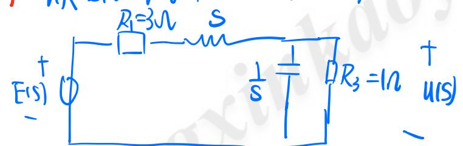

(3) 要输入四路结构为

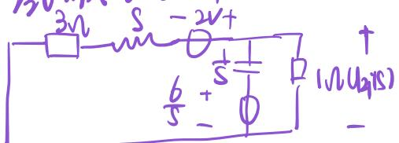

$$
(\frac {1}{s + 3} + s + 1) u (s) = \frac {E (s)}{s + 3}
$$

$$
(\frac {1}{s + 3} + s + 1) U _ {2} (s) = \frac {2}{s + 3} + 6
$$

$$
u _ {2 i} (s) = \frac {6 s + 2 0}{(s + 2) ^ {2}} = \frac {8}{(s + 2) ^ {2}} + \frac {6}{s + 2}
$$

$$
H (s) = \frac {U (s)}{E (s)} = \frac {1}{s + 3} \cdot \frac {s + 3}{s ^ {2} + 4 s + 4} = \frac {1}{s ^ {2} + 4 s + 4}
$$

$$
\therefore u _ {2} | t | = (8 t + 6) e ^ {- 2 t} u _ {1} | t |
$$

PDF免费QQ群电路15本分为梦马班作业

公众号：通信考研小马哥

10、【2024 福州大学

$$
(\frac {1}{s + 3} + s + 1) U _ {X} (s) = \frac {\frac {1 2}{s}}{s + 3}
$$

】电路图如下图所示

(1) 求 $H(s)=\frac{V_{0}(s)}{E(s)}$ ;

$$
\begin{array}{r l} {U _ {2 S} (s)} & {= \frac {1 2}{S (s + 3)} \cdot \frac {s + 3}{(S + 2) ^ {2}} = \frac {1 2}{S (S + 2) ^ {2}}} \\ & {= \frac {3}{S} + \frac {- 6}{(S + 2) ^ {2}} + \frac {- 3}{S + 2}} \end{array}
$$

(2) 输入 $e(t)=\sin2tu(t)$ ，为使响应不含正弦稳态响应求LC约束；

$$
\therefore U _ {x} (t) = [ 3 - (6 t + 3) e ^ {- 2 t} ] _ {(x)}
$$

(3) $R = 1, C = 1, L = 1, e(t) = \sin 2tu(t)$ 起始状态0，求 $v_{0}(t)$ 全响应，稳态响应，零状态响应。

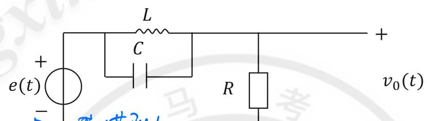

见状态下四格域模型为

(1)

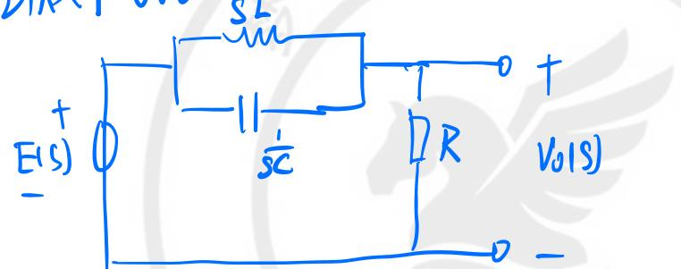

$$
[ \frac {1}{s L _ {1 1} \frac {1}{s c}} + \frac {1}{R} ] V _ {0} (s) = \frac {E (s)}{s L _ {1 1} \frac {1}{s c}}
$$

$$
\begin{array}{r l} {\Rightarrow H (s) = \frac {V _ {0} (s)}{E (s)}} & {= \frac {\frac {1}{S L / / S c}}{\frac {1}{S L / / S c} + \frac {1}{R}}} \\ & {= \frac {L C S ^ {2} + 1}{S L} \cdot \frac {S R L}{L R C S ^ {2} + R + L}} \\ & {= \frac {R L C S ^ {2} + R}{R L C S ^ {2} + R + L S}} \\ & {= \frac {S ^ {2} + \frac {1}{L C}}{S ^ {2} + \frac {1}{R C} S + \frac {1}{L C}}} \end{array}
$$

(2) $\frac{1}{b}e(t)=\sin2t(u(t))$

$\frac{1}{10}e(t)=\sin2t(y(t))$ 则 $Y(s)=H(s)\cdot E(s)=\frac{s^{2}+\frac{1}{LC}}{s^{2}+\frac{1}{RC}s+\frac{1}{LC}}$ $\frac{2}{s^{2}+4}$ $\frac{1}{10}y(t)$ 中无 sin 项

说明 $s^{2}+4$ 给分，则 $LC=\frac{1}{4}$

(3) $\frac{1}{n}R = L = C = 1$ 则 $H(S) = \frac{S^{2} + 1}{S^{2} + S + 1}$ 官网：www.tongxinkaoyan.com

PDF免费QQ群615698143梦马班作业

DF免费QQ群615698143 若 $e(t) = \sin 2t(u(t))$ 则标志的响应 $V_{\text{loss}}(t) = [H(2)]\sin[2t + \varphi(2)]u(t)$

艾中

$$
H (W) = \frac {- w ^ {2} + 1}{- w ^ {2} + \hat {j} w + 1} \Rightarrow H (2) = \frac {- 4 + 1}{- 4 + \hat {j} ^ {2} + 1} = \frac {- 3}{- 3 + \hat {j} ^ {2}}
$$

$$
\begin{array}{r l} {\left| H (2) \right| = \frac {3}{\sqrt {9 + 4}}} & {= \frac {3}{\sqrt {1 3}} \quad , \quad \varphi (2) = \arctan \frac {0}{- 3} - [ \arctan \frac {2}{- 3} + \pi ]} \\ & {= \pi + \arctan \frac {2}{3}} \end{array}
$$

$$
\therefore V _ {\text {oss}} (t) = \frac {3}{\sqrt {1 3}} \sin (2 t + \arctan \frac {2}{3} + \pi) u (t)
$$

无O则 $V_{0}(t)=V_{0}x(t)$

$$
V _ {0} (s) = \frac {s ^ {2} + 1}{s ^ {2} + s + 1} \cdot \frac {1}{s ^ {2} + 4} = \frac {- \frac {6}{1 3} s + \frac {2}{1 3}}{s ^ {2} + s + 1}
$$

$$
\frac {- \frac {6}{1 3} s + \frac {2}{1 3}}{s ^ {2} + s + 1} = \frac {- \frac {6}{1 3} (s + \frac {1}{2})}{(s + \frac {1}{2}) ^ {2} + (\frac {\sqrt {3}}{2}) ^ {2}} + \frac {\frac {5}{1 3} \cdot \frac {\sqrt {3}}{2} \cdot \frac {2}{\sqrt {3}}}{(s + \frac {1}{2}) ^ {2} + (\frac {\sqrt {3}}{2}) ^ {2}}
$$

$\frac{\frac{6}{13}s+\frac{18}{13}}{s^{2}+4}$

易用定凑sin和cos
得联系也似

$$
(\frac {b}{1 3} \cos 2 t + \frac {9}{1 3} \sin 2 t) (u +)
$$

$$
\therefore V _ {0} (t) = \left(- \frac {6}{1 3} \cos \frac {\sqrt {3}}{2} t + \frac {1 0}{1 3 \sqrt {3}} \sin \frac {\sqrt {3}}{2} t\right) e ^ {- \frac {1}{2} t} n (t) + \frac {3}{\sqrt {1 3}} \sin (2 \pi + a n \tan \frac {2}{3} + \pi) (n + 1)
$$