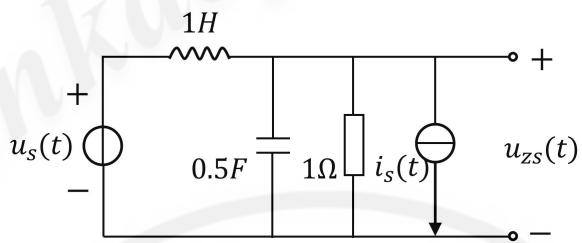
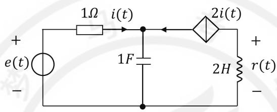
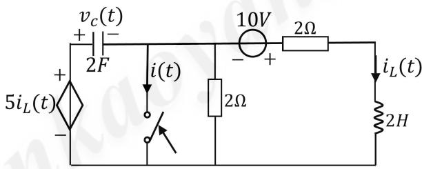
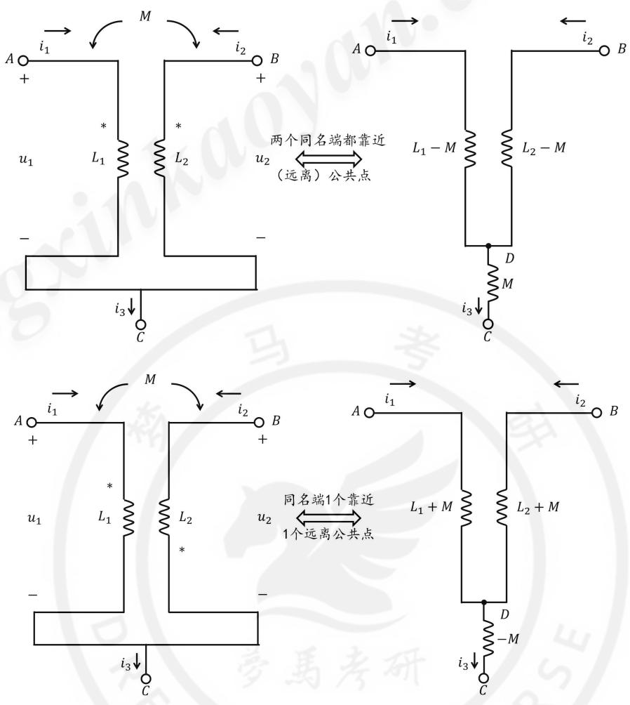
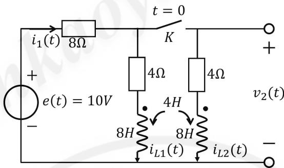
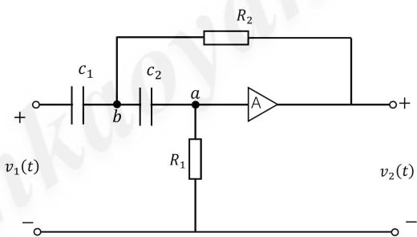

## 专题8 复杂电路的s域分析

考点 1: 多激励源电路的s域分析

例 40：如图所示的电路， $u_{s}(t)=10\sqrt{2}\cos(\sqrt{2}t)Vu(t)$ ， $i_{s}(t)=e^{-2t}u(t)A$ ，求零状态响应 $u_{zs}(t)$ 。

## 考点2：含受控源电路的s域分析

1、当做独立激励源；

2、补充受控量的方程

例 41: 如图所示的电路, 起始状态为零, 激励信号 $e(t) = e^{-5t} u(t)$ , 求

(1)响应 $r(t)$ ;

(2)初值 $r(0^{+})$ ;

(3)稳态值 $r(\infty)$ 。

  
夢馬考研

例 42: 如图所示电路, 当 t < 0 时, 开关 K 断开, 电路已达到稳态, t = 0 时刻闭合开关 K, 试求 t > 0 时的 $i(t)$ 。

DF免费QQ群615698143B站up：信号与系统\_谷哥

考点3：含电磁互感电路的s域分析  

磁耦合电路的解题步骤

(1)利用去耦等效电路画时域电路图;

(2)利用(1)结果电路求0\_状态;

(3)利用(2)结果的0\_状态画s域电路模型;

(4)列出方程求解响应。

例 43: 如图所示电路, 已知电阻 $R_{1}=8\Omega$ , $R_{2}=R_{3}=4\Omega$ , 电感 $L=L_{1}=L_{2}=8H$ , 互感 M=4H, 在 t=0 时断开开关 K。若开关 K 断开前电路已达到稳态, 试求 t>0 时的 $i_{1}(t)$ 和 $v_{2}(t)$ 。

## 考点4：含运放电路的s域分析

例 44: 电路如下图所示, 图中运算放大器输入阻抗为 $\infty$ , 输出阻抗为 0, 求:

(1)写出系统函数 $H(s)=\frac{V_{2}(s)}{V_{1}(s)}$ ;

(2)求使得系统稳定的放大系数A的范围;

(3)求临界稳定时的冲激响应;

(4)若 $A = 1, R_{1} = R_{2} = R, C_{1} = C_{2} = C$ ，粗略画出系统的幅频曲线。