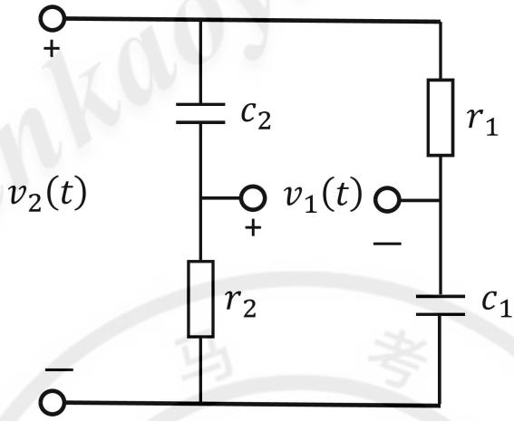
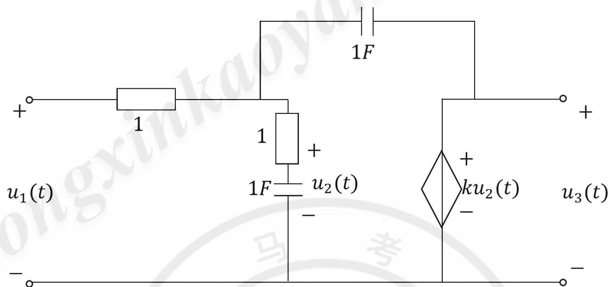
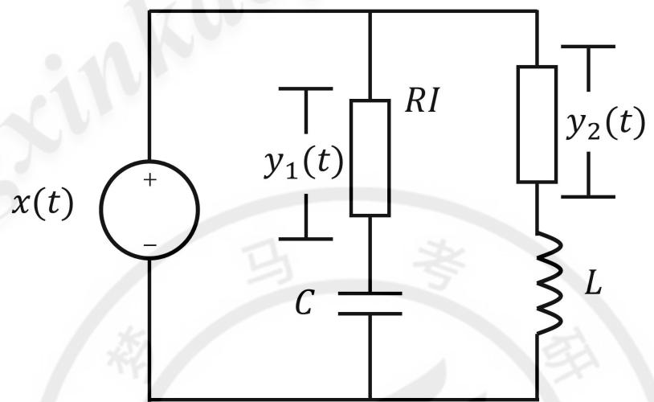
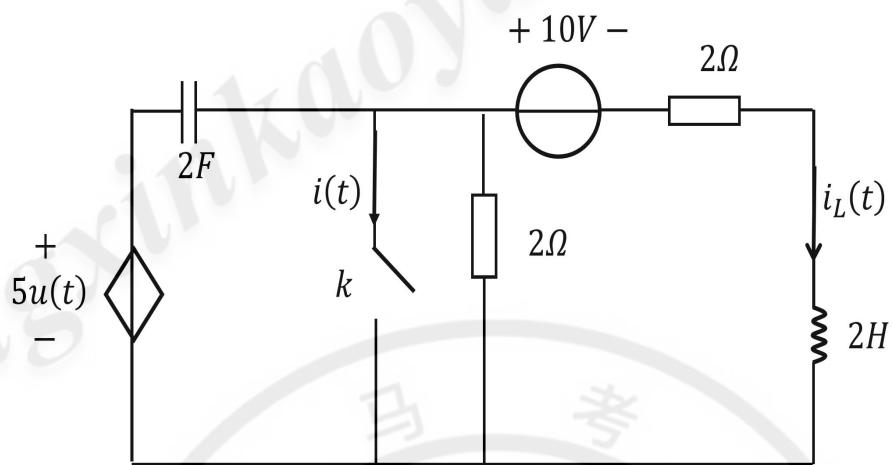
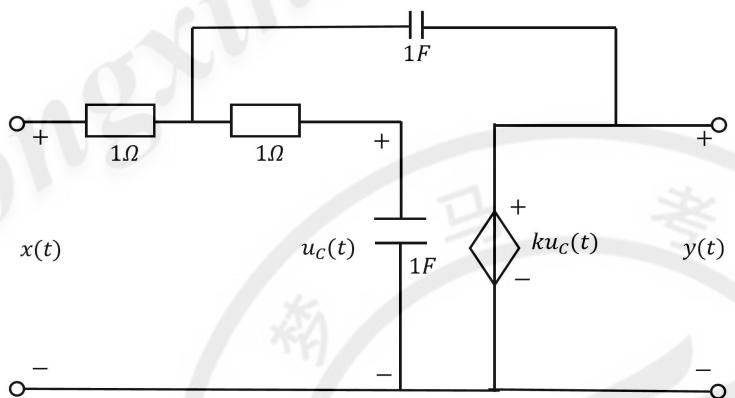
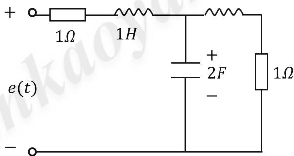
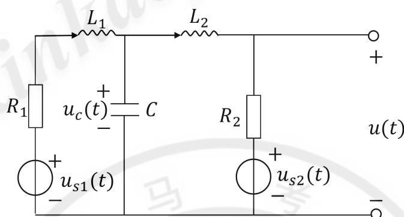

## 【第33节】课后作业

## 1、【2024 沈阳工业大学】

如图所示电路系统中， $r_{1}c_{1}>r_{2}c_{2}$ ，求下列各问。

(1) 求系统函数 $H(s)=\frac{V_{2}(s)}{V_{1}(s)}$ ;

(2) 求系统的零点、极点，并绘制零、极点图；

(3) 在网络参数满足什么条件下才能构成全通网络。

## 2、【2024 山西大学】

如下图所示零状态电路，图中 $ku(t)$ 受控源，初始状态为0。

(1) 求 $H(s)=\frac{U_{3}(s)}{U_{1}(s)}$

(2) 讨论 $k$ 值及系统稳定性

(3) 当 $k = 3$ , $u_{1}(t) = \cos 2tu(t)$ , 求响应 $u_{3}(t)$

## 3、【2024 东华大学】

已知电路图如下:

(1) 证明 $x(t) \to y_1(t)$ 和 $x(t) \to y_2(t)$ 对任意的参数 $R_1$ 、 $R_2$ 、 $L$ 和 $C$ 均为因果稳定系统

(2) 若 $R_{1}=1\Omega,\quad C=0.5F,\quad x(t)=cos2t$ ，求 $y_{1}(t)$

  
夢馬考研

## 4、【2024 东北大学】

如图所示电路，当 $t < 0$ 时，开关K断开，且电路已达到稳定状态，当 $t = 0$ 时，开关K闭合，试求 $t > 0$ 时 $i(t)$

## 5、【2024 重庆邮电大学】

零状态电路系统如下图所示， $ku_{c}(t)$ 为受控电压源， $x(t)$ 是电路激励， $y(t)$ 为电路响应。（关注通信考研小马哥，通信考研不迷路）

(1) 画出s域电路模型;

(2) 求系统函数 $H(s)$ ;

(3) 求系统稳定时 $k$ 取值范围。

  
夢馬考研

## 6、【2024 大连理工大学】

列出下列电路的状态方程并判断是否稳定

## 7、【2024 重庆邮电大学】

在下图所示电路系统中，电感 $L_{1}=1H,\quad L_{2}=\frac{1}{3}H$ ，电容 $C=\frac{1}{2}F$ ，电阻 $R_{1}=2\Omega$ ， $R_{2}=1\Omega$ 。若 $u_{s1}(t)$ 和 $u_{s2}(t)$ 为该系统的输入， $u(t)$ 为系统输出，以流过电感的电流和电容两端电压为状态变量，写出该系统的状态方程和输出方程。

