# 【第33节】课后作业

①

1、【2024 沈阳工业大学】

如图所示电路系统中， $r_{1}c_{1}>r_{2}c_{2}$ ，求下列各问。

解: 宠体态条件下电路域

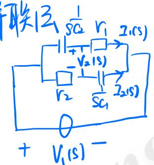

核型为：

$$
I _ {1} (s) = \frac {V _ {1} (s)}{s G + r _ {1}}
$$

$$
I _ {2} (s) = \frac {V _ {1} (s)}{r _ {2} + \frac {1}{s c _ {1}}}
$$

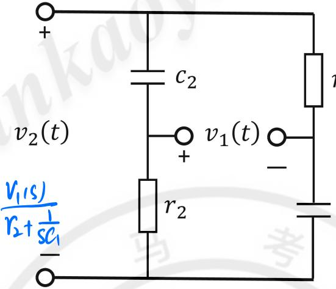

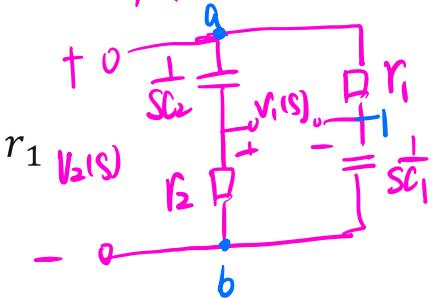

$c_{1}$ ② 带共四所

$$
\frac {1}{S C _ {2}} I _ {1} (s) + V _ {2} (s) - r _ {2} I _ {2} (s) = 0
$$

$$
b: (S C _ {1} + \frac {1}{r _ {2}}) u _ {b} = \frac {V _ {1} (S)}{r _ {2}}
$$

$\Rightarrow V_{2}(s)=V_{2}\frac{I_{2}(s)-\frac{1}{S}(I_{2})I_{1}(s)}{(1)}$ 求系统函数 $H(s)=\frac{V_{2}(s)}{V_{1}(s)};$

$=\frac{r_{2}V_{1}(s)}{r_{2}+\frac{1}{sC_{1}}}-\frac{\frac{1}{sC_{2}}v_{1}(s)}{sC_{2}+\frac{1}{sC_{1}}}(2)$ 求系统的零点、极点，并绘制零、极点图；

(3) 在网络参数满足什么条件下才能构成全通网络。

$$
\begin{array}{r l} {V _ {2} (s)} & {= u a - u b} \\ & {= [ \frac {S C _ {2}}{S C _ {2} + \frac {1}{r _ {1}}} - \frac {\frac {1}{r _ {2}}}{S C _ {1} + \frac {1}{r _ {2}}} ] V _ {1} (s)} \end{array}
$$

$$
\begin{array}{r l} {\therefore H (s) = \frac {V _ {2} (s)}{V _ {1} (s)}} & {= \frac {V _ {2}}{V _ {2} + \frac {1}{S C _ {1}}} - \frac {\frac {1}{S C _ {2}}}{\frac {1}{S C _ {2}} + V _ {1}}} \\ & {= \frac {s ^ {2} - \frac {1}{C C _ {2} r _ {1} V _ {2}}}{(s + \frac {1}{C _ {2} r _ {1}}) (s + \frac {1}{C _ {1} V _ {2}})}} \end{array}
$$

$$
\begin{array}{r l} {H (s) = \frac {v _ {2} (s)}{v _ {1} (s)}} & {= \frac {S C _ {2}}{S C _ {2} + \frac {1}{n}} - \frac {\frac {1}{r _ {2}}}{S C _ {1} + \frac {1}{r _ {2}}}} \\ & {= \frac {S ^ {2} - \frac {1}{C _ {1} C _ {2} r _ {1} r _ {2}}}{(S + C _ {2} r _ {1}) (S + \frac {1}{C _ {1} r _ {2}})}} \end{array}
$$

例 由 $H\left( S\right)$ 表达可见.

要点为 ${S}_{1,2} =  \pm  \frac{1}{\sqrt{{c}_{1}{c}_{2}{r}_{1}{r}_{2}} }$

$$
\mathrm{极点为} S _ {3} = - \frac {1}{c _ {2} r _ {1}}, S _ {4} = - \frac {1}{c _ {1} r _ {2}}
$$

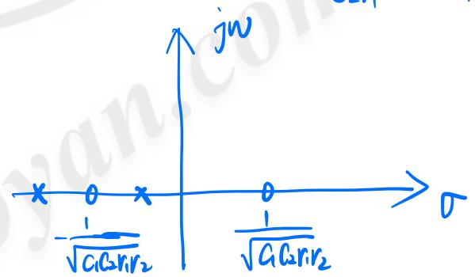

(3) 全面网络要求填充零极点关于纵轴镜像
故有一对零极点,相等可约,利导一对零极点、镜像
故反当 $C_{1}r_{2}=C_{2}r_{1}$ 时可满足全面积态

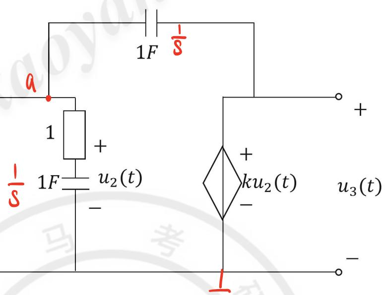

## 2、【2024 山西大学】

如下图所示零状态电路，图中 $ku(t)$ 受控源，初始状态为0。

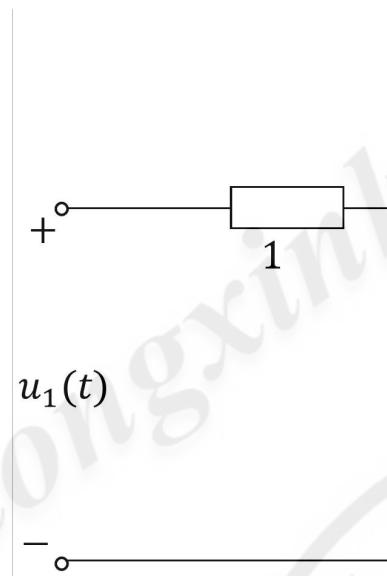

(1) 求 $H(s)=\frac{U_{3}(s)}{U_{1}(s)}$

(2) 讨论 $k$ 值及系统稳定性

(3) 当 $k = 3$ ， $u_{1}(t) = \cos 2tu(t)$ ，求响应 $u_{3}(t)$

(2) $= \widehat{P}\overline{1}{S}^{2} + \left( {3 + k}\right) S + 1$ 中

若 $3k > 0$ ，即 $k < 3$ 时，亲民不稳定， $k = 3$ 时，亲民临界稳定； $k > 3$ 时，亲民不稳定

$$
\therefore u _ {3} | t | = (\cos t - \cos 2 t) u _ {1} | t |
$$

$$
\begin{array}{r l} {u _ {3} (s) = \frac {3}{s ^ {2} + 1}} & {\cdot \frac {s}{s ^ {2} + 4}} \\ & {= \frac {a s + b}{s ^ {2} + 1} + \frac {c s + d}{s ^ {2} + 4}} \\ & {= \frac {s}{s ^ {2} + 1} + \frac {- s}{s ^ {2} + 4}} \end{array}
$$

(3) k=3时 $H(S)=\frac{3}{S^{2}+1}$

(1) $\left(1+\frac{1}{1+\frac{1}{s}}+s\right)u_{a}=u_{1}(s)+\frac{k(u_{2}(s))}{\frac{1}{s}}$ ①

增列关系： $u_{2}(s)=\frac{\frac{1}{s}}{1+\frac{1}{s}}u_{a}=\frac{1}{s+1}u_{a}\textcircled{②}$

$$
H (s) = \frac {V _ {3} (s)}{V _ {1} (s)} = \frac {k U _ {2} (s)}{V _ {1} (s)} = \frac {k}{S ^ {2} + (3 - k) S + 1}
$$

①②联立可得：

$$
[ s ^ {2} + (3 - k) s + 1 ] u _ {2} (s) = u _ {1} (s)
$$

3、【2024 东华大学】

已知电路图如下:

(1) 证明 $x(t) \to y_1(t)$ 和 $x(t) \to y_2(t)$ 对任意的参数 $R_1$ 、 $R_2$ 、 $L$ 和 $C$ 均为因果稳定

(2) 若 $R_{1}=1\Omega,\quad C=0.5F,\quad x(t)=cos2t$ ，求 $y_{1}(t)$

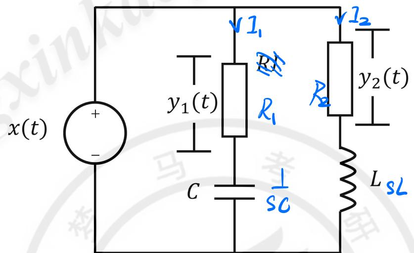

解:

(1)

$$
Y _ {1} (s) = \frac {R _ {1}}{R _ {1} + \frac {1}{s c}} \cdot X (s) \Rightarrow H _ {1} (s) = \frac {Y _ {1} (s)}{X (s)} = \frac {R _ {1}}{R _ {1} + \frac {1}{s c}} = \frac {R _ {1} c s}{R _ {1} c s + 1} = \frac {s}{s + \frac {1}{R _ {1} c}}
$$

$$
Y _ {2} (s) = \frac {R _ {2}}{R _ {2} + s L} \cdot X (s) \Rightarrow H _ {2} (s) = \frac {R _ {2} (s)}{X (s)} = \frac {R _ {2}}{R _ {2} + s L} = \frac {\frac {R _ {2}}{L}}{S + \frac {R _ {2}}{L}}
$$

由 ${H}_{1}\left( S\right)$ 和 ${H}_{2}\left( S\right)$ 可见,极点 $- \frac{1}{{R}_{1}C}$ 和 $- \frac{{R}_{2}}{L}$ 均在 $S$ 处半而

故 $H_{1}(S)$ 和 $H_{2}(S)$ 均为可果成立反应(2) $R_{1}=1\Omega$ , C=0.5F. 则 $H_{1}(S)=\frac{S}{S+2}\Rightarrow H_{1}(W)=\frac{jw}{jw+2}$ 当 $x(t)=\cos2t$ 时 $H_{1}(2)=\frac{j^{2}}{j^{2}+2}=\frac{j}{j+1}$ $|H_{1}(2)|=\frac{1}{\sqrt{1+1}}=\frac{\sqrt{2}}{2}$ $\varphi_{1}(2)=\arctan\frac{1}{0}-\arctan\frac{1}{1}=\frac{\pi}{4}$ $\therefore y_{1}(t)=\frac{\sqrt{2}}{2}\cos(2t+\frac{\pi}{4})$

②

②

4、【2024 东北大学】

如图所示电路，当 $t < 0$ 时，开关K断开，且电路已达到稳定状态，当 $t = 0$ 时，

开关K闭合，试求 $t > 0$ 时 $i(t)$

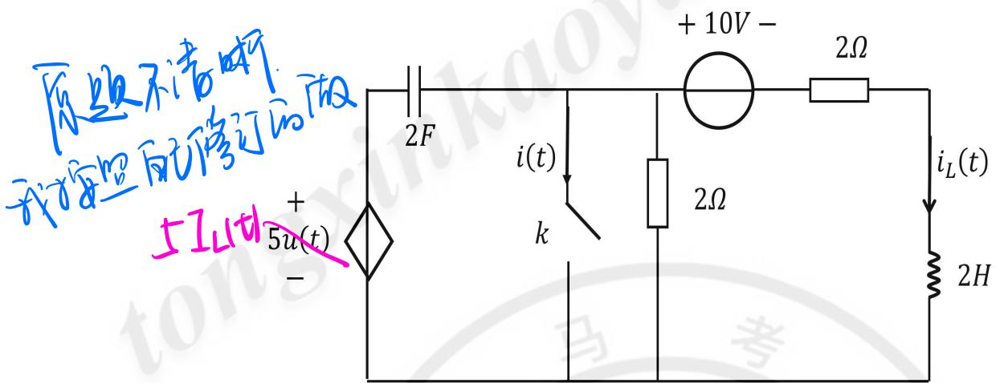

t<0 时开关 k 断开，电路处于状态。此时电路模型为

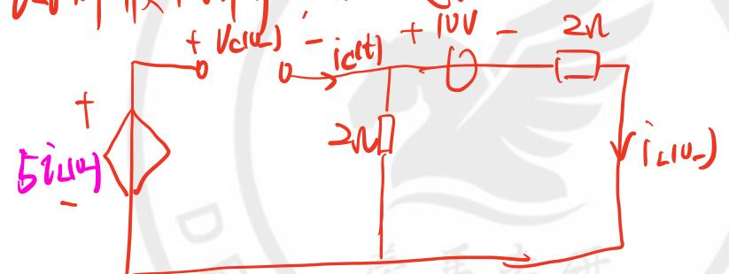

$$
i _ {L} (u) = - 2. 5 A
$$

$$
V _ {C} (u - 1) = 2 i _ {L} (u - 1) - \bar {5} i _ {L} (u - 1) = 0
$$

$$
V _ {C} (v -) = 7 i _ {L} (v -) = - 1 7. 5 V
$$

t=0 时开关 k 闭合. S 域电路模型为

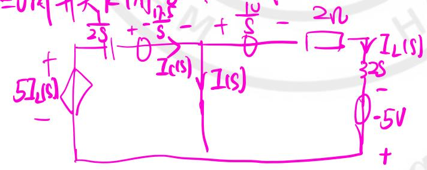

$I(s) = I_c(s) - I_L(s)$ ①

$$
\frac {1}{2 s} I _ {c} (s) - \frac {1 7 . 5}{s} - 5 I _ {L} (s) = 0
$$

$$
\frac {1 0}{s} + (2 + 2 s) I _ {L} (s) + 5 = 0
$$

由②可得： $I_C(s) = 35 + 10s$ $I_C(s)$ 代入①可得： $I(s) = 35 + (10s - 1)$ $I_2(s)$

由③可得 $I_{L}(s) = -\frac{10 + 5s}{2s(s+1)} \Rightarrow I_{1}(s) = 35 + \frac{-5(s+2)(10s-1)}{2s(s+1)}$ $= 10 + \frac{-45s + 10}{2s(s+1)}$

$\therefore |t|=10\delta(t)+(5-\frac{3}{2}e^{-t})4(k)$ 梦马班作业
BDF免费QQ群615698143

## 5、【2024 重庆邮电大学】

零状态电路系统如下图所示, $ku_{c}(t)$ 为受控电压源, $x(t)$ 是电路激励, $y(t)$ 为电

路响应。(关注通信考研小马哥，通信考研不迷路)

(1) 画出s域电路模型;

(2) 求系统函数 $H(s)$ ;

(1)

(3) 求系统稳定时 $k$ 取值范围。

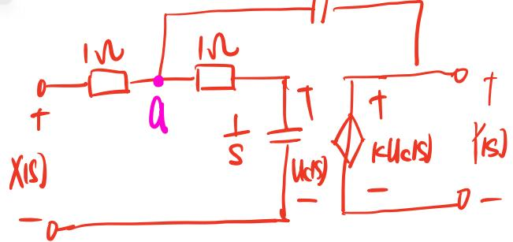

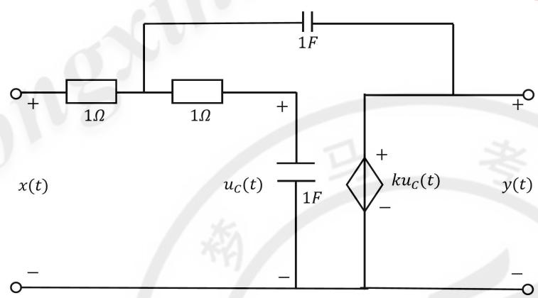

$$
(\frac {1}{1} + \frac {1}{n \frac {1}{s}} + s) u _ {a} = x (s) + \frac {k u _ {c} (s)}{\frac {1}{s}}
$$

$$
\frac {u _ {a}}{1 + \frac {1}{s}} \cdot \frac {1}{s} = u _ {c} (s) \Rightarrow u _ {c} (s) = \frac {u _ {a}}{s + 1}
$$

$$
(S ^ {2} + 3 S + 1) u _ {c} (s) = x (s) + k S u _ {c} (s)
$$

$$
\Rightarrow H (s) = \frac {Y (s)}{X (s)} = \frac {K U (s)}{X (s)} = \frac {1}{S ^ {2} + (3 - k) s + 1}
$$

(3) $3 - k > 0 \Rightarrow k < 3$ 时就称定

6、【2024 大连理工大学】木学可以作废 [章节测试讲时再讲]

列出下列电路的状态方程并判断是否稳定

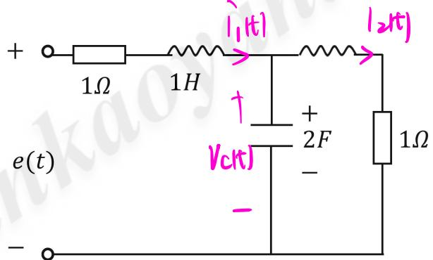

选取电势电压和电流为积分变量.如图示

对于内容列里所在书夹kCL合4 $\dot{i}_{C}|t|=\dot{i}_{1}|t|-\dot{i}_{2}|t|$

$$
\begin{array}{r l} {\Rightarrow C \frac {d u _ {C} (t)}{d t} = i _ {1} (t) - i _ {2} (t)} & {\Rightarrow \frac {d u _ {C} (t)}{d t} = \frac {1}{c} [ i _ {1} (t) - i _ {2} (t) ]} \\ & {\quad = \frac {1}{2} [ i _ {1} (t) - i _ {2} (t) ]} \end{array}
$$

对电感 $\angle 1$ 所在环路到 kV L 行.

$$
e (t) + i _ {1} (t) + 2 \frac {d i _ {1} (t)}{a t} + v _ {c} (t) = 0
$$

$$
\frac {d i _ {1} (t)}{d t} = - i _ {1} (t) - V _ {C} (t) - e (t)
$$

对 $\because \angle 2$ 所在四岔列 ${kV}$ 线

$$
\angle \frac {d i _ {2} (t)}{d t} + i _ {2} (t) - v _ {c} (t) = 0
$$

$$
\frac {d i _ {2} (t)}{d t} = V _ {0} (t) - i _ {2} (t)
$$

$$
\left[ \begin{array}{l} \frac {d v _ {c} (t)}{d t} \\ \frac {d j _ {1} (t)}{d t} \\ \frac {d j _ {2} (t)}{d t} \end{array} \right] = \left[ \begin{array}{l l l} 0 & \frac {1}{2} & - \frac {1}{2} \\ - 1 & - 1 & 0 \\ 1 & 0 & - 1 \end{array} \right] \left[ \begin{array}{l} v _ {c} (t) \\ i _ {1} (t) \\ i _ {2} (t) \end{array} \right] + \left[ \begin{array}{l} 0 \\ - 1 \\ 0 \end{array} \right] e (t)
$$

$$
A = \left[ \begin{array}{l l l} 0 & \frac {1}{2} & - \frac {1}{2} \\ - 1 & - 1 & 0 \\ 1 & 0 & - 1 \end{array} \right]
$$

$$
| S I - A | = \left| \begin{array}{l l l} s & - \frac {1}{2} & \frac {1}{2} \\ 1 & s + 1 & 0 \\ - 1 & 0 & s + 1 \end{array} \right|
$$

官网：www.tongxinkaoyan.com $= S \times (-1)^{n+1} \mid S+1 \quad 0 \mid^{-\frac{1}{2}} \times (-1)^{n+2} \mid -\frac{1}{2}(1)^{n+3} \mid^{6}$ 免费QQ群615698143

B站up: 信号与系统\_谷哥

公众号：通信考研小马哥

$$
= S (S + 1) ^ {2} + \frac {1}{2} (S + 1) + \frac {1}{2} (S + 1) = S ^ {3} + 2 S ^ {2} + 2 S + 1
$$

[未学]

7、【2024 重庆邮电大学】

满足罗斯矩阵.故永远设定

在下图所示电路系统中，电感 $L_{1}=1H$ ， $L_{2}=\frac{1}{3}H$ ，电容 $C=\frac{1}{2}F$ ，电阻 $R_{1}=2\Omega$ ， $\frac{5}{3}$

$$
\begin{array}{l l l l} s ^ {3} & 1 & 2 & 0 \\ s ^ {2} & 2 & 1 & 0 \\ s ^ {1} & \frac {3}{2} & - \frac {1}{2} \\ s ^ {0} & 5 \end{array}
$$

$R_{2} = 1\Omega$ 。若 $u_{s1}(t)$ 和 $u_{s2}(t)$ 为该系统的输入， $u(t)$ 为系统输出，以流过电感的电

流和电容两端电压为状态变量，写出该系统的状态方程和输出方程。

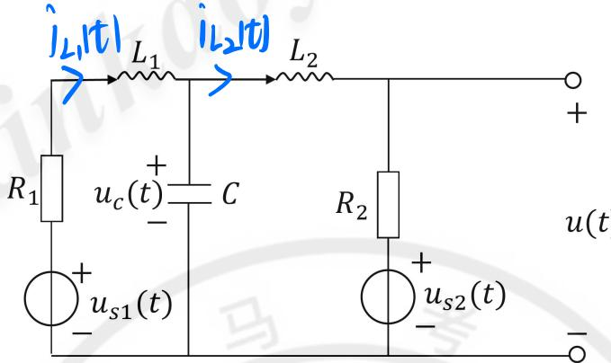

列电容所在节点的 $kC\angle$ 方程 $i_{C}(t) = i_{L_1}(t) - i_{L_2}(t)$

$$
C \frac {d u _ {c} (t)}{d t} = i _ {c 1} (t) - i _ {c 2} (t)
$$

$$
\frac {d u _ {d t}}{d t} = \frac {1}{c} [ j _ {L _ {1}} | t | - j _ {L _ {2}} | t | ] = 2 [ j _ {L _ {1}} | t | - j _ {L _ {2}} | t | ]
$$

到四恶所在环路的kVL方程：

$$
\begin{array}{r l} {L _ {1} \frac {d i _ {2 1} (t)}{d t} + V _ {0} (t) - U _ {s 1} (t) + R _ {1} i _ {4 1} (t)} & {= 0} \\ {\Rightarrow \frac {d i _ {2 1} (t)}{d t}} & {= \frac {1}{4} [ - V _ {0} (t) + U _ {s 1} (t) - R _ {1} i _ {2 1} (t) ]} \\ & {= - V _ {0} (t) - 2 i _ {4 1} (t) + U _ {s 1} (t)} \\ {L _ {2} \frac {d i _ {2 1} (t)}{d t}} & {+ R _ {2} i _ {2 2} (t) + U _ {s 2} (t) - V _ {0} (t)} \\ {\frac {d i _ {2 1} (t)}{d t}} & {= \frac {1}{2 2} [ V _ {0} (t) - U _ {s 2} (t) - R _ {2} i _ {2 2} (t) ]} \\ & {= 3 U (d t) - 3 i _ {2 1} (t) - 3 U _ {s 2} (t)} \end{array}
$$

$$
\left[ \begin{array}{l} \frac {d u _ {a t}}{d t} \\ \frac {d i _ {4 1 t}}{d t} \\ \frac {d i _ {2 2 t}}{d t} \end{array} \right] = \left[ \begin{array}{r r r} 0 & 2 & - 2 \\ - 1 & - 2 & 0 \\ 3 & 0 & 3 \end{array} \right] \left[ \begin{array}{l} u _ {a t} \\ i _ {4 1 t} \\ i _ {2 2 t} \end{array} \right] + \left[ \begin{array}{r r} 0 & 0 \\ 1 & 0 \\ 0 & 3 \end{array} \right] \left[ \begin{array}{l} u _ {s _ {1} 1 t} \\ u _ {s _ {2} 1 t} \\ \text {   梦马班作业   } \end{array} \right]
$$

DF免费QQ群615698143
B站up：信号与系统\_谷哥

$$
\begin{array}{r l} {u | t |} & {= R _ {2} i _ {L 2} (t) + u _ {S 2} (t)} \\ & {= i _ {L 2} (t) + u _ {S 2} (t)} \end{array}
$$

公众号：通信考研小马哥

$$
u _ {1 t 1} = \left[ \begin{array}{l l l} 0 & 0 & 1 \end{array} \right] \left[ \begin{array}{l} u _ {c 1 t 1} \\ i _ {4 1 t 1} \\ i _ {c 2 t 1} \end{array} \right] + \left[ \begin{array}{l l} 0 & 1 \end{array} \right] \left[ \begin{array}{l} u _ {s _ {1} t 1} \\ u _ {s _ {2} t 1} \end{array} \right]
$$

