DF免费QQ群615698143
节点电压法（结构双层分析）

直好给定

$11^{\circ}$ 独立度

电信S域分析 → 元体的S域核整 $V_{C}(0-1), i_{C}(0-1)$

→受挫度

先状态响应

20 增加受控量练习

技路线

投给奇致忌

变杂电路

电流 $V$ 为一开

顷洛仿S域列于稳

双反法

由正弦：矩

选题

$\mu_{3} \Rightarrow \pi V(0) \neq 0 \quad i < 0$

多派助：书页

受控原
同名：我公正，并名：杜贞
自磁互态 ① 共效回答 ② 已常

万年放大路

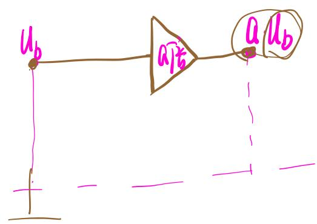

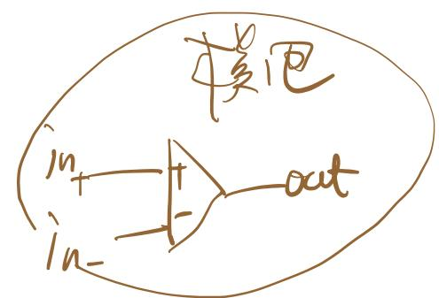

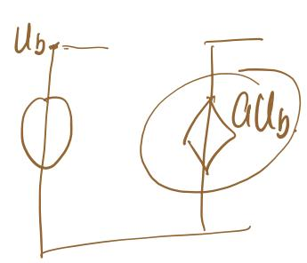

专题8 复杂电路的s域分析

考点1: 多激励源电路的s域分析

中点 $|D_{1}|$ 是

，电后房独立，电后房开给
电后房独立，电后房起给

例 40: 如图所示的电路, $u_{s}(t)=10\sqrt{2}\cos(\sqrt{2}t)V u(t), i_{s}(t)=e^{-2t}u(t)A$ , 求零状态响应 $u_{z s}(t)$ 。

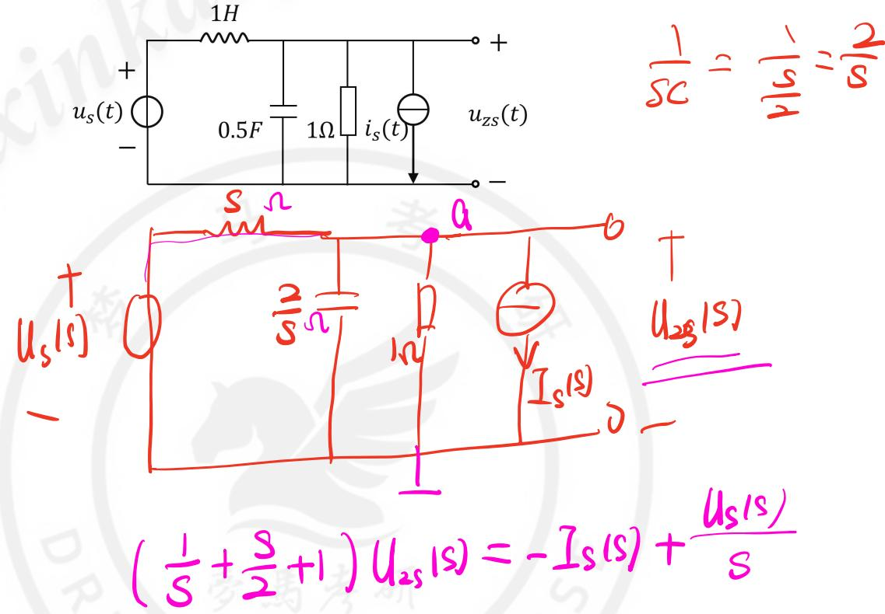

## 考点2：含受控源电路的s域分析

1、当做独立激励源；

2、补充受控量的方程

例 41: 如图所示的电路, 起始状态为零, 激励信号 $e(t) = e^{-5t} u(t)$ , 求

(1)响应 $r\left( t\right)$ ;

(2)初值 $r(0^{+})$ ;

(3)稳态值 $r(\infty)$ 。

数学电压关系

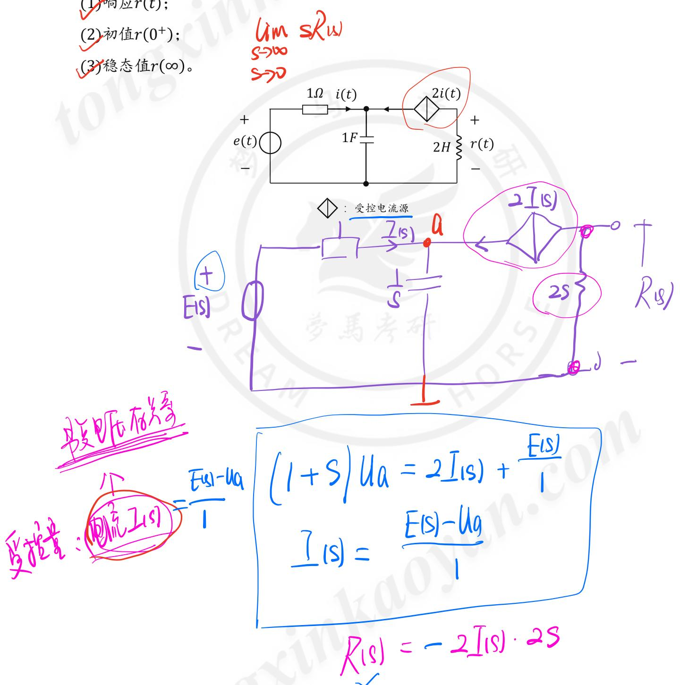

例 42: 如图所示电路, 当 t < 0 时, 开关 K 断开, 电路已达到稳态, t = 0 时刻闭合开关 K, 试求 t > 0 时的 $i(t)$ 。

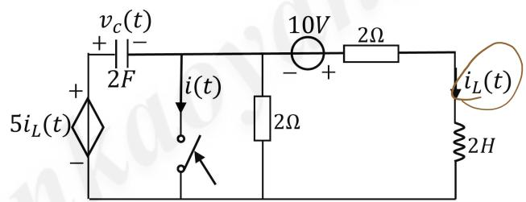

拔路前 k 断开，致忌. 对城四舍
+ $V_{c}(0-2)$ —

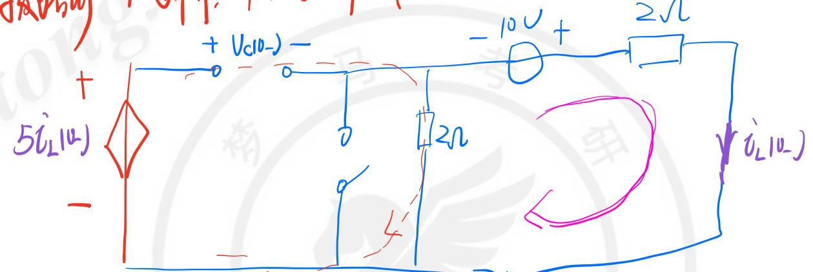

$$
\begin{array}{l l} {k V L \dot {v} _ {L} ^ {\mathrm{ch}}} & {- 1 0 + (2 + 2) \dot {v} _ {L} (v _ {-}) = 0 \Rightarrow \dot {v} _ {L} (v _ {-}) = 2. 5 A} \\ {V _ {C} (v _ {-})} & {+ V _ {C} (v _ {-}) - 2 \dot {v} _ {L} (v _ {-}) - 3 \dot {v} _ {L} (v _ {-}) = 0 \Rightarrow 7 \dot {v} _ {L} (v _ {-}) = V _ {C} (v _ {-})} \\ & {= 1 7. 5 V} \end{array}
$$

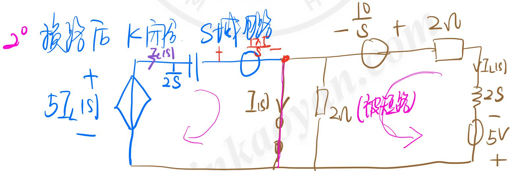

左回路 kU L : 右回路 kU L :

考点3：含电磁互感电路的s域分析  
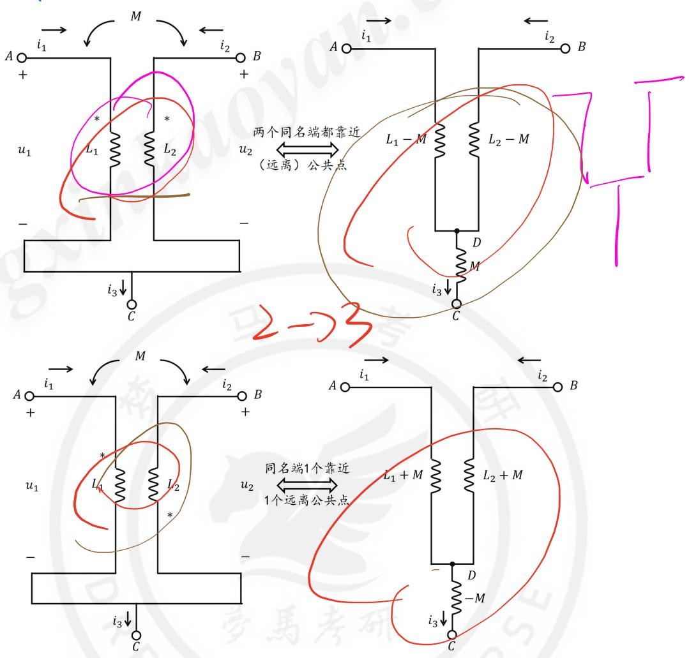

磁耦合电路的解题步骤

(1)利用去耦等效电路画时域电路图;

(2)利用(1)结果电路求0\_状态;

(3)利用(2)结果的0\_状态画s域电路模型;

(4)列出方程求解响应。

例 43: 如图所示电路, 已知电阻 $R_{1} = 8 \Omega$ , $R_{2} = R_{3} = 4 \Omega$ , 电感 $L = L_{1} = L_{2} = 8 H$ , 互感 $M = 4 H$ , 在 $t = 0$ 时断开开关 $K$ 。若开关 $K$ 断开前电路已达到稳态, 试求 $t > 0$ 时的 $i_{1}(t)$ 和 $v_{2}(t)$ 。

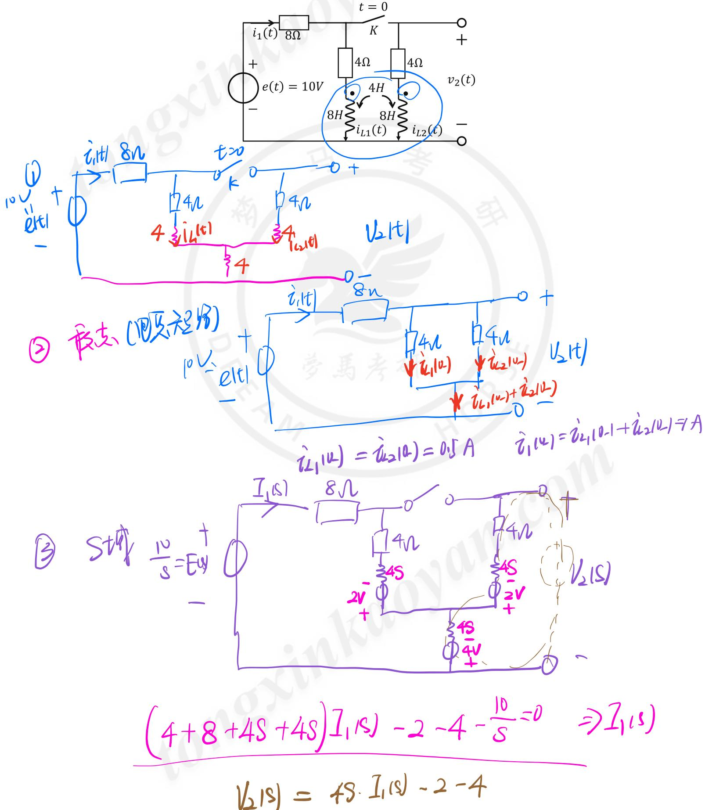

考点4：含运放电路的s域分析

例 44: 电路如下图所示, 图中运算放大器输入阻抗为 $\infty$ , 输出阻抗为 0, 求:

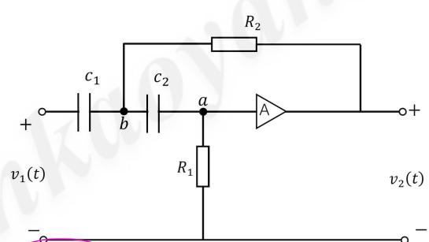

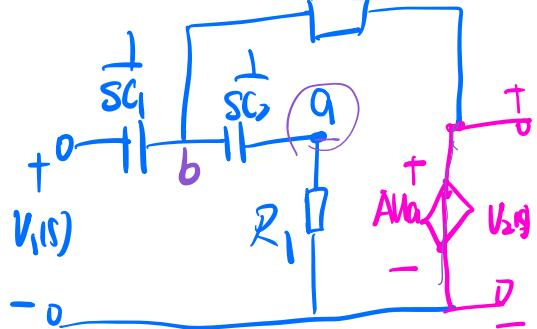

$A < A_{0}$ $\alpha > 0.3 > 0$

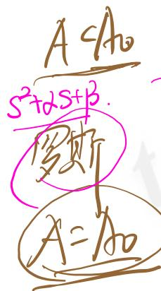

(1)写出系统函数 $H\left( s\right)  = \frac{{V}_{2}\left( s\right) }{{V}_{1}\left( s\right) }$ ,

(2)求使得系统稳定的放大系数A的范围;

(3)求临界稳定时的冲激响应；

$$
(S C _ {1} + S C _ {2} + \frac {1}{R _ {2}}) U _ {b} - S C _ {2} \cdot U _ {a} = \frac {V _ {1} (s)}{\frac {1}{S C _ {1}}} + \frac {A U a}{R _ {2}}
$$

$a : \left( \frac{1}{R_{1}} + S C_{2} \right) U_{a} - S C_{2} U_{b} = 0$

(4)若 $A = 1, R_{1} = R_{2} = R, C_{1} = C_{2} = C$ ，粗略画出系统的幅频曲线。

$$
(3) A = 1 + \frac {R _ {2}}{R _ {1}} + \frac {R _ {2} C _ {1}}{R _ {1} C _ {2}} \mathrm{时}
$$

H(S)=

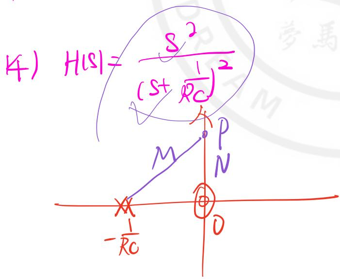

$$
\frac {S ^ {2} A}{S ^ {2} + (\frac {C _ {1} + C _ {2}}{C _ {1} C _ {2} R _ {1}} + \frac {1 - A}{C _ {1} R _ {2}}) S + \frac {1}{C _ {1} C _ {2} R _ {1} R _ {2}}}
$$

$$
\frac {C _ {1} + C _ {2}}{C _ {1} C _ {2} R _ {1}} + \frac {1 - A}{C _ {1} R _ {2}} > 0 \Rightarrow A <   1 + \frac {R _ {1}}{R _ {1}} + \frac {R _ {2} G}{R _ {1} C _ {2}}
$$

$$
\left| H (w) \right| = \frac {i V ^ {2}}{M ^ {2}}
$$

电路的状态度量分析

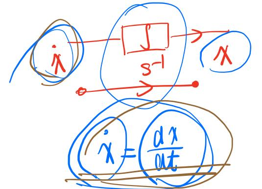

⇒ 电抗状态质量：

状态程 $\dot{x}=\frac{x_{1}\cdots x_{2}}{x_{1}+x_{2}}$ 和 f 化，代归组分

的 $n$ 和 $i$ 存在的数分多

当回后电压和电压电流

$$
\begin{array}{r l} & {V _ {L} (t) + 2 \dot {i} _ {C} (t) - u _ {C} (t) = 0} \\ & {= L \frac {d i \dot {u} _ {S}}{c d t} = u _ {C} - 2 \dot {i} _ {L}} \end{array}
$$

DF免费QQ群635098143 电路状态及量分析：状态了程和场正了程 10 还四路的电压和四零点的为快不变量 $u_{\mathrm {C}}$ $i_{\mathrm {L}}$

$2^{0}$ 状考过程：

$$
\dot {u} _ {c}
$$

$$
| c ^ {(t)} | = C \frac {d u _ {c} (t)}{d t} = C \cdot \dot {u} _ {c}
$$

$$
u _ {c} (t) = L \frac {d i _ {c} (t)}{d t} = L i _ {c}
$$

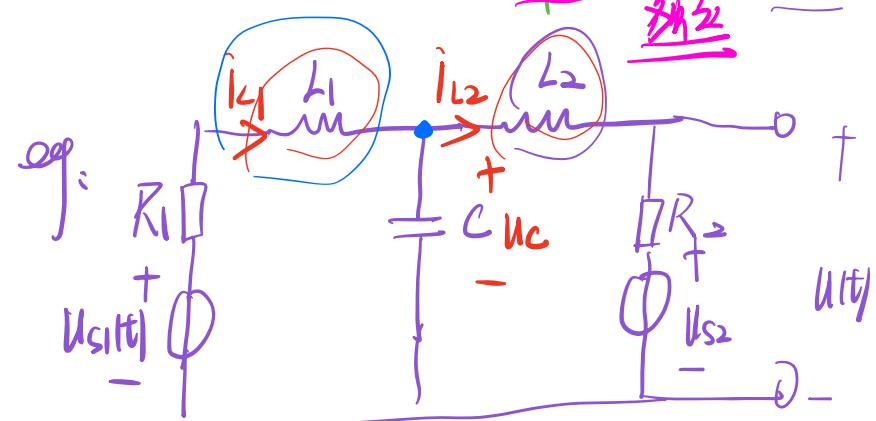

$$
\frac {\frac {i u}{-}}{o u t}
$$

$\begin{aligned}&\dot{u}_{0}=\frac{i_{C}}{C}\\&i_{L1}=\frac{u_{L1}}{L_{1}}\\&i_{L2}=\frac{u_{L2}}{L_{2}}\end{aligned}$ 选题、四流和见音电压为状态变共记作 $i_{L1}, i_{L2}$ 和 $u_{C}$ . 招同式状态差： $i_{L1}=\frac{i_{C}}{C}[i_{L1}-i_{L2}]=2i_{L1}-2i_{L2}$ $i_{L1}=\frac{i_{L1}}{L_{1}}[us_{1}-uc-2i_{L1}]=us_{1}-uc-2i_{L1}$ $i_{L2}=\frac{i_{L2}}{L_{2}}[uc-i_{L2}-us_{2}]=3[uc-i_{L2}-us_{2}]$ 转生过程： $u(t)=k_{2}i_{L2}+us_{2}=i_{L2}+us_{2}$

$$
u _ {L 1} + u _ {C} - u _ {S 1} + R _ {1} i _ {L 1} = 0
$$

$$
u _ {L 2} + R _ {2} i _ {L 2} + u _ {S 2} - u _ {C} = 0
$$

$$
u _ {L 2} = u _ {C} - i _ {L 2} - u _ {S 2}
$$

DF免费QQ群615698143

laplace

ROC. 序列属性

$2^{0}$ 常见字号 $\angle T$

$\ln  \rightarrow  {sg}$ 级性质

文投日.

H(1) →
日条. 短点. 泡门. 践. 无大且 最小如存

6° 双个热

$y_{2i}$ $s_{y_{2i}}$ PDF免费QQ群615698143