简单 1-7 共 40分 —— 35分
中子 8-10 共 40分 —— 30分
较难 11 共 15分 —— 10分
双3 12-14 共 55分 —— 30分
105分

离散  \( \angle T2s \) . 口夹散点 连点  \( Ae^{-1} + Be^{-x} \) 

 \( \frac{1}{5} \)  内域分析 (响应)

 \( A(-1)^{n} + B(-2)^{n} \) 

 \( A(n) g(n) \) 

若零  \( \frac{u(t) - dt}{f(t)} = f(t) \)   \( \angle T2s \) . 味双点

若零  \( \frac{U(t) - d(t)}{f(t)} = f(t) \) 

若零  \( \frac{U(t) - d(t)}{f(t)} = f(t) \) 

若零  \( \frac{U(t) - d(t)}{f(t)} = f(t) \) 

若零  \( \frac{U(t) - d(t)}{f(t)} = f(t) \) 

若零  \( \frac{U(t) - d(t)}{f(t)} = f(t) \)  宏图

若零  \( \frac{U(t) - d(t)}{f(t)} = f(t) \) 

若零  \( \frac{U(t) - d(t)}{f(t)} = f(t) \) 

若零  \( \frac{U(t) - d(t)}{f(t)} = f(t) \) 

若零  \( \frac{U(t) - d(t)}{f(t)} = f(t) \)

若零  \( \frac{U(t) - d(t)}{f(t)} = f(t) \)

若零  \( \frac{U(t) - d(t)}{f(t)} = f(t) \)

若零  \( \frac{U(t) - d(t)}{f(t)} = f(t) \)

若零  \( \frac{U(t) - d(t)}{f(t)} = f(t) \)

若零  \$ D\_{SP} \$ 中处理式

\$ D\_{SP} \$ 中处理式

\$ D\_{SP} \$ 中处理式

\$ D\_{SP} \$ 中处理式

\$ D\_{SP} \$ 中处理式

\$ D\_{SP} \$ 中处理式

\$ D\_{SP} \$ 中处理式

\$ D\_{SP} \$ 中处理式

\$ D\_{SP} \$ 中处理式

\$ D\_{SP} \$ 中处理式

\$ D\_{SP} \$ 中处理式

\( D\_{SP} \$ 中处理式

\$ D\_{SP} \$ 中处理式

\$ D\_{SP} \$ 中处理式

\$ D\_{SP} \$ 中处理式

\$ D\_{SP} \$ 中处理式

\$ D\_{SP} \$ 中处理式

\$ D\_{SP} \$ 中处理式

\$ D\_{SP} \$ 中处理式

\$ D\_{SP} \$ 中处理式

\$ D\_{SP} \$ 中处理式

\$\$ D\_{SP} \$ 中处理式

\$ D\_{SP} \$ 中处理式

\$ D\_{SP} \$ 中处理式

\$ D\_{SP} \$ 中处理式

\$ D\_{SP} \$ 中处理式

\$ D\_{SP} \$ 中处理式

\$ D\_{SP} \$ 中处理式

\$ D\_{SP} \$ 中处理式

\$ D\_{SP} \$ 中处理式

\$ D\_{SP} \$ 中处理式

DIPPT

\$ D\_{SP} \$ 中处理式

\$ D\_{SP} \$ 中处理式

\$ D\_{SP} \$ 中处理式

\$ D\_{SP} \$ 中处理式

\$ D\_{SP} \$ 中处理式

\$ D\_{SP} \$ 中处理式

\$ D\_{SP} \$ 中处理式

\$ D\_{SP} \$ 中处理式

\$ D\_{SP} \$ 中处理式

\$ D\_{SP} \$ 中处理
    \$ D\_{SP} \$ 中处理
    \$ D\_{SP} \$ 中处理
    \$ D\_{SP} \$ 中处理
    \$ D\_{SP} \$ 中处理
    \$ D\_{SP} \$ 中处理
    \$ D\_{SP} \$ 中处理
    \$ D\_{SP} \$ 中处理
    \$ D\_{SP} \$ 中处理
    \$ D\_{SP} \$ 中处理
    \$ D\_{SP} \$ 中处理
    // 比来描述
    // 比来描述
    // 比来描述
    // 比来描述
    // 比来描述
    // 比来描述
    // 比来描述
    // 比来描述
    // 比来描述
    // 比来描述
    // 比来描述
    // 比来描述
    // 比来描述
    // S域分析
    // 简词
    // 简词
    // 简词
    // 简词
    // 简词
    // 简词
    // 简词
    // 简词
    // 简词
    // 简词
    // 简词
    // 简词
    // 简词
    // 简词
    // 简词
\`\`\`

# LT 及连续系统 S 域分析章节测试

注：闭卷，计算量和灵活性强，在有限时间合理选择拿分

1、[25 南京理工大学 891]

$\frac{1}{|a|} y (at)$

$\frac { 1 } { a } y ( a t )$

①卷积定义

② FT性质. 只及性质 $f(t) \hookrightarrow f^{-1}(t)$ 则 $f^{-1}(t) \hookrightarrow \frac{1}{|a|} F(\frac{w}{a})$

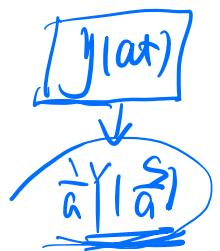

③ $\angle$ 性质强度度 $f\left( t\right)  \Leftrightarrow  F\left( s\right)$ . 则 $f\left( {at}\right)  \Leftrightarrow  \frac{1}{a}F\left| {\overrightarrow{a}}^{S}\right|$

## 2、[25 中国海洋大学 819]

已知 $f(t)$ 单边拉氏变换为 $F(s)$ ，求 $g(t)=te^{-4t}f(2t)$ 的单边拉氏变换。

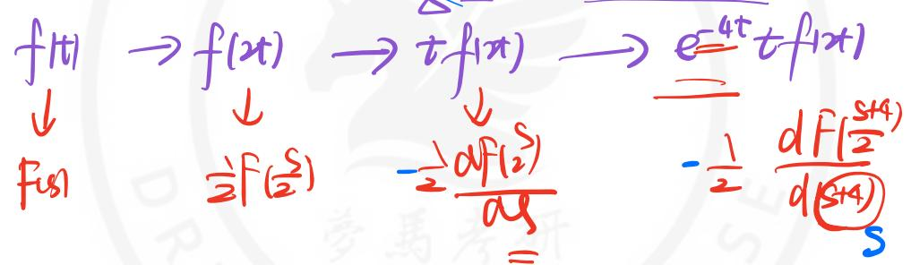

## 3、[25 沈阳工业大学 807]

已知象函数 $F(s) = \frac{(s + 2)}{(s + 4)^2(s + 5)}$ ，求其原函数的初值 $\lim_{t\to 0_+}f(t) = -D$ 。

求其原函数的终值 $\lim_{t\to\infty}f(t)=0$ 。

$$
f (0 +) = \lim _ {s \to \infty} s f (s)
$$

$$
f (x) = \lim _ {s \to 0} s f (s)
$$

## 4、[25 天津大学 815]

已知某滤波器的系统函数 $H(s)=\frac{s}{s^{2}+4s+16}$ ，则该滤波器特性是\_\_\_\_（低通、

高通、带通、带阻)

$$
= \frac {s}{| s + 2 | ^ {2} + B}
$$

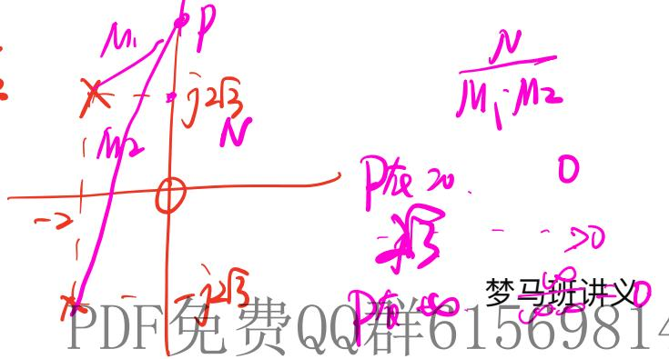

## 5、[25 天津大学 815]

已知一 LTI 系统函数 $H(s) = \frac{1}{(s+1)(s+2)}$ ，初始状态 $y(0_{-}) = 1$ ， $y'(0_{-}) = 2$ ，则系统

的零输入响应 $y_{zi}(t)=$ \_\_\_\_。

$$
A e ^ {- t} + B e ^ {- 2 t}
$$

$$
y _ {2 i} (a + 1) = y (a - 1) = A + B = 1
$$

$$
y _ {2 i} ^ {\prime} (u + 1) = y _ {1 2 - 1} ^ {\prime} = - A - 2 B = 2
$$

## 6、[25 天津工业大学 812]

计算卷积 $e^{-2t}u(t)*2 = \underline{1}$ 。

$E \leftrightarrow H(B) H(D) \cdot E .$ DO ROC

$e^{-it}u(t) \Leftrightarrow \frac{1}{8+2} \cdot 0.2-2 \Rightarrow H(0) \text{ for } \Omega H(0) = \frac{1}{2}$

## 7、[25 重庆邮电大学 801]

已知连续LTI系统的输入 $x(t)$ 与输出 $y(t)$ 的关系表达式为 $\frac{d^{2}y(t)}{dt^{2}}+\frac{dy(t)}{dt}-2y(t)=$

$$
\frac {d x (t)}{d t} + x (t)
$$

(1) 求系统函数 $H(s)$ 表达式;

(2)若系统是因果的,求该系统的单位冲激响应 $h\left( t\right)$ ;

(3)若该系统是非因果又非稳定,确定 $H\left( s\right)$ 的收敛域。

$$
\frac {\sigma <   - 2}{}
$$

## 8、[25 南京理工大学 818]

已知因果线性时不变连续时间系统微分方程为$\frac{1 + \frac{1}{(s+1)(s+5)}}{1}$

$$
y ^ {\prime \prime} (t) + 6 y ^ {\prime} (t) + 5 y (t) = x ^ {\prime \prime} (t) + 2 x ^ {\prime} (t) - 3 x (t)
$$

(1) 求单位冲激响应 $h(t)$ 及系统函数 $H(s) = \frac{(s^{2} + 2s - 3)}{(s^{2} + 6s + 5)} = \frac{(s + 3)(s - 1)}{(s + 1)(s + 5)}$

(2) 求出并画出系统的幅频特性; 当输入 $x(t)=2$ ，求系统输出信号 $y(t)$

(3) 画出系统 $H(s)$ 的并联型流图

$$
H (w) = H (s) / s = j w = \frac {- w ^ {2} + 2 j w - 3}{- w ^ {2} + 6 j w + 5}
$$

$$
2 <   \stackrel {H (B)} {\longrightarrow} H (U) \cdot 2   O G R O C.
$$

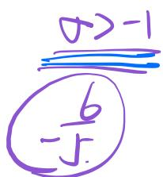

$$
\underline {{H (0)}} = - \frac {3}{5}
$$

$$
| H (w) | = \frac {\sqrt {(3 - w ^ {2}) ^ {2} + (2 w) ^ {2}}}{\sqrt {(5 - w ^ {2}) ^ {2} + (6 w) ^ {2}}}
$$

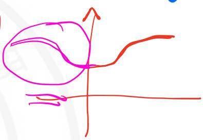

## 9、[25 宁波大学 829]

已知 1 和 2 两个因果系统如下:

1 系统微分方程为: $y''(t) + 4y'(t) + 3y(t) = x(t)$ , 单位冲激响应为: $h_1(t) = \frac{1}{2}(e^{-t} - e^{-3t})u(t)$

2 系统微分方程为： $y''(t) + 4y'(t) + 3y(t) = x'(t) + 2x(t)$

(1)求2系统的单位冲激响应 $h_{2}(t)$ 。 $y_{x} \rightarrow y$

(2) 若 $x(t) = e^{-4t}u(t)$ ， $y(0^{+}) = \frac{1}{3}$ ， $y'(0^{+}) = \frac{1}{3}$ ，求 2 系统的输出 $y(t)$ 。

(3)1 系统和 2 系统级联成 3 系统，求 3 系统的单位冲激响应 $h_{3}(t)$ 。

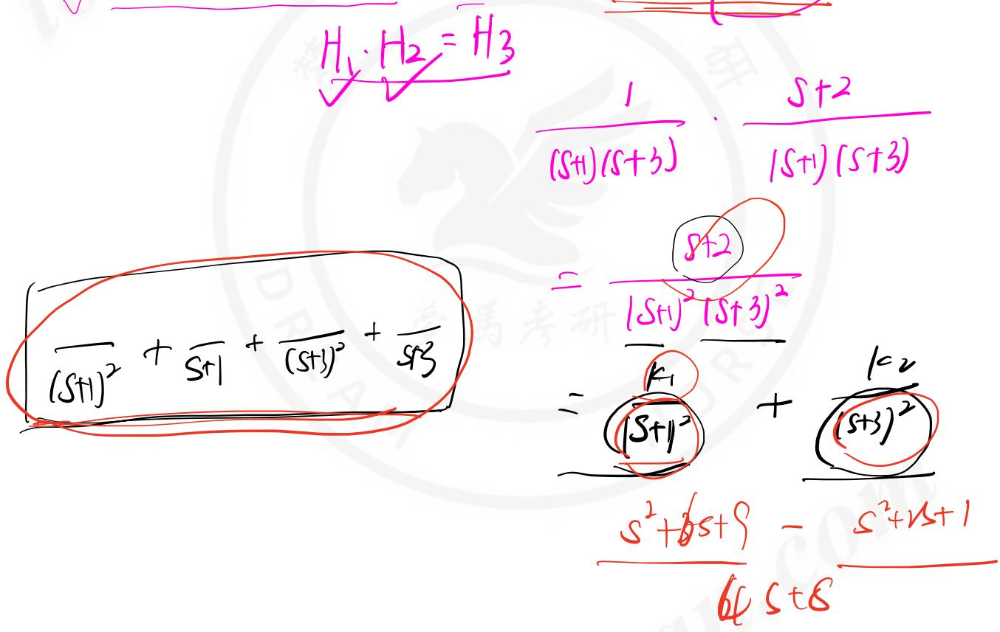

10、[25 宁波大学 829]

$$
S ^ {2} + \alpha S + \beta . \Rightarrow \alpha > 0. \beta > 0
$$

已知一因果 LTI 系统的微分方程为 $y''(t) + 4y'(t) + (1 - k)y(t) = 2kx(t)$

(1) $k$ 满足什么条件系统稳定。 $1 - k > 0$

(2)临界稳定条件下，系统的单位阶跃响应 $g(t)$ 。

$$
\frac {2 k}{s ^ {2} + 4 s + (1 - k)}
$$

(3)当k=1， $x_{1}(t)=te^{-t}u(t)$ ， $y(0^{-})=2$ ， $y'(0^{-})=1$ ，求零状态响应 $y_{zs}(t)$ 和全响应 $y(t)$ 。 $H_{U1}=\frac{2}{S(s+4)}$

$H(s) X_{1}(s)$

$$
G (s) = \frac {H (s)}{s} = \frac {2}{s ^ {2} (s + 0)} \dots
$$

## 11、[25 重庆邮电大学 801]

下图是一个因果连续LTI系统的框图, $X(s)$ 和 $Y(s)$ 分别是系统的输入信号 $x(t)$ 和输出信号 $y(t)$ 的拉氏变换。

(1) 若系统稳定, 确定 $\beta$ 的取值范围。

(2 若 $\beta=1$ , 求描述该系统的微分方程, 并依此写出其状态方程和输出方程。

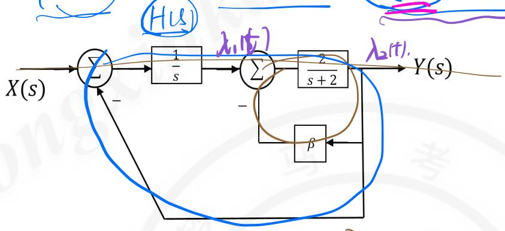

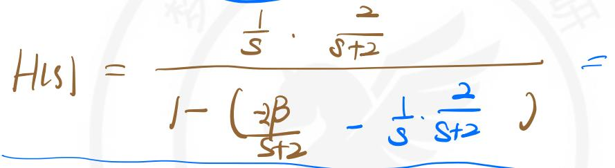

## 12、[25 武汉理工大学 855]

$$
y (t) = 0. 1 \sin (t) - 0. 3 \cos
$$

$$
\begin{array}{r l} {a \cos \omega t + \arctan \frac {- b}{a}} & \\ {= \sqrt {a ^ {2} + b ^ {2}} \cos (\omega t + \arctan \frac {- b}{a})} & \\ {= \sqrt {a ^ {2} + b ^ {2}} \sin (\omega t + \arctan \frac {a}{b})} & \end{array}
$$

$$
x (t) = \sin (t) \quad \text {   with   } x (t) \rightarrow | H (1) | \cos (t + \varphi (1))
$$

$$
H (w) = \frac {k (- w ^ {2} + 4)}{- w ^ {2} + 3 j w + 2}
$$

(2)求该系统的单位冲激响应 $h(t)$ 并写出微分方程

$$
\vert H (1) \vert = \frac {3 1 k _ {1}}{\sqrt {1 0}} = \frac {1}{\sqrt {1 0}}
$$

$$
\Rightarrow | H | = \pm \frac {1}{3}
$$

$$
\because a + 3 y \cdot a + 2 y \cdot a = \frac {1}{3} x ^ {\prime} (a + \frac {4}{3} x + t)
$$

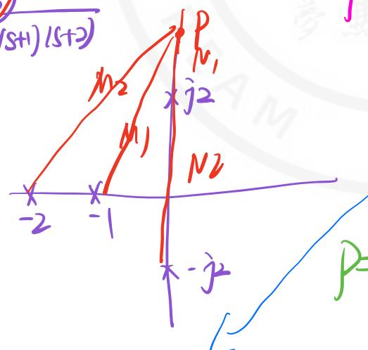

$$
\frac {N _ {1} \cdot N _ {2}}{N _ {1} \cdot N _ {2}}
$$

$$
N _ {1} = N _ {2} = 2.
$$

$$
M _ {1} = 1. M _ {2} = 2
$$

$$
\vert H (0) \vert = 2
$$

$$
\mathrm{向} x (t) = 2, y (t) = ?
$$

$$
P = 2 \quad N _ {1} = 0.
$$

$$
P = \infty \quad M _ {1} = M _ {2} = M _ {1}: M _ {2} = \infty
$$

$$
\begin{array}{l} {| H (2) | = 0} \\ {| H (1 0) | = 1} \end{array}
$$

13、[25 厦门大学 847]

已知某系统的的零极点图如下，且 $H(\infty)=1$

(1)、求该系统的系统函数 $H(s)$ 和冲激响应 $h(t)$ ;

(2)、当激励为 $x(t)=3\cos tu(t)$ 时，求系统此时的稳态响应；

(3) 根据 (1) 的系统函数 $H(s)$ 画出一种符合条件的电路示意图, 其中表明

相应的(LRC);

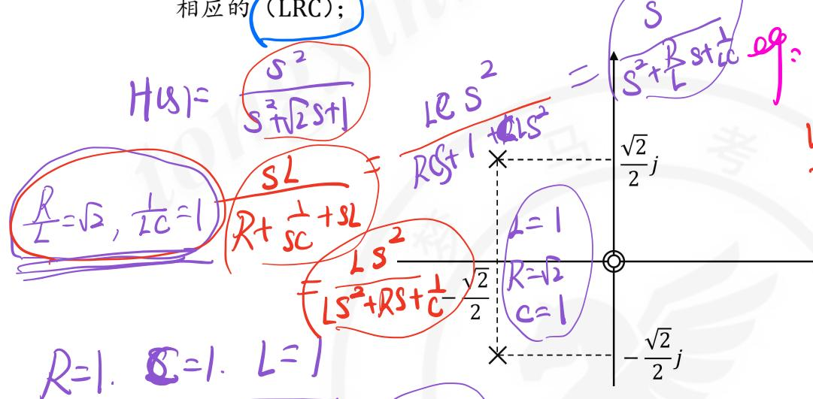

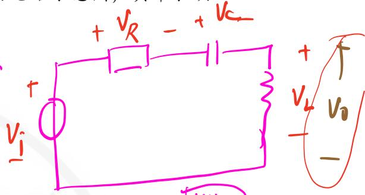

$$
\begin{array}{r l} {\mathrm{问}} & {V _ {R} = V _ {0} = ?} \\ & {V _ {C} = V _ {0} = ?} \\ & {V _ {L} = V _ {0} = ?} \end{array}
$$

$$
H (s) = \frac {1}{1 + \frac {1}{s} + s} = \frac {s}{s ^ {2} + s + 1}
$$

$$
V _ {0} = V _ {R}
$$

$$
H (s) = \frac {R}{R + \frac {1}{s c} + s L}
$$

$$
H (s) = \frac {\frac {1}{s}}{1 + \frac {1}{s} + s} = \frac {1}{s ^ {2} + s + 1}
$$

$$
V _ {0} = V _ {C}
$$

$$
H (s) = \frac {s}{1 + \frac {1}{s} + s} \frac {s ^ {2}}{s ^ {2} + s + 1}
$$

$$
H (s) = \frac {\frac {1}{s c}}{R + \frac {1}{s c} + s L}
$$

$$
V _ {0} = V _ {L}
$$

$$
H (s) = \frac {s L}{R + \frac {1}{s L} + s L}
$$

14、

[25 南京理工大学 818]

如图所示电路中输入信号为电压源 $x(t)$ ，输出信号为电感的两端电压为 $V_{L}(t)$ ，元件参数为 $R_{1}=R_{2}=1\Omega, C=1F, L=1H$

$$
i _ {c} = c \frac {d u _ {c}}{d t}
$$

(1) 选择状态变量 $\lambda_{1}(t) = v_{C}(t), \lambda_{2}(t) = i_{L}(t)$ , 写出电路状态方程与输出方程

$V_{L}(t)$

$$
\dot {u} _ {c} = \frac {1}{c} \dot {i} _ {c}
$$

$$
\lambda_ {1} = V _ {c}
$$

$$
\lambda_ {2} = I _ {L} = \frac {1}{L} U _ {L} \Rightarrow k V L
$$

(2) 求电路的系统函数 $H(s)$ $\frac{1}{c}$ $\rightarrow$ kcal

(3) 如果 $x(t) = 2u(t)$ , 电容和电感的起始电压和起始电流分别为 $V_{C}(0^{-}) = 4V$ 和 $I_{L}(0^{-}) = -2A$ , 求输出的零状态响应 $v_{zs}(t)$ 和零输入响应 $v_{zi}(t)$

张子程

$$
\dot {u} _ {i} = \frac {1}{c} \dot {I} _ {c} = \frac {1}{c} (\dot {I} - \dot {I} _ {c}) +
$$

$$
\dot {\lambda} _ {2} ^ {-} i _ {L} = \frac {1}{L} u _ {L}
$$

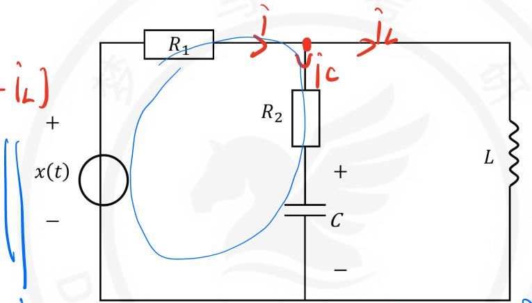

$$
R _ {1} i + R _ {2} i _ {c} + U _ {c} = x (t)
$$

$$
j + i c + u c = \lambda (t)
$$

$$
\hat {j} = \chi (t) - \hat {i} _ {c} - u _ {c}
$$

$$
\frac {1}{c} = 1
$$

$$
i - i _ {c} = x (t) + i _ {c} - u _ {c} - i _ {c}
$$