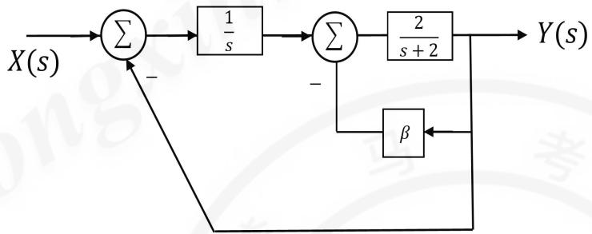
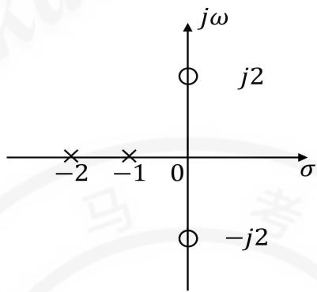
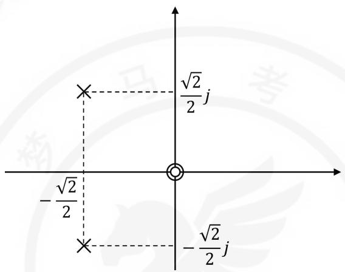
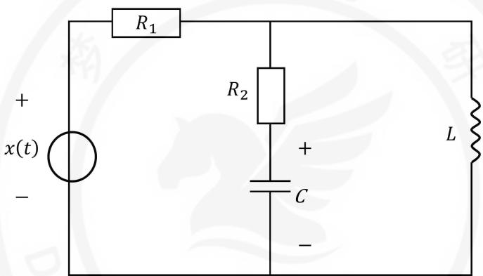

# LT 及连续系统 S 域分析章节测试

## 注：闭卷，计算量和灵活性强，在有限时间合理选择拿分

1、[25 南京理工大学 891]

已知 $f_{1}(t)*f_{2}(t) = y(t)$ ，当 $a > 0$ 时，求 $f_{1}(at)*f_{2}(at) =$

## 2、[25 中国海洋大学 819]

已知 $f(t)$ 单边拉氏变换为 $F(s)$ ，求 $g(t) = te^{-4t}f(2t)$ 的单边拉氏变换。

## 3、[25 沈阳工业大学 807]

已知象函数 $F(s) = \frac{(s + 2)}{(s + 4)^2(s + 5)}$ ，求其原函数的初值 $\lim_{t\to 0_+}f(t) =$ \_\_\_\_。求其原函数的终值 $\lim_{t\to \infty}f(t) =$ \_\_\_\_。

## 4、[25 天津大学 815]

已知某滤波器的系统函数 $H(s)=\frac{s}{s^{2}+4s+16}$ ，则该滤波器特性是\_\_\_\_（低通、高通、带通、带阻）

## 5、[25 天津大学 815]

已知一 LTI 系统函数 $H(s) = \frac{1}{(s + 1)(s + 2)}$ ，初始状态 $y(0_{-}) = 1$ ， $y'(0_{-}) = 2$ ，则系统的零输入响应 $y_{zi}(t) =$ \_\_\_\_。

## 6、[25 天津工业大学 812]

计算卷积 $e^{-2t}u(t)*2=$ \_\_\_\_。

## 7、[25 重庆邮电大学 801]

已知连续LTI系统的输入 $x(t)$ 与输出 $y(t)$ 的关系表达式为 $\frac{d^2y(t)}{dt^2} +\frac{dy(t)}{dt} -2y(t) =$ $\frac{dx(t)}{dt} +x(t)$

(1) 求系统函数 $H(s)$ 表达式;

(2) 若系统是因果的, 求该系统的单位冲激响应 $h(t)$ ;

(3) 若该系统是非因果又非稳定, 确定 $H(s)$ 的收敛域。

8、[25 南京理工大学 818]

已知因果线性时不变连续时间系统微分方程为

$$
y ^ {\prime \prime} (t) + 6 y ^ {\prime} (t) + 5 y (t) = x ^ {\prime \prime} (t) + 2 x ^ {\prime} (t) - 3 x (t)
$$

(1) 求单位冲激响应 $h(t)$ 及系统函数 $H(s)$

(2) 求出并画出系统的幅频特性；当输入 $x(t)=2$ ，求系统输出信号 $y(t)$

(3) 画出系统 $H(s)$ 的并联型流图

## 9、[25 宁波大学 829]

已知 1 和 2 两个因果系统如下:

1 系统微分方程为： $y''(t) + 4y'(t) + 3y(t) = x(t)$ ，单位冲激响应为： $h_{1}(t) = \frac{1}{2}(e^{-t} - e^{-3t})u(t)$

2 系统微分方程为： $y''(t) + 4y'(t) + 3y(t) = x'(t) + 2x(t)$

(1) 求 2 系统的单位冲激响应 $h_{2}(t)$ 。

(2) 若 $x(t) = e^{-4t}u(t)$ , $y(0^{+}) = \frac{1}{3}$ , $y'(0^{+}) = \frac{1}{3}$ , 求 2 系统的输出 $y(t)$ 。

(3)1 系统和 2 系统级联成 3 系统, 求 3 系统的单位冲激响应 $\hbar_{3}(t)$ 。

10、[25 宁波大学 829]

已知一因果 LTI 系统的微分方程为 $y''(t) + 4y'(t) + (1 - k)y(t) = 2kx(t)$

(1) k 满足什么条件系统稳定。

(2)临界稳定条件下，系统的单位阶跃响应 $g(t)$ 。

(3) 当 $k = 1$ , $x_{1}(t) = te^{-t}u(t), y(0^{-}) = 2$ , $y'(0^{-}) = 1$ , 求零状态响应 $y_{zs}(t)$ 和全响应 $y(t)$ 。

11、[25 重庆邮电大学 801]

下图是一个因果连续LTI系统的框图, $X(s)$ 和 $Y(s)$ 分别是系统的输入信号 $x(t)$ 和输出信号 $y(t)$ 的拉氏变换。

(1) 若系统稳定, 确定 $\beta$ 的取值范围。

(2 若 $\beta = 1$ ，求描述该系统的微分方程，并依此写出其状态方程和输出方程。

  
夢馬考研

12、[25 武汉理工大学 855]

已知一个因果 LTI 系统的零极点图如下图所示，且系统在输入 $x(t)=\sin(t)$

时的输出为 $y(t) = 0.1\sin (t) - 0.3\cos (t)$

(1)求系统函数 $H(s)$ 及收敛域

(2)求该系统的单位冲激响应 $h(t)$ 并写出微分方程

(3)粗略画出幅度响应曲线，并判断系统的滤波特性。

(4)当输入 $x(t) = \sum_{n = -\infty}^{\infty}\cos (2t + \frac{n\pi}{4})$ 时，求该系统的稳态响应

13、[25 厦门大学 847]

已知某系统的的零极点图如下，且 $H(\infty) = 1$

(1)、求该系统的系统函数 $H(s)$ 和冲激响应 $h(t)$ ;

(2)、当激励为 $x(t)=3\cos tu(t)$ 时，求系统此时的稳态响应；

(3)、根据（1）的系统函数 $H(s)$ 画出一种符合条件的电路示意图，其中表明相应的（LRC）；

  
夢馬考研

14、

[25 南京理工大学 818]

如图所示电路中输入信号为电压源 $x(t)$ ，输出信号为电感的两端电压为 $V_{L}(t)$ ，元件参数为 $R_{1}=R_{2}=1\Omega, C=1F, L=1H$

(1) 选择状态变量 $\lambda_{1}(t) = v_{C}(t), \lambda_{2}(t) = i_{L}(t)$ ，写出电路状态方程与输出方程 $V_{L}(t)$

(2) 求电路的系统函数 $H(s)$

(3) 如果 $x(t) = 2u(t)$ ，电容和电感的起始电压和起始电流分别为 $V_{C}(0^{-}) = 4V$ 和 $I_{L}(0^{-}) = -2A$ ，求输出的零状态响应 $v_{zs}(t)$ 和零输入响应 $v_{zi}(t)$

