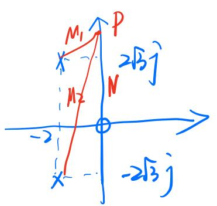
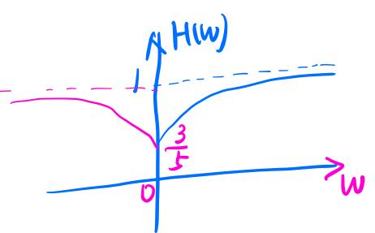
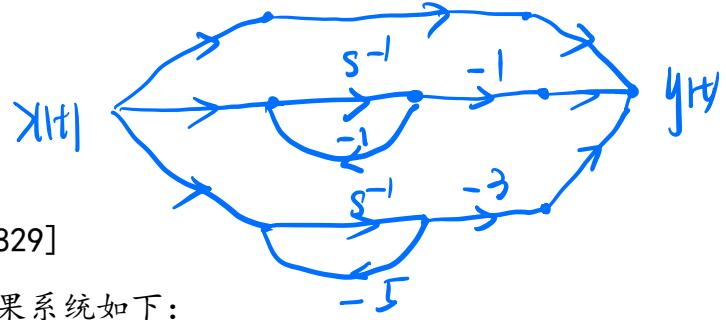
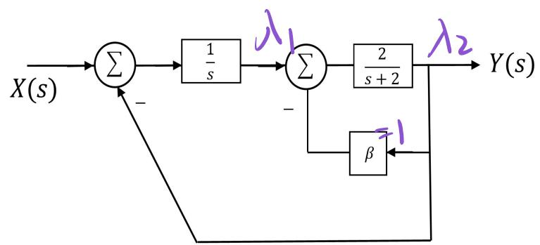
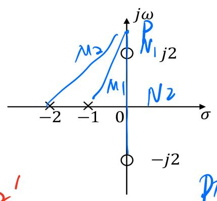
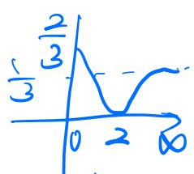
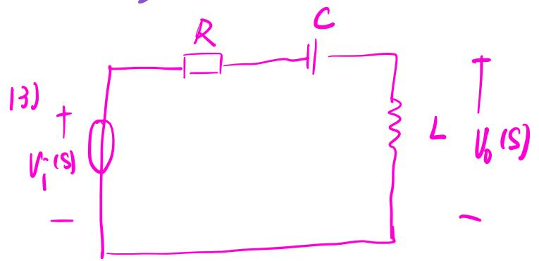
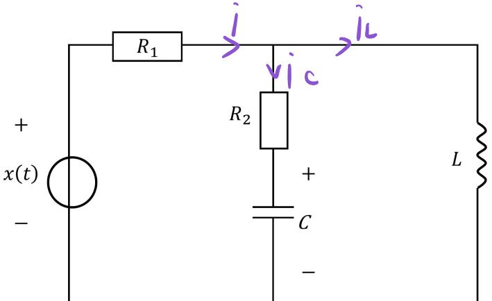
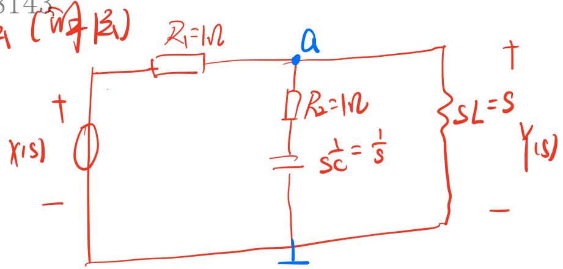
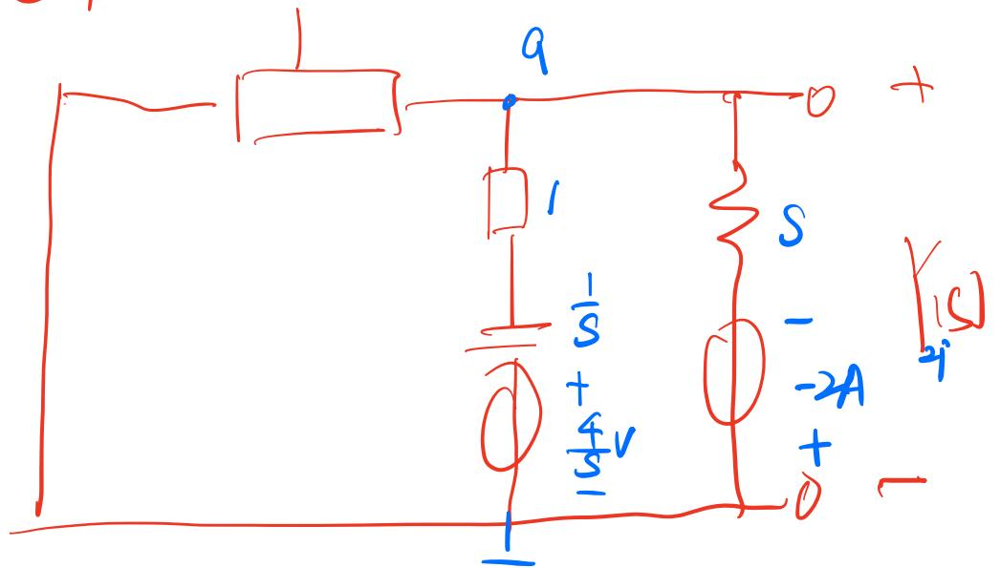

# LT及连续系统S域分析章节测试

1、[25 南京理工大学 891]

已知 $f_{1}(t) * f_{2}(t) = y(t)$ ，求 $f_{1}(at) * f_{2}(at) = \frac{1}{a}y(at)$

解: $Y_{|S|} = F_1|S| \cdot F_2|S|$

$$
\begin{array}{r l} {\mathrm{则}} & {f _ {1} (a t) * f _ {2} (a t) \stackrel {2 T} {\leftrightarrow} \frac {1}{a} F _ {1} (\frac {S}{a}) \cdot \frac {1}{a} F _ {2} (\frac {S}{a})} \\ & {\downarrow_ {i} = \frac {1}{a} [ \frac {1}{a} Y (\frac {S}{a}) ]} \end{array}
$$

## 2、[25 中国海洋大学 819]

已知 $f(t)$ 单边拉氏变换为 $F(s)$ ，求 $g(t) = te^{-4t}f(2t)$ 的单边拉氏变换。

$$
\mathrm{解:} f (t) \xrightarrow {\mathrm{尺度}} f (x) \xrightarrow {S _ {\mathrm{微Q}}} t f (x) \xrightarrow {S _ {\mathrm{移}}} e ^ {- 4 t} t f (x)
$$

3. [25 沈阳工业大学 807]

已知象函数 $F(s) = \frac{(s + 2)}{(s + 4)^2(s + 5)}$ ，求其原函数的初值 $\lim_{t\to 0_+}f(t) = \underline{0}$ 。

求其原函数的终值 $\lim_{t\to\infty}f(t)=D$ 。

解： $F\left( s\right)$ 为真分式

$$
\begin{array}{l} {F (s) \mathrm{为真分式}} \\ {\mathrm{则} f (0 + 1) = \lim _ {t \to \infty} f (t) = \lim _ {s \to \infty} s F (s) = \lim _ {s \to \infty} \frac {s (s + 2)}{(s + 4) ^ {2} (s + 5)} = 0} \end{array}
$$

$$
f (x) = \lim _ {t \to \infty} f (t) = \lim _ {s \to 0} s f (s) = \lim _ {s \to 0} \frac {s (s + 2)}{(s + 4) ^ {2} (s + 5)} = 0
$$

5

## 4. [25 天津大学 815]

已知某滤波器的系统函数 $H(s)=\frac{s}{s^{2}+4s+16}$ ，则该滤波器特性是带通（低通、

高通、带通、带阻）

解：极点 $(s+2)^{2}+12=0\Rightarrow s,2=-2\pm2\sqrt{3}$

$$
| H (W) | = \frac {N}{M _ {1} \cdot M _ {2}}
$$

$$
P _ {\mathrm{在} O \mathrm{点}} | H (O) | = D
$$

$$
P \text {   在   } 2 \sqrt {3} \text {   点   } \left| H (2 \sqrt {3}) \right| = \frac {2 \sqrt {3}}{2 \times 2 \sqrt {3}} = \frac {\sqrt {3 9}}{2 6}
$$

P在四点 $\vert H(\infty)\vert=0$

PDF免费QQ群615698143

5、[25 天津大学 815]

已知一LTI系统函数 $H(s) = \frac{1}{(s + 1)(s + 2)}$ ，初始状态 $y(0_{-}) = 1$ ， $y^{\prime}(0_{-}) = 2$ ，则系统

的零输入响应 $y_{zi}(t)=$ \_\_\_\_。

解: 由 $H(S)$ 可知 极点为 -1 和 -2.

故设 $f_{2}(t)=A e^{-t}+B e^{-2t}$

$$
y _ {2 i} ^ {\prime} (v + 1) = y _ {1} ^ {\prime} (v - 1) = - A - 2 B = 2
$$

## 6、[25 天津工业大学 812]

计算卷积 $e^{-2t}u(t)*2=\underline{1}$ 。

答: $E \xrightarrow{H(B)} H(O) \cdot E$ , $O$ 在 $R_{0}C$ 内

$H(S)=\frac{1}{s+2}\quad v>-2\quad \text{故}H(0)=\frac{1}{2}$

$$
\therefore y (t) = \frac {1}{2} \cdot 2 = 1
$$

7、[25 重庆邮电大学 801]

已知连续LTI系统的输入 $x(t)$ 与输出 $y(t)$ 的关系表达式为 $\frac{d^2y(t)}{dt^2} +\frac{dy(t)}{dt} -2y(t) =$ $\frac{dx(t)}{dt} +x(t)$

$\frac{d t}{d t} + x(t)$ (1) 求系统函数 $H(s)$ 表达式；

(2) 若系统是因果的, 求该系统的单位冲激响应 $h(t)$ ;

(3) 若该系统是非因果又非稳定, 确定 $H(s)$ 的收敛域。

(1) $H(s)=\frac{y(s)}{x(s)}=\frac{s+1}{s^{2}+s-2}=\frac{s+1}{(s+2)(s-1)}$

(2) 氟化因果则 ROC 为 $\sigma > 1$

$$
k _ {1} = (s + 2) H (s) / s = - 2 = \frac {s + 1}{s - 1} / s = - 2 = \frac {- 2 + 1}{- 2 - 1} = \frac {- 1}{- 3} = \frac {1}{3}
$$

$$
k _ {2} = (s - 1) H (s) | _ {s = 1} = \frac {s + 1}{s + 2} | _ {s = 1} = \frac {(t + 1)}{1 + 2} = \frac {2}{3}
$$

$$
\therefore h (t) = (\frac {1}{3} e ^ {- 2 t} + \frac {2}{3} e ^ {t}) u (t)
$$

(3) 非对称非线性则对C不为右边域且不够应轴. 故 $\sigma < -2$

PDF免费QQ群615698143

去拆

8、[25 北京理工大学 826]

因果线性时不变系统的系统函数 $H(s) = \frac{s - 2}{s + 2}$ ，输出 $y(t) = e^{-3t}u(t)$ ，求输入

$x(t)$ 的几种可能形式。

解：因果系统则 $H(s)=\frac{s-2}{s+2}$ 的 ROC 为 $\sigma>-2$

$$
y _ {| t |} = e ^ {- 3 t} u (t) \quad \mathrm{则} \quad y (s) = \frac {1}{s + 3}, \quad \sigma > - 3
$$

$$
\frac {y _ {(s)}}{H (s)} = \frac {1}{s + 3} \cdot \frac {s + 2}{s - 2} = \frac {s + 2}{(s + 3) (s - 2)}
$$

(2)双消函数 ① $\sigma > 2$ ∴ $x(t) = (\frac{1}{5} e^{-3t} + \frac{4}{5} e^{2t})u(t)$

$$
= \frac {\frac {1}{3}}{s + 3} + \frac {\frac {4}{5}}{s - 2}
$$

$$
② - 3 <   \nu <   2 \Rightarrow x (t) = \frac {1}{5} e ^ {- 3 t} u (t) - \frac {4}{5} e ^ {2 t} u (t)
$$

15

9. [25 南京理工大学 818]

已知因果线性时不变连续时间系统微分方程为

$$
y ^ {\prime \prime} (t) + 6 y ^ {\prime} (t) + 5 y (t) = x ^ {\prime \prime} (t) + 2 x ^ {\prime} (t) - 3 x (t)
$$

(1) 求单位冲激响应 $h(t)$ 及系统函数 $H(s)$

(2) 求出并画出系统的频响特性; 当输入 $x(t)=2$ , 求系统输出信号 $y(t)$

(3) 画出系统 $H\left( s\right)$ 的并联型流图证明：(1) $H\left( s\right)  = \frac{{y}_{\left( s\right) }}{x\left( s\right) } = \frac{{s}^{2} + {2s} - 3}{{s}^{2} + {6s} + 5} = 1 + \frac{-{4s} - 8}{{s}^{2} + {6s} + 5} = 1 + \frac{-{4s} - 8}{\left( {s + 1}\right) \left( {s + 5}\right) } = 1 + \frac{-1}{s + 1} + \frac{-3}{s + 5}$

$$
h (t) = d (t) - (e ^ {- t} + 3 e ^ {- t}) u (t)
$$

(2) 因案系统: 故 ROC 为 $\sigma > -1$

因果求比：故知C N 2 3 当 $x$ (t) = 2 时 $y$ (t) = H(0)·2 $\xlongequal{H(\text{H})\text{存在}}$ 2· $\frac{-3}{5}$ = - $\frac{6}{5}$

$$
H (w) = H (s) / s = j w = \frac {- w ^ {2} + 2 j w - 3}{- w ^ {2} + 6 j w + 5}
$$

$$
| H (w) | = \frac {\sqrt {(- w ^ {2} - 3) ^ {2} + 4 w ^ {2}}}{\sqrt {(- w ^ {2} + 5) ^ {2} + 3 6 w ^ {2}}} = \frac {\sqrt {w ^ {4} + 1 0 w ^ {2} + 9}}{\sqrt {w ^ {4} + 2 6 w ^ {2} + 2 5}}
$$

$$
\begin{array}{l l} {W = 0 \mathrm{m} ^ {2}} & {| H (0) | = \frac {3}{5} \sqrt {\frac {2 0}{\sqrt {5 2}}} = \frac {\sqrt {5}}{\sqrt {1 3}} > \frac {3}{5}} \\ {W = 1 \mathrm{m} ^ {2}} & {| H (0) | = \frac {\sqrt {5}}{\sqrt {5 2}}} \\ {W = 0 \mathrm{m} ^ {2}} & {| H (0) | = 1} \end{array}
$$

$$
H (s) = 1 + \frac {- 1}{s + 1} + \frac {- 3}{s + 5} = 1 + \frac {- s ^ {- 1}}{1 - (- s ^ {- 1})} + \frac {- 3 s ^ {- 1}}{1 - (- s ^ {- 1})}
$$

PDF免费QQ群615698143

$\left| {x\left| t\right| }\right|$

10、[25 宁波大学 829]
已知 1 和 2 两个因果系统如下:

1 系统微分方程为： $y''(t) + 4y'(t) + 3y(t) = x(t)$ ，单位冲激响应为： $h_{1}(t) = \frac{1}{2}(e^{-t} - e^{-3t})u(t)$

2 系统微分方程为： $y''(t) + 4y'(t) + 3y(t) = x'(t) + 2x(t)$

(1)求2系统的单位冲激响应 $h_{2}(t)$ 。 $2^{1}$

(2) 若 $x(t) = e^{-4t}u(t)$ , $y(0^{+}) = \frac{1}{3}$ , $y'(0^{+}) = \frac{1}{3}$ , 求 2 系统的输出 $y(t)$ 。

(3)1 系统和 2 系统级联成 3 系统, 求 3 系统的单位冲激响应 $h_{3}(t)$ 。 $3^{\prime}$ 证：(1) $H_{2}(S)=\frac{S+2}{S^{2}+4S+3}=\frac{S+2}{(S+1)(S+3)}=\frac{\frac{1}{2}}{S+1}+\frac{\frac{1}{2}}{S+3}$ ∴ $h_{2}|t|=\frac{1}{2}(e^{-t}+e^{-3t})u(t)$ (2) $Y_{2}(S)=X(S)H_{2}(S)=\frac{S+2}{(S+1)(S+3)(S+4)}$ 可知 $\frac{k}{S+4}$ 项中 $k=\frac{-2}{-3\times(-1)}=-\frac{2}{3}$ 即将的为 $-\frac{2}{3}e^{-4t}$ ，可设 $y(t)=Ae^{-t}+Be^{-3t}-\frac{2}{3}e^{-4t}$ $y(0+1)=A+B-\frac{2}{3}=\frac{1}{3}$ $\Rightarrow A=\frac{1}{3}$ ， $B=\frac{2}{3}$ $y'(0+1)=-A-3B+\frac{8}{3}=\frac{1}{3}$ ∴ $y(t)=\left(\frac{1}{3}e^{-t}+\frac{2}{3}e^{-3t}-\frac{2}{3}e^{-4t}\right)u(t)$ (3) $H_{3}(S)=H_{1}(S)\cdot H_{2}(S)=\frac{1}{(S+1)(S+3)}\cdot\frac{S+2}{(S+1)(S+3)}=\frac{S+2}{(S+1)^{2}(S+3)^{2}}$ $=\frac{1}{4}\left[\frac{1}{(S+1)^{2}}-\frac{1}{(S+3)^{2}}\right]$ ∴ $h_{3}|t|=\frac{1}{4}t(e^{-t}-e^{-3t})u(t)$

15

11. [25 宁波大学 829]

已知一因果 LTI 系统的微分方程为 $y''(t) + 4y'(t) + (1 - k)y(t) = 2kx(t)$

(1) $k$ 满足什么条件系统稳定。

(2)临界稳定条件下，系统的单位阶跃响应 $g(t)$ 。

(3) 当 $k = 1$ , $x_{1}(t) = te^{-t}u(t), y(0^{-}) = 2$ , $y'(0^{-}) = 1$ , 求零状态响应 $y_{zs}(t)$ 和全响

设 $\eta$ : (1) $H(S)=\frac{2k}{S^{2}+4S+(1-k)}$

罗斯可得：1-k>0 则 k<1 时状况

(2) k=1 时系统临界稳定 H(S)= $\frac{2}{S(S+4)}$

$$
G (s) = \frac {H (s)}{s} = \frac {2}{s ^ {2} (s + 4)} = \frac {\frac {1}{2}}{s ^ {2}} + \frac {- \frac {1}{8}}{s} + \frac {\frac {1}{8}}{s + 4} \Rightarrow q (t) = (\frac {1}{2} t - \frac {1}{8} + \frac {1}{8} e ^ {- 4 t}) u (t)
$$

(3) $y_{2i}|t| = A + Be^{-4t}$ 则 $y_{2i}|t| = y_{1i}|t| = A + B = 2$ $y_{2i}|t| = y_{1i}|t| = -4B = 1$ $\therefore y_{2i}|t| = (\frac{9}{4} - \frac{1}{4}e^{-4t})u(t)$ $y_{2i}|s| = x_1(s) \cdot H(s) = \frac{1}{(s+1)^2} \cdot \frac{2}{s(s+4)} = \frac{k_1}{s} + \frac{k_2}{s+4} + \frac{k_3}{(s+1)^2} + \frac{k_4}{s+1}$ $k_1 = \frac{2}{1 \times 4} = \frac{1}{2}, \quad k_2 = \frac{2}{9 \times (-4)} = -\frac{1}{8}$ $k_3 = \frac{2}{-1 \times 3} = -\frac{2}{3}, \quad k_4 = \left. \frac{0 - 2(x_3 + 4)}{(s(s+4))^2} \right|_{s=-1} = \frac{-2 \times 2}{(-1 \times 3)^2} = \frac{-4}{9}$ $\therefore \text{定线式向应为 } |x_s|t| = (\frac{1}{2} - \frac{1}{18}e^{-4t} - \frac{2}{3}t e^{-t} - \frac{4}{9}e^{-t})u(t)$ 定轴向应 $y_{1i}|t| = (\frac{11}{4} - \frac{11}{36}e^{-4t} - \frac{2}{3}t e^{-t} - \frac{4}{9}e^{-t})u(t)$

15

[25 重庆邮电大学 801]

下图是一个因果连续LTI系统的框图, $X(s)$ 和 $Y(s)$ 分别是系统的输入信号 $x(t)$ 和输出信号 $y(t)$ 的拉氏变换。

(1) 若系统稳定, 确定 $\beta$ 的取值范围。

(2 若 $\beta = 1$ , 求描述该系统的微分方程, 并依此写出其状态方程和输出方程。

解：(1) 由 Messon 可得：

$$
H (s) = \frac {\frac {1}{s} \cdot \frac {2}{s + 2}}{1 - [ \frac {- 2 \beta}{s + 2} + \frac {2}{s (s + 2)} ]} = \frac {2}{s ^ {2} + (2 + 2 \beta) s + 2}
$$

罗斯可得. $2 + 2\beta > 0 \Rightarrow \beta > -1$ 时成立

则当 $\beta  = {137H}\left( S\right)  = \frac{2}{{s}^{2} + {4S} + 2}$

$\Rightarrow$ 微后方程为 $y^{\prime}|t| + 4y^{\prime}|t| + 2y|t| = 2x|t|$

状态变量如同所示

$$
\begin{array}{r l} {\lambda_ {1} (s) = [ x (s) - \lambda_ {2} (s) ] \cdot \frac {1}{s}} & {\Rightarrow s \lambda_ {1} (s) = \lambda (s) - \lambda_ {2} (s)} \\ & {\Rightarrow \dot {\lambda} _ {1} (t) = x (t) - \lambda_ {2} (t)} \end{array}
$$

$$
\lambda_ {2} (s) = [ \lambda_ {1} (r) - \lambda_ {2} (s) ] \cdot \frac {2}{s + 2} \Rightarrow (s + 2) \lambda_ {2} (s) = 2 \lambda_ {1} (s) - 2 \lambda_ {2} (s)
$$

$$
\left[ \begin{array}{l} \dot {\lambda_ {1}} \\ \dot {\lambda_ {2}} \end{array} \right] = \left[ \begin{array}{l l} 0 & - 1 \\ 2 & - 4 \end{array} \right] \left[ \begin{array}{l} \lambda_ {1} \\ \lambda_ {2} \end{array} \right] + \left[ \begin{array}{l} 1 \\ 0 \end{array} \right] \left[ \begin{array}{l} x \pi i \\ x \pi i \end{array} \right], y \pi i = \left[ \begin{array}{l l} 0 & 1 \end{array} \right] \left[ \begin{array}{l} \lambda_ {1} \\ \lambda_ {2} \end{array} \right] _ {\mathrm{PDF免费QQ群615698143}}
$$

20 13、[25 武汉理工大学 855]

已知一个因果 LTI 系统的零极点图如下图所示，且系统在输入 $x(t)=\sin(t)$

时的输出为 $y(t) = 0.1\sin (t) - 0.3\cos (t)$

(4) $W_{0}=2m^{2}|H(2)|=0$

(3) $\lfloor H(w)\rfloor = \frac{\frac{1}{3}N_1 \cdot N_2}{M_1 \cdot M_2}$

∴ 稍志为0

$$
P _ {\mathrm{在0点时}} N _ {1} = 2. N _ {2} = 2
$$

$$
M _ {1} = 1. M _ {2} = 2
$$

$$
\vert H (0) \vert = \frac {\frac {1}{3} \times 4}{2} = \frac {2}{3}
$$

${3}^{\prime }{2}^{\prime }$

(1)求系统函数 $H(s)$ 及收敛域

$P_{在2点}: |H(2)| = 0$

$$
3 ^ {1}
$$

(2)求该系统的单位冲激响应 $h(t)$ 并写出微分方程

$$
\vert H (0) \vert = \frac {1}{3}
$$

(3)粗略画出幅度响应曲线，并判断系统的滤波特性。

菲函

(4)当输入 $x(t)=\sum_{n=-\infty}^{\infty}\cos(2t+\frac{n\pi}{4})$ 时，求该系统的稳态响应解：(1) 由零极点图可知. $H(S)=\frac{K(S^{2}+4)}{(S+2)(S+1)}$

$$
\begin{array}{r l} {x (t) = \sin t - 1, y (t) = 0. 1 \sin t - 0. 3 \cos t} & {= \sqrt {0 . 1 ^ {2} + (0 . 3) ^ {2}} \sin (t + \arctan \frac {- 0 . 3}{0 . 1})} \\ & {= \sqrt {0 . 1} \sin (t - \arctan 3)} \\ {\Rightarrow | H (1) | = \sqrt {0 . 1}, \varphi (1)} & {= - \arctan 3} \end{array}
$$

$$
H (W) = H (S) \bigg | _ {S = j w} = \frac {k (- w ^ {2} + 4)}{- w ^ {2} + 3 j w + 2} \Rightarrow H (1) = \frac {3 k}{1 + 3 j}
$$

$$
| H (1) | = \frac {3 | k |}{\sqrt {1 0}} \quad , \quad P (1) = \left\{ \begin{array}{l l} - \arctan 3, & k > 0 \\ \pi - \arctan 3, & k <   0 \end{array} \right.
$$

$$
H (8) = \frac {\frac {1}{3} (S ^ {2} + 4)}{(S + 1) (S + 2)}
$$

$$
\Rightarrow k > 0 \quad \text { or } \quad | H (1) | = \frac {3 k}{\sqrt {1 0}} = \frac {1}{\sqrt {1 0}} \Rightarrow k = \frac {1}{3} \Rightarrow
$$

$$
\mathrm{对象} \Rightarrow 2 0 c \mathrm{为} \quad \sigma > - 1
$$

$$
(2) H (s) = \frac {1}{3} + \frac {- s + \frac {2}{3}}{(s + 1) (s + 2)} = \frac {1}{3} + \frac {\frac {5}{3}}{s + 1} + \frac {- \frac {8}{3}}{s + 2} \Rightarrow h (t) = \frac {1}{3} \delta (t) + \sqrt {\frac {5}{3}} e ^ {- t} - \frac {8}{3} e ^ {- x t} (x t)
$$

$$
y ^ {\prime \prime} (t) + 3 y (t) + 2 y (t) = \frac {1}{3} x ^ {\prime \prime} (t) + \frac {4}{3} x (t)
$$

PDF免费QQ群615698143

15

[25 厦门大学 847]

已知某系统的的零极点图如下，且 $H(\infty)=1$

(1)、求该系统的系统函数 $H(s)$ 和冲激响应 $h(t)$ ;

$$
h (t) ^ {3 ^ {\prime}};
$$

(2)、当激励为 $x(t)=3\cos tu(t)$ 时，求系统此时的稳态响应；

(3)、根据（1）的系统函数 $H(s)$ 画出一种符合条件的电路示意图，其中表明

相应的（LRC）； $5'$

解：(1)

$$
H (S) = \frac {k S ^ {2}}{(S + \frac {\sqrt {2}}{2}) ^ {2} + \frac {1}{2}}
$$

$$
\begin{array}{r l} {| H (1)} & {= \frac {1}{\sqrt {2}} = \frac {\sqrt {2}}{2}} \\ {\varphi (1)} & {= \pi - \arctan \frac {\sqrt {2}}{0}} \\ & {= \pi - \frac {\pi}{2} = \frac {\pi}{2}} \end{array}
$$

$$
H (x) = k = 1
$$

叔

$$
\begin{array}{r l} {y _ {\mathrm{ss}} (t)} & {= \frac {3 \sqrt {2}}{2} \cos (t + \frac {\pi}{2}) u | t |} \\ & {= - \frac {3 \sqrt {2}}{2} \sin t u | t |} \end{array}
$$

$$
\begin{array}{r l} {H (s)} & {= \frac {s ^ {2}}{(s + \frac {\sqrt {2}}{2}) ^ {2} + \frac {1}{2}}} \\ & {= \frac {s ^ {2}}{s ^ {2} + \sqrt {2} s + 1}} \end{array}
$$

$$
\begin{array}{r l} {H (s) = 1 + \frac {- \sqrt {2} s - 1}{s ^ {2} + \sqrt {2} s + 1}} \\ {= 1 + \frac {- \sqrt {2} (s + \frac {\sqrt {2}}{2})}{(s + \frac {\sqrt {2}}{2}) ^ {2} + \frac {1}{2}}} \end{array}
$$

$$
\therefore h (t) = \sqrt {1} (t) - \sqrt {2} e ^ {- \frac {\sqrt {2}}{2} t} \cos \frac {\sqrt {2}}{2} t u (t)
$$

$$
H (s) = \frac {V _ {0} (s)}{V _ {1} (s)} = \frac {s L}{R + \frac {1}{S C} + s L} = \frac {L s ^ {2}}{L s ^ {2} + R s + \frac {1}{G}} = \frac {s ^ {2}}{s ^ {2} + \sqrt {2} s + 1}
$$

$$
\Rightarrow L = 1 H, \quad R = \sqrt {2} \Omega , C = 1 F
$$

20

[25 南京理工大学 818]

如图所示电路中输入信号为电压源 $x(t)$ ，输出信号为电感的两端电压为 $V_{L}(t)$ ，元件参数为 $R_{1} = R_{2} = 1\Omega, C = 1F, L = 1H$

也可以节点
电压表
(备考在后面)

(1) 选择状态变量 $\lambda_{1}(t) = v_{C}(t), \lambda_{2}(t) = i_{L}(t)$ ，写出电路状态方程与输出方程 $V_{L}(t)$

(2)求电路的系统函数 $H(s)$

(3) 如果 $x(t) = 2u(t)$ , 电容和电感的起始电压和起始电流分别为 $V_{C}(0^{-}) = 4V$ 和 $I_{L}(0^{-}) = -2A$ , 求输出的零状态响应 $v_{zs}(t)$ 和零输入响应 $v_{zi}(t)$ .

(1) i.e. 到由零所在焦点, k⊂l 有可知: ic = i - i₂ } 联立

$$
R _ {1} \cdot i + R _ {2} i _ {c} + u _ {c} = x (t) \Rightarrow i + i _ {c} + u _ {c} = x (t)
$$

$$
i _ {C} = x (t) - i _ {C} - u _ {C} - i _ {L} \Rightarrow i _ {C} = \frac {1}{2} [ x (t) - u _ {C} - i _ {L} ]
$$

$$
\dot {u} _ {c} = \dot {\lambda} _ {1} = \frac {1}{c} i _ {c} = i _ {c} = \frac {1}{2} [ x (t) - \lambda_ {1} - \lambda_ {2} ]
$$

到四题所在四路kV L3程可知： ${u}_{L} - {u}_{C} - {R}_{2} \cdot  {i}_{C} = 0$

$$
\Rightarrow i _ {L} = \dot {\lambda} _ {2} = \frac {1}{L} u _ {L} = u _ {L} = u _ {C} + i _ {C} = \frac {1}{2} [ x (t) + \lambda_ {1} - \lambda_ {2} ]
$$

状态过程为 $\begin{bmatrix}\dot{\lambda}_{1}\\ \dot{\lambda}_{2}\end{bmatrix}=\begin{bmatrix}-\frac{1}{2}&-\frac{1}{2}\\ \frac{1}{2}&-\frac{1}{2}\end{bmatrix}\begin{bmatrix}\lambda_{1}\\ \lambda_{2}\end{bmatrix}+\begin{bmatrix}\frac{1}{2}\\ \frac{1}{2}\end{bmatrix}x(t)$

输方程 ${u}_{L} = {\lambda }_{2} \Rightarrow  {u}_{L} = \left\lbrack  {\frac{1}{2} - \frac{1}{2}}\right\rbrack  \left\lbrack  {\frac{{\lambda }_{1}}{{\lambda }_{2}}}\right\rbrack   + \left\lbrack  {\frac{1}{2}}\right\rbrack  x\left( t\right)$

(2)由(1)可: $A = \begin{bmatrix} -\frac{1}{2} & -\frac{1}{2} \\ \frac{1}{2} & -\frac{1}{2} \end{bmatrix}$ . $B = \begin{bmatrix} -\frac{1}{2} \\ \frac{1}{2} \end{bmatrix}$ , $C = \begin{bmatrix} -\frac{1}{2} & -\frac{1}{2} \\ 0 & 0 \end{bmatrix}$ , $D = \frac{1}{2}$ PDF免费QQ群615698143

$$
\begin{array}{r l r} & {\mathrm{DF免费QQ群615698143}} \\ & {H (S) = C \phi (S) B + D} & {\mathrm{其中} \phi (S) = (S I - A) ^ {- 1}} \\ & {= \frac {1}{s ^ {2} + s + \frac {1}{2}} \left[ \begin{array}{l l} \frac {1}{2} & - \frac {1}{2} \end{array} \right] \left[ \begin{array}{l l} s + \frac {1}{2} & - \frac {1}{2} \\ \frac {1}{2} & s + \frac {1}{2} \end{array} \right] \left[ \begin{array}{l} - \frac {1}{2} \\ \frac {1}{2} \end{array} \right] + \frac {1}{2}} & {= \left[ \begin{array}{l l} \left[ \begin{array}{l l} S & 0 \\ 0 & S \end{array} \right] - \left[ \begin{array}{l l} - \frac {1}{2} & - \frac {1}{2} \\ \frac {1}{2} & - \frac {1}{2} \end{array} \right] \end{array} \right] ^ {- 1}} \\ & {= \frac {\frac {1}{4}}{s ^ {2} + s + \frac {1}{2}} \left[ \begin{array}{l l} 1 & - 1 \end{array} \right] \left[ \begin{array}{l l} s + \frac {1}{2} & - \frac {1}{2} \\ \frac {1}{2} & s + \frac {1}{2} \end{array} \right] \left[ \begin{array}{l} 1 \\ 1 \end{array} \right] + \frac {1}{2}} & {= \left[ \begin{array}{l l} s + \frac {1}{2} & \frac {1}{2} \\ - \frac {1}{2} & s + \frac {1}{2} \end{array} \right] ^ {- 1}} \\ & {= \frac {\frac {1}{4}}{s ^ {2} + s + \frac {1}{2}} \left[ \begin{array}{l l} S & - s - 1 \end{array} \right] \left[ \begin{array}{l} 1 \\ 1 \end{array} \right] + \frac {1}{2}} & {= \frac {1}{(s + \frac {1}{2}) ^ {2} + \frac {1}{4}} \left[ \begin{array}{l l} s + \frac {1}{2} & - \frac {1}{2} \\ \frac {1}{2} & s + \frac {1}{2} \end{array} \right]} \\ & {= \frac {- \frac {1}{4}}{s ^ {2} + s + \frac {1}{2}} + \frac {1}{2} = \frac {\frac {1}{2} (s ^ {2} + s)}{s ^ {2} + s + \frac {1}{2}}} & {(I _ {\mathrm{eff}}) = I _ {\mathrm{eff}}.} \end{array}
$$

(3)

$$
\begin{array}{r l} {V _ {2 S} (S) = H (S) \cdot X (S)} & {= \frac {\frac {1}{2} S (S + 1)}{(S + \frac {1}{2}) ^ {2} + \frac {1}{4}} \cdot \frac {2}{S} = \frac {S + 1}{(S + \frac {1}{2}) ^ {2} + (\frac {1}{2}) ^ {2}} = \frac {(S + \frac {1}{2}) + \frac {1}{2}}{(S + \frac {1}{2}) ^ {2} + (\frac {1}{2}) ^ {2}}} \\ & {= \frac {S + \frac {1}{2}}{(S + \frac {1}{2}) ^ {2} + (\frac {1}{2}) ^ {2}} + \frac {\frac {1}{2}}{(S + \frac {1}{2}) ^ {2} + (\frac {1}{2}) ^ {2}}} \\ {\therefore V _ {x} (t)} & {= e ^ {- \frac {t}{2}} (\cos \frac {t}{2} + \sin \frac {t}{2}) u (t)} \end{array}
$$

$$
\begin{array}{r l} {V _ {2 i} (s) = C \phi (s) \lambda (0, -)} & {= [ \frac {1}{2} - \frac {1}{2} ] \phi (s) [ \begin{array}{l} 4 \\ - 2 \end{array} ]} \\ & {= \frac {\frac {1}{2}}{(s + \frac {1}{2}) ^ {2} + (\frac {1}{2}) ^ {2}} [ 1 - 1 ] [ \begin{array}{l l} s + \frac {1}{2} & - \frac {1}{2} \\ \frac {1}{2} & s + \frac {1}{2} \end{array} ] [ \begin{array}{l} 4 \\ - 2 \end{array} ]} \\ & {= \frac {\frac {1}{2}}{(s + \frac {1}{2}) ^ {2} + (\frac {1}{2}) ^ {2}} [ s - s - 1 ] [ \begin{array}{l} 4 \\ - 2 \end{array} ]} \\ & {= \frac {3 s + 1}{(s + \frac {1}{2}) ^ {2} + (\frac {1}{2}) ^ {2}} = \frac {3 (s + \frac {1}{2})}{(s + \frac {1}{2}) ^ {2} + (\frac {1}{2}) ^ {2}} + \frac {(- 1) \times \frac {1}{2}}{(s + \frac {1}{2}) ^ {2} + (\frac {1}{2}) ^ {2}}} \end{array}
$$

$\therefore {V}_{2i}\left( t\right)  = {e}^{-\frac{t}{2}}\left( {3\cos \frac{t}{2} - \sin \frac{t}{2}}\right) w\left( t\right)$ PDF免费QQ群615698143

DF免费QQ群615698143

(2) 节质电层法 (微层)

$$
\begin{array}{r l} & {\left(\frac {1}{1} + \frac {1}{1 + \frac {1}{s}} + \frac {1}{s}\right) Y (s) = \frac {X (s)}{1}} \\ & {\Rightarrow (1 + \frac {s}{s + 1} + \frac {1}{s}) Y (s) = X (s)} \\ & {\Rightarrow H (s) = \frac {Y (s)}{X (s)} = \frac {S (s + 1)}{2 s ^ {2} + 2 s + 1} = \frac {\frac {1}{2} S (s + 1)}{s ^ {2} + s + \frac {1}{2}}} \end{array}
$$

完输入也可以用电池法、做

$$
\begin{array}{r l} {(\frac {1}{1} + \frac {1}{1 + \frac {1}{s}} + \frac {1}{s}) | _ {2 i} ^ {(s)} = \frac {\frac {4}{s}}{1 + \frac {1}{s}}} & {- \frac {- 2}{s}} \\ {| _ {2 i} ^ {(s)} = \frac {6 s + 2}{s (s + 1)} \cdot \frac {\frac {1}{2} s (s + 1)}{s ^ {2} + s + \frac {1}{2}}} \end{array}
$$