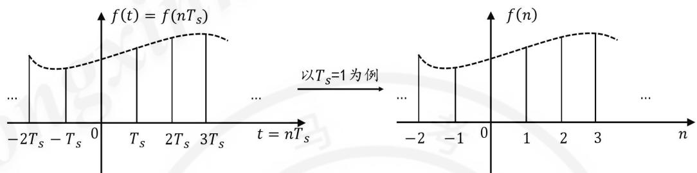
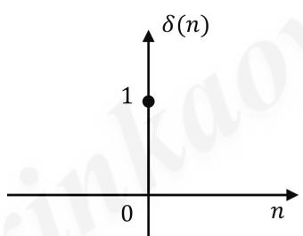
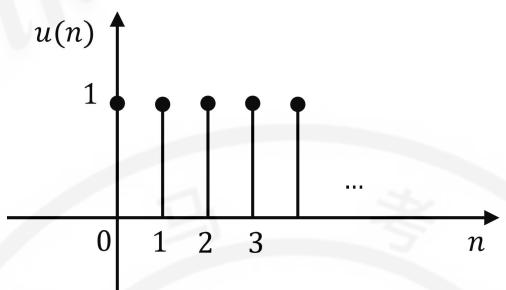
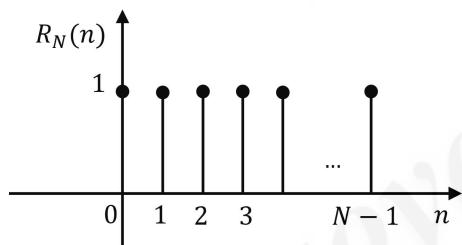

第 6 章 序列与离散系统的时域分析

<table><tr><td>#</td><td>专题内容</td><td>考点</td><td>考查内容</td></tr><tr><td>1</td><td>常见序列与系统判断</td><td>1、序列的表示、分类与判断2、常见序列及其性质3、离散系统的分类与判断</td><td>1、冲激与阶跃序列的应用★2、周期序列的判断★★3、LTIS和因果稳定系统判断★★</td></tr><tr><td>2</td><td>离散系统的时域分析</td><td>1、完全响应的分解与迭代法2、经典法求解系统响应3、双零法求解系统响应4、前向差分方程的求解5、冲激响应的时域求解</td><td>1、时域角度看待解形式关系★★2、边界条件的应用★★★</td></tr><tr><td>3</td><td>序列的卷积</td><td>1、卷积定义、性质及应用2、卷积求解</td><td>1、卷积定义、应用与性质★★2、卷积的性质求解法★★★3、有限长序列卷积结论★★★</td></tr></table>

## 专题1 常见序列与系统判断

## 考点 1：序列的表示、分类与判断

1、连续信号的离散化

(1)等间隔采样： $T_{s}$

$nT_{s}$ 表示时间，而n仅表示序号。

(2)序列位置取值: $n$ 只能取整数

(3)数字角频率与模拟角频率的关系

$f(t) = \cos \Omega t$ 其中 $\Omega$ 是模拟角频率； $f(n) = \cos \omega n$ 其中 $\omega$ 是数字角频率

$$
f (n T _ {s}) = f (n) = \cos \Omega \cdot n T _ {s} = \cos \Omega T _ {s} \cdot n = \cos \omega n \Rightarrow \omega = \Omega T _ {s}
$$

2、序列表示：表达式法；图形法；集合法(强调位置与幅值)

$$
\begin{array}{c} f (n) = \{- 1, 2, - 8, - 2, 5 \} \\ \uparrow \\ n = 0 \end{array}
$$

或

$$
f (n) = \{- 1, \underline {{2}}, - 8, - 2, 5 \}
$$

或

$$
f (n) = \{- 1, 2, - 8, - 2, 5 \} n \geq - 1
$$

3、序列基本运算——移位、反转、尺度

$f(n)\xrightarrow{n_0 > 0} f(n\pm n_0)$ ：“+”左“-”右 $n_0$ 取整数

$f(n)\to f(-n)$ ：纵轴对称

$$
f (n) \stackrel {a > 0} {\longrightarrow} f (a n) \left\{ \begin{array}{l l} {{0 <   a <   1}} & {{f (n) \stackrel {\text {扩展}} {\longrightarrow} f (\frac {n}{2}) \text {补零}}} \\ {{a > 1}} & {{f (n) \stackrel {\text {压缩}} {\longrightarrow} f (2 n) \text {删点}}} \end{array} \right.
$$

4、周期序列的判断

$$
f (n) = A c o s (\omega n + \varphi)
$$

$\frac{2\pi}{\omega} = \left\{ \begin{array}{l}\text{整数} N: \text{则周期为该整数}\\ \text{互质分数} \frac{P}{Q}: \text{则周期为分子} P\\ \text{无理数：非周期序列} \end{array} \right.$

## 考点2：常见序列及其性质

1、单位冲激序列

(1)定义：

$$
\delta (n) = \left\{ \begin{array}{l} 0, n \neq 0 \\ 1, n = 0 \end{array} \right.
$$

(2)图形：

(3)应用:表示任意序列—移位加权和

$$
f (n) = \sum_ {m = - \infty} ^ {\infty} f (m) \delta (n - m)
$$

2、单位阶跃序列

(1)定义：

$$
u (n) = \left\{ \begin{array}{l} 1, n \geq 0 \\ 0, n <   0 \end{array} \right.
$$

(2)图形:

(3)应用

范围限制：让括号内整体项 $\geq 0$ ，求得 $n$ 的范围即为该序列有效范围 $f(n)\cdot u(n)$ ：保留 $f(n)$ 中 $n\geq 0$ 的部分

$f(n)\cdot u(-n + 2)$ ：保留 $f(n)$ 中 $n\leq 2$ 的部分， $-n + 2\geq 0\Rightarrow n\leq 2$

3、矩形序列 $R_{N}(n)$

(1)定义：

$$
R _ {N} (n) = {\left\{ \begin{array}{l l} {1,} & {0 \leq n \leq N - 1} \\ {0,} & {{\text {其它}}} \end{array} \right.}
$$

(2)图形：

(3) 应用: $f(n)R_{N}(n)$ 保留 $f(n)$ 的 $0 \rightarrow N - 1$ 的部分

4、 $\delta(n)$ 、 $u(n)$ 、 $R_{N}(n)$ 之间的关系

(1) $\delta(n)$ 与 $u(n)$ 关系：

$$
u (n) = \sum_ {m = 0} ^ {\infty} \delta (n - m) = \sum_ {i = - \infty} ^ {n} \delta (i), \delta (n) = u (n) - u (n - 1)
$$

(2) $\delta (n)$ 与 $R_{N}(n)$ 关系：

$$
R _ {N} (n) = \sum_ {m = 0} ^ {N - 1} \delta (n - m)
$$

(3) $u(n)$ 与 $R_{N}(n)$ 关系：

$$
R _ {N} (n) = u (n) - u (n - N)
$$

## 考点3：离散系统的分类与判断

1、线性时不变系统的判断(简易表达式)— 十二字准则

例 1: $y(n) = x(n)\sin(\omega n)$ ，判断线性、时不变性。

2、因果系统

(1)定义法：响应不超前激励；

(2)充要法： $n < 0$ ， $h(n) = 0$ 。

3、稳定系统

(1)定义法: 有界输入有界输出;

(2)充要法： $\sum_{n = -\infty}^{\infty}|h(n)| < \infty$

例 2: 已知系统 $y(n) = x(n)\sin(\omega n)$ ，判断因果、稳定性。

例 3: 已知系统 $h(n)=a^{n}u(n)$ ，判断因果、稳定性。