## 第 6 章 序列与离散系统的时域分析

<table><tr><td>#</td><td>专题内容</td><td>考点</td><td>考查内容</td></tr><tr><td>1</td><td>常见序列与系统判断</td><td>1、序列的表示、分类与判断2、常见序列及其性质3、离散系统的分类与判断</td><td>1、冲激与阶跃序列的应用★2、周期序列的判断★★3、LTIS和因果稳定系统判断★★</td></tr><tr><td>2</td><td>离散系统的时域分析</td><td>1、完全响应的分解与迭代法2、经典法求解系统响应3、双零法求解系统响应4、前向差分方程的求解5、冲激响应的时域求解</td><td>1、时域角度看待解形式关系★★2、边界条件的应用★★★ $y_{(1)}$   $y_{(2)}$  $y_{(1)}$   $y_{(2)}$ </td></tr><tr><td>3</td><td>序列的卷积</td><td>1、卷积定义、性质及应用2、卷积求解</td><td>1、卷积定义、应用与性质★★2、卷积的性质求解法★★★3、有限长序列卷积结论★★★</td></tr></table>

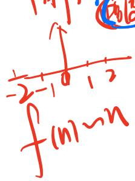

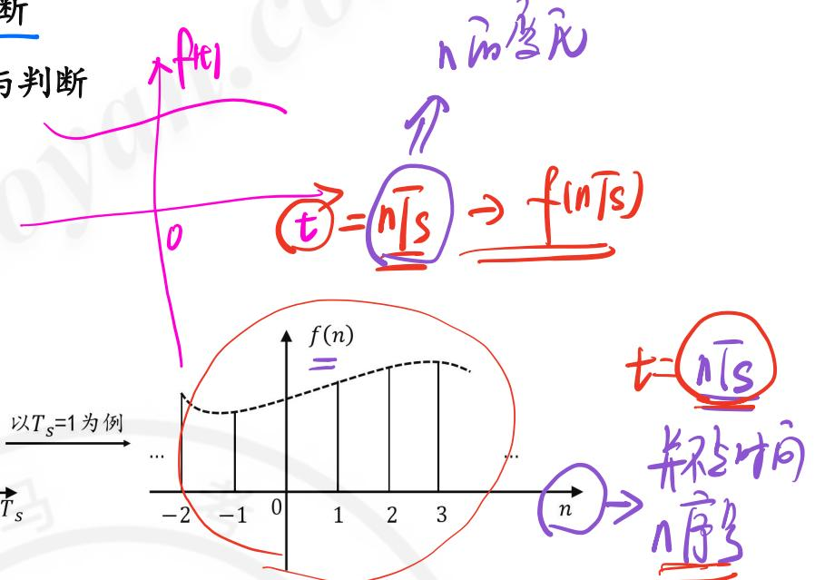

$$
\cos n
$$

专题1 常见序列与系统判断

表式

## 考点1：序列的表示、分类与判断

1、连续信号的离散化

(1)等间隔采样: $T_{s}$

$nT_{s}$ 表示时间，而n仅表示序号。

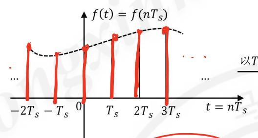

n的度元

(3)数字角频率与模拟角频率的关系

模拟(直线): 测试 $\Omega$ Cos $\omega t$ Cos $\Omega t$

$f(t) = \cos \Omega t$ 其中 $\Omega$ 是模拟角频率； $f(n) = \cos \omega n$ 其中 $\omega$ 是数字角频率

$$
f (n T _ {s}) = f (n) = \cos \Omega \cdot n T _ {s} = \cos \Omega T _ {s} \cdot n = \cos \omega n \Rightarrow \omega = \Omega T _ {s}
$$

高易(2014)南开华 W

$$
\cos \pi n T _ {s} = \cos w n
$$

2、序列表示：表达式法；图形法；集合法(强调位置与幅值)

$\therefore {S}_{\Delta APQ} = {S}_{\Delta AOB} + {S}_{\Delta AQP} + {S}_{\Delta AOB} + {S}_{\Delta AQP} + {S}_{\Delta AQP}$

$$
\frac {\cos w n}{=}
$$

n 要取

$$
f (n) = \{- 1, 2, - 8, - 2, 5 \}   n = 0
$$

$$
\begin{array}{c} 5 \text {个数} \\ - 1 \quad 2 \quad - 8 \quad - 2 \quad 5 \\ n = - 1 \quad n = 0 \quad n = 1 \quad n = 2 \quad n = 3 \end{array}
$$

或

$$
f (n) = \{- 1, \underline {{2}}, - 8, - 2, 5 \}
$$

$$
f (n) = \{- 1, 2, - 8, - 2, 5 \}   n \geq - 1
$$

3、序列基本运算——移位、反转、尺度

$$
f (n) \xrightarrow {n _ {0} > 0} f (n \pm n _ {0}): “ + ” \text {左} “ - ” \text {右}
$$

2) $f(n)\rightarrow f(-n)$ ：纵轴对称

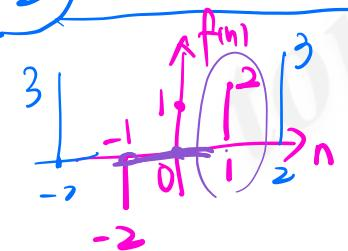

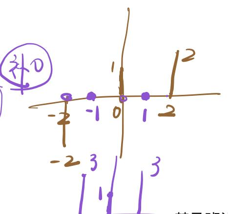

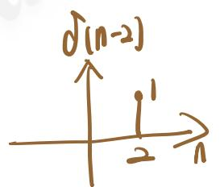

高桂

$f(n)\xrightarrow{a > 0}f(an)$ $\left\{ \begin{array}{ll}0 <   a <   1 & f(n)\xrightarrow{\text{扩展}}f(\frac{n}{2})\text{补零}\\ a > 1 & f(n)\xrightarrow{\text{压缩}}f(2n)\text{删点} \end{array} \right.$

$$
\begin{array}{l}{f (n) \rightarrow f (2 n - 5)}\\{f (n) \rightarrow f (n - 5) \rightarrow f (2 n - 5)}\end{array}
$$

4、周期序列的判断

$$
\mathrm{由} = 3. x
$$

$$
f (n) = A \cos (\omega n + \varphi)
$$

整数 $N$ : 则周期为该整数

$$
\frac {2 \pi}{w} = T _ {1}
$$

$$
\left(\frac {2 \pi}{\omega} = \right.
$$

$$
\frac {P}{Q}:
$$

$$
\frac {2 \pi}{w} \text {近} ^ {\mathrm{电}} / 2
$$

无理数：非周期序列

$$
f _ {1} + f _ {2}
$$

最小值反TV

$$
f _ {1} (n) + f _ {2} (n)
$$

$$
\sum_ {i} A _ {i} \delta (n \pm m _ {i})
$$

考点 2: 常见序列及其性质

1、单位冲激序列

(1) 理志型.

(1)定义：

$$
\delta (n) = \left\{ \begin{array}{l l} 0, n \neq 0 \\ 1, n = 0 \end{array} \right.
$$

(2)图形： $\sqrt{n(n\pm m)}$ 来表乐任一点

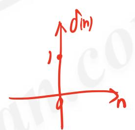

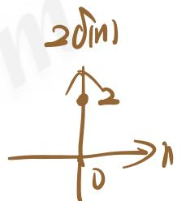

可以用 $\frac{A}{\sqrt{10}}\frac{d(n\pm m)}{\sqrt{10}}$

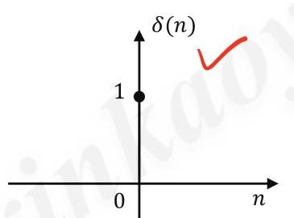

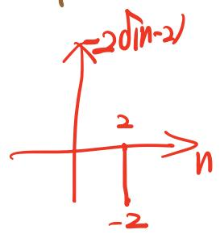

(3)应用:表示任意序列—移位加权和

$$
\left\{ \begin{array}{l} f (n) \cdot \delta (n) = f (0) \frac {\delta (n)}{\Delta} \\ f (n) \delta (n - n) = f (m) \delta (n - m) \end{array} \right.
$$

多位加权和 $f(n)=\sum_{m=-\infty}^{\infty}f(m)\delta(n-m)=\frac{1}{m^{2}}$ 富丽所有点 $f(+)d(n+)$ $f(0)d(n)+f(1)d(n-1)+...$

$\sum_{m = -\infty}^{\infty}f(m) = \delta (n - m)$ PDF免费QQ群梦马班讲义615698143

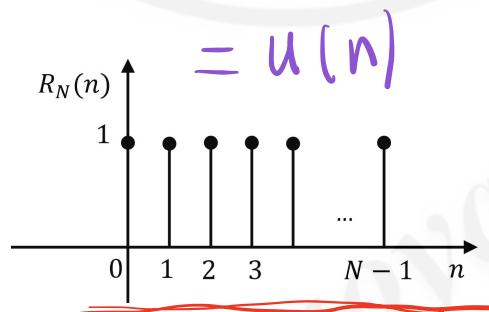

DF免费QQ群615698143
B站up: 信号与系统\_谷哥

$f(t) \cup (2^{t+5})$

2、单位阶跃序列

(1)定义：

公众号：通信考研小马哥

$u \vert t \vert . t = 0.61$ 无意义

$$
u (n) = \left\{ \begin{array}{l} 1, n \geq 0 \\ 0, n <   0 \end{array} \right.
$$

$$
\frac {f (u [ u - u ])}{\mathrm{段}}
$$

(2)图形：

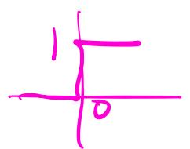

$$
u (t + 1) - u (t - 1) - 1 \rightarrow 1
$$

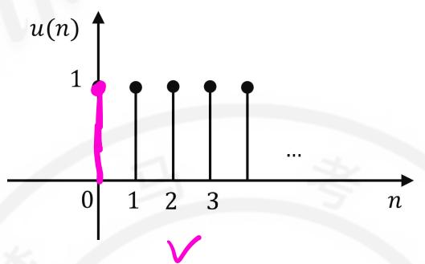

政单卫

(3)应用

范围限制: 让括号内整体项 $\geq 0$ , 求得 $n$ 的范围即为该序列有效范围 $f(n) \cdot u(n)$ : 保留 $f(n)$ 中 $n \geq 0$ 的部分 $f(n) \cdot u(-n+2)$ : 保留 $f(n)$ 中 $n \leq 2$ 的部分, $-n+2 \geq 0 \Rightarrow n \leq 2$

$$
\begin{array}{r l} {n + 2 > 0} \\ {- n \geq - 2} \\ {n \leq 2} \end{array}
$$

3、矩形序列 $R_{N}(n)$

(1)定义：

加
窗
u-u

$$
R _ {N} (n) = \left\{ \begin{array}{l l} 1, & 0 \leq n \leq N - 1 \\ 0, & \text {其它} \end{array} \right.
$$

长度为N

(2)图形：

$$
R _ {N} (n) = u (n) - u [ n - n ]
$$

(3) 应用: $f(n) R_{N}(n)$ 保留 $f(n)$ 的 $0 \rightarrow N - 1$ 的部分

$f(n) \left[ u - u \right]$ 故.

问\$\delta(m)\$如何若文\$n(n)\$

$$
u (n) = \sum_ {m = 0} ^ {\infty} \frac {1}{\Delta} \delta (n - m) = \sum_ {m = 0} ^ {\infty} \delta (n - m) P D
$$

$$
\begin{array}{r l} & {\mathrm{2f4}} \\ & {\delta (n)} \\ & {u u} \\ & {R _ {N} (n)} \end{array} \quad \begin{array}{l} {f (n)} \\ {\sum_ {m = - 0} ^ {\infty} f (m) d ^ {(n - m)}} \\ {: f (n) d ^ {(n)} / d ^ {(n - n 0)}} \\ {f (u) u (n)} \\ {f (u) \cdot [ u - u ]} \\ {u - u.} \end{array}
$$

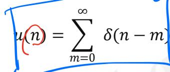

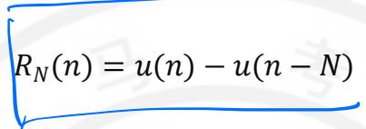

DF免费QQ群615698143
B站up: 信号与系统\_谷哥

4、 $\delta(n)$ 、 $u(n)$ 、 $R_{N}(n)$ 之间的关系

(1) $\delta (n)$ 与 $u(n)$ 关系：

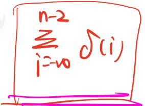

公众号：通信考研小马哥

(2) $\delta(n)$ 与 $R_{N}(n)$ 关系：

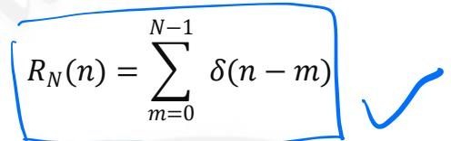

(3) $u(n)$ 与 $R_{N}(n)$ 关系：

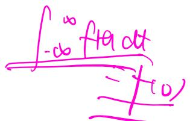

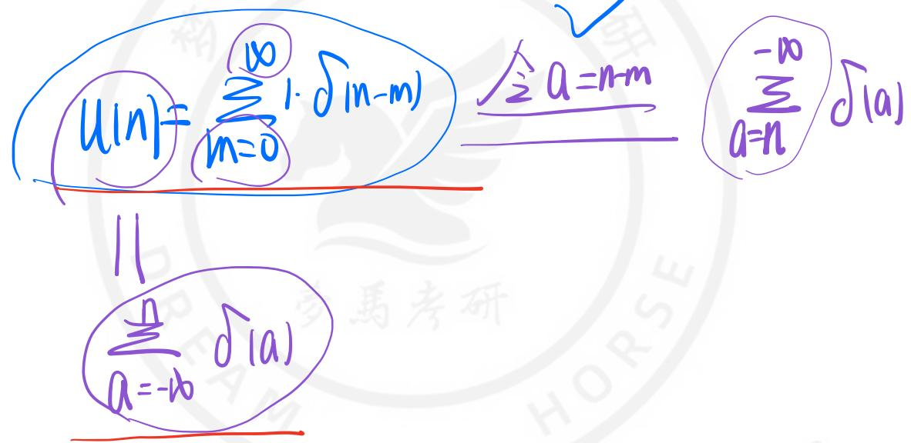

## 考点3: 离散系统的分类与判断

$$
(m) = x (n) \sin (w n)
$$

1、线性时不变系统的判断(简易表达式)— 十二字准则

例 1: $y(n) = x(n)\sin (\omega n)$ ，判断线性、时不变性。非线性案例：

$$
y (n) = f ^ {2} (n), y (n) = \{f (n) \}
$$

$1^{0}$ 让激励. $\sin(wwn)$

$$
\begin{array}{l} {y (n) = a f (n) + \frac {b}{2}} \\ {y (n) = h / \log (f (n))} \end{array}
$$

$$
H [ a _ {1} x _ {1 (n)} + a _ {2} x _ {2 (n)} ] = [ a _ {1} x _ {1 (n)} + a _ {2} x _ {2 (n)} ] \cdot \sin (\omega n)
$$

$$
a _ {1} y _ {1} (n) + a _ {2} y _ {2} (n) = a _ {1} x _ {1} (n) \sin (w n) + a _ {2} x _ {2} (n) \sin (w n)
$$

$$
\underline {{y (n - n _ {0})}} = x (n - n _ {0}) \sin (w (n - n _ {0}))
$$

时要案例：
派的外 n
派动内 n 非（余数）

2、因果系统

(1)定义法: 响应不超前激励;

(2)充要法： $n < 0$ ， $h(n) = 0$ 。

## 3、稳定系统

(1)定义法：有界输入有界输出；

(2)充要法: $\sum_{n=-\infty}^{\infty}|h(n)|<\infty$ 。

例 2: 已知系统 $y(n) = x(n)\sin (\omega n)$ ，判断因果、稳定性。

点义法

因果

设 $\left| x\right|  = M$ .

[21]

$$
\begin{array}{r l} {| y (n) |} & {= | x (n) \sin (w n) |} \\ {\leq | x (n) | \cdot | \sin (w n) |} \\ {\leq | x (n) | \cdot 1} \\ {= | x (n) | \leq M} \end{array}
$$

例 3: 已知系统 $h(n) = a^{n} u(n)$ , 判断因果、稳定性。

$|a|<1$ 改点. $|a|=1$ 不稳点

充安民

$$
\sum_ {n = 0} ^ {\infty} f _ {0} ^ {n}
$$

n<0 时 h(n)>0 8 朵

$$
\begin{array}{r l} {\sum_ {n = - \infty} ^ {\infty} | h (m) |} & {= \sum_ {n = - \infty} ^ {\infty} | a ^ {n} u (n) |} \\ & {= \sum_ {n = 0} ^ {\infty} | a ^ {n} | = | a | ^ {n}} \end{array}
$$

$$
= \left\{ \begin{array}{l} \frac {1}{| - | a |} \\ \infty \end{array} \right.
$$

$$
| a | <   1
$$

$$
\vert a \vert \ge 1
$$

设域理点 $y(n)=f(n)\sin(wn)$ 证明 $h(n)$ 时
成立

日噪
稳点

$$
\hat {E} _ {\alpha \beta}
$$

$$
y _ {\Delta} (n) = f (n - 2)
$$

$\angle I: \text{RVC}: \text{OZ}$ 材 $u(t)$ 型 $\rightarrow n$ 定义: 响应超越的动

完全因 $h(t)$ : $u(t)$ 型 $t < 0$ 时 $h(t) = 0$ $u(n)$ 型 $n < 0$ 时

定义: 存齐在不齐 $o$ 时, 效 $(f(n)) \leq M$ . 则 $|y(n)| < \infty$ 完全因 $h(n)$ : $f_{\infty} |h(n)| > -\infty$ $\sum_{n=-\infty}^{\infty} |h(n)| < \infty$ $\angle I: \text{包底轴} \Rightarrow P$ 所有.

DF免费QQ群615698143

总结：

1. 原列

n 感反

表示形式： $\overline{正方形}$ 表达式 $\overline{矩形}$ 梁分线(下置)

同其他信号：

无即效 $\Rightarrow  {非}$

α. 常见例

$$
\begin{array}{l} {\delta n \mapsto \sum_ {m = - \infty} ^ {\infty} f (m) \delta n - m} \\ {u (n) \Rightarrow \left\{ \begin{array}{l l} {f (n) u [ \leq 2 0 ]} \\ {f (n) [ u - u ]} \end{array} \right.} \\ {R _ {n} (n)} \end{array}
$$

$$
f (n) \delta (n - m) = f (m) \delta (n - m)
$$

段

$$
u (n) - u (n - 2)
$$

$$
R _ {N} (n) = \frac {n (n) - n [ n - N ]}{N - 1}
$$

序号 0→N-1

$$
R _ {N} (n) = \sum_ {n = 0} ^ {\infty} \delta (n - m)
$$

☆

度异 $(n - \frac{3}{2})$

DF免费QQ群615698143

3. 系统

2725

$y_{t} = \sqrt{x}$ 时则

案例规律.

这并非

无安局√

Rock1 (4) (27)

$\frac{ABCD\beta gK_{1}}{2}=\frac{[APg]}{2}$ (ABCD $\beta gK_{1}$ )