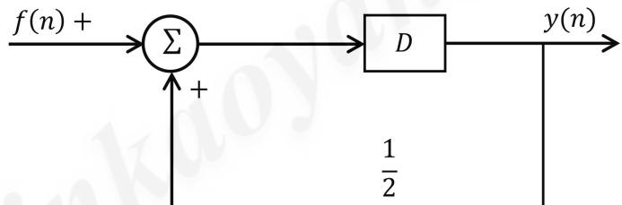
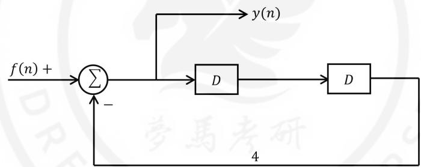
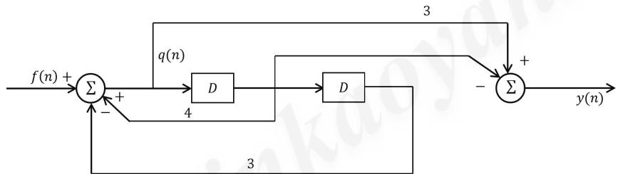
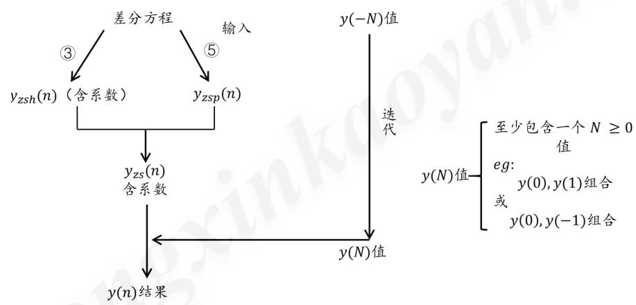
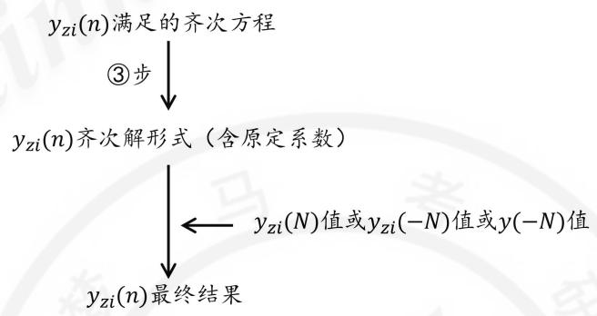
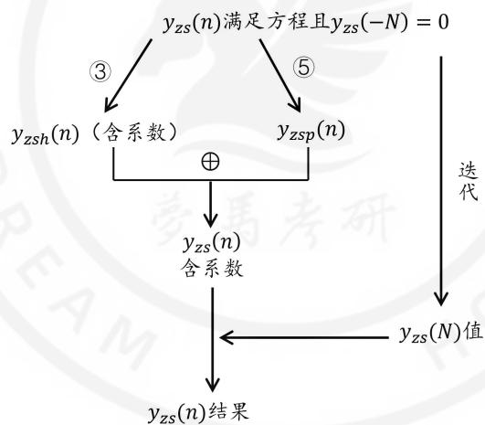

## 专题2 离散系统的时域分析

## 考点 1：完全响应的分解与迭代法

1、差分方程

(1)前向差分： $\triangle f(n) = f(n + 1) - f(n)$ ，后向差分： $\nabla f(n) = f(n) - f(n - 1)$

(2)前向差分与后向差分关系： $\nabla f(n) = \triangle f(n - 1)$ ，仅移位无原则变化，性质相同

(3)差分方程的阶数：响应中变量序号的最大值与最小值的差

2、离散系统的模拟框图—加法器、倍乘器、延时器

(1)差分方程与模拟框图的转换：梅森公式(强烈建议)，详见第7章；

(2)从差分方程画模拟框图:

①差分方程右端没有激励的延时项

例 4: $y(n)-y(n-1)-2y(n-2)=f(n)$ ，画出该系统的时域框图。

②差分方程右端含有激励的延时项

例 5: $y(n) - y(n-1) + 2y(n-2) = f(n) + 3f(n-1)$ 。

(3)模拟框图转差分方程时域方法：以加法器为突破口

例 6: 写出以下离散系统的差分方程。

例 7: 写出以下离散系统的差分方程。

例 8: 写出以下离散系统的差分方程。

考点2：经典法求解系统响应

完全响应的分解与解形式

$$
\begin{array}{c} y (n) = y _ {h} (n) + y _ {p} (n) \\ = y _ {z i} (n) + y _ {z s h} (n) + y _ {z s p} (n) \\ = y _ {z i} (n) + y _ {z s} (n) \end{array}
$$

迭代法：不易直接给出一个闭式解答，更多应用在求解响应某个值

例 9: $y(n+1)=ay(n)+x(n)$ , $x(n)=\delta(n)$ , $y(-1)=0$ , 求 $y(n)$ 。

1、经典法流程

(1)响应区间： $[0, \infty]$

(2)流程:

2、齐次解(自由响应):

(1)特征方程，因式分解

(2)求特征根形式

(3)根据特征根写出齐次解形式

不同特征根所对应的齐次解

<table><tr><td>特征根  $\lambda$ </td><td>齐次解  $y_h(n)$ </td></tr><tr><td>单实根</td><td> $C\lambda^n$ </td></tr><tr><td>r 重实根</td><td> $(C_{r-1}n^{r-1} + C_{r-2}n^{r-2} + \cdots + C_1n + C_0)\lambda^n$ </td></tr></table>

例10： $y(n) + 3y(n - 1) + 2y(n - 2) = f(n)$ ，求该微分方程的齐次解。

例11: $y(n) + 6y(n - 1) + 12y(n - 2) + 8y(n - 3) = x(n)$ ，求该微分方程的齐次解。

3、特解(强迫响应):

(1)将激励带入方程右端，化简得自由项；

(2)根据n>0时刻，自由项的形式选择特解的形式(含待定系数);

(3)将选定的特解带入方程左端;

(4)左右系数平衡求待定系数;

(5)得特解的最终结果。

不同激励所应的特解

<table><tr><td>激励 f(n)</td><td colspan="2">特解  $y_p(n)$ </td></tr><tr><td rowspan="3"> $a^n$ </td><td>当a不等于特征根时</td><td> $Pa^n$ </td></tr><tr><td>当a是特征单根时</td><td> $(Pn + P_0)a^n$ </td></tr><tr><td>当a是r重特征根时</td><td> $[P_r n^r + P_{r-1} n^{r-1} + \cdots + P_1 n + P_0] a^n$ </td></tr><tr><td>常数B</td><td colspan="2">常数P</td></tr></table>

例 12: 若描述某系统的差分方程为

$$
y (n) + 4 y (n - 1) + 4 y (n - 2) = f (n)
$$

已知初始条件 $y(0) = 0$ ， $y(1) = -1$ ，激励 $f(n) = 2^n$ ， $n \geq 0$ 。求方程的全解。

例 13：用经典法求差分方程所描述的LTI离散系统的完全响应。

$$
y (n) + 3 y (n - 1) + 2 y (n - 2) = f (n)
$$

$$
f (n) = u (n), y (- 1) = 1, y (- 2) = 0
$$

4、边界条件对完全响应求解的影响

仍以上题为例利用 $y(0)$ 和 $y(-1)$ 求待定系数

$$
\left\{ \begin{array}{l} y (0) = A + B + \frac {1}{6} = - 2 \\ y (- 1) = - A - \frac {B}{2} + \frac {1}{6} = 1 \end{array} \Rightarrow A = \frac {1}{2}, B = - \frac {8}{3} \right.
$$

也就是说求 $y(n)$ 中待定系数， $y(N)$ 值至少包含一个 $N \geq 0$ 值即可，一般选择 $y(0)$ 和 $y(-1)$ 。

## 考点3：双零法求解系统响应

1、零输入响应 $y_{zi}(n)$

(1)定义：无外加激励，仅由系统-N时刻值引起的响应

(2)零输入响应方程与解形式—齐次方程与齐次解

(3)求解流程:

例 14: 若描述某离散系统的差分方程为

$$
y (n) + 3 y (n - 1) + 2 y (n - 2) = f (n)
$$

已知 $f(n)=0,\ n<0$ ，初始条件 $y(-1)=0,\ y(-2)=\frac{1}{2}$ ，求该系统的零输入响应。

## 【梦马班点拨】边界条件的解释：

① $y_{zi}(n)$ 满足齐次方程, 即 $y_{zi}(N)$ 值全部为 $y_{zi}(-N)$ 值线性迭代而来, 与其它无关, 故 $y_{zi}(N)$ 值和 $y_{zi}(-N)$ 值都可以满足 $y_{zi}(n)$

$$
② y (n) = y _ {z i} (n) + y _ {z s} (n) \Rightarrow y (- N) = y _ {z i} (- N) + y _ {z s} (- N) \text {且} y _ {z s} (- N) = 0
$$

$$
\Rightarrow y (- N) = y _ {z i} (- N) \mathrm{即} y (- N) \mathrm{和} y _ {z i} (- N) \mathrm{均可}
$$

## 2、零状态响应 $y_{zs}(n)$

(1)定义: 与系统起始状态无关, 仅由外加激励引起的响应

(2)满足的方程： $y(n)\rightarrow y_{zs}(n)$ ，且 $y_{zs}(-N)=0$ ， $y(-N)$ 的值用不到

(3)解形式: 齐次解+特解

(4)流程:

例 15: 离散系统

$$
y (n) + 3 y (n - 1) + 2 y (n - 2) = f (n)
$$

其中的 $f(n)=2^{n}$ ， $n\geq0$ ，初始条件 $y(-1)=0$ ， $y(-2)=\frac{1}{2}$ ，求该系统的零状态响应。

考点4：前向差分方程的求解

前向差分方程下完全响应的求解

例 16: $y(n+2)+3y(n+1)+2y(n)=f(n+1)+3f(n)$ , $f(n)=u(n)$

$y(-1) = 1$ ， $y(-2) = 1$ ，求全响应。

## 考点 5：冲激响应(单位样值响应/单位序列响应)的时域求解

1、定义：

当LTI离散系统的激励为单位序列 $\delta(n)$ 时，系统的零状态响应称为单位序列响应(或单位样值响应、单位冲激响应)，用 $h(n)$ 表示。

2、冲激响应满足的方程与解形式

(1) $h(n)$ 满足方程:

$f(n)\to \delta (n),y(n)\to h(n),$ 且 $h(-N) = 0$

(2)求解流程:

①若方程右边只为 $f(n)$ ，则 $h(n)$ 齐次解，齐次三步求解法 $+h(N)$ 即可求得，其中 $h(N)$ 至少包含一个 $N\geq0$ 值；

②若方程右端为 $f(n)$ 和延时组合，则先按 $f(n)$ 单独作用求解，再借助线性关系算齐次解。

例 17: 求以下系统的冲激响应

$$
y (n) - y (n - 1) - 2 y (n - 2) = f (n)
$$

例 18: 求该系统的冲激响应

$$
y (n) - y (n - 1) - 2 y (n - 2) = f (n) - f (n - 2)
$$