DF免费90群615698147

## 一. 三要录

阶段

1. 微分方程： $y^{2}(t)+3y^{2}(t)+2y(t)=f^{2}(t)+3f(t)$

2. 输入：u(t) 或 e $^{-2t}$ u(t) 型

(极点根)

3. $y^{(k)}(0,-1)$ 值： $y(0,-1)$ 和 $y^{'}(0,-1)$

二. 时域分析 $y(t) = y_n(t) + y_p(t)$ 证顶式
1. 分解: $h(t), g(t) = y_i(t) + y_{x_h}(t) + y_{x_p}(t)$ 双反式 $y_x(t)$

2. $D_{-} \rightarrow D_{+}$ 发以自己编程

响应正确 ${Q}_{4} \rightarrow  {200}$

3

证明：3.5 代

35 此式

9(t1) :

用自己的O $_{2}$ 值
个脉
用自己的O $_{2}$ 值

$$
g (t) = \int_ {- \infty} ^ {t} h (\tau) d \tau
$$

三难点：对称 $\angle 1 = \angle 7$ 层

单根 霍 $A_{1}e^{\alpha_{1}t} + A_{2}e^{\alpha_{2}t} = A_{1}e^{-\alpha_{1}t} + A_{2}e^{\alpha_{2}t}$ 单根展

$$
y ^ {\prime \prime} (t) + 3 y ^ {\prime} (t) + 2 y (t) = - f ^ {\prime} (t) + 3 f (t)
$$

=重根

标准

$\int e^{-3t} u(t)$ 使得 $Be^{-3t}$

$$
H (S) = \frac {8 + 3}{(S + 1) (S + 2)} \cdot \frac {1}{(S + 1)}
$$

离散时间永尼响应分析

## 一.三象 $\alpha^{2}+3\alpha+2$

1. 若分方程 $y(m)+3y(m-1)+2y(m-2)=f(m)+3f(m-1)$

2. 描入 $\alpha^{n}(11n)$

3. $y(-x)$ 值： $y(-1)$ 和 $y(-2)$

将归纳-1和-2

## 二. 时域分析

1. 分解：

3.

证明 $B_1: y_h(n), y_p(n)$

$h(n)$ : 3选.代

$\varphi(n) = [度数域12]$

由：

$$
\begin{array}{r l} {y _ {i} (A)} & {= A (- 1) ^ {n} + B (- 2) ^ {n}} \\ {y _ {2 i} (- 1)} & {= y (- 1) = A (- 1) ^ {- 1} + B (- 2) ^ {- 1} = - A - \frac {B}{2} = 1} \\ {y _ {i} (- 2)} & {= y (- 2) = A (- 1) ^ {- 2} + B (- 2) ^ {- 2} = A + \frac {B}{4} = 1} \end{array}
$$

$$
\begin{array}{l} y _ {3} (N) \text {值} \\ \uparrow \text {代} y _ {3} (N) \text {分挂} \\ y _ {3} (- N) \text {值} = 0 \end{array}
$$

$$
\begin{array}{r l} {y _ {n} (n) = B _ {1} (- 1) ^ {n} + B _ {2} (- 2) ^ {n}} \\ {+ C \cdot 2 ^ {n}} \end{array}
$$

DF免费QQ群615698143
离散条氏的时域分析.

$$
\begin{array}{r l} & {\mathrm{叶}} \\ & {\mathrm{变} \left\{ \begin{array}{l l} {y _ {2 i} (n)} & {: 3: y _ {2 i} (n) \cdot y _ {2 i - n} = y (n)} \\ {y _ {2 s} (n)} & {: 3. 5: y _ {2 s} (n) \mathrm{值} \xrightarrow {\mathrm{选} y _ {2 s - 1} - n > 0} h (n) \mathrm{值}} \\ {h (n)} & {: 3: h (n) \mathrm{值} \xrightarrow {\mathrm{选}} h (- n) > 0} \\ {g (n)} & {: 3: g (n) \mathrm{值} \xrightarrow {\mathrm{选}} g (- n) > 0} \end{array} \right\} \quad \mathrm{或} \frac {5}{\sqrt {2}} \frac {\mathrm{选}}{\sqrt {2}} \frac {d}{\pi} \mathrm{代}} \\ & {\mathrm{区}} \\ & {\mathrm{变} \left\{ \begin{array}{l l} {h (n)} & {: 3: h (n) \mathrm{值}} \\ {-} & {\mathrm{值}} \end{array} \right.} \\ & {\mathrm{变} \left\{ \begin{array}{l l} {g (n)} & {: 3: g (n) \mathrm{值}} \\ {-} & {\mathrm{值}} \end{array} \right. \quad f (n) = u (n)} \end{array}
$$

1. 进支求法：
\$\left\{\begin{array}{l}\text{微分子程}\\ \text{相因}\end{array}\right.\$ 
2. 高费单元
\$\left\{\begin{array}{l}\text{差分子程}\\ y\_{(n+1)+3y(n-1)+2y(n-2)}\\ \text{相因}\end{array}\right.\$ 
\$f\_{(n)}\$ 
加元素 传递器 科端 
加元素 传递器 
\$\rightarrow f\_{(n)}\$ 
\$\rightarrow D\$ 
\$\rightarrow D\$ 
\$\rightarrow f\_{(n-2)}\$ 
\$\rightarrow y\_{(n)}\$ 
\$y'\_{(n)} = f\_{(n)} - y'\_{(n)} - 2y'\_{(n)}\$ 
\$\Rightarrow y'\_{(n)} + y'\_{(n)} + 2y'\_{(n)} = f'\_{(n)}\$ 
\$\rightarrow \frac{1}{E}\$ 
\$\rightarrow \frac{1}{D}\$ 
\$\rightarrow \frac{1}{E}\$ 
\$→ y'\_{(n)}\$ 
\$→ y\_{(n)}\$ 
\$→ y\_{(n)}\$ 
PDF免费QQ群615698143

## 专题2 离散系统的时域分析

## 考点1：完全响应的分解与迭代法

1、差分方程

(1)前向差分： $\triangle f(n) = f(n + 1) - f(n)$ ，后向差分： $\nabla f(n) = f(n) - f(n - 1)$

(2)前向差分与后向差分关系: $\nabla f(n)=\triangle f(n-1)$ , 仅移位无原则变化, 性质相同

(3)差分方程的阶数：响应中变量序号的最大值与最小值的差

## Menson. → 钻子程

2、离散系统的模拟框图—加法器、倍乘器、延时器

(1)差分方程与模拟框图的转换: 梅森公式(强烈建议), 详见第7章;

(2)从差分方程画模拟框图:

①差分方程右端没有激励的延时项

例 4: $y(n)-y(n-1)-2y(n-2)=f(n)$ ，画出该系统的时域框图。

②差分方程右端含有激励的延时项

例 5: $y(n) - y(n-1) + 2y(n-2) = f(n) + 3f(n-1)$ 。

(3)模拟框图转差分方程时域方法：以加法器为突破口

例 6: 写出以下离散系统的差分方程。

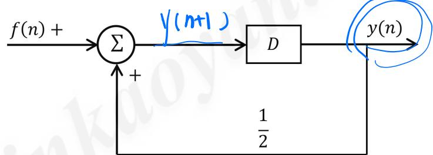

$$
y (n + 1) = f (n) + \frac {1}{2} y (n)
$$

$$
\Rightarrow y (n + 1) - \frac {1}{2} y (n) = f (n)
$$

例 7: 写出以下离散系统的差分方程。

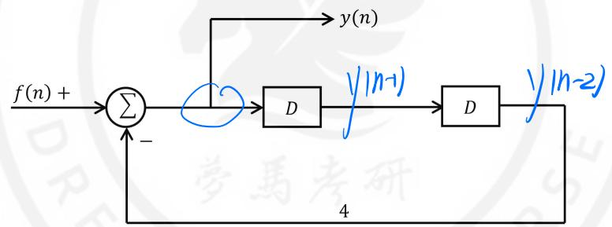

$$
\begin{array}{r l} {y (n)} & {= f (n) - 4 y (n - 2)} \\ & {\Rightarrow y (n) + 4 y (n - 2) = f (n)} \end{array}
$$

例 8: 写出以下离散系统的差分方程。

Messon

$$
\begin{array}{r l} {H (z)} & {= \frac {3 z ^ {- 1}}{1 - (4 z ^ {- 1} - 2 z ^ {- 2})}} \\ & {= \frac {3 z ^ {2} - z}{z ^ {2} - 4 z + 3}} \end{array}
$$

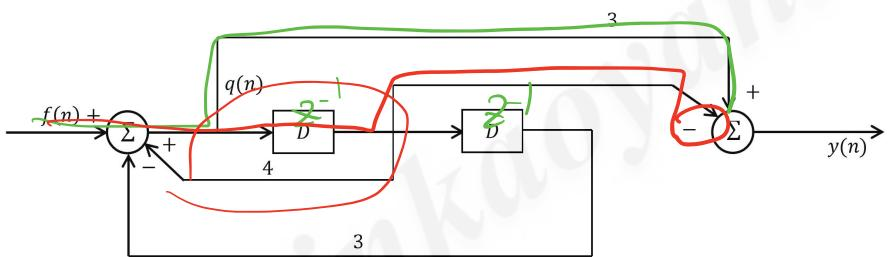

$$
9 (n) = f (n) + 4 9 (n - 1) - 3 9 (n - 2) \Rightarrow 9 (n) \div 4 9 (n - 1) + 3 9 (n - 2) = f (n)
$$

$$
y _ {(n)} = 3 y _ {(n)} - 9 (n - 1)
$$

$$
y (n) - 4 y (n - 1) + 3 y (n - 2) = 3 f (n) - f (n - 1)
$$

PDF免费QQ群615698143

考点 2：经典法求解系统响应

完全响应的分解与解形式

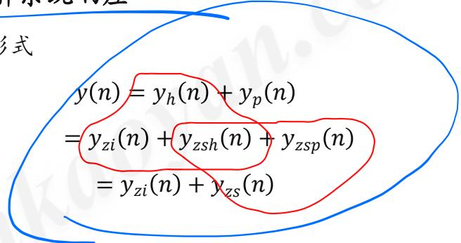

迭代法：不易直接给出一个闭式解答，更多应用在求解响应某个值

例 9: $y(n+1) = ay(n) + x(n), \ x(n) = \delta(n), \ y(-1) = 0,$ 求 $y(n)$ 。

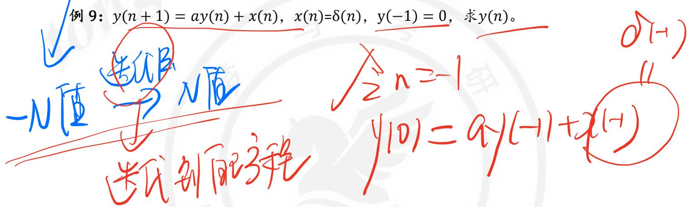

1、经典法流程

(1)响应区间： $[0, \infty]$

(2)流程:

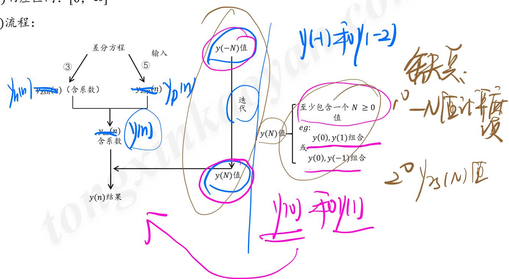

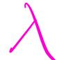

2、齐次解(自由响应):

(1)特征方程，因式分解

(2)求特征根形式

(3)根据特征根写出齐次解形式

  
不同特征根所对应的齐次解

<table><tr><td>特征根  $\lambda$ </td><td>齐次解  $y_h(n)$ </td></tr><tr><td>单实根</td><td> $C\lambda^n$  $C_1(-1)^n + C_2(-2)^n$ </td></tr><tr><td>r 重实根</td><td> $(C_{r-1}n^{r-1} + C_{r-2}n^{r-2} + \cdots + C_1n + C_0)\lambda^n$   $(C_1n + C_2)(-1)^n$ </td></tr></table>

例 10: $y(n) + 3y(n - 1) + 2y(n - 2) = f(n)$ ，求该微分方程的齐次解。

例 11: $y(n) + 6y(n-1) + 12y(n-2) + 8y(n-3) = x(n)$ ，求该微分方程的齐次解。

3、特解(强迫响应):

(1)将激励带入方程右端，化简得自由项；

(2)根据n>0时刻，自由项的形式选择特解的形式(含待定系数);

(3)将选定的特解带入方程左端;

(4)左右系数平衡求待定系数；

(5)得特解的最终结果。

不同激励所应的特解

<table><tr><td>激励f(n)</td><td colspan="2">特解yp(n)</td></tr><tr><td rowspan="3">an</td><td>当a不等于特征根时</td><td>Pan</td></tr><tr><td>当a是特征单根时</td><td>(Pn+P0)an</td></tr><tr><td>当a是r重特征根时</td><td>[Prnr+Pr-1rn-1+···+P1n+P0]an</td></tr><tr><td>常数B</td><td colspan="2">常数P</td></tr></table>

例 12: 若描述某系统的差分方程为

$$
y (n) + 4 y (n - 1) + 4 y (n - 2) = f (n)
$$

已知初始条件 $y(0)=0,\quad y(1)=-1$ ，激励 $f(n)=2^{n},\quad n\geq0$ 。求方程的全解。

例 13: 用经典法求差分方程所描述的LTI离散系统的完全响应。

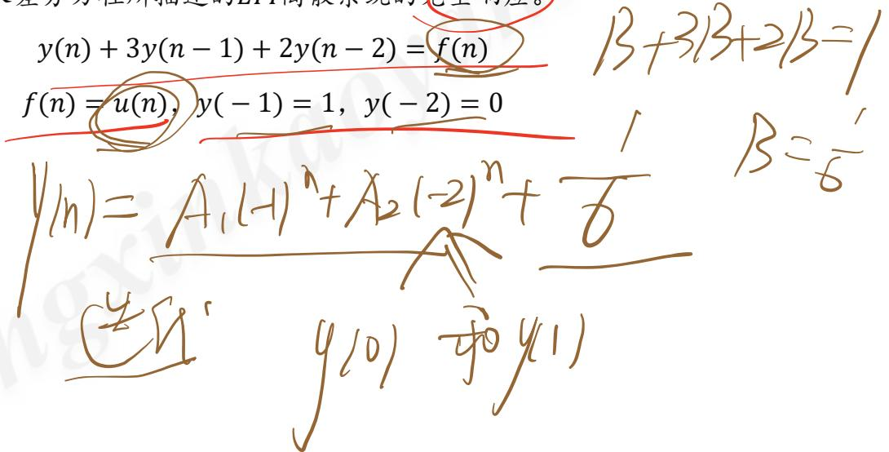

4、边界条件对完全响应求解的影响

仍以上题为例利用 $y(0)$ 和 $y(-1)$ 求待定系数

$$
\left\{ \begin{array}{l} y (0) = A + B + \frac {1}{6} = - 2 \\ y (- 1) = - A - \frac {B}{2} + \frac {1}{6} = 1 \end{array} \Rightarrow A = \frac {1}{2}, B = - \frac {8}{3} \right.
$$

也就是说求 $y(n)$ 中待定系数， $y(N)$ 值至少包含一个 $N \geq 0$ 值即可，一般选择 $y(0)$ 和 $y(-1)$ 。

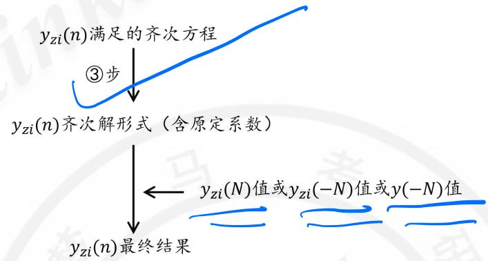

## 考点3：双零法求解系统响应

1、零输入响应 $y_{zi}(n)$

(1)定义：无外加激励，仅由系统-N时刻值引起的响应

(2)零输入响应方程与解形式—齐次方程与齐次解

(3)求解流程:

例 14: 若描述某离散系统的差分方程为

$$
y (n) + 3 y (n - 1) + 2 y (n - 2) = f (n)
$$

已知 $f(n)=0,\ n<0$ ，初始条件 $y(-1)=0,\ y(-2)=\frac{1}{2}$ ，求该系统的零输入响应。

## 【梦马班点拨】边界条件的解释：

① $y_{zi}(n)$ 满足齐次方程, 即 $y_{zi}(N)$ 值全部为 $y_{zi}(-N)$ 值线性迭代而来, 与其它无关, 故 $y_{zi}(N)$ 值和 $y_{zi}(-N)$ 值都可以满足 $y_{zi}(n)$

$$
② y (n) = y _ {z i} (n) + y _ {z s} (n) \Rightarrow y (- N) = y _ {z i} (- N) + y _ {z s} (- N) \text {且} y _ {z s} (- N) = 0
$$

$\Rightarrow y(-N) = y_{zi}(-N)$ 即 $y(-N)$ 和 $y_{zi}(-N)$ 均可

## 2、零状态响应 $y_{zs}(n)$

(1)定义: 与系统起始状态无关, 仅由外加激励引起的响应

(2)满足的方程： $y(n)\rightarrow y_{zs}(n)$ ，且 $y_{zs}(-N)=0$ ， $y(-N)$ 的值用不到

(3)解形式: 齐次解+特解

(4)流程:

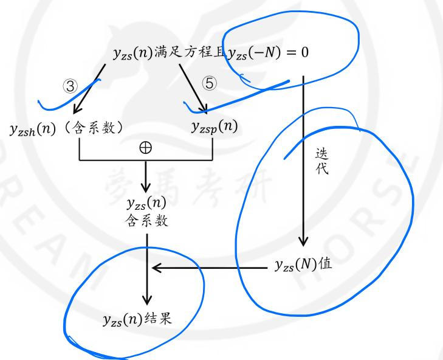

例 15: 离散系统

$$
y (n) + 3 y (n - 1) + 2 y (n - 2) = f (n)
$$

其中的 $f(n)=2^{n}$ ， $n\geq0$ ，初始条件 $y(-1)=0$ ， $y(-2)=\frac{1}{2}$ ，求该系统的零状态响应。

## 考点4：前向差分方程的求解

前向差分方程下完全响应的求解

例 16: $y(n+2)+3y(n+1)+2y(n)=f(n+1)+3f(n)$ , $f(n)=u(n)$

$y(-1) = 1$ ， $y(-2) = 1$ ，求全响应。

## 考点 5：冲激响应(单位样值响应/单位序列响应)的时域求解

1、定义：

当LTI离散系统的激励为单位序列 $\delta(n)$ 时，系统的零状态响应称为单位序列响应（或单位样值响应、单位冲激响应），用 $h(n)$ 表示。

2、冲激响应满足的方程与解形式

(1) $h(n)$ 满足方程:

$$
f (n) \rightarrow \delta (n), y (n) \rightarrow h (n), \text {且} h (- N) = 0
$$

(2)求解流程:

①若方程右边只为 $f(n)$ ，则 $h(n)$ 齐次解，齐次三步求解法 $+h(N)$ 即可求得，其中 $h(N)$ 至少包含一个 $N\geq0$ 值；

②若方程右端为 $f(n)$ 和延时组合，则先按 $f(n)$ 单独作用求解，再借助线性关系算齐次解。

例 17: 求以下系统的冲激响应

$$
y (n) - y (n - 1) - 2 y (n - 2) = f (n)
$$

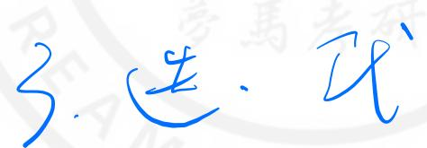

$$
h (n) - h (n - 1) - 2 h (n - 2) = \delta (n)
$$

$$
\alpha^ {2} - \alpha - 2 = (\alpha - 2) (\alpha + 1) = 0
$$

$$
\begin{array}{l} {h (n) = A _ {1} (2 1 ^ {n} + A _ {2} (- 1) ^ {n}} \\ {\mathrm{if} n > 0 \quad h (0) - h (- 1) - 2 h (- 2) = \delta (0) = 1} \\ {\mathrm{if} n = 1 \quad h (1) - h (0) - 2 h (- 1) = \delta (1) = 0} \end{array}
$$

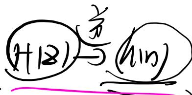

例 18: 求该系统的冲激响应

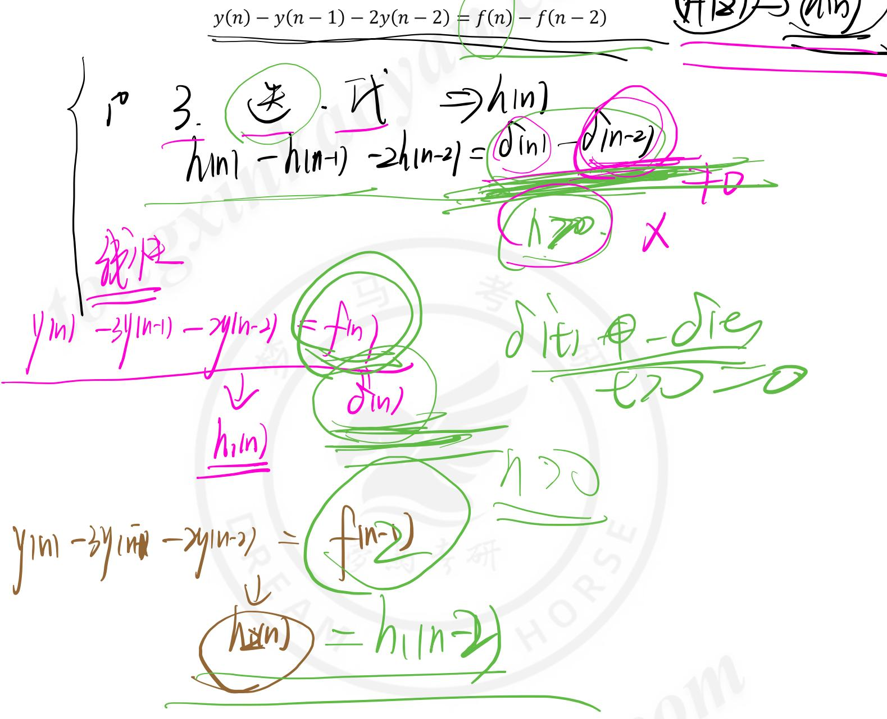

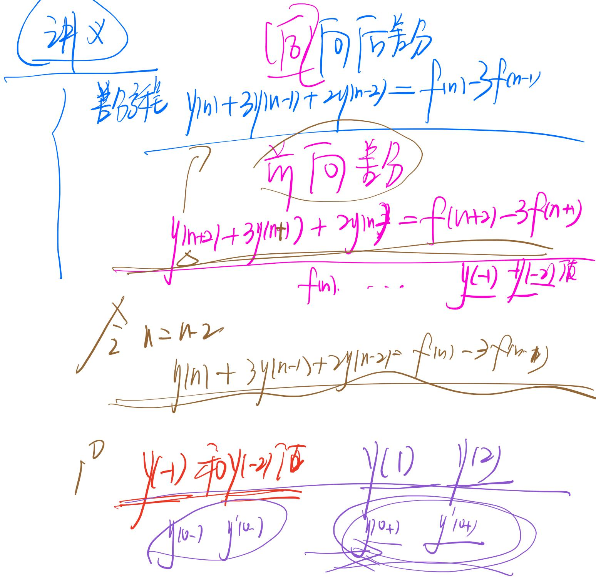

$1^{D} \frac{y(-1) + y(-2)}{y(0-1)y'(0-1)} \frac{y(1)}{y(0+1)y'(0+1)}$