如需打印，微信扫一扫。彩色黑白同价，五分一页，首单免费，满三元顺丰包邮次日达。

最好用的刷题小程序，多专业课题全网唯一

扫码打印 首单免费

长按识别二维码，开始学习吧

免费资料分享群

微信群是唯一更新渠道。

微信群是唯一更新渠道。

群聊：上岸笔记B19

每日分享免费
| 考研 | 考公 | 考编 | 法考 | 教师 | 财会 | 金融 | 医考 |
四六级 | 专四八 | 教育类 | 小初高 | 云课堂 | 影音类 | 等
等 |

DF免费QQ群615698143
连法时间系统表示形式相互转换

中间度微分子程

模拟枪图

$$
\boxed {S} \Bigg | _ {s ^ {- 1}}
$$

能流图

亮点图

定型 $\int\limits_{h(0+t)}^{H(S_{0})}f(t)dt=H(0)$

${4}^{0}\;{H}_{1}(s)\; \rightarrow  {互权总图}$

确定型

因果：Ric： $\nabla$ 2 变

不确定垫

称定：R/C：综合坐标轴

亲克特性

${3}^{0}\;H\left( s\right)$

$H(SO) = f_{10}^{w} f(t) dt$

$$
e ^ {S _ {0} t} \rightarrow \underbrace {(H (S _ {0}) e ^ {S _ {0} t}} _ {S _ {0} \in R u c}
$$

$5^{\circ}$ His $\xrightarrow{Mosson}$ 框团/流团珠冠：古半福
派波：天王民
合道：

流国结构

状态变量分析

$ABCD \Rightarrow \text{响应.}$ 味任意

若H(W)存在，H(S)定后在

$2^{\circ} \text{ HIS } \xrightarrow[\text{题}]{\text{施边}} \text{方程}$

$1^{\circ}$ H(S) $\xrightarrow[\text{ROC 应轴}]{\text{标定}}$ H(W) = (H(S)) / s = jW

$$
s = v + j w
$$

$e^{-2t}u(t)$

h(t) 逆

$$
E \rightarrow H (S _ {0}) \cdot E
$$

$$
e ^ {j w _ {0} t} \rightarrow H (w _ {0}) e ^ {j w _ {0} t}
$$

$$
e ^ {S _ {0} t} \Rightarrow H (S _ {0}) e ^ {S _ {0} t}
$$

So GROC内

DF免费QQ群61568143免费访问新消息形式和物联技

施.→差方程

桥以相周<方边

$$
\left\{\begin{array}{l}{H (2 0)}\\{h (0) \mathrm{初值} = \lim _ {z \to 0} H (2)}\\{\overline {{z _ {0}}} ^ {n} \rightarrow H (2 0) z _ {0} ^ {n}}\end{array}\right.
$$

因果精度. 沈旧. 合通

${4}^{ \circ  }\;\underline{H\left( 2\right) } \rightleftharpoons$ 兑极点图

ROC: 国外域 12123

ROC: 包含单位圆 (圆: 宽心) 积足
因果满足：所有权及位于单位圆内
源设：矢量法
合通： $|P_{n}$ 预 $= k$

$$
H (e ^ {i \omega})
$$

$$
z = r \cdot e ^ {j \theta}
$$

$$
H (e ^ {j \omega})
$$

H(2)存在 $\xrightarrow{不足} H(e^{j\omega})$ 存在 $=H(2)/2=e^{j\omega}$

$2^{0}H(2) \longrightarrow \text{差方程}$

09: 直径为 $\frac{GH(2)}{(无四分)}$ → 方程

$$
\frac {z + 1}{z + 1} = \frac {\frac {z}{z + 2}}{1}, y _ {i} (n) = A (H) ^ {2} + B (2) ^ {n}
$$

$g\left| n\right|  = u\left| n\right)  \times  h\left| n\right)$

$$
g (n) = \frac {z}{z - 1} \cdot H (2)
$$

$$
| H (e ^ {j \omega_ {0}}) | a s [ \frac {\omega_ {0} n + \varphi (\omega_ {0})}{4 m)}
$$

$$
\begin{array}{l}E \rightarrow E \cdot H (0) ^ {2}\\e ^ {j w o n} \rightarrow H (1)\end{array}
$$

H(2) 救心地点

专题 4 系统函数的应用

考点1: 系统函数的定义

1、系统函数为零状态响应的ZT与激励ZT之比

$$
H (z) = \frac {Y _ {z s} (z)}{X (z)}
$$

2、表征系统：

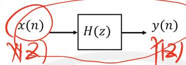

$$
y _ {z s} (n) = x (n) * h (n) \stackrel {Z T} {\Rightarrow} Y _ {z s} (z) = X (z) \cdot H (z)
$$

9: 知 $f\left( n\right) ,\cdots ,y_n\left( n\right)  = \cdots$ 求 $h\left( n\right)$

$$
H (z) = \frac {f _ {(z , 1 2)}}{F (z)} \stackrel {\frac {y}{n}} {\Rightarrow} h (n)
$$

9: 差分得程 = $\frac{右证}{左证}$

9: $h(u) \stackrel{2J}{\rightleftharpoons} H(B)$

## 考点2：系统函数的求解

1、差分方程视角下系统函数的求解

已知差分方程 $y(n) - \frac{3}{4} y(n - 1) + \frac{1}{8} y(n - 2) = x(n) + \frac{1}{3} x(n - 1)$

则Z域方程为

$$
Y (z) - \frac {3}{4} z ^ {- 1} Y (z) + \frac {1}{8} z ^ {- 2} Y (z) = X (z) + \frac {1}{3} z ^ {- 1} X (z)
$$

$$
H (z) = \frac {Y (z)}{X (z)} = \frac {\text {右边形式}}{\text {左边形式}} = \frac {1 + \frac {1}{3} z ^ {- 1}}{1 - \frac {3}{4} z ^ {- 1} + \frac {1}{8} z ^ {- 2}}
$$

2、定义法：已知零状态和激励，各自求解ZT之后的比值；

3、变换法：

$$
h (n) \xrightarrow {Z T} H (z)
$$

## 考点3：系统函数的应用

1、求系统的差分方程：

$$
H (z) = \frac {Y (z)}{X (z)} = \frac {\text {右边形式}}{\text {左边形式}}
$$

例 12: 当输入 $x(n)=u(n)$ 时, 某 LTI 离散系统的零状态响应为 $y_{zs}(n)=[2-(0.5)^{n}+(-1.5)^{n}]u(n)$ , 求其系统函数和描述该系统的差分方程。

$\geq u(n)$ 特别

$\Rightarrow$ 二阶程.

$$
H (2) = \frac {2 + 0 . 5 2 ^ {- 2}}{1 + 2 ^ {- 1} - 0 . 7 5 2 ^ {- 2}} = \frac {\mathrm{右}}{\sqrt {2}} y _ {(n)} + y _ {(n - 1)} - 0. 7 5 y _ {(n - 2)} = 2 x _ {(n)} + 0. 5 x _ {(n - 2)}
$$

2. 求冲激响应 $h(n)$ : $H(z) \xrightarrow{\text{逆Z变换}} h(n)$

3. 求零状态响应 $y_{zs}(n)$ : $Y_{zs}(z)=H(z)X(z)\xrightarrow{\text{逆Z变换}}y_{zs}(n)$ 4. 常见的特征输入结论

$$
\begin{array}{r l} {z = e ^ {\lambda w}} & \\ {w = 0.} & \\ {\underline {{z = 1}}} & \\ {h (n) + 2 v ^ {n}} & \end{array}
$$

$$
x (n) = e ^ {j \omega_ {0} n} \xrightarrow {h (n)} y (n) = H (e ^ {j \omega_ {0}}) e ^ {j \omega_ {0} n}
$$

$$
x (n) = \boxed {z _ {0} ^ {n}} {\overset {h (n)} {\longrightarrow}} y (n) = H (z _ {0}) z _ {0} ^ {n},   z _ {0} \text {在} R O C \text {内}
$$

$$
h (n) \underset {z} {\longrightarrow} H (z)
$$

$$
x (n) = \cos (\omega_ {0} n) \xrightarrow {h (n)} y (n) = | H (e ^ {j \omega_ {0}}) | \cos [ \omega_ {0} n + \varphi (\omega_ {0}) ]
$$

205、系统函数零极点判断系统特性

(1)系统函数零、极点图

$$
= z _ {0} ^ {n} \sum_ {m = - \infty} ^ {\infty} h (m) z _ {0} ^ {- n} = \sum_ {n = - \infty} ^ {\infty} h (n) z _ {0} ^ {- n} = H (z) H (z) = \frac {A (z)}{B (z)}
$$

$A(z)=0$ 的点称为 $H(z)$ 的零点， $B(z)=0$ 的点称为 $H(z)$ 的极点，在图中，零点用

‘O’表示，极点用‘X’表示

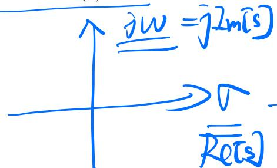

例 13: 已知 $H(z)=\frac{1+\frac{1}{3}z^{-1}}{1-\frac{3}{4}z^{-1}+\frac{1}{8}z^{-2}}=\frac{z\left(z+\frac{1}{3}\right)}{z^{2}-\frac{3}{4}z+\frac{1}{8}}=\frac{z\left(z+\frac{1}{3}\right)}{\left(z-\frac{1}{2}\right)\left(z-\frac{1}{4}\right)}$ ，画出该系统零极点图。

例 14: 一线性时不变离散时间系统 $H(z)$ 的零、极点分布如图所示, 且已知其单位脉冲响应 $h(n)$ 的初值 $h(0_{\bullet}) = 1$ 。试求

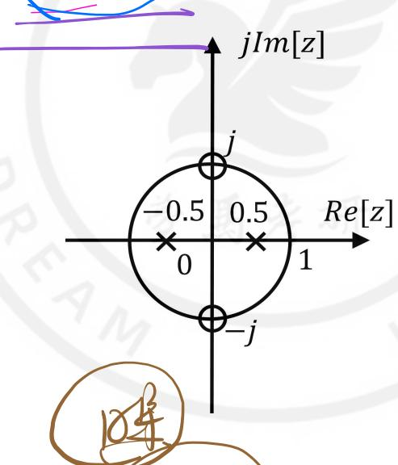

设 $H(8)=\frac{K(8^{2}+1)}{(2-0.5)(8+0.5)}$

$$
\begin{array}{r l} {h (0)} & {= \lim _ {z \to 0} H (z)} \\ & {= k = 1} \end{array}
$$

(1)系统函数 $H(z)$ ，并说明系统是否稳定及其理由；

(2)该系统的单位样值响应 $h\left( n\right)$ ;

$\frac{1}{2}x - 1 > 0.5, x \in \mathbb{Z}^{n - 1}$ 故点. $|x| < 0.1$ (3)若输入为 $x(n)$ , 零状态输出为 $y(n)$ , 写出描述系统的离散方程。

$$
\vert 2 \vert <   0. 5
$$

$$
h (n) = \dots [ - ] u (- n - 1)
$$

(2)判断因果系统、稳定系统

①因果系统: $ROC$ 为圆外域;

②稳定系统：ROC内包含单位圆(指的是单位圆圈，不是实心圆)

(3)因果稳定: 朱里准则: 线性时不变离散系统是因果稳定系统的充分必要条件是系统函数的极点全部位于单位圆内, 即 $|z| > r, 0 < r < 1$ (离散), 要判别系统函数

朱星波刚

$H(z)=\frac{B(z)}{A(z)}$ 的特征方程 $A(z)=0$ 的根的模是否小于1。

朱里列表：设

$$
\begin{array}{c} c _ {n - 1} = a _ {n} a _ {n} - a _ {0} a _ {0} \\ c _ {n - 2} = a _ {n} a _ {n - 1} - a _ {0} a _ {1} \end{array}
$$

$$
d _ {n - 2} = c _ {n - 1} c _ {n - 1} - c _ {0} c _ {0}
$$

$$
d _ {n - 3} = c _ {n - 1} c _ {n - 2} - c _ {0} c _ {1}
$$

$$
\begin{array}{c c c c c} A (z) = a _ {n} z ^ {n} + a _ {n - 1} z ^ {n - 1} + \dots a _ {1} z + a _ {0} \\ \hline 1 & a _ {n} & a _ {n - 1} & a _ {n - 2} \dots a _ {1} & a _ {0} \\ 2 & a _ {0} & a _ {1} & a _ {2} \dots & a _ {n - 1} & a _ {n} \\ \hline 3 & c _ {n - 1} & c _ {n - 2} \dots & c _ {1} & c _ {0} \\ 4 & c _ {0} & c _ {1} \dots & c _ {n - 2} & c _ {n - 1} \\ \hline 5 & d _ {n - 2} & d _ {n - 3} & \dots d _ {0} \\ 6 & d _ {0} & d _ {1} & \dots d _ {n - 2} \\ \hline \end{array}
$$

罗斯 $\frac{s^{2}+2s+\beta}{\alpha>0,\beta>0}$

官所
公司.(不设改,正)

$$
s ^ {n} s ^ {n - 1} s ^ {n - 2} \dots s ^ {1} s ^ {0}
$$

2n-3行

注意列到第几行

则朱里准则: $A(z) = 0$ 的所有根在单位圆内的充分必要条件是

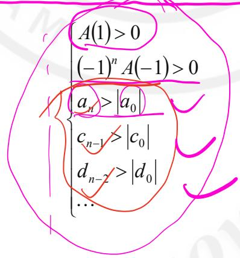

$$
\begin{array}{l} {z ^ {2} + 2 z + \beta} \\ {\boxed {n = 2}} \\ {\boxed {2 n - 3 = 1 5}} \\ {\boxed {1}} \\ {\boxed {2}} \\ {\boxed {\beta}} \end{array}
$$

$$
\begin{array}{r l} {A (1)} & {= 1 + \alpha + \beta > 0} \\ {(- 1) ^ {n} A (- 1)} & {= A (- 1) = 1 - \alpha + \beta > 0} \\ {\mathrm{def}} & {| \alpha | <   1 + \beta . | \beta | <   1} \end{array}
$$

若系统为二阶系统, 即 $H(z)$ 分母多项式为 $z^{2} + \alpha z + \beta$ 形式, 即 $|\alpha| < 1 + \beta$ 且 $|\beta| < 1$ 。

例 15: 若系统的特征方程 $A(z) = 4z^{4} - 4z^{3} + 2z - 1$ , 该系统是否稳定。

$$
\begin{array}{l} {\mathrm{问} 1 3: \text {若系统的特征方程} A (2) = 1 2 - 1 2 + 2 2 - 1, \text {该系统是否稳定。}} \\ {\mathrm{n=4}} \\ {\mathrm{2n-3=5}} \\ {A (1) = 4 - 4 + 2 - 1 = 1 > 0 \sqrt {3}} \\ {(- 1) ^ {4} A (- 1) = 4 + 4 - 2 - 1 = 5 > 0 \sqrt {4}} \\ {\mathrm{官网:tongxinkaoyan.com}} \end{array}
$$

例 16: 为使 $H(z) = \frac{2z + 1}{z^{2} + z + K}$ 系统稳定, 求 $K(\text {实数})$ 的取值范围。

$$
\begin{array}{l} {\alpha = 1. \quad \beta = k} \\ {| \alpha | <   1 + \beta \text {且} | \beta | <   1} \\ {1 <   1 + \beta \text {且} | \beta | <   1} \end{array}
$$

例17: 已知因果系统 $y(n) - y(n-1) - 2y(n-2) = x(n) + 2x(n-1)$

(1)求系统函数 $H(z)$

(2)求冲激响应 $h(n)$

(3)判断系统稳定性

不长安

$$
H (2) = \frac {1 + 2 8 ^ {- 1}}{1 - 2 ^ {- 1} - 2 2 ^ {- 2}} = \frac {2 ^ {2} + 2 8}{2 ^ {2} - 2 - 2}
$$

$\therefore {12} > 2$

(3)全通系统:

①定义：幅频特性对所有频率均等于常数或1，即 $|H(e^{j\omega})| = k$ 或 1联2 欢天 $\frac{1}{2}$

$\text{负1+j} \text{另一负21-j}$

②零极点分布特点: 全通系统的零点和极点互为共轭倒数关系  
若零极点均为实数, 则零点和极点为倒数关系; 若为共轭出现, 则零点共轭出现, 极点共轭出现, 且还呈现倒数关系, 可见四个知其一, 便可得所有。

零极点为实数: 则有零点 2, 即一定有极点 $\frac{1}{2}$ (2 个一组)
零极点为共轭: 若有零点 $1 + j$ , 必有零点 $1 - j$ , 极点 $\frac{1}{1 + j}$ 和 $\frac{1}{1 - j}$ (4 个一组)

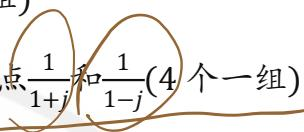

(4)最小相位系统: 如果因果稳定系统的所有零点都在单位圆内, 则称之为“最小相位系统”, 反之, 如果所有零点都在单位圆外, 则称之为“最大相位系统” (5)可逆系统

最小相位系统保证其逆系统存在。给定一个因果稳定系统 $H(z)=\frac{A(z)}{B(z)}$ ，定义其逆系统为 $H_{INV}(z)=\frac{1}{H(z)}=\frac{B(z)}{A(z)}$ ，当且仅当 $H(z)$ 为最小相位系统时， $H_{INV}(z)$ 才是因果稳定的(物理可实现的)

表式
正规
天贵片
西巾兼顾
3度.
走马直观(6)滤波特性

①画系统零极点分布图，单位圆上取一点P，画几何矢量图； ②幅频特性

$\left|H\left(e^{j\omega}\right)\right| = \frac{\text{所有零点对应长度乘积}}{\text{所有极点对应长度乘积}}$

相频特性

$\varphi\left(e^{j\omega}\right)=\left(\text{所有零点夹角之和}\right)-\left(\text{所有极点夹角之和}\right)$

③走势判断类型。

$0 \rightarrow \pi$ 低通: 高低; 高通: 低高; 带通: 低高低; 带阻: 高低高

例 18: 已知 $H(z)=\frac{0z}{(z+0.2)(z-0.5)}$ ，画出该系统的幅频特性图。

【梦马班点拨】 $0 \rightarrow \pi$ 看滤波器类型， $-\pi \rightarrow \pi$ 是完整幅频曲线。

注意: 若分子 $z$ 前有系数, 系数应代入影响 $|H(e^{j\omega})|$ 各点值, 不影响走势!

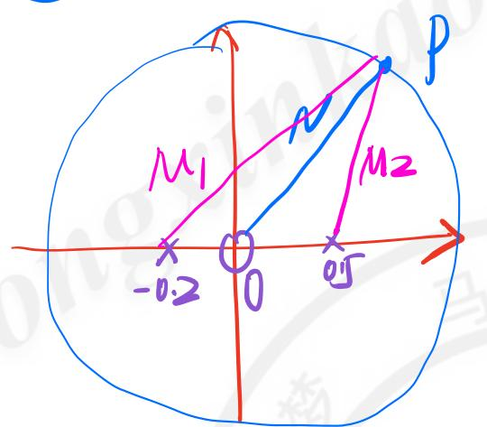

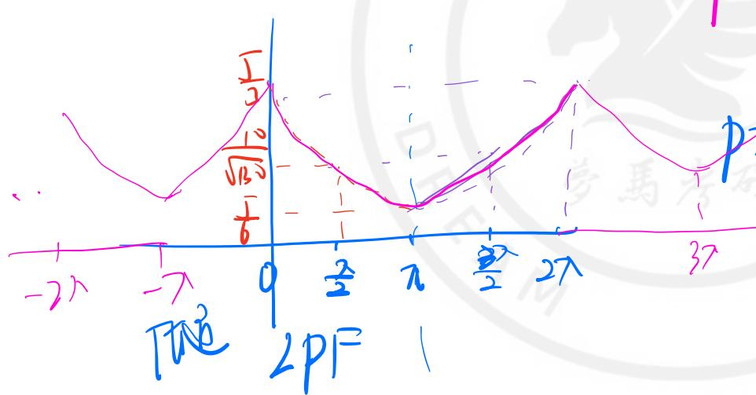

$$
| H (e ^ {j w}) | = \frac {O N}{M _ {1} \cdot M _ {2}}
$$

$P_{在0} \quad N=1, M_1=1.2 \quad M_2=0.5$ $|H(e^{j0})| = \frac{5}{3}$

$P$ 在 $\frac{\pi}{2}$ , $N=1$ , $M_1 = 0.8$ , $M_2 = 1.5$ $|H(e^{0\frac{\pi}{2}})| = \frac{10}{\sqrt{BD}}$ $P$ 在 $\pi$ , $N=1$ , $M_1 = 0.8$ , $M_2 = 1.5$ $\frac{5}{6}$

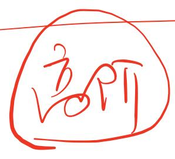

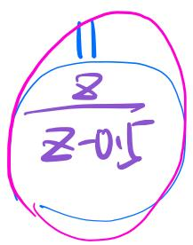

DF免费QQ群615699143

H(2)

$$
H (e ^ {j w}) = \frac {e ^ {j w}}{e ^ {j w} - 0 . 5} = \frac {\cos w + j \sin w}{\cos w - 0 . 5 + j \sin w}
$$

$$
\left| H (e ^ {j w}) \right| = \frac {1}{\sqrt {(\cos w - 0 . 5) ^ {2} + \sin^ {2} w}} = \frac {1}{\sqrt {1 - \cos w + 0 . 2 5}} = \frac {1}{\sqrt {1 . 2 5 - \cos w}}
$$

$\therefore w = 0$ 时

$$
\begin{array}{l} \frac {1}{2} w = \frac {3}{2} n t \\ \frac {1}{2} w = x n t \end{array}
$$

(不考)

(考)

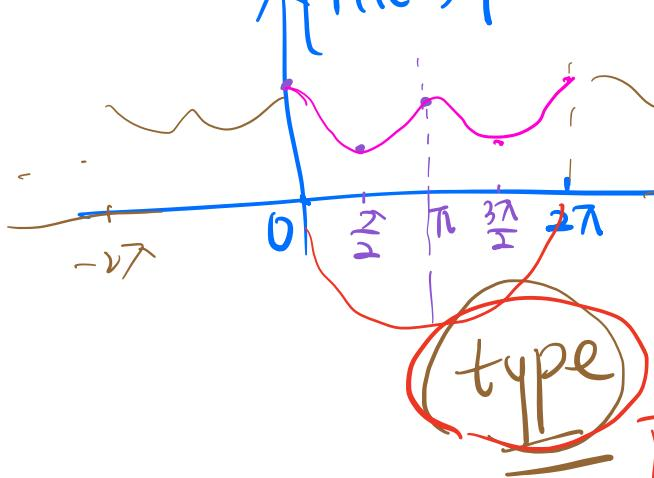

DF免费QQ群698143

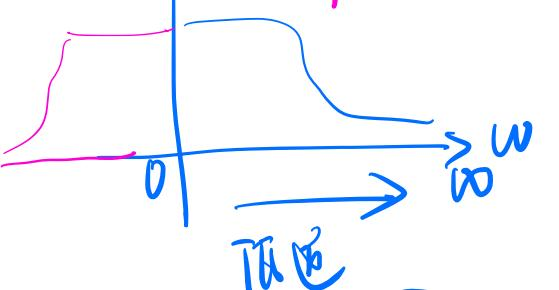

(边) $0 \rightarrow 100$ 等分

$\frac{0 \rightarrow \infty }{L} \Rightarrow$ 走势 $\Rightarrow  + {type}$

$$
| H (w) | = \frac {N}{M}
$$

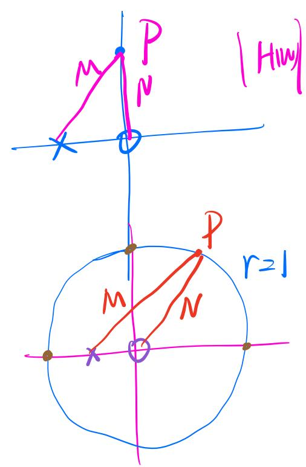

周期为2π

$$
\cos \pi n = (- 1) ^ {n}
$$

高频力量

$$
\begin{array}{l} p \cdot 0 \\ \downarrow \\ p \cdot \infty \end{array} \dots
$$

$$
\left| H (e ^ {\partial w}) \right| = \frac {N}{M}
$$

π → 反3 $\frac{3π}{2}$ → 反4
2π → 反5

## 考点4：系统函数可约性对响应求解的影响

1、问题提出：

$$
H (z) = \frac {\text { 分子 } z \text { 多项式 }}{\text { 分母 } z \text { 多项式 }} = \frac {A (z)}{B (z)}
$$

其中 $B(z)=0$ 的点称为系统极点(对应时域特征根)，反映微分方程左边形式，在各响应的齐次解或齐次部分中出现。

而 $A(z)=0$ 的点称为系统零点。零极点分布影响系统特性，而零极点有可能出现相同情况。

2、系统出现可约性(零极点相同)对系统分析的影响

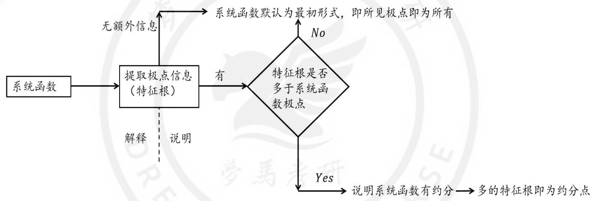

【梦马班点拨】极点(特征根)信息一般呈现在方程阶数或各响应的解形式中

例19: $H(z) = \frac{1}{z^2 + 5z + 6}$ , 试写出差分方程。 $= \frac{z^{-2}}{1 + 5z - 4 + 6z - 2}$ $y(n) + 5y(n-1) + 6y(n-2) = f(n-2)$

例 20: 因果系统的差分方程 $y(n) + 3y(n-1) + 2y(n-2) = f(n) + f(n-1)$ ,

$f(n)=u(n)$ , $y(-1)=1$ , $y(-2)=2$ , 求

$$
H (z) = \frac {1 + z ^ {- 1}}{1 + 3 z ^ {- 1} + 2 z ^ {- 2}} = \frac {z (z + 1)}{(z + 1) (z + y)}
$$

(3)零极点图。

【梦马班点拨】需要注意：

$$
\mathrm{设} y _ {2 i n} = A (- 2) ^ {n} + B (- 1) ^ {n}
$$

(1) $H(z)$ 可约性可直接用于求零状态，但零状态齐次部分一般会少一项，该项即是约掉的零极点项。

(2)不能按照 $H(z)$ 约分后形式，应根据方程式或者 $H(z)$ 最初形式确定特征根，否则 $y_{zi}(n)$ 和 $y(n)$ 有误

例如该题中 $y_{zi}(n)$ 根据方程 $y_{zi}(n)=A(-1)^{n}+B(-2)^{n}$ ，若根据 $H(z)=\frac{z}{(z+2)}$ 只列为 $y_{zi}(n)=B(-2)^{n}$ 是错误的。