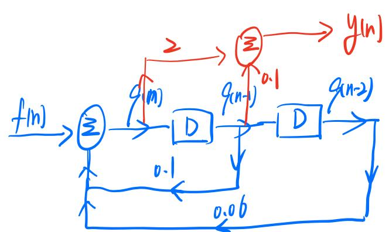
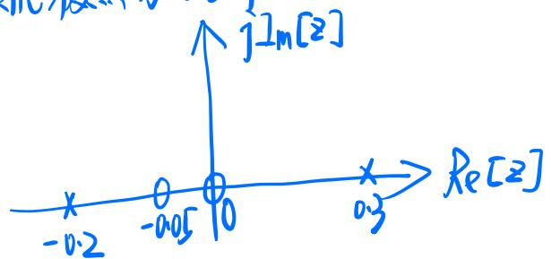
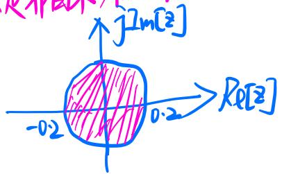

如需打印，微信扫一扫。彩色黑白同价，五分一页，首单免费，满三元顺丰包邮次日达。

最好用的刷题小程序，多专业课题全网唯一

扫码打印 首单免费

长按识别二维码，开始学习吧

免费资料分享群

微信群是唯一更新渠道。

微信群是唯一更新渠道。

群聊：上岸笔记B19

每日分享免费
| 考研 | 考公 | 考编 | 法考 | 教师 | 财会 | 金融 | 医考 |
四六级 | 专四八 | 教育类 | 小初高 | 云课堂 | 影音类 | 等
等 |

## 【第40节】课后作业

## 1、【2024 西安电子科技大学】

已知某因果离散时间系统的差分方程

$$
y (n + 2) - 0. 1 y (n + 1) - 0. 0 6 y (n) = 2 f (n + 2) + 0. 1 f (n + 1)
$$

$f(n)$ 为激励， $y(n)$ 为响应

(1)画出系统直接形式的流图；

(2)求系统函数 $H(z)$ 及单位序列响应 $h(n)$ ;

(3)画出系统函数的零极点分布图，并判断系统是否稳定；

(4)已知系统零输入的初始条件 $y_{zi}(0)=1,\quad y_{zi}(1)=0$ ，求系统 $y_{zi}(n)$ ;

(5)当激励 $f(n)=(0.3)^{A}u(n)$ 时，求系统 $y_{zs}(n)$ ;

解：(1) $y_{(n)} - 0.1y_{(n-1)} - 0.06y_{(n-2)} = 2f(n) + 0.1f(n-2)$

取中间度当 $g\left( n\right)$ ,使 $f\left( n\right)  = g\left( n\right)  - {0.1g}\left( {n - 1}\right)  - {0.06g}\left( {n - 2}\right)$

$$
H (z) = \frac {2 z ^ {2} + 0 . 1 z}{z ^ {2} - 0 . 1 z - 0 . 0 6} = \frac {z (2 z + 0 . 1)}{(z - 0 . 3) (2 + 0 . 2)}
$$

$$
\vert 2 \vert y (n) = 2 g (n) + 0. 1 9 (n - 1)
$$

$$
\frac {H (2)}{z} = \frac {2 z + 0 . 1}{(2 - 0 . 3) (2 + 0 . 2)} = \frac {\frac {7}{5}}{z - 0 . 3} + \frac {\frac {3}{5}}{z + 0 . 2}
$$

$$
H (2) = \frac {\frac {7}{5} 2}{2 - 0 . 3} + \frac {\frac {3}{5} 2}{2 + 0 . 2}
$$

$$
\therefore h (n) = \left[ \frac {7}{5} (0. 3) ^ {n} + \frac {3}{5} (- 0. 2) ^ {n} \right] u (n)
$$

(3) 由H(2)表达式可知系统零点为0和-0.05，系统极点为0.3和-0.2，系统空板点图为

(4) 由右点列 $y_{2i}(n)=A(0.3)^{n}+B(-0.2)^{n}$

$$
\begin{array}{r l} {y _ {i} (0)} & {= A + B = 1} \\ {y _ {i} (1)} & {= 0. 3 A - 0. 2 B = 0} \end{array}
$$

$$
\Rightarrow \left\{ \begin{array}{l l} A = 0. 4 \\ B = 0. 6 \end{array} \right.
$$

$$
\therefore y _ {2 i} (n) = \left[ 0. 4 (0. 3) ^ {n} + 0. 6 (- 0. 2) ^ {n} \right] u (n)
$$

$$
f (n) = (0. 3) ^ {n} u (n)
$$

$$
f (z) = \frac {z}{z - 0 . 3}
$$

因某系统故系统ROC为 $|B|>0.3$ 说明ROC内包含单位因，故系统状态

$\Rightarrow y_{s}|n|=\sqrt{\frac{1}{n}(0.3)^{n}+\frac{46}{25}(0.3)^{n}+\frac{8}{25}(0.2)^{n}/43}$ 梦马班作业

$$
\mathrm{DF} \mathrm{免费QQ群615698143} \mathrm{B站up:信号与系统_谷哥} 7. \frac {3}{1 0} z
$$

公众号：通信考研小马哥

## 2、【2024 西安电子科技大学】

已知一 LTI 系统差分方程为

$$
y (n + 2) - y (n + 1) + 0. 1 6 y (n) = f (n + 1) + 0. 3 f (n)
$$

(1) 若系统因果, 试确定该系统的单位序列响应 $h(n)$ 和系统函数 $H(z)$ ;

(2) 若系统因果, 试判断该系统是否为稳定系统? 为什么? 若系统反因果, 请在 z 平

面上画出其系统函数 $H(z)$ 的收敛域；

(3) 若系统因果, $y(-1) = 1$ , $y(-2) = 0$ , 计算该系统的零输入响应 $y_{zi}(n)$ 。

解: $H(z) = \frac{y'(z)}{f'(z)} = \frac{z + 0.3}{z^2 - z + 0.16} = \frac{z + 0.3}{(z - 0.2)(z - 0.8)}$

普洱因果则 ROC 为 |z| > 0.8

$$
H (8) = \frac {- \frac {5}{6}}{z - 0 . 2} + \frac {\frac {1 1}{6}}{z - 0 . 8}
$$

$$
\begin{array}{r l} {\therefore H (z)} & {= \left[ \frac {- \frac {1}{6} z}{z - 0 . 2} + \frac {\frac {1 1}{6} z}{z - 0 . 8} \right] z ^ {- 1}} \\ {\therefore h (n)} & {= \left[ - \frac {5}{6} (0. 2) ^ {n - 1} + \frac {1 1}{6} (0. 8) ^ {n - 1} \right] u (n - 1)} \\ & {= \left[ - \frac {2 5}{6} (0. 2) ^ {n} + \frac {5 5}{2 4} (0. 8) ^ {n} \right] u (n - 1)} \end{array}
$$

(2) ROC为121>0.8 说明ROC内各
单位圆数系统稳定

紫外线反因果 则121<0.2
不足非因果, 反因果特拍左序列

(3) 由H(2)极点可列

$$
\begin{array}{r l} {y _ {2 i} (n)} & {= A (0. 2) ^ {n} + B (0. 8) ^ {n}} \\ {y _ {2 i} (- 1)} & {= y (- 1) = 5 A + \frac {1}{4} B = 1} \\ {y _ {2 i} (- 2)} & {= y (- 2) = 2 5 A + \frac {2 5}{1 6} B = 0} \\ {\Rightarrow y _ {2 i} (n)} & {= \left[ - \frac {1}{1 5} (0. 2) ^ {n} + \frac {1 6}{1 5} (0. 8) ^ {n} \right] u (n)} \end{array}
$$

## 3、【2024 沈阳理工大学】

已知系统函数

$$
H (z) = \frac {z ^ {2} - 3 z}{z ^ {2} - 3 z + 2}
$$

(1) 对于所有收敛域求出对应的脉冲响应 $h(n)$ ;

(2) 写出系统的差分方程;

（3）对因果系统，若输入 $x(n) = (-1)^n u(n)$ ，全响应 $y(n) = [2 + \frac{4}{3}(2)^n + \frac{2}{3}(-1)^n]$ ，求 $y(-1)$ 和 $y(-2)$ 。

解: $H(z) = \frac{z(z-3)}{(z-1)(z-2)}$ 则 $\frac{H(z)}{z} = \frac{z-3}{(z-1)(z-2)} = \frac{z}{z-1} + \frac{-1}{z-2}$

$$
H (2) = \frac {2 8}{z - 1} + \frac {- 8}{z - 2}
$$

(1) 若 ROC 为 |z| > 2 时

若 ROC 为 |z| < 1 时

若 ROC 为 |<|z|<2 时 $h(n) = [2 - (2)^n] u(n)$ $h(n) = [-2 + (2)^n] u(-n-1)$ $h(2) = 2u(n) + (2)^n u(-n-1)$

(2) $H\left( 2\right)  = \frac{{z}^{2} - {3z}}{{z}^{2} - {3z} + 2} = \frac{{1 - 3{z}^{-1}}}{{1 - 3{z}^{-1} + 2{z}^{-2}}$

∴ 3程为 $y(n)-3y(n-1)+2y(n-2)=2x(n)-3x(n-1)$

$$
\begin{array}{r l} {(3)} & {n = 0 \text {   or   } y (1) = 2 + \frac {4}{3} + \frac {2}{3} = 4} \\ & {n = 1 \text {   or   } y (1) = 2 + \frac {8}{3} - \frac {2}{3} = 4} \\ & {y (1) - 3 y (1) + 2 y (- 1) = x (1) - 3 x (1) = - 1 - 3 = - 4} \\ & {\Rightarrow y (- 1) = \frac {- 4 - 4 + 1 2}{2} = 2} \\ & {y (1 0) - 3 y (- 1) + 2 y (- 2) = x (1 0) - 3 x (- 1) = 1} \\ & {\Rightarrow y (- 2) = \frac {1 - 4 + 6}{2} = \frac {3}{2}} \end{array}
$$

很多同学可得用 $y_{2i}(n)$ $2^{0}y_{2i}(n)$ $3^{0}y_{2i}(-1)=y(-1)$ $y_{2i}(-2)=y(-2)$ 右交麻烦

## 4、【2024 桂林电子科技大学】

已知离散因果LTI系统差分方程

$$
y (n) - 5 y (n - 1) + 6 y (n - 2) = f (n - 1)
$$

输入 $f(n)=2^{n}u(n)$ ，给定初始条件 $y(0)=-1,y(1)=-10$ ，求解全响应 $y(n)$ 。

解：

$$
\begin{array}{r l} & {H (z) = \frac {z ^ {- 1}}{1 - 5 z ^ {- 1} + 6 z ^ {- 2}} = \frac {z}{z ^ {2} - 5 z + 6}} \\ & {\therefore \frac {y _ {2 s (z)}}{z} = \frac {H (z) \cdot F (z)}{z} = \frac {z}{(z - 2) ^ {2} (z - 3)} = \frac {- 2}{(z - 2) ^ {2}} + \frac {- 3}{z - 2} + \frac {3}{z - 3}} \\ & {\therefore y _ {2 s (z)} = \frac {- 2 z}{(z - 2) ^ {2}} + \frac {- 3 z}{z - 2} + \frac {3 z}{z - 3}} \\ & {\therefore y _ {2 s (n)} = [ - n (2) ^ {n} - 3 (2) ^ {n} + 3 (3) ^ {n} ] u (n)} \\ & {\therefore y (n) = A (2) ^ {n} + B (3) ^ {n} - n (2) ^ {n}} \\ & {y (0) = A + B = - 1 \qquad \Rightarrow \left\{ \begin{array}{l l} A = 5 \\ B = - 6 \end{array} \right.} \\ & {y (1) = 2 A + 3 B - 2 = - 1 0} \\ & {\therefore y (n) = [ (- n + 5) (2) ^ {n} - 6 (3) ^ {n} ] u (n)} \end{array}
$$

## 5、【2024 湖南师范大学】

描述某LTI离散时间系统的差分方程为

$$
y (n + 2) + 3 y (n + 1) + 2 y (n) = f (n + 1) + 3 f (n)
$$

输入信号为 $f(n)=u(n)$ ，若初始条件 $y(1)=1,y(2)=3$ ，求出该系统的零输入响应 $y_{zi}(n)$ 和零状态响应 $y_{zs}(n)$ ;

$$
\begin{array}{r l} & {H (z) = \frac {z + 3}{z ^ {2} + 3 z + 2} = \frac {z + 3}{(z + 1) (z + 2)}} \\ & {\frac {y _ {(2 s | z)}}{z} = \frac {H (z) \cdot F (z)}{z} = \frac {z + 3}{(z + 1) (z + 2) (z - 1)} = \frac {- 1}{z + 1} + \frac {\frac {1}{3}}{z + 2} + \frac {\frac {2}{3}}{z - 1}, | z | > 2} \\ & {\therefore y _ {(2 s | z)} = \frac {- z}{z + 1} + \frac {\frac {1}{3} z}{z + 2} + \frac {\frac {2}{3} z}{z - 1}} \\ & {\therefore y _ {(2 s (n)} = [ - (- 1) ^ {n} + \frac {1}{3} (- 2) ^ {n} + \frac {2}{3} ] u (n)} \\ & {\mathrm{设} y _ {(2 i (n)} = A (- 1) ^ {n} + B (- 2) ^ {n}} \\ & {\mathrm{则} y (n) = (A - 1) (- 1) ^ {n} + (B + \frac {1}{3}) (- 2) ^ {n} + \frac {2}{3}} \\ & {y (1) = - A + 1 - 2 (B + \frac {1}{3}) + \frac {2}{3} = 1} \\ & {y (2) = A - 1 + 4 (B + \frac {1}{3}) + \frac {2}{3} = 3} \\ & {\Rightarrow A = - 2 \qquad B = 1} \\ & {\therefore y _ {(2 i (n)} = [ - 2 (- 1) ^ {n} + (- 2) ^ {n} ] u (n)} \end{array}
$$

## 6、【2024 中南大学】

已知某离散因果LTI系统的差分方程为

$$
y (n) + 3 y (n - 1) + 2 y (n - 2) = x (n) + 2 x (n - 2)
$$

初始状态为 $y(-1)=y(-2)=1$ ，输入信号 $x(n)=5^{n}u(n)$ ,

求：

(1) 系统的零输入响应 $y_{zi}(n)$ 、零状态响应 $y_{zs}(n)$ 和全响应 $y(n)$ ;

(2) 判断系统的频率响应函数 $H(e^{j\omega})$ 是否存在，若存在则写出 $H(e^{j\omega})$ ;

(3) 判断系统的稳定性。

(1) 由方程可知特征根为 -1 和 -2

$$
y _ {2 i} (n) = A (- 1) ^ {n} + B (- 2) ^ {n}
$$

$$
y _ {2 i} (- 2) = y (- 2) = A + \frac {1}{4} B = 1
$$

$$
y _ {2 1} (- 2) = y (- 2) \quad y _ {2 1} (2) = H (2) \cdot (1 2) = \frac {1 + 2 z ^ {- 2}}{1 + 3 z ^ {- 1} + 2 z ^ {- 2}} \cdot \frac {z}{z - 5} = \frac {(z ^ {2} + 2) z}{(z + 1) (z + 2) (z - 5)}
$$

$$
\frac {| 2 s | 8 |}{z} = \frac {z ^ {2} + 2}{(z + 1) (z + 2) (z - 5)} = \frac {- \frac {1}{2}}{z + 1} + \frac {\frac {6}{7}}{z + 2} + \frac {\frac {9}{1 4}}{z - 5}
$$

$$
\therefore y _ {2 5} (z) = \frac {- \frac {1}{2} z}{z + 1} + \frac {\frac {6}{7} z}{z + 2} + \frac {\frac {9}{1 4} z}{z - 5}
$$

$$
\therefore y _ {2 s} (n) = \left[ - \frac {1}{2} (- 1) ^ {n} + \frac {6}{7} (- 2) ^ {n} + \frac {9}{1 4} (\Omega) ^ {n} \right] u (n)
$$

$$
\begin{array}{r l} {\therefore y _ {2 s} (n)} & {= \left[ - \frac {1}{2} (- 1) ^ {n} + \frac {9}{1 4} (5) ^ {n} \right] u (n)} \\ {\therefore y (n)} & {= y _ {2 i} (n) + y _ {2 s} (n)} \\ & {= \left[ \frac {5}{2} (- 1) ^ {n} - \frac {5 0}{7} (- 2) ^ {n} + \frac {9}{1 4} (5) ^ {n} \right] u (n)} \end{array}
$$

$\therefore y_{\left| n\right| }=y_{\left| i\right| }\left| n\right|+y_{\left| s\right| }\left| n\right|=\left(\frac{1}{2}\right)^{\left( n\right) }-\frac{1}{7}$ (2) 目录表达：故 ROC 为 $|z|=2$ 该的 ROC 内不包含单位圆，h(w) 不满足定时可和

即 $H(e^{j\omega})$ 不存在

(3) ROC 为 $|2| > 2$ ，ROC 由不包含单层图，故就不成立

## 7、【2024 成都理工大学】

已知线性非时变因果系统

当输入为 $x_{1}(n) = 2^{n}u(n)$ 时，系统全响应 $y_{1}(n) = \left[\frac{2}{3} (-1)^{n} - (-2)^{n} + \frac{1}{3} 2^{n}\right]u(n)$ 当输入 $x_{2}(n) = u(n)$ 时，系统全响应 $y_{2}(n) = \left[\frac{1}{2} (-1)^{n} - \frac{2}{3} (-2)^{n} + \frac{1}{6}\right]u(n)$

(1) 求系统函数 $H(z)$ ，单位取样响应 $h(n)$ 及该系统的差分方程；

(2) 画出描述该系统的信号流图;

(3) 已知 $y(-1) = 0, y(-2) = \frac{1}{2}, x(n) = n(-2)^n u(n)$ 求该系统的零输入响应，零

状态响应与完全响应。
解：设系统输入响应为 $y_{2i}(n)$ ，则 $y_{1}(n)=y_{2i}(n)+x_{1}(n)\times h(n)$ ① $y_{2}(n)=y_{2i}(n)+x_{2}(n)\times h(n)$ ②

$$
y _ {1} (n) - y _ {2} (n) = [ x _ {1} (n) - x _ {2} (n) ] * h (n)
$$

$$
y _ {1} (z) - y _ {2} (z) = \left[ x _ {1} (z) - x _ {2} (z) \right] \cdot H (z)
$$

可得 $H(z)=\frac{z^{2}}{(z+1)(z+2)}$

$$
\begin{array}{r l} & {\frac {H (2)}{z} = \frac {z}{(2 + 1) (2 + 2)} = \frac {- 1}{z + 1} + \frac {2}{z + 2}} \\ & {\Rightarrow H (2) = \frac {- 2}{z + 1} + \frac {2 8}{z + 2} \Rightarrow h (n) = [ - (- 1) ^ {n} + 2 (- 2) ^ {n} ] h (n)} \end{array}
$$

$$
H (1 8) = \frac {1}{1 + 3 8 ^ {- 1} + 2 8 ^ {- 2}}
$$

(3) 设 $y_{2i}(n)=A(-1)^{n}+B(-2)^{n}$

$$
\Rightarrow y (n) + 3 y (n - 1) + 2 y (n - 2) = x (n)
$$

$$
\Rightarrow \vert_ {A _ {i} (- 1)} = - A - \frac {B}{2} = 0 \Rightarrow \left\{ \begin{array}{l l} A = 1 \\ B = - 2 \end{array} \right.
$$

$$
H (8) = \frac {1}{1 - (- 3 z ^ {- 1} - 2 z ^ {- 2})}
$$

$$
| b | (- 2) = A + \frac {B}{4} = \frac {1}{2}
$$

$$
\Rightarrow y _ {2 i} (n) = [ (- 1) ^ {n} - 2 (- 2) ^ {n} ] u (n)
$$

$$
x (z) = \frac {- 2 z}{(z + 2) ^ {2}}
$$

$$
\Rightarrow P _ {2 3} (z) = H (z) \cdot x (z) = \frac {(z + 2) ^ {3} (z + 1)}{2}
$$

官网：www.tongxinkaoyan.com

7 $\frac{y_{2s}(2)}{2}=\frac{-2z^{2}}{(2+2)^{3}(2+1)}=\frac{-2}{z+1}+\frac{8}{(2+2)}\frac{0}{(3+9)}+\frac{2}{z+2}$ PDF免费QQ群613698143

DF免费QQ群615698143
B站up: 信号与系统\_谷哥 $-z \frac{a(2-a)^{2}-a(2)^{2}}{(2-a)^{4}} \leftrightarrow n^{2}a^{n}(a(n))$

$$
y _ {2 8} (2) = \frac {- 2 8}{2 + 1} + (\frac {8 8}{(2 + 2) ^ {3}}) + \frac {2 8}{2 + 2}
$$

公众号：通信考研小马哥

8、【2024 南京信息工程大学】 $\Rightarrow \frac{a_{2}(2-a)}{(2-a)^{3}}=\frac{a_{2}^{2}-a^{2}2}{(2-a)^{3}}$

$$
= - 2 \frac {a z - a ^ {2} - 2 a z}{(z - a) ^ {3}}
$$

$$
\frac {[ - 2 z ^ {2} + 4 z ] \times 2 + 4 z ^ {2}}{(z + 2) ^ {3}}
$$

已知某离散LTI系统的差分方程

$$
= \frac {a z ^ {2} + a ^ {2} z}{(z - a) ^ {3}}
$$

$$
y (n) + a y (n - 1) + b y (n - 2) = x (n) + c x (n - 1)
$$

其中 $z = 0.65$ 为一阶零点， $z = 0.3$ 为一阶极点， $H(1) = 1$

(1) 求 $H(z)$ 以及 $a, b, c$ 的值；

(2) 求 $h(n)$ , 并说明系统是否稳定?

$$
\begin{array}{r l} {\Rightarrow y _ {3 (n)} = - 2 (- 1) ^ {n} + 2 (- 2) ^ {n}} \\ & {+ 2 n ^ {2} (- 2) ^ {n} - [ n (- 2) ^ {n} + n ^ {2} (- 2) ^ {n} ]} \\ {=} & {- 2 (- 1) ^ {n} + 2 (- 2) ^ {n} + n ^ {2} (- 2) ^ {n} n (- 2) ^ {n}} \end{array}
$$

(3) 输入为 $\delta(n) - 2\delta(n - 2)$ ，求此时的输出。

设: (1) $H(z)=\frac{y_{(z)}}{x(z)}=\frac{1+cz^{-1}}{1+az^{-1}+bz^{-2}}=\frac{z^{2}+cz}{z^{2}+az+b}=\frac{z(z+c)}{z^{2}+az+b}=\left(-2(-1)^{n}+(n^{2}-n+2)(-2)^{n}\right)(1(n))$ $\Rightarrow y_{(n)}=\left[-(-1)^{n}+(n^{2}-n)(-2)^{n}\right](1(n))$

由原权点可渡 $H(2) = \frac{(z - 0.65) \cdot 8}{(z - 0.3) \cdot (z - 1)}$

$$
H (1) = \frac {0 . 3 5}{0 . 7 \times (1 - x)} = 1 \Rightarrow x = \frac {1}{2} \Rightarrow H (2) = \frac {z (2 - 0 . 6 5)}{(z - 0 . 3) (2 - 0 . 5)}
$$

$$
\frac {H (2)}{z} = \frac {z - 0 . 6 5}{(z - 0 . 3) (z - 0 . 5)} = \frac {1 . 7 5}{z - 0 . 3} + \frac {- 0 . 7 5}{z - 0 . 5}
$$

$$
n _ {c} ^ {\prime} H (1) = 1
$$

Zoe 内包含单位图. 要设致定(3) $\sqrt{ln} \Leftrightarrow h(n)$ 故 $\sqrt{ln} - 2\sqrt{ln-2} \rightarrow h(n) - 2h(n-2)$ $y_{(n)} = \begin{bmatrix} 1.75 & 10.31^{n} - 0.75 & 10.51^{n} \\ -2[1.75(10.3)^{n-2} - 0.75(10.5)^{n-2}] & n(n-2) \end{bmatrix} u(n)$