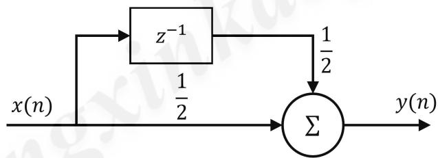
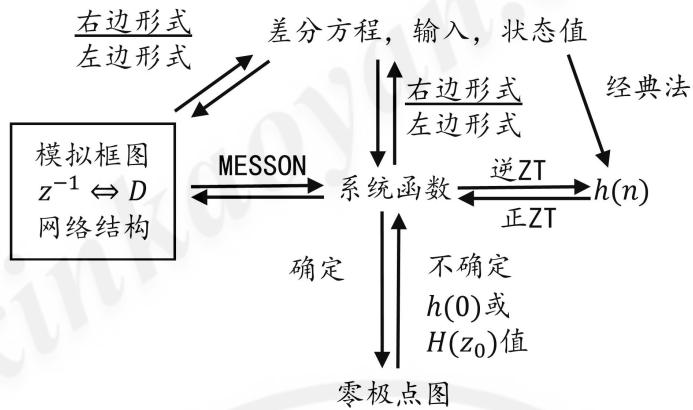
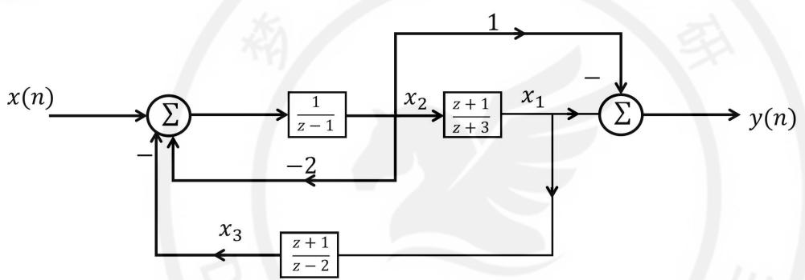

如需打印，微信扫一扫。彩色黑白同价，五分一页，首单免费，满三元顺丰包邮次日达。

最好用的刷题小程序，多专业课题全网唯一

扫码打印 首单免费

长按识别二维码，开始学习吧

免费资料分享群

微信群是唯一更新渠道。

微信群是唯一更新渠道。

群聊：上岸笔记B19

每日分享免费
| 考研 | 考公 | 考编 | 法考 | 教师 | 财会 | 金融 | 医考 |
四六级 | 专四八 | 教育类 | 小初高 | 云课堂 | 影音类 | 等
等 |

## 专题5 网络结构与状态变量分析

## 考点1：梅森公式 $\rightarrow$ 网络结构(模拟框图)与系统函数

$$
H (z) = \frac {\sum_ {k} T _ {k} \Delta_ {k}}{\Delta} (\text {同连续部分的理解})
$$

## 考点2：网络结构的画法

1、离散系统的分类：有限长单位脉冲响应网络(Finite Impulse Response，简称FIR)和无限长单位脉冲响应网络(Infinite Impulse Response，简称IIR)

2、特点：FIR网络结构中不存在反馈支路(回路)，只有前向通路。IIR网络结构中既有前向通路，又有反馈支路

3、IIR系统的基本网络结构——直接型、级联型和并联型

(1)直接型:

①将系统函数分子分母全部化成 $z^{-1}$ 的多项式；

②根据分子、分母 $z^{-1}$ 的次幂数，确定“左几右几”结构；

③根据 $H(z)=\frac{\text{分子}z^{-1}\text{多项式}}{\text{分母}z^{-1}\text{多项式}}=\frac{\text{分子}}{1-[\quad]}$ 形式标记各支路系数。

例21：已知 $H(z) = \frac{8 - 4z^{-1} + 11z^{-2} - 2z^{-3}}{1 - \frac{5}{4}z^{-1} + \frac{3}{4}z^{-2} - \frac{1}{8}z^{-3}}$ ，画出该IIR系统直接型网络结构。

## (2)级联型

①系统函数分子分母因式分解;

②将系统函数化成连乘形式，注意因式分配时尽量采用纯阶网络，以保证延时器个数最少；

③将分配的各子网络，分别按照直接型画图，然后首尾相连。

例 22：已知 $H(z)$ 表达式，画出该 IIR 系统级联型网络结构图。

$$
H (z) = \frac {8 - 4 z ^ {- 1} + 1 1 z ^ {- 2} - 2 z ^ {- 3}}{1 - 1 . 2 5 z ^ {- 1} + 0 . 7 5 z ^ {- 2} - 0 . 1 2 5 z ^ {- 3}}
$$

## (3)并联型

①利用部分分式展开法将(真分式)系统函数化成连加的形式(同阶假分式=常数+真分式);

②采用各走各路的形式，将各子网络，分别按照直接型画图。

例 23: 已知 $H(z)$ 表达式，画出该 IIR 系统并联型网络结构图。

$$
H (z) = \frac {8 - 4 z ^ {- 1} + 1 1 z ^ {- 2} - 2 z ^ {- 3}}{1 - 1 . 2 5 z ^ {- 1} + 0 . 7 5 z ^ {- 2} - 0 . 1 2 5 z ^ {- 3}}
$$

4、FIR网络结构—直接型、级联型

(1)直接型: 仅有前向通路, 标记各支路系数;

例24：已知 $H(z)$ 表达式，画出该FIR系统直接型网络结构图。

$$
H (z) = 0. 9 6 + 2 z ^ {- 1} + 2. 8 z ^ {- 2} + 1. 5 z ^ {- 3}
$$

例 25: H(z) 表达式, 画出该 FIR 系统级联型网络结构图。

$$
H (z) = (0. 6 + 0. 5 z ^ {- 1}) (1. 6 + 2 z ^ {- 1} + 3 z ^ {- 2})
$$

(3)FIR系统的线性相位

①FIR系统，设其 $h(n)$ 的长度为N，若系统具有线性相位，则一定满足 $h(n)=\pm h(N-n-1)$

式中“+”表示第一类线性相位系统；“—”表示第二类线性相位系统。

②FIR系统的频谱(幅度谱和相位谱)处理：根据线性相位和欧拉公式画出三角函数形式

例26：已知离散时间系统的框图如图所示，求该系统的系统函数，并画出系统频率响应特性曲线。

5、离散系统表征形式相互转换

## 考点3：状态方程与输出方程

1、状态变量：选择(模拟框图、网络结构)中延时器的输出为状态变量，并在图中进行标记；

2、状态方程：用状态变量和输入来表示延时器输入端；

3、输出方程：用状态变量和输入来表示系统输出。

例 27: 描述某离散系统的差分方程为

$y(n) + 2y(n - 1) + 3y(n - 2) + 4y(n - 3) = f(n) + 3f(n - 1) + 5f(n - 2)$ 写出其状态方程和输出方程。

考点 4：对结构图直接进行状态变量分析

$$
\xrightarrow {\lambda_ {1} (n)} \boxed {H _ {1} (z) = \frac {z}{z - 1}} \xrightarrow {\lambda_ {2} (n)}
$$

$$
\lambda_ {2} (z) = \lambda_ {1} (z) \cdot \frac {z}{z - 1}
$$

$$
(z - 1) \cdot \lambda_ {2} (z) = z \lambda_ {1} (z)
$$

$$
z \lambda_ {1} (z) = z \lambda_ {2} (z) - \lambda_ {2} (z)
$$

$$
\lambda_ {1} (n + 1) = \lambda_ {2} (n + 1) - \lambda_ {2} (n)
$$

例 28: 对如图所示结构图直接进行状态定量分析。

## 考点5：离散系统双零法状态变量求解

考虑初始状态矢量为 $x(0)$ ， $k = 0$ 接入激励的因果系统，对其状态方程和输出方程分别取单边 $z$ 变换，有

$$
\begin{array}{c} z \boldsymbol {X} (z) - z \boldsymbol {x} (0) = \boldsymbol {A} \boldsymbol {X} (z) + \boldsymbol {B} \boldsymbol {F} (z) ① \\ \boldsymbol {Y} (z) = \boldsymbol {C} \boldsymbol {X} (z) + \boldsymbol {D} \boldsymbol {F} (z) ④ \end{array}
$$

式中 $X(z)$ 、 $F(z)$ 、 $Y(z)$ 分别是 $x(n)$ 、 $f(n)$ 、 $y(n)$ 的单边z变换。

对①式移项得

$$
(z I - A) X (z) = z x (0) + B F (z)
$$

等号两边左乘 $(zI - A)^{-1}$ , 得

$$
\boldsymbol {X} (z) = (z \boldsymbol {I} - \boldsymbol {A}) ^ {- 1} z \boldsymbol {x} (0) + (z \boldsymbol {I} - \boldsymbol {A}) ^ {- 1} \boldsymbol {B} \boldsymbol {F} (z) ②
$$

为了方便，定义

$$
\boldsymbol {\Phi} (z) \stackrel {d e f} {=} (z \boldsymbol {I} - \boldsymbol {A}) ^ {- 1} z
$$

可称为状态方程矩阵[注意与连续系统中的状态方程矩阵 $\Phi(s)$ 的区别]。于是可以将②式简写为

$$
\pmb {X} (z) = \pmb {\Phi} (z) \pmb {x} (0) + z ^ {- 1} \pmb {\Phi} (z) \pmb {B} \pmb {F} (z) ③
$$

对③式取逆z变换，得状态矢量的解为

$$
\pmb {x} (n) = \mathcal {Z} ^ {- 1} [ \pmb {\Phi} (z) \pmb {x} (0) ] + \mathcal {Z} ^ {- 1} [ z ^ {- 1} \pmb {\Phi} (z) \pmb {B} \pmb {F} (z) ] = \pmb {x} _ {z i} (k) + \pmb {x} _ {z s} (k)
$$

式中

$$
\begin{array}{r} \pmb {x} _ {z i} (n) = \mathcal {Z} ^ {- 1} [ \pmb {\Phi} (z) \pmb {x} (0) ] \\ \pmb {x} _ {z s} (n) = \mathcal {Z} ^ {- 1} [ z ^ {- 1} \pmb {\Phi} (z) \pmb {B F} (z) ] \end{array}
$$

分别是状态矢量的零输入解和零状态解。

将③式代入④式可得输出的象函数为

$$
\pmb {Y} (z) = \pmb {C} \pmb {\Phi} (z) \pmb {x} (0) + C z ^ {- 1} \pmb {\Phi} (z) B \pmb {F} (z) + D \pmb {F} (z)
$$

对上式取逆z变换，可求出系统的响应为

$$
\pmb {y} (k) = \mathcal {Z} ^ {- 1} [ \pmb {C} \pmb {\Phi} (z) \pmb {x} (0) ] + \mathcal {Z} ^ {- 1} \bigl \{[ \pmb {C} z ^ {- 1} \pmb {\Phi} (z) \pmb {B} + \pmb {D} ] \pmb {F} (z) \bigr \}
$$

容易看出，上式第一项是系统的零输入响应矢量 $y_{zi}(n)$ ，第二项是系统的零状态响应矢量 $y_{zs}(n)$ ，即

$$
\begin{array}{r} \pmb {y} _ {z i} (n) = \mathcal {Z} ^ {- 1} [ \pmb {C} \pmb {\Phi} (z) \pmb {x} (0) ] \\ \pmb {y} _ {z s} (n) = \mathcal {Z} ^ {- 1} \big [ (\pmb {C} \pmb {z} ^ {- 1} \pmb {\Phi} (z) \pmb {B} + \pmb {D}) \pmb {F} (z) \big ] \end{array}
$$

例 29: 已知某离散因果系统的状态方程和输出方程分别为

$$
\begin{array}{r} \left[ \begin{array}{c} x _ {1} (n + 1) \\ x _ {2} (n + 1) \end{array} \right] = \left[ \begin{array}{c c} 0 & 1 \\ - 6 & 5 \end{array} \right] \left[ \begin{array}{c} x _ {1} (n) \\ x _ {2} (n) \end{array} \right] + \left[ \begin{array}{c} 0 \\ 1 \end{array} \right] f (n) \\ \left[ \begin{array}{c} y _ {1} (n) \\ y _ {2} (n) \end{array} \right] = \left[ \begin{array}{c c} 1 & 1 \\ 2 & - 1 \end{array} \right] \left[ \begin{array}{c} x _ {1} (n) \\ x _ {2} (n) \end{array} \right] \end{array}
$$

初始状态为 $\begin{bmatrix} x_1(0) \\ x_2(0) \end{bmatrix} = \begin{bmatrix} 1 \\ 2 \end{bmatrix}$ ，激励 $f(n) = u(n)$ 。求状态方程的解和系统的输出。

夢馬考研

## 考点6：状态变量分析判断稳定性

系统函数矩阵 $H(z)$ 与系统稳定性的判断

由 $\mathbf{y}_{zs}(n) = \mathcal{Z}^{-1}\bigl[(Cz^{-1}\Phi (z)B + D)F(z)\bigr]$ 可看出，零状态响应 $\mathbf{y}_{zs}(n)$ 的象函数 $Y_{zs}(z)$ 为

$$
\boldsymbol {Y} _ {z s} (z) = [ \boldsymbol {C z} ^ {- 1} \boldsymbol {\Phi} (z) \boldsymbol {B} + \boldsymbol {D} ] \boldsymbol {F} (z) = \boldsymbol {H} (z) \boldsymbol {F} (z)
$$

式中

$$
\pmb {H} (z) \stackrel {d e f} {=} \pmb {C} z ^ {- 1} \pmb {\Phi} (z) \pmb {B} + \pmb {D}
$$

它是一个 $q \times p$ 阶矩阵，常称为系统的系统函数矩阵或转移函数矩阵。容易推出其逆 $z$ 变换就是单位样值响应矩阵 $\pmb{h}(n)$ ，即

$$
\mathcal {Z} [ \pmb {h} (n) ] = \pmb {H} (z) = \pmb {C} z ^ {- 1} \pmb {\Phi} (z) \pmb {B} + \pmb {D} = \pmb {C} (z \pmb {I} - \pmb {A}) ^ {- 1} \pmb {B} + \pmb {D}
$$

由于

$$
(z \boldsymbol {I} - \boldsymbol {A}) ^ {- 1} = \frac {\operatorname{adj} (\boldsymbol {z I} - \boldsymbol {A})}{\det (\boldsymbol {z I} - \boldsymbol {A})}
$$

代入 $\mathcal{Z}[h(k)]=H(z)=Cz^{-1}\Phi(z)B+D=C(zI-A)^{-1}B+D$ ，得

$$
\boldsymbol {H} (z) = \frac {\boldsymbol {C a d j} (z \boldsymbol {I} - \boldsymbol {A}) \boldsymbol {B} + \boldsymbol {D} d e t (z \boldsymbol {I} - \boldsymbol {A})}{d e t (z \boldsymbol {I} - \boldsymbol {A})}
$$

可见，多项式 $det(zI-A)$ 就是系统的特征多项式，所以 $H(z)$ 的极点就是特征方程

$$
d e t (z \pmb {I} - \pmb {A}) = 0
$$

的根，即系统的特征根。判断特征根是否在z平面的单位圆内可以判断因果系统是否稳定。可见系统是否稳定只与状态方程中的系统矩阵A有关。

例 30: 描述某因果系统的状态方程为

$$
\boldsymbol {x} (n + 1) = \left[ \begin{array}{c c} 0 & \frac {1}{6} \\ - 1 & - \frac {5}{6} \end{array} \right] \boldsymbol {x} (n) + \left[ \begin{array}{c c} 1 & 2 \\ 4 & 5 \end{array} \right] \boldsymbol {f} (n)
$$

试判断该系统是否稳定。