如需打印，微信扫一扫。彩色黑白同价，五分一页，首单免费，满三元顺丰包邮次日达。

最好用的刷题小程序，多专业课题全网唯一

扫码打印 首单免费

长按识别二维码，开始学习吧

免费资料分享群

微信群是唯一更新渠道。

微信群是唯一更新渠道。

群聊：上岸笔记B19

每日分享免费
| 考研 | 考公 | 考编 | 法考 | 教师 | 财会 | 金融 | 医考 |
四六级 | 专四八 | 教育类 | 小初高 | 云课堂 | 影音类 | 等
等 |

如需打印，微信扫一扫。彩色黑白同价，五分一页，首单免费，满三元顺丰包邮次日达。

最好用的刷题小程序，多专业课题全网唯一

扫码打印 首单免费

长按识别二维码，开始学习吧

免费资料分享群

微信群是唯一更新渠道。

微信群是唯一更新渠道。

群聊：上岸笔记B19

每日分享免费
| 考研 | 考公 | 考编 | 法考 | 教师 | 财会 | 金融 | 医考 |
四六级 | 专四八 | 教育类 | 小初高 | 云课堂 | 影音类 | 等
等 |

DF免费QQ群615698143

$1^{\circ} h H_{1} \xrightarrow{可移} H(W)$

$2^{\circ}H$ $(OH)_{2}$ $\rightarrow$ $H(S)_{2}$ 空存在

$$
H (W) = H (S) / s = j W
$$

连续时间前3的物理变换

1° FTR义 ⇒ 常见信号 PT

文朱信号FT

$2^{\circ}$ FT性质 $= ?$

懒子妊娠结局

会动词演清 $2$ $3^{\circ}$ 同色 $10^{13}$ 当 $P$ 厂 $4^{\circ}$ 抱样才恢复 $5^{\circ}$ 讨明于词调

$$
z = e ^ {i w} = \underline {{r e}} ^ {j 0}.
$$

$$
H i e ^ {j \omega}
$$

$$
2 0 H (e ^ {j \omega})
$$

亮散时间号的厚出长度授

$1^{0}$ DTFI $\Rightarrow$ 解DIPT

20 惯

$2^{\circ}$ 鹏：会动的预估

DTFT (天星片) 以2π为周期

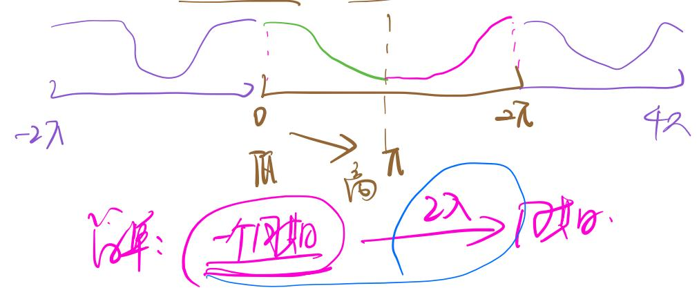

解： $\frac{一个周期}{2\lambda}$ $\rightarrow$ $1000.$

## 专题6 序列的傅里叶变换DTFT及其性质

## 考点 1：离散时间傅里叶变换(Discrete Tine Fourier Transform, DTFT)

1、定义及隐含周期性

在满足绝对可和 $\sum_{n = -\infty}^{\infty}|x(n)| < \infty$ 时，序列傅里叶变换存在，其定义为：

$$
D T F T [ x (n) ] = X (e ^ {j \omega}) = \sum_ {n = - \infty} ^ {\infty} x (n) e ^ {- j \omega n}
$$

正变板

$$
I D T F T [ X (e ^ {j \omega}) ] = x (n) = \frac {1}{2 \pi} \int_ {- \pi} ^ {\pi} X (e ^ {j \omega}) e ^ {j \omega n} d \omega
$$

$$
W = 0
$$

$$
x (e ^ {j 0}) = \sum_ {n = - i b} ^ {i b} x (n)
$$

$$
\int_ {- \pi} ^ {\pi} x (e ^ {i w}) d w = 2 \pi x (1 0)
$$

$$
\begin{array}{r l} & {X (e ^ {j \omega}) = \sum_ {n = - \infty} ^ {\infty} x (n) e ^ {- j \omega n} \cdot 1} \\ & {= \sum_ {n = - \infty} ^ {\infty} x (n) e ^ {- j \omega n} - e ^ {- j 2 \pi n n}} \\ & {= \sum_ {n = - \infty} ^ {\infty} x (n) e ^ {- j (w + 2 \pi m) n} = X [ e ^ {j (w + 2 \pi m)} ]} \\ & {\Rightarrow X (e ^ {j \omega}) \mathrm{是以} 2 \pi \mathrm{为周期的连续谱}} \end{array}
$$

(1)定义

$X(e^{j\omega})$ 是 $\omega$ 的复函数，可表示为

$$
X (e ^ {j \omega}) = | X (e ^ {j \omega}) | e ^ {j \varphi (\omega)} = R e [ X (e ^ {j \omega}) ] + j I m [ X (e ^ {j \omega}) ]
$$

$X(e^{j\omega})$ 表示 $x(n)$ 的频域特性，也称为 $x(n)$ 的频谱， $|X(e^{j\omega})|$ 为幅度谱， $\varphi(\omega)$ 为相位谱，二者都是 $\omega$ 的连续函数。

$$
\begin{array}{r l} & {| x (e ^ {j \omega}) | = \sqrt {\hat {x} ^ {2} + \overline {{\hat {x}}} ^ {2}}. \quad \varphi_ {(w)} = 0} \\ & {X (e ^ {j \omega}) = \sum_ {n = - \infty} ^ {\infty} x (n) e ^ {- j \omega n} = \sum_ {n = - \infty} ^ {\infty} x (n) [ \cos \omega n - j \sin \omega n ]} \\ & {= \sum_ {n = - \infty} ^ {\infty} x (n) \cos \omega n - j \sum_ {n = - \infty} ^ {\infty} x (n) \sin \omega n = R e [ x (e ^ {j \omega}) ] + j I m [ x (e ^ {j \omega}) ]} \\ & {\Rightarrow R e [ x (e ^ {j \omega}) ] = \sum_ {n = - \infty} ^ {\infty} x (n) \cos \omega n \sim \omega \text {偶函数}} \\ & {I m [ x (e ^ {j \omega}) ] = - \sum_ {n = - \infty} ^ {\infty} x (n) \sin \omega n \sim \omega \text {奇函数}} \end{array}\tag{2}
$$

(3)画频谱图(幅频、相频)时, 一般只画 0 到 $2 \pi$ , 或 $- \pi$ 到 $\pi$ (首选)一个周期即可;

(1)

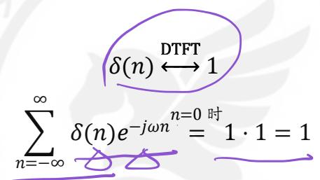

(2)

$\sum_{n = -\infty}^{\infty}|u(n)| = \sum_{n = 0}^{\infty}1 = \infty$ 不满足绝对可和

(3)

武俊学

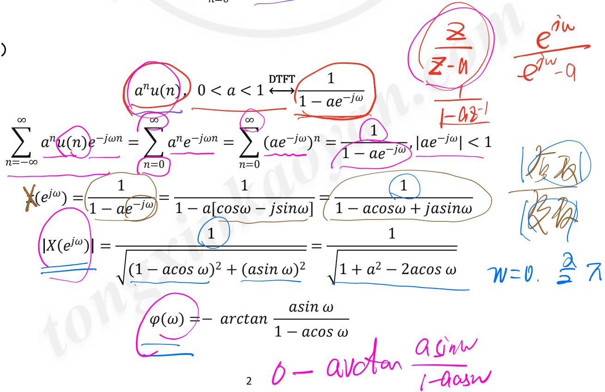

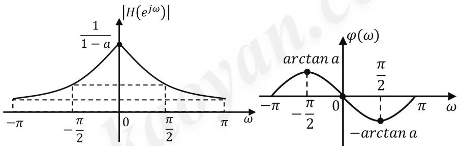

3、常见滤波器的幅频特性

(大量问)

(1)频率成分的解释:

在 $-\pi \rightarrow \pi$ 或 $0 \rightarrow 2\pi$ 周期内，0为低频， $\pi$ 为高频，幅频特性曲线画 $-\pi \rightarrow \pi$ ，但低频

到高频变换情况只看 $0 \to \pi$

夢馬考研

(2)四种滤波器的幅频特性曲线

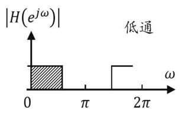

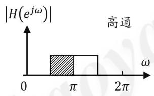

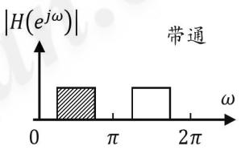

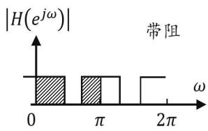

(3)滤波器判断时, 只需要看幅频在 3 个点 $(0, \pi / 2, \pi)$ 的值连成的曲线, $0 \rightarrow \pi$ 即低频到高频的走势, 在 $0 \rightarrow \pi$ 的幅频特性: 低通 (高低)、高通 (低高)、带通 (低高低)、带阻 (高低高)

(4)画幅频特性曲线时, 画出 $(0, \pi / 2, \pi)$ 的值连成的曲线, 然后关于 $\pi$ 或 $0$ 偶对称, 补充另一半图形即可;

(5)画相频特性曲线时, 画出 $(0、\pi / 2、\pi)$ 的值连成的曲线, 然后关于 $\pi$ 或 0 奇对称, 补充另一半图形即可。

## 考点 2: DTFT 的基本性质

1、线性

若 $DTFT[x_1(n)] = X_1(e^{j\omega})$ ， $DTFT[x_2(n)] = X_2(e^{j\omega})$ ，则

$$
D T F T \left[ a x _ {1} (n) + b x _ {2} (n) \right] = a X _ {1} \left(e ^ {j \omega}\right) + b X _ {2} \left(e ^ {j \omega}\right)
$$

式中 $a, b$ 为任意常数。

2、序列的位移

若DTFT $[x(n)] = X(e^{j\omega})$ ，则

$$
D T F T [ x (n - n _ {0}) ] = e ^ {- j \omega n _ {0}} X (e ^ {i \omega})
$$

时域位移对应频域的相移。

3、频域的位移

若DTFT $[x(n)] = X(e^{j\omega})$ ，则

$$
D T F T \left[ e ^ {j \omega_ {0} n} x (n) \right] = X \left[ e ^ {j (\omega - \omega_ {0})} \right]
$$

频域位移对应时域的调制。

4、序列的线性加权

若DTFT $[x(n)] = X(e^{j\omega})$ ，则

$$
D T F T [ n x (n) ] = j \left[ \frac {d}{d \omega} X \left(e ^ {j \omega}\right) \right]
$$

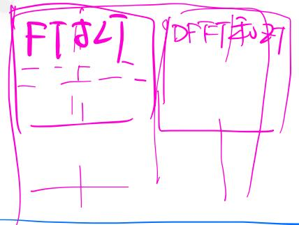

时域的线性加权对应频域微分。

5、序列的反褶

若DTFT $[x(n)] = X(e^{j\omega})$ ，则

$$
D T F T [ x (- n) ] = X (e ^ {- j \omega})
$$

时城反褶对应频域也反褶。

$x(t)$

$x(t) \hookrightarrow x(w)$

${tx}\left( t\right)  \leftrightarrow  j\frac{dx|w|}{dw}$

${tx}\left( t\right)  \Leftrightarrow   - \frac{dx\left( s\right) }{ds}$

$n(x(n)) \leq -z \frac{d(x(z))}{dz}$ $h(x|u) < \sqrt{0.15}$ for $j \frac{dx(e^{j u})}{dw}$

$$
\frac {N (t) + x (- t)}{2} \mathrm{学分量}
$$

6、奇偶虚实性

$\operatorname{Re}(\overline{X}|w)$

若 $x(n)$ 为实序列， $DTFT[x(n)] = X(e^{j\omega})$ ，它的实部和虚部分别为 $Re[X(e^{j\omega})]$ 和

$Im\left[X(e^{j\omega})\right]$ ，也可写作模与辐角形式

$$
X (e ^ {j \omega}) = | X (e ^ {j \omega}) | e ^ {j \varphi (\omega)}
$$

它们具有以下特性:

$$
R e [ X (e ^ {j \omega}) ] = R e [ X (e ^ {- j \omega}) ]
$$

$$
I m [ X (e ^ {j \omega}) ] = - I m [ X (e ^ {- j \omega}) ]
$$

$$
| X (e ^ {j \omega}) | = | X (e ^ {- j \omega}) |
$$

$$
\varphi (\omega) = - \varphi (- \omega)
$$

$$
X (e ^ {j \omega}) = X ^ {*} (e ^ {- j \omega})
$$

这表明复函数 $X(e^{j\omega})$ 的实部为偶函数，虚部为奇函数；模为偶函数，辐角是奇函数。 $X(e^{j\omega})$ 与 $X(e^{-j\omega})$ 共轭。

$x(n)$ 的偶分量 $x_{e}(n)$ 和奇分量 $x_{o}(n)$ 表示式分别为

$$
x _ {e} (n) = \frac {1}{2} [ x (n) + x (- n) ]
$$

$$
x _ {o} (n) = \frac {1}{2} [ x (n) - x (- n) ]
$$

它们的傅里叶变换分别为

$$
D T F T [ x _ {e} (n) ] = R e [ X (e ^ {j \omega}) ]
$$

$$
D T F T \left[ x _ {o} (n) \right] = j I m \left[ X (e ^ {j \omega}) \right]
$$

以上特性与连续时间信号的情况一致。

7、时域卷积定理

若DTFT $[x(n)] = X(e^{j\omega})$ ，DTFT $[h(n)] = H(e^{j\omega})$ ，则

$$
D T F T [ x (n) * h (n) ] = X (e ^ {j \omega}) H (e ^ {j \omega})
$$

时域卷积对应频域相乘。

8、频域卷积定理

若 $X(e^{j\omega}) = DTFT[x(n)], H(e^{j\omega}) = DTFT[h(n)]$ ，则

$$
\frac {1}{2 \pi} [ X (e ^ {j \omega}) * H (e ^ {j \omega}) ] = \frac {1}{2 \pi} \int_ {- \pi} ^ {\pi} X (e ^ {j \theta}) H [ e ^ {j (\omega - \theta)} ] d \theta = D T F T [ x (n) h (n) ]
$$

时域相乘对应频域卷积。

9、帕塞瓦尔定理

若DTFT $[x(n)] = X(e^{j\omega})$ ，则

$$
\sum_ {n = - \infty} ^ {\infty} | x (n) | ^ {2} = \frac {1}{2 \pi} \int_ {- \pi} ^ {\pi} | X (e ^ {j \omega}) | ^ {2} d \omega
$$

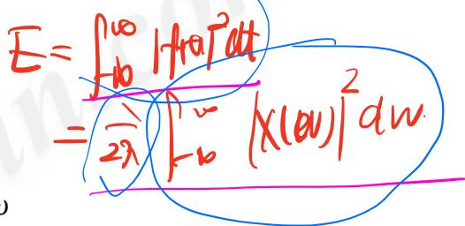

此定理也称为能量定理, 序列的总能量等于其傅里叶变换模平方在一个周期内积

分取平均，即时域总能量等于频域一周期内总能量。

祝XX(W)有限长

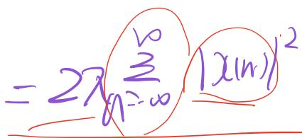

$\begin{pmatrix} \cos\pi n & x(n) \\ (-1)^{n} & x(n) \\ e^{0\pi n} & x(n) \end{pmatrix} \rightarrow x[e^{x(0-\pi)}]$ 合动的便语
官网：tongxinkaoyan.com

$$
e ^ {j \omega n} x (n) \leftrightarrow x (e ^ {j \omega}) e ^ {j \omega n} x (n) \leftrightarrow x (e ^ {j \omega - \omega})
$$

DF免费QQ群615698143

B站up: 信号与系统\_谷哥

n=0时    n>0=1
n=1时    n>π=-1
n=2π    n>2π=1

专题7 DTFT应用

$$
e ^ {j \pi n} x (n) \hookrightarrow X [ e ^ {j (n - \pi)} ]
$$

$$
= \cos \pi n - j \sin \pi n
$$

公众号：通信考研小马哥

$$
e ^ {j \pi n} = \cos \pi n = (- 1) ^ {n}
$$

## 考点 系统 DTFT 分析

1、原理

若 $x(n)\leftrightarrow X(e^{j\omega})$ ，则

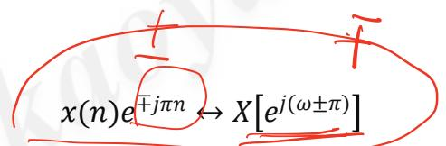

其中 $e^{\pm j\pi n}=(-1)^{n}=\cos(\pi n)$

2、解题思路：不管如何移位，只关注一个周期内的变化或画法，其他均以 $2 \pi$ 为周期来延拓。

例31: 已知系统框图如下图所示, 其中 $H(e^{j\omega}) = \begin{cases} 1, & |\omega| < \frac{\pi}{4} \\ 0, & \frac{\pi}{4} < |\omega| < \pi' \end{cases}$ , $x[n] = \cos \frac{7}{8} n\pi + 1$ , 求 $y[n]$ 。

$$
x (e ^ {j w}) \cdot H _ {x} = Y (e ^ {j w})
$$

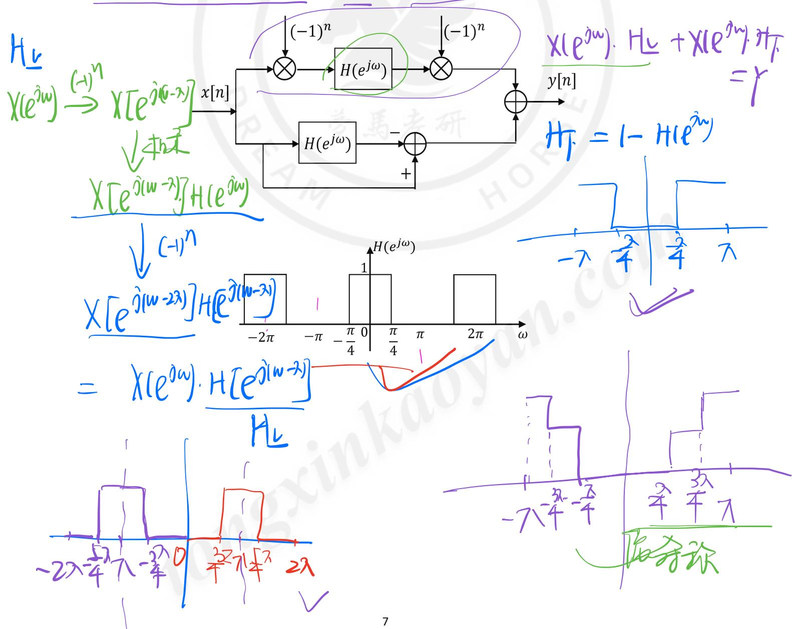

PDF免费QQ群梦马班讲义

DF免费QQ群615698143
B站up: 信号与系统\_谷哥 $n=0$ 时 $n>0=1$ $n=1$ 时 $n>x=-1$ $n=2$ 时 $n>2x=1$ 专题7 DTFT应用

$$
e ^ {j \pi n} x (n) \hookrightarrow X [ e ^ {j (n - \pi)} ]
$$

$$
= \cos \pi n - j \sin \pi n
$$

公众号：通信考研小马哥

$$
e ^ {j \pi n} = \cos \pi n = (- 1) ^ {n}
$$

考点 系统 DTFT 分析

1、原理

若 $x(n)\leftrightarrow X(e^{j\omega})$ ，则

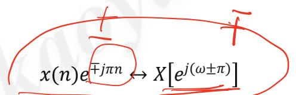

其中 $e^{\pm j\pi n}=(-1)^{n}=\cos(\pi n)$

2、解题思路：不管如何移位，只关注一个周期内的变化或画法，其他均以 $2 \pi$ 为周期来延拓。

例 31: 已知系统框图如下图所示, 其中 $H(e^{j\omega}) = \begin{cases} 1, & |\omega| < \frac{\pi}{4} \\ 0, & \frac{\pi}{4} < |\omega| < \pi \end{cases}$ ,

$$
x (n) = \delta (n)
$$

$x[n] = \cos \frac{7}{8} n\pi + 1$ ，求 $y[n]$ 。

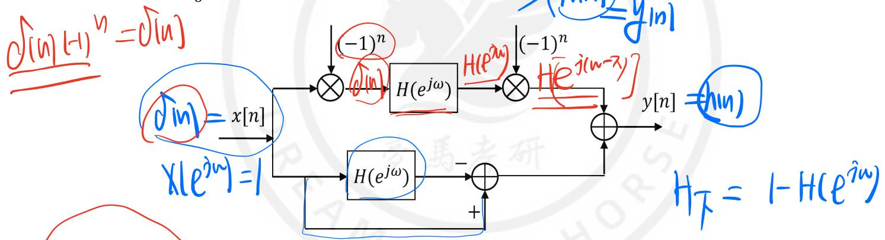

总 [支权]

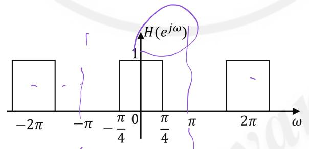

会动的题谱

$e^{\pm j\pi n} = \cos \pi n = (-1)^{n} \Rightarrow \text{移为} \pi$

② $\rightarrow$ $|H(e^{j\omega})|$ $\rightarrow$

抓一个周知过程中发抓一个周知()

最15月以为80日梦马班讲义 PDF免费QQ群615698143

DF免费QQ群615698143

$1^{0}$ DFT. FFT 等: DFT 求的叶运算量过大
所以 FFT 来求 $X(k)=DFT[x(m)]$ DFT 封 FFT 的时序一致: 求 $X(k)$

高牧原的
原且叶皮坡
2天为周期连皮谱高考讲师受授DTI

$$
\mathrm{d} \pi [ x _ {n} ] = \chi (k) = \frac {\sum_ {n = 0} ^ {N - 1} x _ {n} W _ {N} ^ {k n}}{k \mathrm{以} \sqrt {2} 0 \rightarrow N - 1 W _ {N} = e ^ {- j \frac {2 \pi}{N}}}
$$

DTFT

$$
x (e ^ {j \omega}) = \sum_ {n = 0} ^ {N - 1} x (n) e ^ {- j \omega n}
$$

$$
x (k) = \frac {\sum_ {n = 0} ^ {N - 1} x (n)}{n}
$$

$$
\underline {{W}} = \frac {2 \pi}{N} \cdot k \quad K (Q O N)
$$

$$
\chi (k) \geq x (e ^ {j \omega})
$$

$$
N = 4
$$

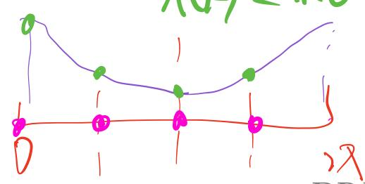

$$
\neq \overline {{1 0}} \Rightarrow 3
$$

DF免费QQ群615698143

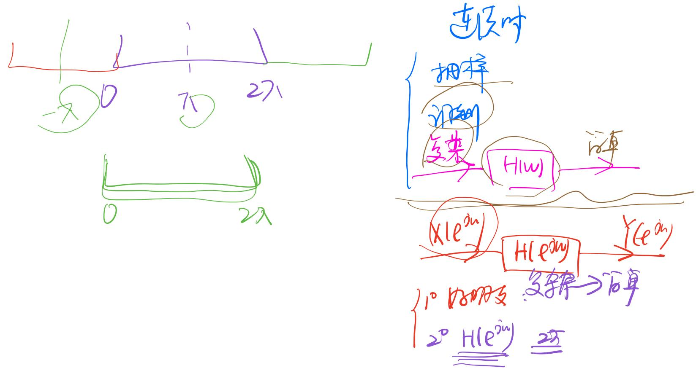

DF免费QQ群GF5698143有限长序列 $x(n):N(0\rightarrow N-1)$

$10^{DFT}$ 与 $DFT$ 关系为 $x(e^{j\omega})$ 在 $[0,2\pi]$ 上 N 点与 $|P|$ 随近反诺

DFT 高级浮足对接

2 DFT 投射一样在求 X(k) 快捷. $\overrightarrow{x(k)} \rightarrow$ 任顺和 FPT

性质： $x(m)$ 及\$\overline{原}\$

$$
\frac {x (k) = \stackrel {*} {x} (N - k)}{x (1) = x ^ {*} (4 - 1) = \stackrel {*} {x} (3)}
$$

$x(2) = [\text{阶后偶数之和}] - [\text{所奇数之和}]$

$$
\begin{array}{r l} {x (k)} & {= \sum_ {n = 0} ^ {3} x (n) \frac {W _ {N} ^ {k n}}{3}} \\ {k = 0 \mathrm{时}} & {x (0) = \sum_ {n = 0} ^ {3} x (n)} \end{array}
$$

$$
\begin{array}{r l} {W _ {N}} & {= e ^ {- j \frac {2 \pi}{N}}} \\ {W _ {4}} & {= e ^ {- j \frac {2 \pi}{4}}} \end{array}
$$

$$
\begin{array}{r l} {x (2) = \sum_ {n = 0} ^ {3} x (n) W _ {4} ^ {2 n}} & {= x (1 0) W _ {4} ^ {0} + x (1) W _ {4} ^ {2} + x (2) W _ {4} ^ {4} + x (3) W _ {4} ^ {6}} \\ & {= x (1 0) - x (1) + x (2) - x (3)} \\ & {= [ x (1 0) + x (2) ] - [ x (1) + x (3) ]} \end{array}
$$

$$
W _ {4} ^ {2} = e ^ {- j \frac {2 \lambda}{4} \cdot 2} = e ^ {- j \pi} W _ {4} ^ {4} = e ^ {- j \frac {2 \lambda}{4} \cdot 4}
$$

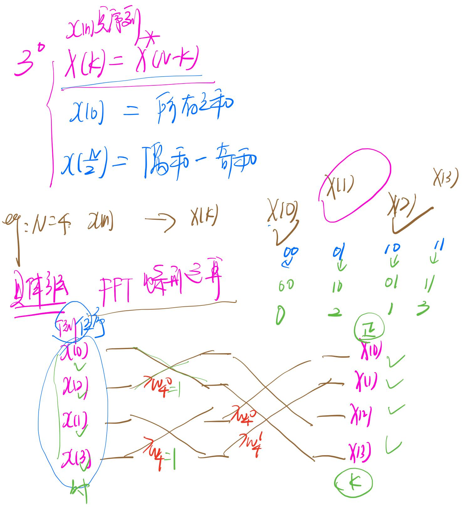

$$
\begin{array}{l} {X (k) = X ^ {*} (N - k)} \\ {X (1) = X ^ {*}} \\ {X | 2 | = X ^ {*} (6)} \\ {X | 3 | = X ^ {*} (5)} \end{array}
$$

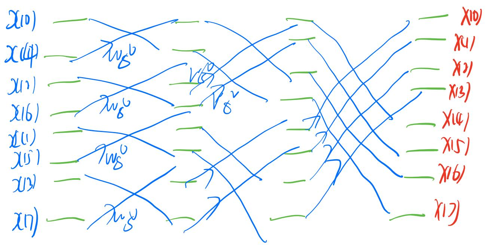