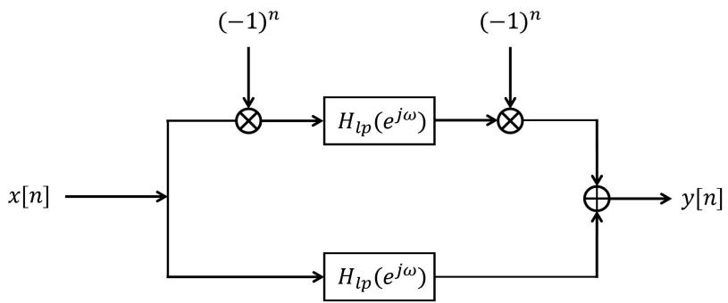
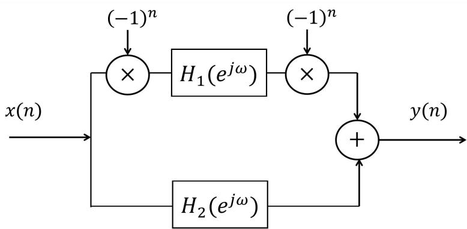

## 【第42节】课后作业

## 1、【2024华南理工大学】

已知某系统的输入为：

$$
x [ n ] = \frac {\sin (\frac {\pi}{2} n) - \sin (\frac {\pi}{8} n)}{\pi n}
$$

（1）求输入的傅里叶变换� $[ ( e ^ { j \omega } )$

（2）�[�]经过以下系统，其中 $H ( e ^ { j \omega } )$ 为截止频率为 $\frac { \pi } { 4 } ,$ ，幅值为1的理想低通滤波器，求其输出信号 $y [ n ]$ 的频谱 $Y ( e ^ { j \omega } )$

## 2、【2024中国海洋大学】

某线性时不变系统如下图所示，已知：

$$
H _ {1} (e ^ {j \omega}) = \frac {1}{a - \frac {1}{2} e ^ {j \omega}}, H _ {2} (e ^ {j \omega}) = \frac {1}{1 - \frac {1}{4} e ^ {j \omega}}
$$

（1）求 $H _ { 1 } ( e ^ { j \omega } )$ 和 $\mathbf { \boldsymbol { H } } _ { 2 } ( e ^ { j \omega } )$ 表示的两个系统的冲激响应ℎ(�)；

（2）求系统函数�(�)，并画出零极点图；

（3）求该系统所表示的差分方程；

（4）画出系统的直接型模拟框图。

B站u ：信号与系统\_谷哥DF免费QQ群615698143