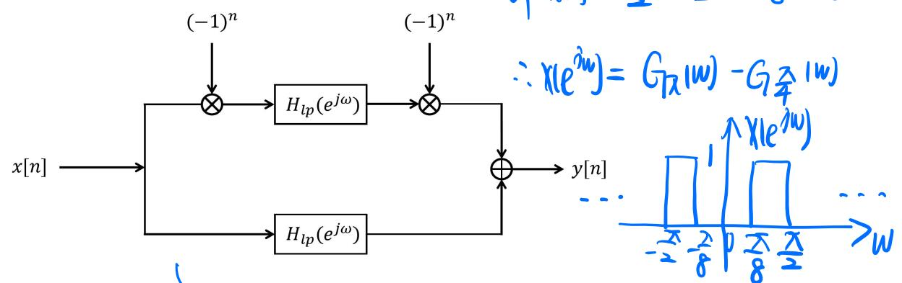
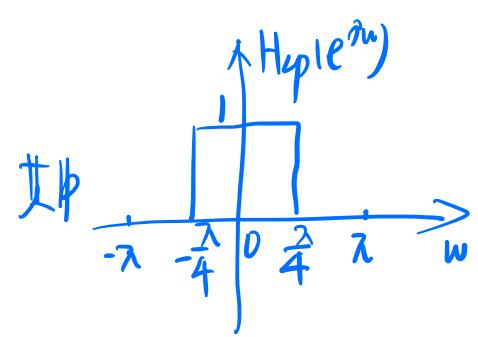
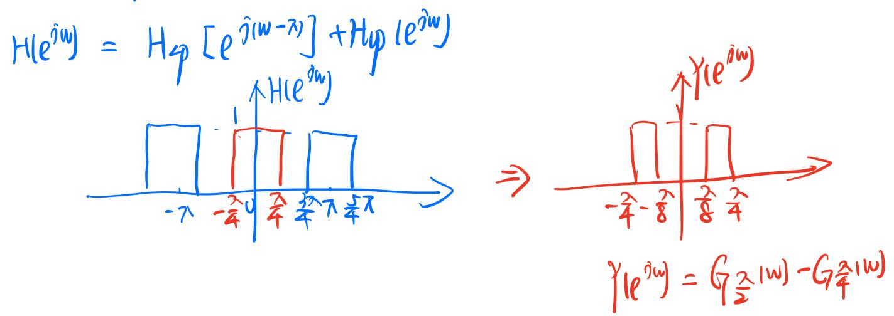
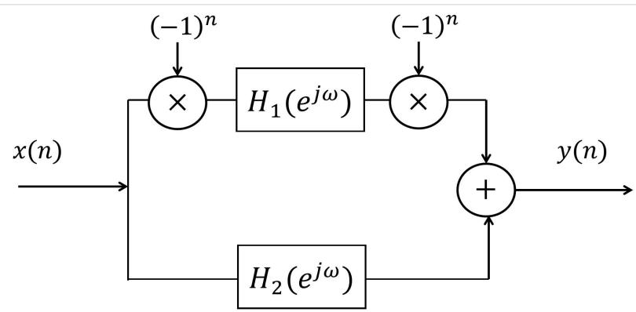
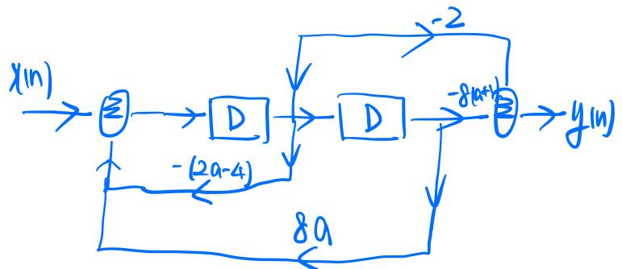
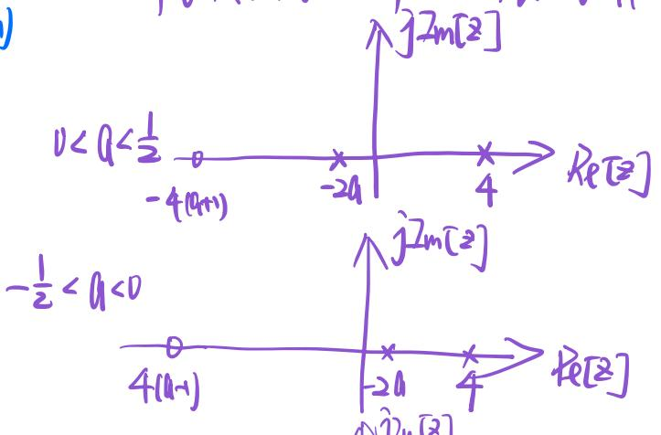

如需打印，微信扫一扫。彩色黑白同价，五分一页，首单免费，满三元顺丰包邮次日达。

最好用的刷题小程序，多专业课题全网唯一

扫码打印 首单免费

长按识别二维码，开始学习吧

免费资料分享群

微信群是唯一更新渠道。

微信群是唯一更新渠道。

群聊：上岸笔记B19

每日分享免费
| 考研 | 考公 | 考编 | 法考 | 教师 | 财会 | 金融 | 医考 |
四六级 | 专四八 | 教育类 | 小初高 | 云课堂 | 影音类 | 等
等 |

如需打印，微信扫一扫。彩色黑白同价，五分一页，首单免费，满三元顺丰包邮次日达。

最好用的刷题小程序，多专业课题全网唯一

扫码打印 首单免费

长按识别二维码，开始学习吧

免费资料分享群

微信群是唯一更新渠道。

微信群是唯一更新渠道。

群聊：上岸笔记B19

每日分享免费
| 考研 | 考公 | 考编 | 法考 | 教师 | 财会 | 金融 | 医考 |
四六级 | 专四八 | 教育类 | 小初高 | 云课堂 | 影音类 | 等
等 |

## 【第42节】课后作业

1、【2024 华南理工大学】

已知某系统的输入为：

$$
\begin{array}{r l} {\frac {\sin (\frac {\pi}{2} n)}{\pi n}} & {= \frac {1}{2} \cdot \frac {\sin (\frac {\pi}{2} n)}{\frac {\pi}{2} n}} \\ & {= \frac {1}{2} \operatorname{Sal} (\frac {\pi}{2} n)} \end{array}
$$

$$
x [ n ] = \frac {s i n (\frac {\pi}{2} n) - s i n (\frac {\pi}{8} n)}{\pi n}
$$

(1) 求输入的傅里叶变换 $X(e^{j\omega})$ ;

$$
\frac {\sin (\frac {\pi}{8} n)}{\pi n} = \frac {1}{8} \frac {\sin (\frac {\pi}{8} n)}{\frac {\pi}{8} n} = \frac {1}{8} \sin (\frac {\pi}{8} n)
$$

(2) $x[n]$ 经过以下系统，其中 $H(e^{j\omega})$ 为截止频率为 $\frac{\pi}{4}$ ，幅值为1的理想低通滤波

器，求其输出信号 $y[n]$ 的频谱 $Y(e^{j\omega})$ 。

$$
\mathrm{即} x (n) = \frac {1}{2} S a (\frac {\pi}{2} n) - \frac {1}{8} S a (\frac {\pi}{8} n)
$$

$$
\begin{array}{r l} h (n) & = \left\{\sqrt {n} \cdot (- 1) ^ {n} \right] * h _ {\varphi} (n) \\ & = \left[ \sqrt {n} * h _ {\varphi} (n) \right] (- 1) ^ {n} + h _ {\varphi} (n) \\ & = h _ {\varphi} (n) (- 1) ^ {n} + h _ {\varphi} (n) \end{array}\tag{2}
$$

## 2、【2024 中国海洋大学】

某线性时不变系统如下图所示，已知：

$$
H _ {1} (e ^ {j \omega}) = \frac {1}{a - \frac {1}{2} e ^ {j \omega}}, H _ {2} (e ^ {j \omega}) = \frac {1}{1 - \frac {1}{4} e ^ {j \omega}}
$$

$$
\begin{array}{r l} {(1) H _ {1} (z)} & {= \frac {1}{a - \frac {1}{2} z} = \frac {- 2}{z - 2 a}} \\ & {= \sqrt {\frac {- 2 z}{z - 2 a}} \cdot z ^ {- 1}} \\ & {= 2 (2 a) ^ {n} u (n)} \end{array}
$$

Hle $^{my}$ 介存在

$$
\begin{array}{r l} {\therefore h _ {1} (n)} & {= - 2 (2 a) ^ {n - 1} u (n - 1)} \\ & {= - 2 ^ {n} a ^ {n - 1} u (n - 1)} \end{array}
$$

其中 $\left| {2a}\right|  < 1 \Rightarrow  \frac{1}{2} < a < \frac{1}{2}$

$$
\begin{array}{r l} {H _ {2} (z)} & {= \frac {1}{1 - \frac {1}{4} z} = \frac {- 4}{z - 4}} \\ & {= \sqrt {\frac {- 4 z}{z - 4}} \cdot z ^ {- 1}} \\ & {A (4) ^ {n} (1 - n - 1)} \end{array}
$$

$$
4 (4) ^ {n} u (- n - 1)
$$

(1) 求 $H_{1}(e^{j\omega})$ 和 $H_{2}(e^{j\omega})$ 表示的两个系统的冲激响应 $h(n)$ ;

$$
\begin{array}{r l} {h _ {2} (n)} & {= 4 (4) ^ {n - 1} u (- n)} \\ & {= 4 ^ {n} u (- n)} \end{array}
$$

易错点

(2) 求系统函数 $H(z)$ , 并画出零极点图;

∵|2|＜4梯
↓足

(3) 求该系统所表示的差分方程;

(2) $\frac{y}{3}x(n)=\sqrt{n}$ 时 $y(n)=h(n)$

$H_{2}(e^{i\omega})\pi_{3}\pi$

(4) 画出系统的直接型模拟框图。

$$
h (n) = h _ {\mathrm{上}} (n) + h _ {\mathrm{下}} (n)
$$

$$
1 3) H (2) = \frac {- 2 z - 8 (a + 1)}{z ^ {2} + (2 a - 4) z - 8 a} = \frac {- 2 z ^ {- 1} - 8 (a + 1) z ^ {- 2}}{1 + (2 a - 4) z ^ {- 1} - 8 a z ^ {- 2}}
$$

其中

$$
\Rightarrow y (n) + (2 a - 4) y (n - 1) - 8 a y (n - 2) = - 2 x (n - 1) - 8 (a + 1) x (n - 2)
$$

$$
\begin{array}{r l} {h _ {\pm} (n)} & {= \left[ (\sqrt {n}) \cdot (- 1) ^ {n} \right] * h _ {1} (n) \cdot (- 1) ^ {n}} \\ & {= [ \sqrt {n}) * h _ {1} (n) ] \cdot (- 1) ^ {n} = (- 1) ^ {n} h _ {1} (n)} \end{array}
$$

$$
H (2) = \frac {- 2 z ^ {- 1} - 8 (a + 1) z ^ {- 2}}{1 - [ - (2 a - 4) z ^ {- 1} + 8 a z ^ {- 2} ]}
$$

$$
\begin{array}{r l} {h _ {\mathrm{下}} (n)} & {= h _ {2} (n)} \\ {\therefore h (n)} & {= (- 1) ^ {n} h _ {1} (n) + h _ {2} (n) \Rightarrow H (2) = H _ {1} (- 2) + H _ {2} (2)} \\ & {= \frac {- 2}{- 2 - 2 a} + \frac {- 4}{2 - 4} = \frac {- 2 2 - 8 (a + 1)}{(2 + 2 a) (2 - 4)}} \end{array}
$$

可见极点为-2a和4. 浓点为4(a+1)

$$
a = 0 ^ {2}
$$

PDF免费QQ群615698143 梦马班作业

DF免费QQ群615698143
B站up: 信号与系统\_谷哥

公众号：通信考研小马哥