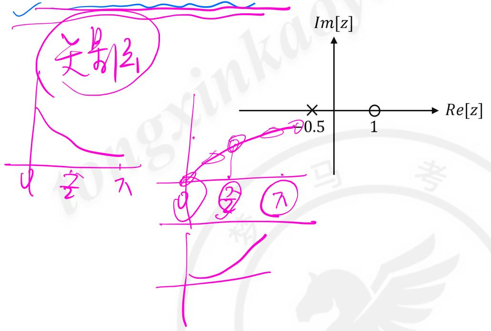
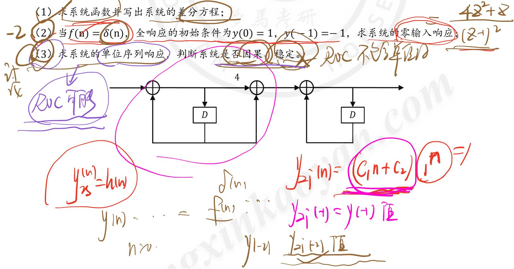
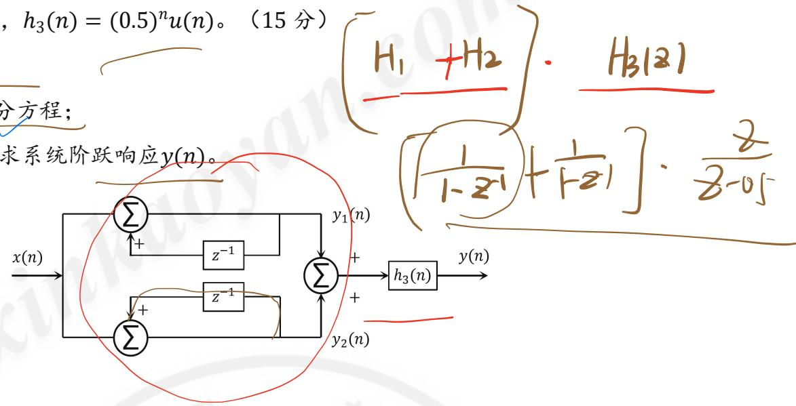
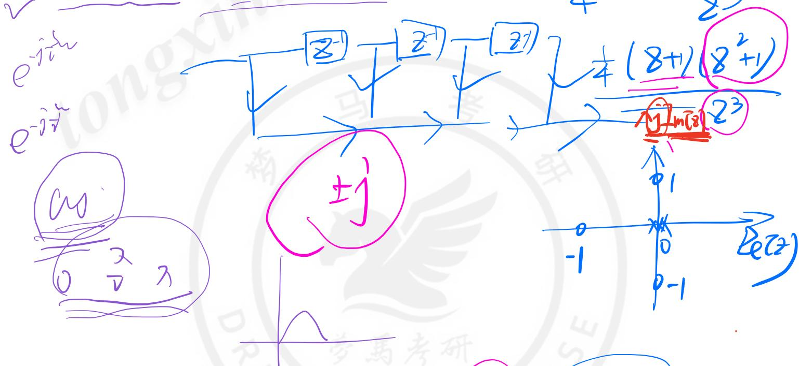
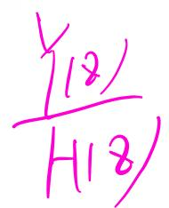
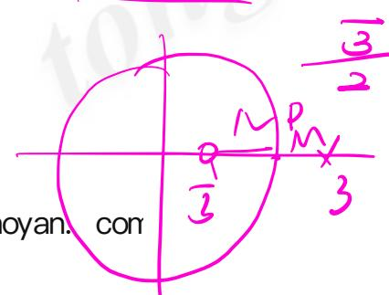
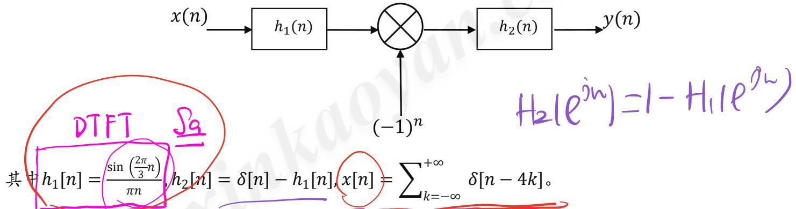
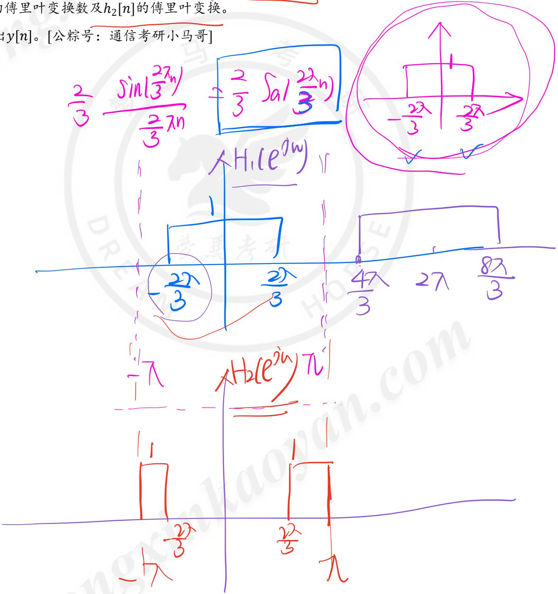
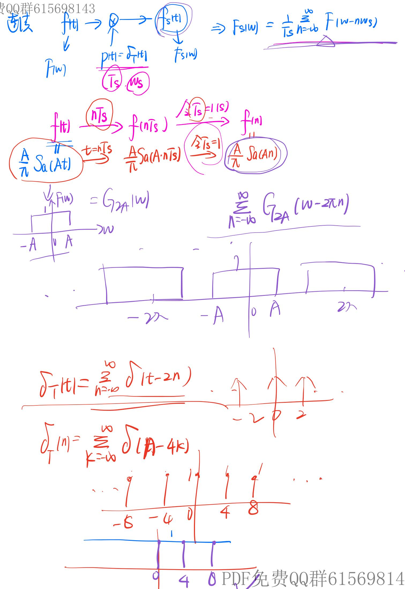

如需打印，微信扫一扫。彩色黑白同价，五分一页，首单免费，满三元顺丰包邮次日达。

最好用的刷题小程序，多专业课题全网唯一

扫码打印 首单免费

长按识别二维码，开始学习吧

免费资料分享群

微信群是唯一更新渠道。

微信群是唯一更新渠道。

群聊：上岸笔记B19

每日分享免费
| 考研 | 考公 | 考编 | 法考 | 教师 | 财会 | 金融 | 医考 |
四六级 | 专四八 | 教育类 | 小初高 | 云课堂 | 影音类 | 等
等 |

# 离散系统的Z域分析

## 1. 【2025 天津大学 815】

已知信号为 $f(n)=3e^{j\frac{3}{5}\pi(n+\frac{1}{2})}$ ，则其周期N=

$$
W = \frac {3 \pi}{5}
$$

$$
\frac {2 \pi}{w} = \frac {(p)}{0}
$$

## 【2025 天津工业大学 812】

已知数列 $A_{1}:\{1,0,2,3,5\}(n=0$ 时为0)，和数列 $A_{2}:\{1,4,7\}(n=0$ 时为1。求 $A_{1}*A_{2}$ 为\_\_\_\_。

(n=0时为...)

## 3、【2025 广西科技大学 809】

已知两个离散序列 $x_{1}[n]=\{1,0,-1\}(n=-1,0,1)$ 和 $x_{2}[n]=\{2,2\}(n=0,1)$ ，则 $x_{1}[n]*x_{2}[n]$ 在n=0时的值为\_\_\_\_。

$f(x)=f(x+f_{2}(x)) \Rightarrow f(2)$ 的积分

## 4、【2025 中国科学院 859】

给定因果序列的z变换为 $X(z)=\frac{1}{(1-0.5z^{-1})(1+0.5z^{-1})}$ ，则该序列的初值与终值分别为（）
A.0 与 1    B.1 与 0    C.1 与 2    D.2 与 1

$$
\begin{array}{r l} {x (0)} & = \lim _ {z \to 0} x (z) \\ & = \lim _ {z \to 1} (z - 1) x (z) \end{array}
$$

## 【2025 华侨大学 823】

某离散因果系统的系统函数为 $H(z)=\frac{z^{2}+3z+2}{2z^{2}-(k-1)z+1}$ ，则系统稳定时，k的取值范围为\_\_\_\_。

$$
z ^ {2} + \alpha z + \beta
$$

$|\alpha| < 1 + \beta$

6、【2025 福州大学 866】

有一个右边序列x[n]，其z变换为 $X(z)=\frac{1}{(1-3z^{-1})(1-z^{-1})}$ ，求x[n]。

$$
\frac {g _ {1} a = h _ {1} a + u _ {1} a}{g _ {1} a = h _ {1} a} \Rightarrow S G (s) = H (s)
$$

7、【2025 天津大学 815】

$$
g (n) = u (n) + h (n)
$$

已知离散 LTI 系统, 在阶跃信号 $u(n)$ 激励下, 产生的阶跃响应 $g(n) = \left(\frac{1}{2}\right)^{n} u(n)$ , 试求

(1) 系统函数 $H(z)$ 与单位序列响应 $h(n)$

(2) 当 $f(n)=\left(\frac{1}{3}\right)^{n}u(n)$ 的激励下，系统产生的零状态响应 $y_{zs}(n)$

(3) 在 (2) 的条件下, 若初始状态下 $y(-1) = 2$ 时, 求系统的自由响应 $y_{h}(n)$ 与强迫响应 $y_{p}(n)$

H(2) 纯 $\Rightarrow$ 极支 3知0

qib y2i

$$
\rightarrow y (- 1) = 2 (x - 1)
$$

8、【2025 华侨大学 823】

已知因果离散系统的系统函数 $H(z)$ 的零极点分布如图所示，并且 $H(0) = -2$ 。

(1) 求系统函数 $H(z)$ :

(2) 求系统的频率响应；

(3) 粗略画出系统的幅频响应曲线。[公粽号：通信考研小马哥]

$$
\frac {\mathrm{设} \frac {k (z - 1)}{z + 0 . 5}}{| z | > 0 . 5} = H (z)
$$

9、【2025 西北工业大学 827】

某因果LTI线性时不变系统， $f(n)$ 和 $y(n)$ 分别为输入信号和输出信号，差分方程为：

$$
y (n) + a y (n - 1) + b y (n - 2) = f (n) + c f (n - 1) + d f (n - 2)
$$

其中 $a$ 、 $b$ 、 $c$ 、 $d$ 均为常实数，系统函数 $H(z)$ 具有如下特征：

$H(z)$ 在原点 z = 0 有二阶零点， $H(z)$ 有一个极点在 z = 0.5， $H(1) = \frac{8}{3}$ 。求 $(H/2)$

(1) 求 $a 、 b 、 c 、 d$ 的值

(2) 若输入为 $\delta(n)-\delta(n-2)$ ，求零状态响应 $y_{zs}(n)$

$$
\frac {1 + c z ^ {- 1} + d z ^ {- 2}}{1 + a z ^ {- 1} + b z ^ {- 2}}
$$

$$
\begin{array}{l} {\mathrm{(3)} \text {输入为} (- 1) ^ {n}, \text {求零状态响应} y _ {z s} (n)} \\ {\mathrm{(4)} \text {判断该系统是否稳定}} \\ {\frac {(- 1) ^ {n} \Leftrightarrow H (- 1) ^ {(- 1) ^ {n}}}{(1 - z ^ {- 2}) H (z)}} \\ {\sqrt {h (n) - h (n - 2)}} \end{array} = \begin{array}{l} {\frac {k z ^ {2}}{(z - 0 . 5) (z - z _ {0})}} \\ {= \frac {z ^ {2}}{(z - 0 . 5) (z - z _ {0})}} \\ {\textcircled {z _ {0}}} \end{array} \quad \begin{array}{l} {H (z) = \frac {z ^ {2} + c z + d}{z ^ {2} + a z + b}} \\ {\boxed {c = d = 0}} \\ {\boxed {k = 1}} \end{array}
$$

$[u(n)-] (u(n-2))$

PDF免费QQ群613698143

DF免费QQ群615698143
B站up: 信号与系统\_谷哥

9、【2025 福州大学 866】

公众号：通信考研小马哥

已知如下图因果 LTI 系统， $h_{3}(n)=(0.5)^{n}u(n)$ 。（15 分）

(1) 求系统函数 $H(z)$ ;

(2) 写出描述此系统差分方程;

(3) 当 $x(n) = u(n)$ 时, 求系统阶跃响应 $y(n)$ 。

【2025 华侨大学 823】

离散系统如图，其中 D 为单位延时器。

(1) 求系统函数并写出系统的差分方程;

(2) 当 $f(n)=\delta(n)$ ，全响应的初始条件为 $y(0)=1$ ， $y(-1)=-1$ ，求系统的零输入响应， $(8-1)^{2}$ (3) 求系统的单位序列响应，判断系统是否因果不稳定。

11、【2025 广西科技大学 809】

用计算机快速地对测量的随机数据 $f(n)$ 进行平均处理时，当收到一个测量数据后，它就把这一次输入的数据与前三次输入的数据进行平均，输出数据表示为：

$$
y (n) = \frac {1}{4} [ f (n) + f (n - 1) + f (n - 2) + f (n - 3) ]
$$

(1) 试画出系统z域模拟框图；(3分)

$\frac{1}{4}(1+2^{-1}+2\cdot42^{-3})$

(3) 求系统的频率响应, 并画出其幅频特性曲线。(8 分)

## 12、【2025 河海大学 863】

已知一系统的单位样值响应 $h(n)$ 满足如下关系：

$H(-1)=\frac{1}{2}$ 且-1在Roc内

$$
e ^ {\pm j n \lambda} \cos \lambda n (- 1) ^ {n} \rightarrow \frac {1}{2} (- 1) ^ {n} h (n) - b h (n - 1) = (\frac {1}{3}) ^ {n} u (n)
$$

当输入 $x(n)=\cos\pi n$ 时，输出 $y(n)=\frac{1}{2}\cos\pi n$

$$
H (2) (1 - b z ^ {- 1}) = \frac {8}{8 - \frac {1}{3}}
$$

(1) 求系统函数 $H\left( z\right)$ 及其收敛域。

(2) 求单位样值响应 $h(n)$ , 并判断是不是稳定、因果系统。

$$
H (z) = \frac {z}{z - \frac {1}{3}} \cdot \frac {1}{1 - b ^ {2}}
$$

(3) 当输出 $y(n) = -\frac{6}{5} 2^n u(-n-1) - \frac{1}{5} (\frac{1}{3})^n u(n)$ 时，求输入 $x(n)$ 。

13、【2025 宁波大学 829】

公众号：通信考研小马哥

已知一因果 LTI 系统的差分方程如下:

$\mathrm{H}(\mathrm{O}) \mid \mathrm{H}(\mathrm{I}) =$

$$
\frac {1 8 - 5 1 2 ^ {- 1} - 9 8 - 2}{1 8 + 3 2 ^ {- 1} - 2 - 2}
$$

$$
1 8 y [ n ] + 3 y [ n - 1 ] - y [ n - 2 ] = 1 8 x [ n ] - 5 1 x [ n - 1 ] - 9 x [ n - 2 ]
$$

(1)求系统函数 $H(z)$ 及其逆变换。

(2)输入 $x[n]=(1+7\cos(n\pi))u[n]$ 时，求稳态响应 $y_{s}[n]$ 。

(3)画出系统的并联型结构框图。

$$
\left[ 1 + 7 (- 1) ^ {n} \right] u (n) = 9 +
$$

(4)若系统的逆系统存在，判断其稳定性，说明原因。

$H_{总} = \frac{1}{H_{原}}$

$$
\begin{array}{c}1 <   \rightarrow \frac {H (1)}{\Delta} \cdot 1\\H (e ^ {j 0})\end{array}
$$

14. 【2025 福州大学 866】一

$$
\mathrm{极负一} \alpha
$$

已知系统 $y(n)+ay(n-1)=x(n)$ 响应是 $y(n)=(5+2n)(0.5)^{n}u(n)$ 。(20分)

(1) 求系统零输入响应和零状态响应；

$$
C _ {1} n + C _ {2}) (0. 5) ^ {n}
$$

(2) 若 $y(-1)=10$ ，求系统 $y(n)+ay(n-1)=x(n)$ 零输入响应；

(3) 求 $y(n) + ay(n-1) = x(n-1)$ 零状态响应; $y_{2}(n-1)$

(4) 求 $y(n) + ay(n-1) = 2x(n-1) + x(n)$ 的零状态响应； $2y_{x}(n-1) + y_{y}(n)$

(5) 若 $y(-1) = 4$ ，求系统 $y(n) + ay(n-1) = 2x(n-1) + x(n)$ 的全响应。

$$
\frac {y _ {2 j _ {1}}}{0 . 5}
$$

$$
\frac {1}{1 + a z ^ {- 1}} = \frac {1}{1 + 0 . 5 z ^ {- 1}} = \frac {z}{z - 0 . 5}
$$

$$
y _ {3} \frac {(C _ {1} n + C _ {2}) 0 . 5 ^ {n}}{(2 n + C _ {2}) 0 . 5 ^ {n}}
$$

15、【2025 安徽工程大学 813】

已知一因果 LTI 系统的差分方程为:

$$
y (n) - \frac {7}{2} y (n - 1) + \frac {3}{2} y (n - 2) = x (n - 1) + \frac {1}{2} x (n - 2)
$$

(1) 求该系统的系统函数 $H\left( z\right)$ 。

(2) 判断该系统是否稳定? 若稳定, 给出收敛域, 若不稳定, 试在不改变系统幅度特性前提条件下将系统变成稳定系统。

$$
H (8) = \frac {z ^ {- 1} + \frac {1}{2} z ^ {- 2}}{1 - \frac {7}{2} z ^ {- 1} + \frac {3}{2} z ^ {- 2}} = \frac {z + \frac {1}{2}}{z ^ {2} - \frac {7}{2} z + \frac {3}{2}} = \frac {z + \frac {1}{2}}{(z - 3) (z - \frac {1}{2})}
$$

$|z|>3$ 不成立.

$$
\mathrm{Roc} \mathrm{为} \frac {1}{2} <   | 2 | <   3
$$

$1^{\circ}$ 锐标志：负极义及相反权

$$
| H (e ^ {0 w}) | = k \text {   或   } 1
$$

20 最根本概念：18 系长的系统变量在单位周内

3° 非最相位意义 = 最小相位意义 函数意义取联

$$
H _ {1} (e ^ {j \omega})
$$

DF免费QQ群615698143
B站up: 信号与系统\_谷哥

公众号：通信考研小马哥

16、【2025 华南理工大学】【不计算在 150 分内，该题为附加题】

已知系统调制框图如下

(1) 求 $x[n]$ 的傅里叶变换数及 $h_2[n]$ 的傅里叶变换。

(2) 求总输出 $y [ n ]$ 。[公粽号: 通信考研小马哥]时 1 用 $T_S = 4$ 米抽

$f(t) = 1 \xrightarrow{t = nT_s} f(nT_s) \xrightarrow{\frac{1}{2}T_s = 4} f$ $2\pi d(w)$ $\frac{1}{T_s}\sum_{n=-\infty}^{\infty} f(w - nw_s)$ $= \frac{1}{4}\sum_{n=-\infty}^{\infty} 2\pi d(w - n \cdot \frac{2\pi}{4})$ $= \frac{7}{2}\sum_{n=-\infty}^{\infty} \delta(w - \frac{3\pi}{2}n)$

$\underline{\underline{d(n)}} a^{n}u(n)$ $\forall f(t)$ 用 $\overline{Ts}$ 并相等 $\frac{-1}{Ts}\sum_{n = -\infty}^{\infty}f(w-nw_s)$