如需打印，微信扫一扫。彩色黑白同价，五分一页，首单免费，满三元顺丰包邮次日达。

最好用的刷题小程序，多专业课题全网唯一

扫码打印 首单免费

长按识别二维码，开始学习吧

免费资料分享群

微信群是唯一更新渠道。

微信群是唯一更新渠道。

群聊：上岸笔记B19

每日分享免费
| 考研 | 考公 | 考编 | 法考 | 教师 | 财会 | 金融 | 医考 |
四六级 | 专四八 | 教育类 | 小初高 | 云课堂 | 影音类 | 等
等 |

## 离散系统的Z域分析

【2025 天津大学 815】

已知信号为 $f(n) = 3e^{j\frac{3}{5}\pi \left(n + \frac{1}{2}\right)}$ ，则其周期 $N =$

解: $\frac{2\pi}{N}=2\pi \cdot \frac{5}{3\pi}=\frac{10}{3}\Rightarrow N=10$

2、【2025 天津工业大学 812】

$\{ 1,4,9,1,31,46,35\}$

已知数列 $A_{1}:\{1,0,2,3,5\}(n=0$ 时为0)，和数列 $A_{2}:\{1,4,7\}(n=0$ 时为1)。求 $A_{1}*A_{2}$ 为\_\_\_\_。(n=0时为4)

解:

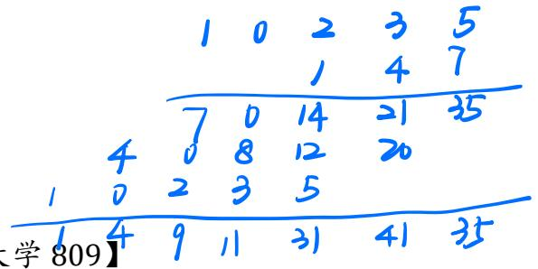

已知两个离散序列 $x_{1}[n] = \{1,0, - 1\} (n = -1,0,1)$ 和 $x_{2}[n] = \{2,2\} (n = 0,1)$ ，则 $x_{1}[n]*x_{2}[n]$ 在 $n = 0$ 时的值为 2。

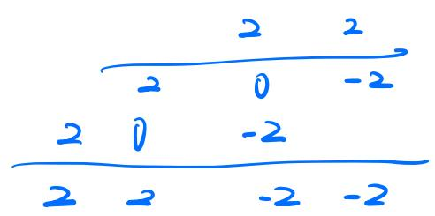

$$
1 n = - 1, 0, 1, 2
$$

5 4、【2025 中国科学院 859】

给定因果序列的z变换为 $X(z)=\frac{1}{(1-0.5z^{-1})(1+0.5z^{-1})}$ ，则该序列的初值与终值分别为B

A.0与1 B.1与0 C.1与2 D.2与1

$$
x (0) = \lim _ {z \to x _ {0}} x (2) = \frac {1}{1 \times 1} = 1
$$

$$
x (0) = \lim _ {z \to 1} (z - 1) \times | z \rangle = 0
$$

5、【2025 华侨大学 823】

某离散因果系统的系统函数为 $H(z)=\frac{z^{2}+3z+2}{2z^{2}-(k-1)z+1}$ ，则系统稳定时，k的取值范围为-2<k<4。 $=\frac{\frac{1}{2}(z^{2}+3z+2)}{z^{2}-\frac{k-1}{2}z+\frac{1}{2}}$ $z^{2}+2z+\beta$ $|α|<1+\beta$ 且 $|β|<1$ $\Rightarrow \frac{|k-1|}{2}<1+\frac{1}{2}=\frac{3}{2}\Rightarrow|k-1|<3$ PDF免费QQ群015698143

6. 【2025 福州大学 866】

有一个右边序列x[n]，其z变换为 $X(z)=\frac{1}{(1-3z^{-1})(1-z^{-1})}$ ，求x[n]。

$$
x (z) = \frac {z ^ {2}}{(z - 3) (z - 1)}
$$

$$
\frac {(x , y)}{z} = \frac {z}{(z - 3) (z - 1)} = \frac {\frac {3}{2}}{z - 3} + \frac {- \frac {1}{2}}{z - 1}
$$

$$
\begin{array}{r l} {x (2)} & {= \frac {\frac {3}{2} 8}{2 - 3} + \frac {- \frac {1}{2} 8}{2 - 1}} \\ {\therefore x (n)} & {= [ \frac {3}{2} (3) ^ {n} - \frac {1}{2} ] n (n)} \end{array}
$$

7、【2025 天津大学 815】

已知离散LTI系统，在阶跃信号 $\mathrm{u}(n)$ 激励下，产生的阶跃响应 $g(n) = \left(\frac{1}{2}\right)^n\mathrm{u}(n)$ ，试求

$f^{1}$ (1) 系统函数 $H(z)$ 与单位序列响应 $h(n)$

$\int^{1} (2)$ 当 $f(n) = \left(\frac{1}{3}\right)^n u(n)$ 的激励下，系统产生的零状态响应 $y_{zs}(n)$

(3) 在 (2) 的条件下, 若初始状态下 $y(-1) = 2$ 时, 求系统的自由响应 $y_{h}(n)$ 与强迫响应 $y_{p}(n)$

(1)

$$
\begin{array}{r l} & {g (n) = a (n) + h (n) \quad \mathrm{即} G (z) = \frac {z}{z - 1} \cdot H (z)} \\ & {\Rightarrow H (z) = \frac {z - 1}{z} G (z) = \frac {z - 1}{z}, \frac {z}{z - \frac {1}{2}} = \frac {z - 1}{z - \frac {1}{2}}} \\ & {\qquad = 1 + \frac {- \frac {1}{2} z}{z - \frac {1}{2}} \cdot z ^ {- 1}} \\ & {\Rightarrow h (n) = \delta (n) - \frac {1}{2} (\frac {1}{2}) ^ {n - 1} n (n - 1)} \\ & {\qquad = \delta (n) - (\frac {1}{2}) ^ {n} n (n - 1)} \\ & {\qquad \therefore y _ {x} (n) = [ - 3 (\frac {1}{2}) ^ {n} + 4 (\frac {1}{3}) ^ {n} ] n (n)} \end{array}
$$

(3) 设 $\mu_{i}|n|=A(\frac{1}{2})^{n}$

$$
\begin{array}{r l} & {\mathrm{则} y _ {2 i} (- 1) = y (- 1) = A (\frac {1}{2}) ^ {- 1} = 2 A = 2} \\ & {\Rightarrow A = 1} \\ & {\Rightarrow y _ {2 i} (n) = (\frac {1}{2}) ^ {n} n (n)} \\ & {\Rightarrow y _ {p} (n) = 4 (\frac {1}{3}) ^ {n} n (n)} \\ & {y _ {h} (n) = - 2 (\frac {1}{2}) ^ {n} n (n)} \end{array}
$$

DF免费QQ群615698143

【2025 华侨大学 823】

已知因果离散系统的系统函数 $H(z)$ 的零极点分布如图所示，并且 $H(0) = -2$ 。

$s^{1}$ (1) 求系统函数 $H(z)$ ;

21（2）求系统的频率响应；

$$
(1) \mathrm{设} H (z) = \frac {k (z - 1)}{z + 0 . 5}
$$

3 (3) 粗略画出系统的幅频响应曲线。[公粽号：通信考研小马哥]

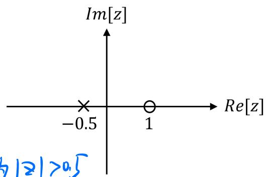

$$
H (0) = \frac {- k}{0 . 5} = - 2
$$

$$
\Rightarrow k = 1
$$

$$
\therefore H (z) = \frac {z - 1}{z + 0 . 5}
$$

(2) 因素系统故 ROC 为 |z| > 0.5

$$
H (e ^ {j w}) = H (2) / 8 = e ^ {j w}
$$

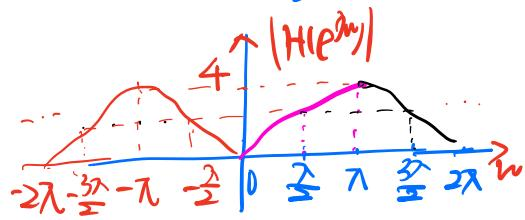

(3)

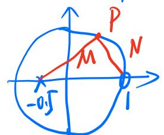

$$
| H (e ^ {i \omega}) | = \frac {N}{M}
$$

P在 $0^{\circ}$ 时 $|H(e^{j\omega})|=0$

在 $\frac{\pi}{2}$ 时

$$
\vert H (e ^ {\frac {2}{3}}) \vert = \frac {\sqrt {2}}{\frac {\sqrt {5}}{3}} = \frac {2 \sqrt {1 0}}{5}
$$

10 $^{1}$ 9、【2025 西北工业大学 827】

在π时

$$
| H (e ^ {0. 3}) | = \frac {2}{0 . 5} = 4
$$

某因果 LTI 线性时不变系统， $f(n)$ 和 $y(n)$ 分别为输入信号和输出信号，差分方程为：

$$
y (n) + a y (n - 1) + b y (n - 2) = f (n) + c f (n - 1) + d f (n - 2)
$$

其中 $a$ 、 $b$ 、 $c$ 、 $d$ 均为常实数，系统函数 $H(z)$ 具有如下特征：

$H(z)$ 在原点 $z = 0$ 有二阶零点， $H(z)$ 有一个极点在 $z = 0.5$ ， $H(1) = \frac{8}{3}$

$4^{1}$ （1）求a、b、c、d的值

(2) 若输入为 $\delta(n)-\delta(n-2)$ ，求零状态响应 $y_{zs}(n)$

2 $^{1}$ (3) 输入为 $(-1)^{n}$ ，求零状态响应 $y_{zs}(n)$

2' (4) 判断该系统是否稳定

(1) 由题干可知：

$$
H (z) = \frac {k z ^ {2}}{(z - 0 . 5) (z - z _ {1})} = \frac {1 + c z ^ {- 1} + d z ^ {- 2}}{1 + a z ^ {- 1} + b z ^ {- 2}} = \frac {z ^ {2} + c z + d}{z ^ {2} + a z + b}
$$

$$
\begin{array}{r l} {\Rightarrow k = 1.} & {c = d = 0} \\ {H (1)} & {= \frac {1}{0 . 5 \times (1 - z _ {1})} = \frac {8}{3} = \frac {2}{1 - z _ {1}} \Rightarrow z _ {1} = \frac {1}{4} \Rightarrow a = - \frac {3}{4}. b = \frac {1}{8}} \end{array}
$$

(2) 由(1)可知 $H\left( 8\right)  = \frac{{2}^{2}}{\left| 8 - \frac{1}{2}\right) \left| {8 - \frac{1}{4}}\right) }$

$$
\frac {H (2)}{2} = \frac {2}{(2 - \frac {1}{2}) (2 - \frac {1}{4})} = \frac {2}{2 - \frac {1}{2}} + \frac {- 1}{2 - \frac {1}{4}}
$$

(3) -1在R0C内

$$
\Rightarrow h (n) = [ 2 (\frac {1}{2}) ^ {n} - (\frac {1}{4}) ^ {n} ] u (n)
$$

$$
H (- 1) = \frac {1}{- 3 \times (- 2)} = \frac {8}{1 5} \Rightarrow y _ {x m} = \frac {8}{1 5} (- 1) ^ {n}
$$

(4) ROC为121> $\frac{1}{2}$ . ROC内包含单位图的稳定

$y_{x(m)} = h(m) - h(n-2)$ $= [2(3)^{m} - (4)^{n}]$

DF免费QQ群615698143

10 $^{1}$ 9、【2025 福州大学 866】

$$
= \delta (n) + \frac {3}{4} \delta (n - 1) + [ - 6 (\frac {1}{2}) ^ {n} + 1 5 (\frac {1}{4}) ^ {n} ] n (n - 2)
$$

已知如下图因果 LTI 系统， $h_{3}(n)=(0.5)^{n}u(n)$ 。（15 分）

$3^{1}$ （1）求系统函数 $H(z)$ ;

2' (2) 写出描述此系统差分方程;

$\int^{1}(3)$ 当 $x(n)=u(n)$ 时，求系统阶跃响应 $y(n)$ 。

$$
\begin{array}{r l} {H (z)} & {= \left[ \frac {1}{1 - z ^ {- 1}} + \frac {1}{1 - z ^ {- 1}} \right] \cdot H _ {3} (z)} \\ & {= \frac {2 z}{z - 1} \cdot \frac {z}{z - 0 . 5} = \frac {2 z ^ {2}}{(z - 1) (z - 0 . 5)}} \end{array}
$$

(3) $Y_{(2)} = H_{(2)} \frac{2}{2-1}$

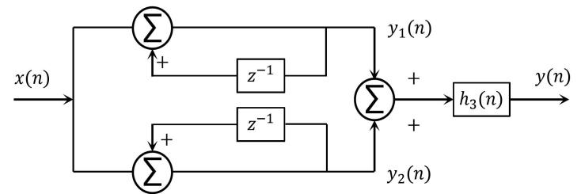

$$
\begin{array}{r l} \frac {| z |}{z} & = \frac {2 z ^ {2}}{(z - 1) ^ {2} (z - 0 . 5)} \\ & = \frac {2}{z - 0 . 5} + \frac {4}{(z - 1) ^ {2}} + \frac {0}{z - 1} \end{array}
$$

$$
H (z) = \frac {2 z ^ {2}}{z ^ {2} - 1 \sqrt {z + 0}} = \frac {2}{1 - 1 \sqrt {z ^ {- 1} + 0 \sqrt {z ^ {- 2}}}}
$$

$$
\Rightarrow y (2) = \frac {2 8}{2 - 0 . 5} + \frac {4 8}{(2 - 1) ^ {2}}
$$

$$
\Rightarrow y (n) - 1. 5 y (n - 1) + 0. 5 y (n - 2) = 2 x (n)
$$

$$
\Rightarrow y | n | = [ 2 \cos ] ^ {n} + 4 n ] (n)
$$

10. 【2025 华侨大学 823】

离散系统如图，其中 D 为单位延时器。

4（1）求系统函数并写出系统的差分方程；

γ（2）当 $f(n)=\delta(n)$ ，全响应的初始条件为 $y(0)=1,\quad y(-1)=-1$ ，求系统的零输入响应；

4'（3）求系统的单位序列响应，判断系统是否因果、稳定。

(3) $H(\frac{2}{z}) = \frac{4z+1}{(z-1)^{2}} = \frac{5}{(z-1)^{2}} + \frac{4}{z-1}$

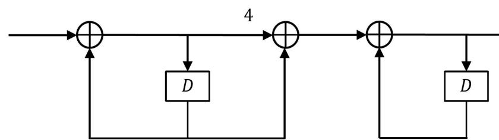

$$
\therefore H (2) = \frac {5 8}{(2 - 1) ^ {2}} + \frac {4 8}{2 - 1}
$$

易见UC为|z|>1 说明式
因果不稳定

若则C为|x|<1 家氏不赖
物体

$$
\Rightarrow y (n) - 2 y (n - 1) + y (n - 2) = 4 f (n) + f (n - 1)
$$

$$
\mathrm{D} (n) h (n) = (- 5 n - 4) u (1 - n - 1)
$$

(2) 由 $H\left( 8\right)  = \frac{{4z}^{2} + 8}{{z}^{2} - 2{z}^{2} + 1} = \frac{2\left( {4{z}^{2} + 1}\right) }{\left( {z - 1}\right) ^{2}}$ 可知 $1$ 为二重数项

$$
\Rightarrow y _ {2 i} (w) = (C _ {1} n + C _ {2}) I ^ {n} = C _ {1} n + C _ {2} y _ {2 i} (- 1) = Y (1) = - C _ {1} + C _ {2} = - 1
$$

$$
\begin{array}{r l} {\mathrm{令} n = 0, y (0) - 2 y (- 1) + y (- 2)} & {= 4 \sqrt {(0)} + \sqrt {(n - 1)}} \\ & {\Rightarrow y (- 2) = 4 - 1 + (- 2) = 1} \end{array}
$$

PDF免费QQ群615698143

DF免费QQ群615698143 $\Rightarrow  y_{2i}(n) = (-2n-3)(1n)$

10' 11.【2025 广西科技大学 809】

用计算机快速地对测量的随机数据 $f(n)$ 进行平均处理时，当收到一个测量数据后，它就把这一次输入的数据与前三次输入的数据进行平均，输出数据表示为：

$$
y (n) = \frac {1}{4} [ f (n) + f (n - 1) + f (n - 2) + f (n - 3) ]
$$

3 (1) 试画出系统z域模拟框图；(3分)

(2) 求系统函数 $H(z)$ , 并画出其零、极点分布图; (4分) [公粽号: 通信考研小马哥]

(3) 求系统的频率响应，并画出其幅频特性曲线。（8分）

$\hat{w}_{f}\colon(1)$

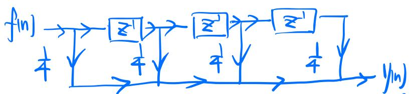

(2) $H(Q)=\frac{y_{(2)}}{f_{(2)}}=\frac{1}{4}(1+z^{-1}+z^{-2}+z^{-3})=\frac{\frac{1}{4}(z^{3}+z^{2}+z+1)}{z^{3}}$ $z^{3}+z^{2}+z+1=(z+1)(z^{2}+1) \Rightarrow \text{要为 } 1 \text{ 和 } \pm j \text{。故共为 } 0(=j)$

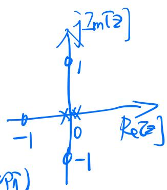

$$
\begin{array}{r l} {H (e ^ {j w})} & {= \frac {1}{4} (1 + e ^ {- j w} + e ^ {- j 2 w} + e ^ {- j 3 w})} \\ & {= \frac {1}{4} [ e ^ {- j \frac {3}{2} w} (e ^ {j \frac {3}{2} w} + e ^ {- j \frac {3}{2} w}) + e ^ {- j \frac {3}{2} w} (e ^ {j \frac {w}{2}} + e ^ {- j \frac {w}{2}}) ]} \\ & {= \frac {1}{4} e ^ {- j \frac {3}{2} w} (2 \cos \frac {3}{2} w + 2 \cos \frac {w}{2}) = \frac {1}{2} (\cos \frac {3}{2} w + \cos \frac {w}{2}) e ^ {- j \frac {3}{2} w}} \end{array}
$$

12、【2025 河海大学 863】

$$
\Rightarrow | H (e ^ {2 w}) | = \frac {1}{2} | \cos^ {3} 2 w + \cos^ {2} 2 w |
$$

15 已知一系统的单位样值响应 $h\left( n\right)$ 满足如下关系：

$w = 0$ 时为 1. $w = \frac{2}{2}$ 时为 0. $w = \pi$ 时为 0

$$
h (n) - b h (n - 1) = (\frac {1}{3}) ^ {n} u (n)
$$

当输入 $x(n) = \cos \pi n$ 时，输出 $y(n) = \frac{1}{2}\cos \pi n$

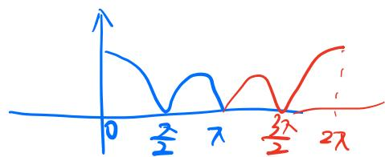

$S'(1)$ 求系统函数 $H(z)$ 及其收敛域。

(2) 求单位样值响应 $h(n)$ , 并判断是不是稳定、因果系统。

$$
\frac {H (2)}{2} = \frac {2}{(2 - \frac {1}{3}) (2 - \frac {1}{2})} = \frac {- 2}{2 - \frac {1}{3}} + \frac {9}{2 - \frac {1}{2}}
$$

$\int^{1}$ (3) 当输出 $y(n) = -\frac{6}{5} 2^{n} u(-n-1) - \frac{1}{5} (\frac{1}{3})^{n} u(n)$ 时，求输入 $x(n)$ 。

$$
\therefore h (n) = \left. - 2 (\frac {1}{3}) ^ {n} + 3 (\frac {1}{2}) ^ {n}\right) n (n)
$$

$$
(1) H (2) = 6 z ^ {- 1} H (2) = \frac {z}{z - \frac {1}{3}}
$$

因果就是元

$$
\Rightarrow H (x) = \frac {z}{z - \frac {1}{3}} \cdot \frac {1}{1 - b ^ {2} - 1} = \frac {z ^ {2}}{(z - \frac {1}{3}) (z - b)}
$$

$$
y _ {| 2 |} = \frac {\frac {1}{5} x ^ {2}}{x - 2} + \frac {- \frac {1}{5} x ^ {2}}{x - \frac {1}{3}} \frac {1}{3} <   | 2 | <   2
$$

设 $x(n) = (-1)^n$ 时 $y(n) = \frac{1}{2}(-1)^n \Rightarrow -1$ 在Roc内且

$$
H (- 1) = \frac {1}{2} \therefore x (2) = \frac {y (2)}{f (2)} = 1 + \frac {\frac {3}{2 2}}{2 - 2} x ^ {1}
$$

$$
\Rightarrow H (- 1) = \frac {1}{- \frac {4}{3} x (- 1 - h)} = \frac {1}{2} \Rightarrow b = \frac {1}{2} \Rightarrow H (2) = \frac {z ^ {2}}{(2 - \frac {1}{3}) (2 - \frac {1}{2})}
$$

且ROC为 $|z| > \frac{1}{2}$

$\therefore x(n)=\sqrt{1(n)}-\frac{3}{2}(2)^{n-1}u(-n)$ $=40^{(n)} - 2 \sqrt{2} - 1 \sqrt{n} + n-1$

DF免费QQ群615698143

15 $^{1}$ 13.【2025 宁波大学 829】

已知一因果 LTI 系统的差分方程如下:

$$
1 8 y [ n ] + 3 y [ n - 1 ] - y [ n - 2 ] = 1 8 x [ n ] - 5 1 x [ n - 1 ] - 9 x [ n - 2 ]
$$

(1)求系统函数 $H(z)$ 及其逆变换。

(1)求系统函数 $H(z)$ 及其逆变换。
(2)输入 $x[n]=(1+7\cos(n\pi))u[n]$ 时，求稳态响应 $y_{s}[n]$ 。(2) $x[n]=[1+7(-1)^{n}]u(n)$ $\Rightarrow H(1)=-\frac{21}{10}$ $H(-1)=\frac{30}{7}$

(3)画出系统的并联型结构框图。

$$
\Rightarrow y _ {s} (n) = \left[ - \frac {2 1}{1 0} + 3 0 \cos (n \pi) \right] u (n)
$$

(4)若系统的逆系统存在，判断其稳定性，说明原因。

$$
\begin{array}{r l} {\therefore h (n)} & {= 9 \delta (n) + [ \frac {1 0}{3} (- \frac {1}{3}) ^ {n} - \frac {1 7}{2} (\frac {1}{6}) ^ {n} ] u (n)} \\ & {= \frac {2 3}{6} \delta (n) + [ \frac {1 0}{3} (- \frac {1}{3}) ^ {n} - \frac {1 7}{2} (\frac {1}{6}) ^ {n} ] u (n - 1)} \end{array}
$$

$$
= \frac {9}{z} + \frac {\frac {1 0}{3}}{z + \frac {1}{3}} + \frac {- \frac {3 4}{3}}{z - \frac {1}{6}}
$$

$$
1 3) H (z) = 9 + \frac {\frac {1 0}{3}}{1 - (- \frac {1}{3} z ^ {- 1})} + \frac {- \frac {1 7}{2}}{1 - \frac {1}{6} z ^ {- 1}}
$$

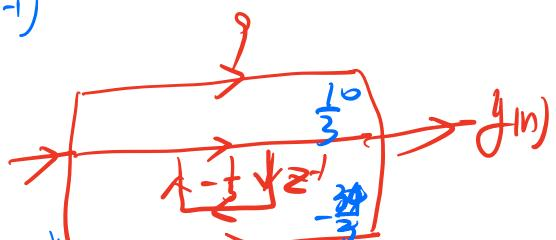

$$
H _ {\mathrm{边}} (2) = \frac {1}{H (2)} = \frac {z ^ {2} + \frac {1}{6} z - \frac {1}{8}}{z ^ {2} - \frac {1}{7} z - \frac {1}{2}}
$$

$\therefore {30} + 1 =  - {40} + 5$

【2025 福州大学 866】

3和-6 2005|z|>3 不良点

已知系统 $y(n) + ay(n - 1) = x(n)$ 响应是 $y(n) = (5 + 2n)(0.5)^{n}u(n)$ 。（20分）

6'（1）求系统零输入响应和零状态响应；

(1) 求系统零输入响应和零状态响应,

2) 若 $y(-1)=10$ ，求系统 $y(n)+ay(n-1)=x(n)$ 零输入响应；

设 $y_{i}(n)=A(0,5)^{n}$

2'（3）求 $y(n)+ay(n-1)=x(n-1)$ 零状态响应；

$$
y _ {i} (- 1) = y (- 1) = A (0 J) ^ {- 1} = 2 A = 1 0
$$

2 $^{1}$ (4) 求 $y(n) + ay(n-1) = 2x(n-1) + x(n)$ 的零状态响应；

$$
\Rightarrow A = J \therefore y _ {2 i} (n) = 5 (0. 5) ^ {n} (n)
$$

3'（5）若 $y(-1)=4$ ，求系统 $y(n)+ay(n-1)=2x(n-1)+x(n)$ 的全响应。

(1) 由方程可知: 一阶系数. 极真为 -α, 即 y|m 中含有 $(-α)^n \Rightarrow α = -0.5$

$y_{(n)}$ 是 $(c_1 n + c_2)(0.5)^n$ 开立式，说明 $x(m)$ 是 $(0.5)^n$ 开立式 $\Rightarrow y_p(n) = 2n(0.5)^n u(m)$

$$
y _ {x | z} = \frac {z}{z - 0 . 5} \cdot \frac {A z}{z - 0 . 5} \Rightarrow y _ {2 s | z} = \frac {A z}{(z - 0 . 5) ^ {2}} = \frac {0 . 5 A}{(z - 0 . 5) ^ {2}} + \frac {A}{z - 0 . 5}
$$

(3) 两输入存在矢量

$$
\Rightarrow | x | 2 = \frac {0 . 5 A ^ {2}}{(2 - 0 . 5) ^ {2}} + \frac {A ^ {2}}{2 - 0 . 5}
$$

西原状态存在鞘官关系

$$
\begin{array}{r l} {\mathrm{则} 1 1 2 s (n)} & {= 2 n (0. 5) ^ {n - 1} u (n - 1)} \\ & {= 4 n (0. 5) ^ {n} u (n - 1)} \end{array}
$$

$$
\Rightarrow y _ {x} (n) = (A n + A) (0. 5) ^ {n} \Rightarrow A = 2
$$

$$
\Rightarrow y _ {x (n)} = 2 (n + 1) (0. 5) ^ {n} u (n), y _ {y _ {i} (n)} = 3 (0. 5) ^ {n} u (n)
$$

(4) ③ $\overrightarrow{v}^{n}$ $y_{2,n}=8n(0,\int)^{n}(n-1)+2(n+1)(0,\int)^{n}(a(n)}=2\delta(n)+2(\ln+1)(0,\int)^{n}(a(n-1))$ PDF免费QQ群615698143

DF免费QQ群615698143 $\Rightarrow  y\left( n\right)  = {40}\left( n\right)  + {21}\left( {n + 1}\right) \left( {0.5}\right) {}^{n}\left( {n - 1}\right)$

## 15、【2025 安徽工程大学 813】

已知一因果 LTI 系统的差分方程为:

$$
y (n) - \frac {7}{2} y (n - 1) + \frac {3}{2} y (n - 2) = x (n - 1) + \frac {1}{2} x (n - 2)
$$

2 $^{1}$ (1) 求该系统的系统函数H(z)。

(2) 判断该系统是否稳定? 若稳定, 给出收敛域, 若不稳定, 试在不改变系统幅度特性前提条件下, 将系统变成稳定系统。

$$
(1) H (2) = \frac {z ^ {- 1} + \frac {1}{2} z ^ {- 2}}{1 - \frac {7}{2} z ^ {- 1} + \frac {3}{2} z ^ {- 2}} = \frac {z + \frac {1}{2}}{z ^ {2} - \frac {7}{2} z + \frac {3}{2}} = \frac {z + \frac {1}{2}}{(z - 3) (z - \frac {1}{2})} | z | > 3
$$

12) $|2|>3$ , 区内不包含单位圆,故不稳定

$$
\begin{array}{r l} {H (z)} & {= \frac {z + \frac {1}{2}}{(z - 3) (z - \frac {1}{2})} = \frac {z + \frac {1}{2}}{(z - \frac {1}{2}) (z - \frac {1}{3})}, \frac {z - \frac {1}{3}}{z - 3}} \\ {\mathrm{故} H _ {\mathrm{新}} (z)} & {= \frac {(z + \frac {1}{2})}{(z - \frac {1}{2}) (z - \frac {1}{3})}} \end{array}
$$

考察知设英：

最小相移表示：所有空权兵却在单位因内

全正负式： $|H(e^{j\omega})|=k$ ，空权互关于单位圆顶倒数关系

非最小扣移就=最小扣移就与长度段联

1-1(2)为非最小有根余元： $\frac{z+\frac{1}{2}}{(z-3)(z-\frac{1}{2})}=\frac{z+\frac{1}{2}}{(z-\frac{1}{3})(z-\frac{1}{2})}\cdot\frac{z-\frac{1}{3}}{z-3}$

不改变悟欲特性：

要称补 $\frac{1}{3}$ 的问题

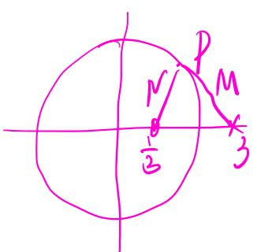

$$
\begin{array}{l}\frac {\pi}{\mu}.\\p = 0 \quad \frac {\frac {3}{3}}{2} = \frac {1}{3}\end{array}\quad\begin{array}{l}k = \frac {1}{3} \uparrow\\\rightarrow\end{array}
$$

$$
\frac {z + \frac {1}{2}}{(2 - \frac {1}{3}) (2 - \frac {1}{2})} \cdot 3
$$

答案不唯一 有 $\frac{z+\frac{1}{2}}{(z-\frac{1}{2})(z-\frac{1}{2})}$ 可算对

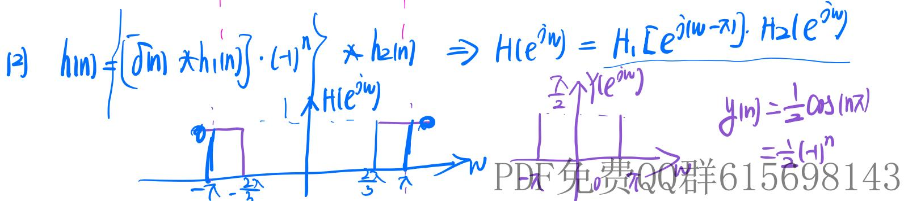

16、【2025 华南理工大学】【不计算在 150 分内，该题为附加题】

已知系统调制框图如下

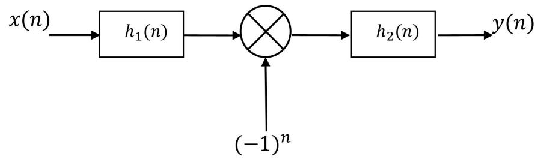

其中 $h_1[n] = \frac{\sin\left(\frac{2\pi}{3}n\right)}{\pi n}, h_2[n] = \delta [n] - h_1[n], x[n] = \sum_{k = -\infty}^{+\infty}\delta [n - 4k]$ 。

(1) 求 $x[n]$ 的傅里叶变换数及 $h_2[n]$ 的傅里叶变换。

(2) 求总输出 $y[n]$ 。[公粽号：通信考研小马哥]

解：(1) $\chi(n)=\sum_{k=-1}^{\infty}\sqrt{n-4k}$ 说明同期 N=4

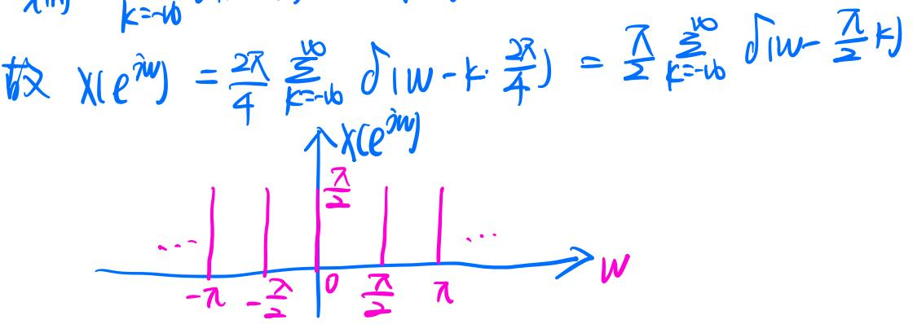

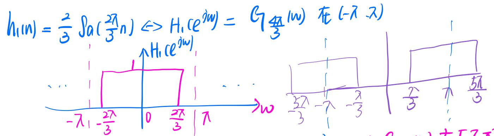

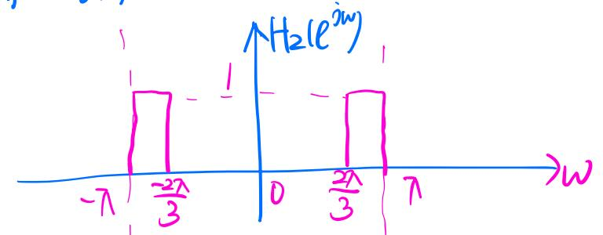

证明: ① $\frac{\sin An}{\pi n} = \frac{A}{\pi} \frac{\sin An}{An} = \frac{A}{\pi} S_{0}(An) \quad \Leftrightarrow G_{2A}(w) \text{ 在 } e^{(-\pi \cdot \pi)}$

$\frac{A}{\pi }S_{a}(A t) \xrightarrow{t=nT_{s}} \frac{A}{\pi }S_{a}(A \cdot nT_{s}) \xrightarrow{\text{令}T_{s}=1s} \frac{A}{\pi }S_{a}(A n)$

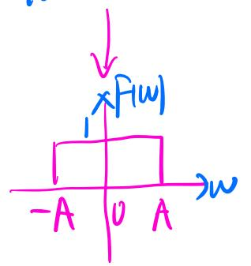

$$
\frac {1}{T s} \sum_ {n = - \infty} ^ {\infty} F (w - n w _ {s}) = \sum_ {n = - \infty} ^ {\infty} G _ {2 A} (w - 2 \pi n)
$$

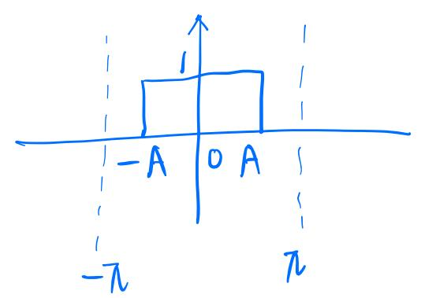

② 周期信号 $\delta_{N}(n)$

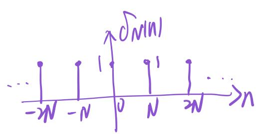

$$
\begin{array}{r l} {\frac {1}{T s} \sum_ {n = - \infty} ^ {\infty} F (w - n w _ {s})} & {= \frac {1}{N} \sum_ {n = - \infty} ^ {\infty} 2 \pi \delta (w - n \cdot \frac {2 \pi}{N})} \\ & {= \frac {2 \pi}{N} \sum_ {n = - \infty} ^ {\infty} \delta (w - n \cdot \frac {2 \pi}{N})} \end{array}
$$

$$
\frac {2}{1 0} x (n) = \sum_ {n = - i \infty} ^ {\infty} \delta (n - 4 k) \mathrm{则} N = 4, \frac {2 \pi}{N} = \frac {\pi}{2}
$$

$$
\mathrm{则} F (e ^ {i w}) = \frac {\pi}{2} \sum_ {n = - 6} ^ {\infty} \delta (w - n \frac {\pi}{2})
$$

DF免费QQ群615698143
③ $\cos(\pi n)=(-1)^{n}$

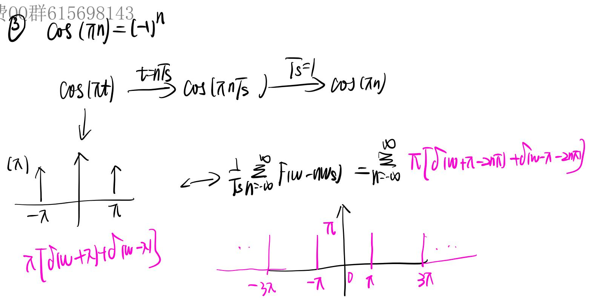