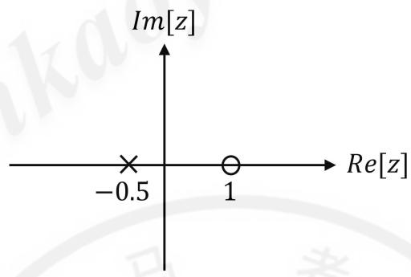
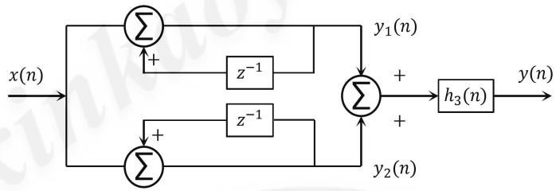
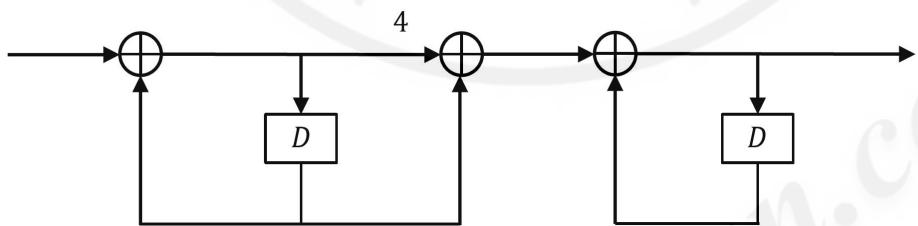
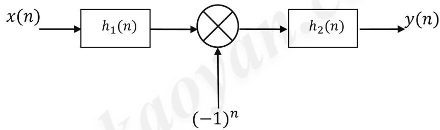

如需打印，微信扫一扫。彩色黑白同价，五分一页，首单免费，满三元顺丰包邮次日达。

最好用的刷题小程序，多专业课题全网唯一

扫码打印 首单免费

长按识别二维码，开始学习吧

免费资料分享群

微信群是唯一更新渠道。

微信群是唯一更新渠道。

群聊：上岸笔记B19

每日分享免费
| 考研 | 考公 | 考编 | 法考 | 教师 | 财会 | 金融 | 医考 |
四六级 | 专四八 | 教育类 | 小初高 | 云课堂 | 影音类 | 等
等 |

## 离散系统的 Z 域分析

## 1、【2025 天津大学 815】

已知信号为 $f(n)=3e^{j\frac{3}{5}\pi\left(n+\frac{1}{2}\right)}$ ，则其周期N=

## 2、【2025 天津工业大学 812】

已知数列 $A_{1}:\{1,0,2,3,5\}(n=0$ 时为0)，和数列 $A_{2}:\{1,4,7\}(n=0$ 时为1)。求 $A_{1}*A_{2}$ 为\_\_\_\_。

## 3、【2025 广西科技大学 809】

已知两个离散序列 $x_{1}[n] = \{1,0, - 1\} (n = -1,0,1)$ 和 $x_{2}[n] = \{2,2\} (n = 0,1)$ ，则 $x_{1}[n]*x_{2}[n]$ 在 $n = 0$ 时的值为\_\_\_\_。

## 4、【2025 中国科学院 859】

给定因果序列的z变换为 $X(z)=\frac{1}{(1-0.5z^{-1})(1+0.5z^{-1})}$ ，则该序列的初值与终值分别为（）
A.0 与 1    B.1 与 0    C.1 与 2    D.2 与 1

## 5、【2025 华侨大学 823】

某离散因果系统的系统函数为 $H(z)=\frac{z^{2}+3z+2}{2z^{2}-(k-1)z+1}$ ，则系统稳定时，k的取值范围为\_\_\_\_。

## 6、【2025 福州大学 866】

有一个右边序列 $x[n]$ ，其 $z$ 变换为 $X(z) = \frac{1}{(1 - 3z^{-1})(1 - z^{-1})}$ ，求 $x[n]$ 。

## 7、【2025 天津大学 815】

已知离散LTI系统，在阶跃信号 $\mathbf{u}(n)$ 激励下，产生的阶跃响应 $g(n) = \left(\frac{1}{2}\right)^n\mathbf{u}(n)$ ，试求

(1) 系统函数 $H(z)$ 与单位序列响应 $h(n)$

(2) 当 $f(n) = \left(\frac{1}{3}\right)^n u(n)$ 的激励下，系统产生的零状态响应 $y_{zs}(n)$

(3) 在 (2) 的条件下, 若初始状态下 $y(-1) = 2$ 时, 求系统的自由响应 $y_{h}(n)$ 与强迫响应 $y_{p}(n)$

8、【2025 华侨大学 823】

已知因果离散系统的系统函数 $H(z)$ 的零极点分布如图所示，并且 $H(0)=-2$ 。

(1) 求系统函数 $H(z)$ ;

(2) 求系统的频率响应;

(3) 粗略画出系统的幅频响应曲线。[公粽号：通信考研小马哥]

## 9、【2025 西北工业大学 827】

某因果 LTI 线性时不变系统， $f(n)$ 和 $y(n)$ 分别为输入信号和输出信号，差分方程为：

$$
y (n) + a y (n - 1) + b y (n - 2) = f (n) + c f (n - 1) + d f (n - 2)
$$

其中 $a 、 b 、 c 、 d$ 均为常实数，系统函数 $H(z)$ 具有如下特征：

$H(z)$ 在原点 $z = 0$ 有二阶零点， $H(z)$ 有一个极点在 $z = 0.5$ ， $H(1) = \frac{8}{3}$

(1) 求 $a 、 b 、 c 、 d$ 的值

(2) 若输入为 $\delta(n)-\delta(n-2)$ ，求零状态响应 $y_{zs}(n)$

(3) 输入为 $(-1)^{n}$ ，求零状态响应 $y_{zs}(n)$

(4) 判断该系统是否稳定

## 9、【2025 福州大学 866】

已知如下图因果 LTI 系统， $h_{3}(n)=(0.5)^{n}u(n)$ 。（15 分）

(1) 求系统函数 $H(z)$ ;

(2) 写出描述此系统差分方程;

(3) 当 $x(n) = u(n)$ 时，求系统阶跃响应 $y(n)$ 。

## 10、【2025 华侨大学 823】

离散系统如图，其中 D 为单位延时器。

(1) 求系统函数并写出系统的差分方程;

(2) 当 $f(n) = \delta(n)$ ，全响应的初始条件为 $y(0) = 1$ ， $y(-1) = -1$ ，求系统的零输入响应；

(3) 求系统的单位序列响应, 判断系统是否因果、稳定。

## 11、【2025 广西科技大学 809】

用计算机快速地对测量的随机数据 $f(n)$ 进行平均处理时，当收到一个测量数据后，它就把这一次输入的数据与前三次输入的数据进行平均，输出数据表示为：

$$
y (n) = \frac {1}{4} [ f (n) + f (n - 1) + f (n - 2) + f (n - 3) ]
$$

(1) 试画出系统z域模拟框图；（3分）

(2) 求系统函数 $H(z)$ , 并画出其零、极点分布图; (4 分) [公粽号: 通信考研小马哥]

(3) 求系统的频率响应, 并画出其幅频特性曲线。(8 分)

## 12、【2025 河海大学 863】

已知一系统的单位样值响应 $h(n)$ 满足如下关系：

$$
h (n) - b h (n - 1) = (\frac {1}{3}) ^ {n} u (n)
$$

当输入 $x(n) = \cos \pi n$ 时，输出 $y(n) = \frac{1}{2}\cos \pi n$

(1) 求系统函数 $H(z)$ 及其收敛域。

(2) 求单位样值响应 $h(n)$ , 并判断是不是稳定、因果系统。

（3）当输出 $y(n)=-\frac{6}{5}2^{n}u(-n-1)-\frac{1}{5}(\frac{1}{3})^{n}u(n)$ 时，求输入 $x(n)$ 。

## 13、【2025 宁波大学 829】

已知一因果 LTI 系统的差分方程如下:

$$
1 8 y [ n ] + 3 y [ n - 1 ] - y [ n - 2 ] = 1 8 x [ n ] - 5 1 x [ n - 1 ] - 9 x [ n - 2 ]
$$

(1)求系统函数 $H(z)$ 及其逆变换。

(2)输入 $x[n]=(1+7\cos(n\pi))u[n]$ 时，求稳态响应 $y_{s}[n]$ 。

(3)画出系统的并联型结构框图。

(4)若系统的逆系统存在，判断其稳定性，说明原因。

## 14、【2025 福州大学 866】

已知系统 $y(n)+ay(n-1)=x(n)$ 响应是 $y(n)=(5+2n)(0.5)^{n}u(n)$ 。（20分）

(1) 求系统零输入响应和零状态响应;

(2) 若 $y(-1)=10$ ，求系统 $y(n)+ay(n-1)=x(n)$ 零输入响应；

(3) 求 $y(n) + ay(n - 1) = x(n - 1)$ 零状态响应；

(4) 求 $y(n) + ay(n - 1) = 2x(n - 1) + x(n)$ 的零状态响应；

（5）若 $y(-1) = 4$ ，求系统 $y(n) + ay(n - 1) = 2x(n - 1) + x(n)$ 的全响应。

15、【2025 安徽工程大学 813】

已知一因果 LTI 系统的差分方程为:

$$
y (n) - \frac {7}{2} y (n - 1) + \frac {3}{2} y (n - 2) = x (n - 1) + \frac {1}{2} x (n - 2)
$$

(1) 求该系统的系统函数 $H(z)$ 。

(2) 判断该系统是否稳定？若稳定，给出收敛域，若不稳定，试在不改变系统幅度特性前提条件下，将系统变成稳定系统。

16、【2025 华南理工大学】【不计算在 150 分内，该题为附加题】

已知系统调制框图如下

其中 $h_1[n] = \frac{\sin\left(\frac{2\pi}{3}n\right)}{\pi n}, h_2[n] = \delta [n] - h_1[n], x[n] = \sum_{k = -\infty}^{+\infty}\delta [n - 4k]$ 。

(1) 求 $x[n]$ 的傅里叶变换数及 $h_2[n]$ 的傅里叶变换。

(2) 求总输出 $y[n]$ 。[公粽号：通信考研小马哥]

夢馬考研