# 数学基础｜墨墨记忆卡重组

来源：[墨墨记忆卡「信号与系统」](https://www.markji.com/deck/editor/67dd5988bbc6238121685de1)。本章共 13 张（总编号 001—013）。印刷体公式与文字已转写为 Markdown/LaTeX；手写内容按约定暂不转写，均已保留本地高清原图。

## 001 二倍角公式、半角公式

**问：** 请写出二倍角公式、半角公式。

**答：**

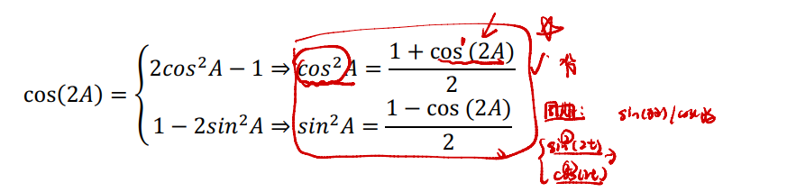

$$\cos(2A) = \begin{cases} 2\cos^2 A - 1 \Rightarrow \cos^2 A = \dfrac{1 + \cos(2A)}{2} \\ 1 - 2\sin^2 A \Rightarrow \sin^2 A = \dfrac{1 - \cos(2A)}{2} \end{cases}$$

（含手写批注，手写部分暂不转写，见原图）

## 002 积化和差

**问：** 请写出积化和差公式及其推导过程。

**答：**

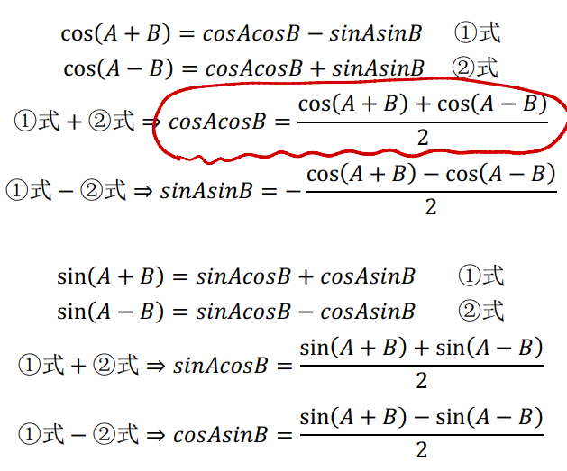

$$\cos(A+B) = \cos A \cos B - \sin A \sin B \quad \text{①式}$$
$$\cos(A-B) = \cos A \cos B + \sin A \sin B \quad \text{②式}$$
$$\text{①式} + \text{②式} \Rightarrow \cos A \cos B = \frac{\cos(A+B) + \cos(A-B)}{2}$$
$$\text{①式} - \text{②式} \Rightarrow \sin A \sin B = -\frac{\cos(A+B) - \cos(A-B)}{2}$$

$$\sin(A+B) = \sin A \cos B + \cos A \sin B \quad \text{①式}$$
$$\sin(A-B) = \sin A \cos B - \cos A \sin B \quad \text{②式}$$
$$\text{①式} + \text{②式} \Rightarrow \sin A \cos B = \frac{\sin(A+B) + \sin(A-B)}{2}$$
$$\text{①式} - \text{②式} \Rightarrow \cos A \sin B = \frac{\sin(A+B) - \sin(A-B)}{2}$$

（图中含手写圈画批注，见原图）

## 003 诱导公式

**问：** 诱导公式的记忆与使用口诀是什么？

**答：** 原角看做锐角

## 004 复函数四点

**问：** 复函数基础的四个要点是什么？

**答：**

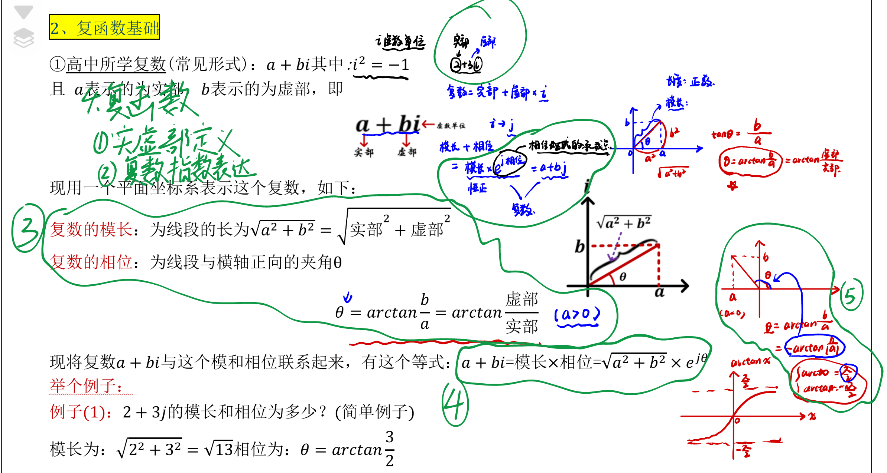

1. 实部虚部定义
2. 指数表达
3. 模长相位定义
4. 复数与指数转换

**2、复函数基础**

① 高中所学复数（常见形式）：$a + bi$，其中：$i^2 = -1$。且 $a$ 表示的为实部，$b$ 表示的为虚部，即：
- $a$：实部
- $b$：虚部
- $i$：虚数单位

现用一个平面坐标系表示这个复数（横轴为实轴 $a$，纵轴为虚轴 $i$，点 $(a,b)$ 到原点的线段长度为 $\sqrt{a^2+b^2}$，与横轴正向夹角为 $\theta$）：

- **复数的模长**：为线段的长为 $\sqrt{a^2 + b^2} = \sqrt{\text{实部}^2 + \text{虚部}^2}$
- **复数的相位**：为线段与横轴正向的夹角 $\theta$

$$\theta = \arctan\frac{b}{a} = \arctan\frac{\text{虚部}}{\text{实部}}$$

现将复数 $a + bi$ 与这个模和相位联系起来，有这个等式：

$$a + bi = \text{模长} \times \text{相位} = \sqrt{a^2 + b^2} \times e^{j\theta}$$

**举个例子：**
- **例子(1)**：$2 + 3j$ 的模长和相位为多少？（简单例子）
- 模长为：$\sqrt{2^2 + 3^2} = \sqrt{13}$，相位为：$\theta = \arctan\dfrac{3}{2}$

（含手写批注，手写部分暂不转写，见原图）

## 005 相位表达式

**问：** 请写出复数相位 $\theta$ 的分段表达式。

**答：**

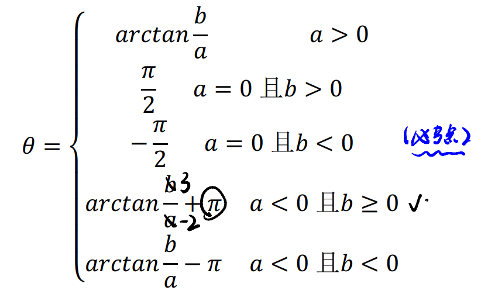

$$\theta = \begin{cases} \arctan\dfrac{b}{a} & a > 0 \\ \dfrac{\pi}{2} & a = 0\ \text{且}\ b > 0 \\ -\dfrac{\pi}{2} & a = 0\ \text{且}\ b < 0 \\ \arctan\dfrac{b}{a} + \pi & a < 0\ \text{且}\ b \ge 0 \\ \arctan\dfrac{b}{a} - \pi & a < 0\ \text{且}\ b < 0 \end{cases}$$

（含手写批注，手写部分暂不转写，见原图）

## 006 欧拉五点

**问：** 欧拉公式的核心要点有哪些？

**答：**

1. 表达式及特性
2. 正余弦函数表达
3. 周期性
4. $j$ 和 $-j$ 代换，$1$ 和 $-1$ 代换

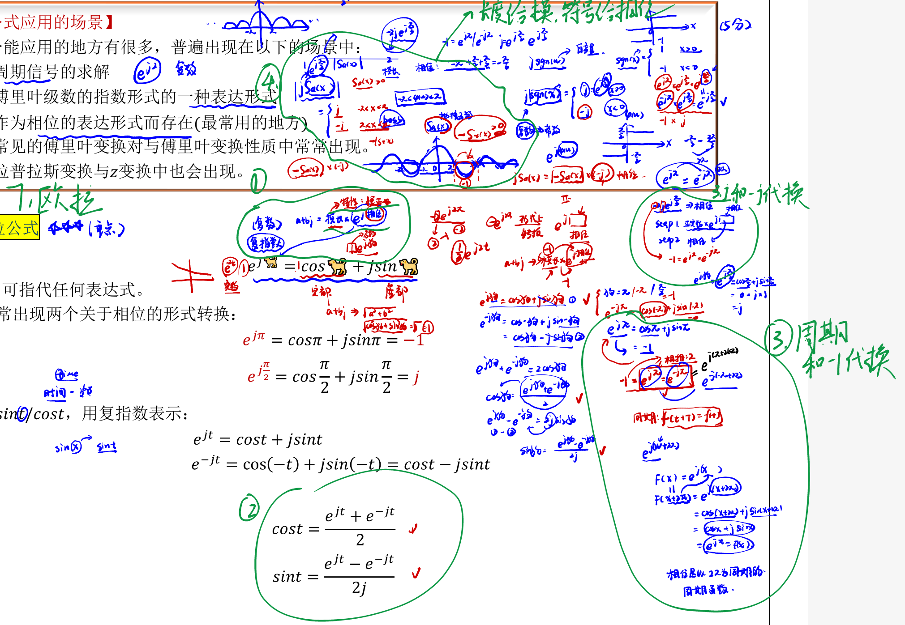

**……式应用的场景】**（图左侧边缘略有裁剪）
……能应用的地方有很多，普遍出现在以下的场景中：
- 周期信号的求解
- 傅里叶级数的指数形式的一种表达形式
- 作为相位的表达形式而存在（最常用的地方）
- 常见的傅里叶变换对与傅里叶变换性质中常常出现。
- 拉普拉斯变换与 $z$ 变换中也会出现。

**……拉公式**（图左侧边缘略有裁剪）：
- ……可指代任何表达式。
- ……常出现两个关于相位的形式转换：

$$e^{j\pi} = \cos\pi + j\sin\pi = -1$$
$$e^{j\frac{\pi}{2}} = \cos\frac{\pi}{2} + j\sin\frac{\pi}{2} = j$$

- $\sin t / \cos t$，用复指数表示：

$$e^{jt} = \cos t + j\sin t$$
$$e^{-jt} = \cos(-t) + j\sin(-t) = \cos t - j\sin t$$

$$\cos t = \frac{e^{jt} + e^{-jt}}{2}$$
$$\sin t = \frac{e^{jt} - e^{-jt}}{2j}$$

（含大量手写笔记与推导，手写部分暂不转写，见原图）

## 007 共轭结论及转换

**问：** 复数取共轭的结论及转换方法是什么？

**答：**

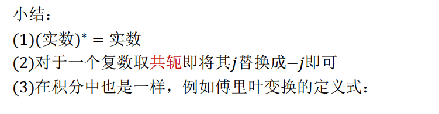

小结：
(1) $(\text{实数})^* = \text{实数}$
(2) 对于一个复数取**共轭**即将其 $j$ 替换成 $-j$ 即可
(3) 在积分中也是一样，例如傅里叶变换的定义式：

## 008 指数信号

**问：** 请说明指数信号的分类及波形特征。

**答：**

分单双边

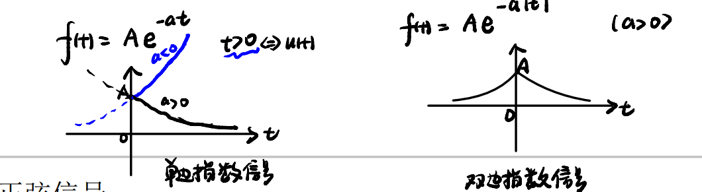

（手写内容暂不转写，见原图）

## 009 正弦信号

**问：** 请写出正弦信号的定义、波形及复指数表示。

**答：**

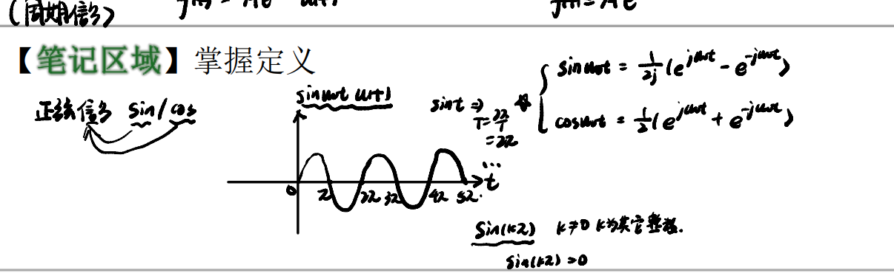

【笔记区域】掌握定义

（含手写笔记与波形图，手写部分暂不转写，见原图）

## 010 复指数信号

**问：** 复指数信号的定义及模长、相位特征是什么？

**答：**

**j后是一个整体**
定义和模长恒正

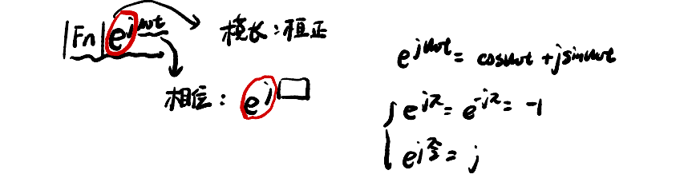

（手写内容暂不转写，见原图）

## 011 抽样信号

**问：** 请说明抽样信号的定义、积分值和包络特征。

**答：**

定义、积分值和包络

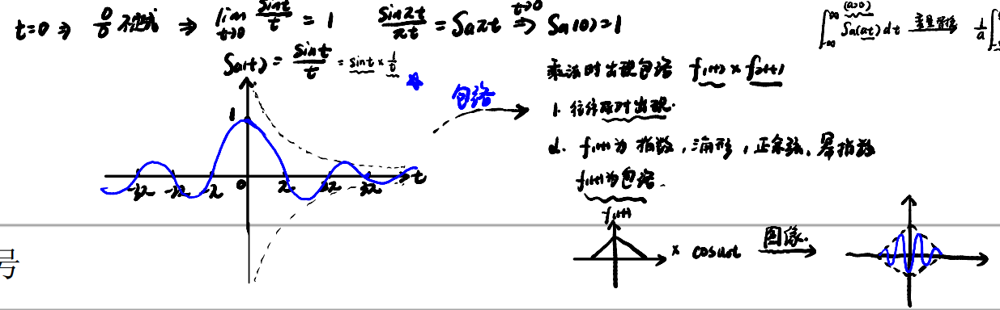
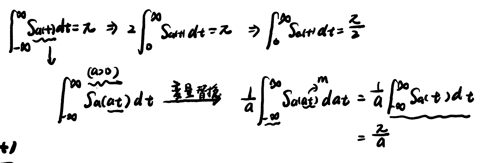

（手写内容暂不转写，见原图）

## 012 复数的意义

**问：** 在描述正弦波（单一频率成分）时，引入复数的意义是什么？

**答：**

要完整地描述一个正弦波（也就是一个单一频率的成分），您必须知道两个信息：
**它的幅度 (Amplitude)：**这个频率成分有多强？它的能量有多大？
**它的相位 (Phase)：**这个频率成分在时间上是如何偏移的？它相对于参考点的起始位置在哪？
一个普通的实数只能承载一个信息。但一个复数，天然就可以完美地编码两个信息。

## 013 三角恒等式

**问：** 请写出三角恒等式。

**答：**

$$\sin(x) = \cos(x - \pi/2)$$

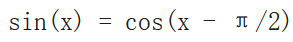
